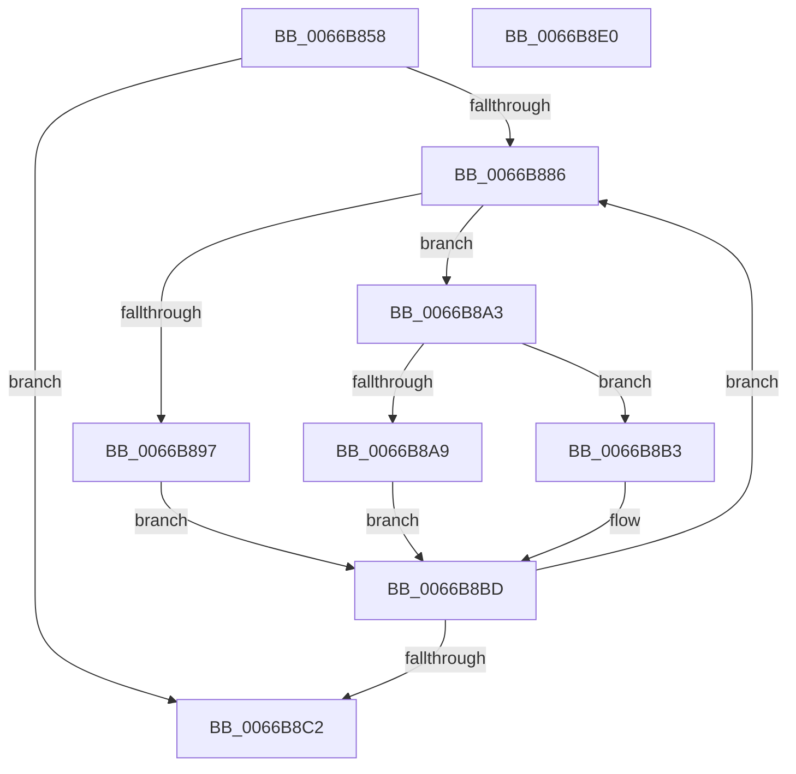

# CmFcpCountFeatureDescriptors

- RVA: `0x0066B858`–`0x0066B8E1` (길이 `137` bytes)
- VA: `0x000000014066B858`
- 실행 섹션: `.text`
- PDB 이름 있음: `예`; PDB Function 태그: `예`
- unwind 정보 RVA: `0x00060300`
- 디코드: `45`개 명령, `137/137` bytes 표시
- 미해석 바이트: `0` (있으면 어셈블리에 `.byte`로 보존)

> 이 문서는 커널 이미지의 기계어와 PDB 기호를 분석해 생성했습니다. 4번과 5번은 함수 원형과 자료형을 바이너리 사용 방식에서 추정한 C 해석이며 원본 소스 복구 결과는 아닙니다.

## 1. Dependencies

- 직접 호출 지점: **1**; 고유 호출 대상: **1**
- 직접 호출자로 확인된 함수: **1**
- RIP 상대 이미지 참조: **0**

### Outgoing calls
- `0x0066B88E` → [CmFcpIsValidMemoryRange](CmFcpIsValidMemoryRange_function_0066B924.md) (function, `0x0066B924`)

### Direct callers
- [CmFcpSecondaryMultiPartDumpDataCallback](CmFcpSecondaryMultiPartDumpDataCallback_function_0066BAA0.md) at `0x0066BB87`

### Static image references
- 디코드된 RIP-relative 메모리 참조가 없습니다.

## 2. Other-region calls and transfers

- 다른 실행 섹션으로 향하는 call: **0**
- 별도 외부 분기/꼬리 이동을 확인하지 못했습니다.

## 3. Assembly (complete function range)

```asm
0066B858  48 89 5C 24 08                  mov qword ptr [rsp + 8], rbx
0066B85D  48 89 6C 24 10                  mov qword ptr [rsp + 0x10], rbp
0066B862  48 89 74 24 18                  mov qword ptr [rsp + 0x18], rsi
0066B867  57                              push rdi
0066B868  41 56                           push r14
0066B86A  41 57                           push r15
0066B86C  48 83 EC 20                     sub rsp, 0x20
0066B870  33 F6                           xor esi, esi
0066B872  48 8D 79 38                     lea rdi, [rcx + 0x38]
0066B876  33 ED                           xor ebp, ebp
0066B878  4D 8B F8                        mov r15, r8
0066B87B  4C 8B F2                        mov r14, rdx
0066B87E  48 8B D9                        mov rbx, rcx
0066B881  48 3B FA                        cmp rdi, rdx
0066B884  77 3C                           ja 0x14066b8c2
0066B886  BA 38 00 00 00                  mov edx, 0x38
0066B88B  48 8B CB                        mov rcx, rbx
0066B88E  E8 91 00 00 00                  call 0x14066b924
0066B893  84 C0                           test al, al
0066B895  75 0C                           jne 0x14066b8a3
0066B897  48 83 C3 08                     add rbx, 8
0066B89B  48 83 C7 08                     add rdi, 8
0066B89F  FF C5                           inc ebp
0066B8A1  EB 1A                           jmp 0x14066b8bd
0066B8A3  48 83 3B 00                     cmp qword ptr [rbx], 0
0066B8A7  75 0A                           jne 0x14066b8b3
0066B8A9  48 83 C3 08                     add rbx, 8
0066B8AD  48 83 C7 08                     add rdi, 8
0066B8B1  EB 0A                           jmp 0x14066b8bd
0066B8B3  FF C6                           inc esi
0066B8B5  48 83 C3 38                     add rbx, 0x38
0066B8B9  48 83 C7 38                     add rdi, 0x38
0066B8BD  49 3B FE                        cmp rdi, r14
0066B8C0  76 C4                           jbe 0x14066b886
0066B8C2  48 8B 5C 24 40                  mov rbx, qword ptr [rsp + 0x40]
0066B8C7  8B C6                           mov eax, esi
0066B8C9  48 8B 74 24 50                  mov rsi, qword ptr [rsp + 0x50]
0066B8CE  41 89 2F                        mov dword ptr [r15], ebp
0066B8D1  48 8B 6C 24 48                  mov rbp, qword ptr [rsp + 0x48]
0066B8D6  48 83 C4 20                     add rsp, 0x20
0066B8DA  41 5F                           pop r15
0066B8DC  41 5E                           pop r14
0066B8DE  5F                              pop rdi
0066B8DF  C3                              ret
0066B8E0  CC                              int3
```

## 4. C-style interpretation (structured pseudocode)

```c
__int64 __fastcall CmFcpCountFeatureDescriptors(__int64 a1, __int64 a2, __int64 a3)
{
    __int64 result;
    __int64 v_rbp;
    __int64 v_rbx;
    __int64 v_rdi;
    __int64 v_rsi;
    __int64 v_rsp;
    unsigned __int64 v_stack_p10;
    unsigned __int64 v_stack_p18;
    unsigned __int64 v_stack_p8;

    v_stack_p8 = v_rbx;
    v_stack_p10 = v_rbp;
    v_stack_p18 = v_rsi;
    v_rsp = (v_rsp) - (32);
    v_rsi = 0;
    v_rbp = 0;
    if ((a1 + 56) > a2) goto loc_0066B8C2;
loc_0066B886:
    result = CmFcpIsValidMemoryRange(a1, 56, a3, a4);
    if ((unsigned __int8)(result) != 0) goto loc_0066B8A3;
    v_rbx = (a1) + (8);
    v_rdi = (a1 + 56) + (8);
    v_rbp = (unsigned int)((v_rbp) + 1);
    goto loc_0066B8BD;
loc_0066B8A3:
    if ((*(unsigned __int64 *)(v_rbx)) != 0) goto loc_0066B8B3;
    v_rbx = (v_rbx) + (8);
    v_rdi = (v_rdi) + (8);
    goto loc_0066B8BD;
loc_0066B8B3:
    v_rsi = (unsigned int)((v_rsi) + 1);
    v_rbx = (v_rbx) + (56);
    v_rdi = (v_rdi) + (56);
loc_0066B8BD:
    if (v_rdi <= a2) goto loc_0066B886;
loc_0066B8C2:
    *(unsigned int *)(a3) = (unsigned int)(v_rbp);
    v_rsp = (v_rsp) + (32);
    return (unsigned int)((unsigned int)(v_rsi));
}
```

## 5. (Beta) C Style

```c
int64_t CmFcpCountFeatureDescriptors(void *Arg1, int64_t Arg2, void *Arg3)
{
    uint8_t *arg1 = (uint8_t *)Arg1;
    uint8_t *arg3 = (uint8_t *)Arg3;

    int64_t result;
    int64_t local_rbp;
    int64_t local_rbx;
    int64_t local_rdi;
    int64_t local_rsi;
    int64_t local_rsp;
    uint64_t v_stack_p10;
    uint64_t v_stack_p18;
    uint64_t v_stack_p8;

    v_stack_p8 = local_rbx;
    v_stack_p10 = local_rbp;
    v_stack_p18 = local_rsi;
    local_rsp = (local_rsp) - (32);
    local_rsi = 0;
    local_rbp = 0;
    if ((Arg1 + 56) > Arg2) goto loc_0066B8C2;
loc_0066B886:
    result = CmFcpIsValidMemoryRange(Arg1, 56, Arg3, a4);
    if ((uint8_t)(result) != 0) goto loc_0066B8A3;
    local_rbx = (Arg1) + (8);
    local_rdi = (Arg1 + 56) + (8);
    local_rbp = (uint32_t)((local_rbp) + 1);
    goto loc_0066B8BD;
loc_0066B8A3:
    if ((*(uint64_t *)(local_rbx)) != 0) goto loc_0066B8B3;
    local_rbx = (local_rbx) + (8);
    local_rdi = (local_rdi) + (8);
    goto loc_0066B8BD;
loc_0066B8B3:
    local_rsi = (uint32_t)((local_rsi) + 1);
    local_rbx = (local_rbx) + (56);
    local_rdi = (local_rdi) + (56);
loc_0066B8BD:
    if (local_rdi <= Arg2) goto loc_0066B886;
loc_0066B8C2:
    *(uint32_t *)(arg3) = (uint32_t)(local_rbp);
    local_rsp = (local_rsp) + (32);
    return (uint32_t)((uint32_t)(local_rsi));
}
```

### 관측된 메모리 오프셋

구조체 형식이 확인되지 않은 접근은 인자 기준의 오프셋으로만 기록했습니다.

| 기준 인자 | 오프셋 표현 | 폭 (bit) | 접근 |
|---|---:|---:|---|
| `Arg1` | `+ 0x0` | `64` | `R` |
| `Arg1` | `+ 0x38` | `64` | `R` |
| `Arg3` | `+ 0x0` | `32` | `W` |

## 6. Execution-region graph

[열기: 2D/3D 그래프와 함수 탐색 컨트롤 패널](../../../control-panel.html?section=text&rva=0x0066B858&view=graph)

- 2D 그래프는 위에서 아래로 흐르고, 3D 그래프는 빈 공간을 드래그해 회전합니다. Shift+드래그는 이동, 휠은 확대·축소, 함수 노드 선택은 대상 보고서 이동입니다.

### Static fallback


