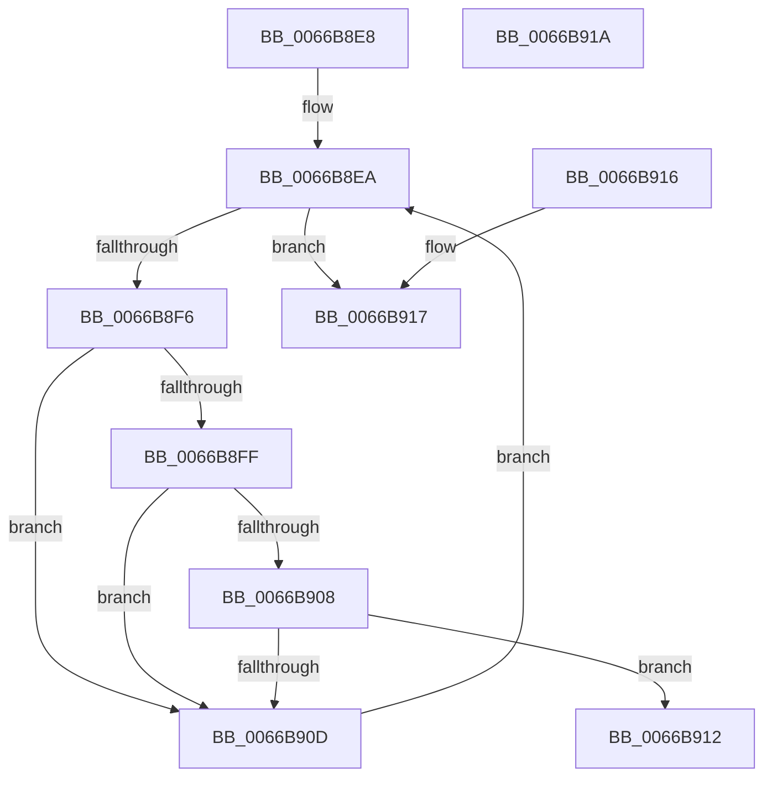

# CmFcpFindNextProviderWithDescriptors

- RVA: `0x0066B8E8`–`0x0066B91B` (길이 `51` bytes)
- VA: `0x000000014066B8E8`
- 실행 섹션: `.text`
- PDB 이름 있음: `예`; PDB Function 태그: `예`
- unwind 정보 RVA: `0x000DB714`
- 디코드: `20`개 명령, `51/51` bytes 표시
- 미해석 바이트: `0` (있으면 어셈블리에 `.byte`로 보존)

> 이 문서는 커널 이미지의 기계어와 PDB 기호를 분석해 생성했습니다. 4번과 5번은 함수 원형과 자료형을 바이너리 사용 방식에서 추정한 C 해석이며 원본 소스 복구 결과는 아닙니다.

## 1. Dependencies

- 직접 호출 지점: **0**; 고유 호출 대상: **0**
- 직접 호출자로 확인된 함수: **1**
- RIP 상대 이미지 참조: **1**

### Outgoing calls
- 직접 디코드된 call 명령이 없습니다.

### Direct callers
- [CmFcpSecondaryMultiPartDumpDataCallback](CmFcpSecondaryMultiPartDumpDataCallback_function_0066BAA0.md) at `0x0066BB63`
- [CmFcpSecondaryMultiPartDumpDataCallback](CmFcpSecondaryMultiPartDumpDataCallback_function_0066BAA0.md) at `0x0066BBE8`

### Static image references
- `0x0066B8EA` → RVA `0x00EF7880` (`.data`; read)

## 2. Other-region calls and transfers

- 다른 실행 섹션으로 향하는 call: **0**
- 별도 외부 분기/꼬리 이동을 확인하지 못했습니다.

## 3. Assembly (complete function range)

```asm
0066B8E8  66 90                           nop
0066B8EA  48 8D 05 8F BF 88 00            lea rax, [rip + 0x88bf8f]
0066B8F1  48 3B C8                        cmp rcx, rax
0066B8F4  74 21                           je 0x14066b917
0066B8F6  48 8B 41 70                     mov rax, qword ptr [rcx + 0x70]
0066B8FA  48 85 C0                        test rax, rax
0066B8FD  74 0E                           je 0x14066b90d
0066B8FF  48 8B 51 78                     mov rdx, qword ptr [rcx + 0x78]
0066B903  48 85 D2                        test rdx, rdx
0066B906  74 05                           je 0x14066b90d
0066B908  48 3B D0                        cmp rdx, rax
0066B90B  77 05                           ja 0x14066b912
0066B90D  48 8B 09                        mov rcx, qword ptr [rcx]
0066B910  EB D8                           jmp 0x14066b8ea
0066B912  48 8B C1                        mov rax, rcx
0066B915  C3                              ret
0066B916  CC                              int3
0066B917  33 C0                           xor eax, eax
0066B919  C3                              ret
0066B91A  CC                              int3
```

## 4. C-style interpretation (structured pseudocode)

```c
__int64 __fastcall CmFcpFindNextProviderWithDescriptors(__int64 a1)
{
    __int64 result;

loc_0066B8EA:
    if (a1 == (v_rip + 8961935)) goto loc_0066B917;
    if (*(unsigned __int64 *)(a1 + 112) == 0) goto loc_0066B90D;
    if (*(unsigned __int64 *)(a1 + 120) == 0) goto loc_0066B90D;
    if ((*(unsigned __int64 *)(a1 + 120)) > (*(unsigned __int64 *)(a1 + 112))) goto loc_0066B912;
loc_0066B90D:
    goto loc_0066B8EA;
loc_0066B912:
    return *(unsigned __int64 *)(a1);
loc_0066B917:
    result = 0;
    return result;
}
```

## 5. (Beta) C Style

```c
int64_t CmFcpFindNextProviderWithDescriptors(int64_t Arg1)
{
    int64_t result;

loc_0066B8EA:
    if (Arg1 == (v_rip + 8961935)) goto loc_0066B917;
    if (*(uint64_t *)(Arg1 + 0x70) == 0) goto loc_0066B90D;
    if (*(uint64_t *)(Arg1 + 0x78) == 0) goto loc_0066B90D;
    if ((*(uint64_t *)(Arg1 + 0x78)) > (*(uint64_t *)(Arg1 + 0x70))) goto loc_0066B912;
loc_0066B90D:
    goto loc_0066B8EA;
loc_0066B912:
    return *(uint64_t *)(Arg1);
loc_0066B917:
    result = 0;
    return result;
}
```

## 6. Execution-region graph

[열기: 2D/3D 그래프와 함수 탐색 컨트롤 패널](../../../control-panel.html?section=text&rva=0x0066B8E8&view=graph)

- 2D 그래프는 위에서 아래로 흐르고, 3D 그래프는 빈 공간을 드래그해 회전합니다. Shift+드래그는 이동, 휠은 확대·축소, 함수 노드 선택은 대상 보고서 이동입니다.

### Static fallback


