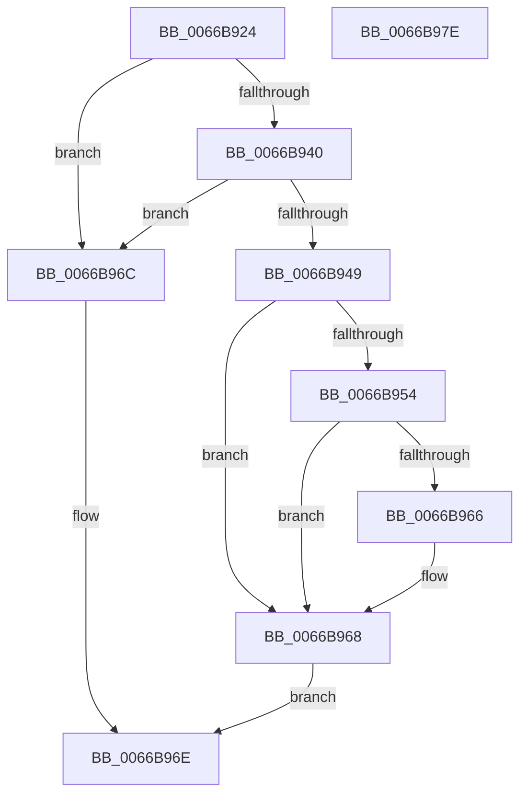

# CmFcpIsValidMemoryRange

- RVA: `0x0066B924`–`0x0066B97F` (길이 `91` bytes)
- VA: `0x000000014066B924`
- 실행 섹션: `.text`
- PDB 이름 있음: `예`; PDB Function 태그: `예`
- unwind 정보 RVA: `0x00060BC4`
- 디코드: `31`개 명령, `91/91` bytes 표시
- 미해석 바이트: `0` (있으면 어셈블리에 `.byte`로 보존)

> 이 문서는 커널 이미지의 기계어와 PDB 기호를 분석해 생성했습니다. 4번과 5번은 함수 원형과 자료형을 바이너리 사용 방식에서 추정한 C 해석이며 원본 소스 복구 결과는 아닙니다.

## 1. Dependencies

- 직접 호출 지점: **2**; 고유 호출 대상: **1**
- 직접 호출자로 확인된 함수: **2**
- RIP 상대 이미지 참조: **0**

### Outgoing calls
- `0x0066B94B` → [MmIsAddressValidEx](../27/MmIsAddressValidEx_function_0027FDD0.md) (function, `0x0027FDD0`)
- `0x0066B95D` → [MmIsAddressValidEx](../27/MmIsAddressValidEx_function_0027FDD0.md) (function, `0x0027FDD0`)

### Direct callers
- [CmFcpCountFeatureDescriptors](CmFcpCountFeatureDescriptors_function_0066B858.md) at `0x0066B88E`
- [CmFcpPopulateModuleFeatures](CmFcpPopulateModuleFeatures_function_0066B988.md) at `0x0066B9D0`
- [CmFcpPopulateModuleFeatures](CmFcpPopulateModuleFeatures_function_0066B988.md) at `0x0066BA08`

### Static image references
- 디코드된 RIP-relative 메모리 참조가 없습니다.

## 2. Other-region calls and transfers

- 다른 실행 섹션으로 향하는 call: **0**
- 별도 외부 분기/꼬리 이동을 확인하지 못했습니다.

## 3. Assembly (complete function range)

```asm
0066B924  48 89 5C 24 08                  mov qword ptr [rsp + 8], rbx
0066B929  48 89 74 24 10                  mov qword ptr [rsp + 0x10], rsi
0066B92E  57                              push rdi
0066B92F  48 83 EC 20                     sub rsp, 0x20
0066B933  33 DB                           xor ebx, ebx
0066B935  48 8B F2                        mov rsi, rdx
0066B938  48 8B F9                        mov rdi, rcx
0066B93B  48 85 C9                        test rcx, rcx
0066B93E  74 2C                           je 0x14066b96c
0066B940  48 81 FA 00 10 00 00            cmp rdx, 0x1000
0066B947  77 23                           ja 0x14066b96c
0066B949  33 D2                           xor edx, edx
0066B94B  E8 80 44 C1 FF                  call 0x14027fdd0
0066B950  84 C0                           test al, al
0066B952  74 14                           je 0x14066b968
0066B954  48 8D 4E FF                     lea rcx, [rsi - 1]
0066B958  33 D2                           xor edx, edx
0066B95A  48 03 CF                        add rcx, rdi
0066B95D  E8 6E 44 C1 FF                  call 0x14027fdd0
0066B962  84 C0                           test al, al
0066B964  74 02                           je 0x14066b968
0066B966  B3 01                           mov bl, 1
0066B968  8A C3                           mov al, bl
0066B96A  EB 02                           jmp 0x14066b96e
0066B96C  32 C0                           xor al, al
0066B96E  48 8B 5C 24 30                  mov rbx, qword ptr [rsp + 0x30]
0066B973  48 8B 74 24 38                  mov rsi, qword ptr [rsp + 0x38]
0066B978  48 83 C4 20                     add rsp, 0x20
0066B97C  5F                              pop rdi
0066B97D  C3                              ret
0066B97E  CC                              int3
```

## 4. C-style interpretation (structured pseudocode)

```c
__int64 __fastcall CmFcpIsValidMemoryRange(__int64 a1, __int64 a2)
{
    __int64 result;
    __int64 v_rbx;
    __int64 v_rsp;
    unsigned __int64 v_stack_p10;
    unsigned __int64 v_stack_p8;

    v_stack_p8 = v_rbx;
    v_stack_p10 = v_rsi;
    v_rsp = (v_rsp) - (32);
    v_rbx = 0;
    if (a1 == 0) goto loc_0066B96C;
    if (a2 > 0x1000ULL) goto loc_0066B96C;
    a2 = 0;
    result = MmIsAddressValidEx(a1, a2, a3, a4);
    if ((unsigned __int8)(result) == 0) goto loc_0066B968;
    a2 = 0;
    a1 = (a2 - 1) + (a1);
    result = MmIsAddressValidEx(a1, a2, a3, a4);
    if ((unsigned __int8)(result) != 0) {
        v_rbx = 1;
    }
    goto loc_0066B96E;
loc_0066B96C:
    result = 0;
loc_0066B96E:
    v_rsp = (v_rsp) + (32);
    return result;
}
```

## 5. (Beta) C Style

```c
int64_t CmFcpIsValidMemoryRange(int64_t Arg1, void *Arg2)
{
    uint8_t *arg2 = (uint8_t *)Arg2;

    int64_t result;
    int64_t local_rbx;
    int64_t local_rsp;
    uint64_t v_stack_p10;
    uint64_t v_stack_p8;

    v_stack_p8 = local_rbx;
    v_stack_p10 = local_rsi;
    local_rsp = (local_rsp) - (32);
    local_rbx = 0;
    if (Arg1 == 0) goto loc_0066B96C;
    if (Arg2 > 0x1000ULL) goto loc_0066B96C;
    Arg2 = 0;
    result = MmIsAddressValidEx(Arg1, Arg2, a3, a4);
    if ((uint8_t)(result) == 0) goto loc_0066B968;
    Arg2 = 0;
    Arg1 = (Arg2 - 1) + (Arg1);
    result = MmIsAddressValidEx(Arg1, Arg2, a3, a4);
    if ((uint8_t)(result) != 0) {
        local_rbx = 1;
    }
    goto loc_0066B96E;
loc_0066B96C:
    result = 0;
loc_0066B96E:
    local_rsp = (local_rsp) + (32);
    return result;
}
```

### 관측된 메모리 오프셋

구조체 형식이 확인되지 않은 접근은 인자 기준의 오프셋으로만 기록했습니다.

| 기준 인자 | 오프셋 표현 | 폭 (bit) | 접근 |
|---|---:|---:|---|
| `Arg2` | `- 0x1` | `64` | `R` |

## 6. Execution-region graph

[열기: 2D/3D 그래프와 함수 탐색 컨트롤 패널](../../../control-panel.html?section=text&rva=0x0066B924&view=graph)

- 2D 그래프는 위에서 아래로 흐르고, 3D 그래프는 빈 공간을 드래그해 회전합니다. Shift+드래그는 이동, 휠은 확대·축소, 함수 노드 선택은 대상 보고서 이동입니다.

### Static fallback


