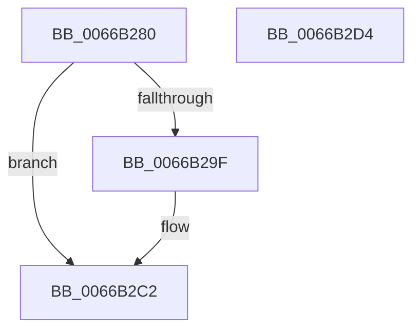

# CmFcpManagerArmFeatureUsageProviderPublishTimer

- RVA: `0x0066B280`–`0x0066B2D5` (길이 `85` bytes)
- VA: `0x000000014066B280`
- 실행 섹션: `.text`
- PDB 이름 있음: `예`; PDB Function 태그: `아니요`
- unwind 정보 RVA: `0x000BFA7C`
- 디코드: `19`개 명령, `85/85` bytes 표시
- 미해석 바이트: `0` (있으면 어셈블리에 `.byte`로 보존)

> 이 문서는 커널 이미지의 기계어와 PDB 기호를 분석해 생성했습니다. 4번과 5번은 함수 원형과 자료형을 바이너리 사용 방식에서 추정한 C 해석이며 원본 소스 복구 결과는 아닙니다.

## 1. Dependencies

- 직접 호출 지점: **2**; 고유 호출 대상: **2**
- 직접 호출자로 확인된 함수: **2**
- RIP 상대 이미지 참조: **1**

### Outgoing calls
- `0x0066B2BD` → [ExSetTimer](../3A/ExSetTimer_function_003A0800.md) (function, `0x003A0800`)
- `0x0066B2CA` → [_security_check_cookie](../6A/_security_check_cookie_function_006AC640.md) (function, `0x006AC640`)

### Direct callers
- [CmFcpManagerPublishFeatureUsageDataBuffers](../../page/A9/CmFcpManagerPublishFeatureUsageDataBuffers_function_00A9677C.md) at `0x00A96977`
- [CmFcpManagerPublishFeatureUsageDataBuffers](../../page/A9/CmFcpManagerPublishFeatureUsageDataBuffers_function_00A9677C.md) at `0x00A96981`
- [CmFcManagerStartRuntimePhase](../../init/C5/CmFcManagerStartRuntimePhase_function_00C5DC70.md) at `0x00C5E17A`

### Static image references
- `0x0066B284` → RVA `0x00E0A740` (`.data`; read)

## 2. Other-region calls and transfers

- 다른 실행 섹션으로 향하는 call: **0**
- 별도 외부 분기/꼬리 이동을 확인하지 못했습니다.

## 3. Assembly (complete function range)

```asm
0066B280  48 83 EC 48                     sub rsp, 0x48
0066B284  48 8B 05 B5 F4 79 00            mov rax, qword ptr [rip + 0x79f4b5]
0066B28B  48 33 C4                        xor rax, rsp
0066B28E  48 89 44 24 30                  mov qword ptr [rsp + 0x30], rax
0066B293  48 8B 89 68 06 00 00            mov rcx, qword ptr [rcx + 0x668]
0066B29A  48 85 C9                        test rcx, rcx
0066B29D  74 23                           je 0x14066b2c2
0066B29F  48 83 64 24 20 00               and qword ptr [rsp + 0x20], 0
0066B2A5  4C 8D 4C 24 20                  lea r9, [rsp + 0x20]
0066B2AA  48 83 4C 24 28 FF               or qword ptr [rsp + 0x28], 0xffffffffffffffff
0066B2B0  45 33 C0                        xor r8d, r8d
0066B2B3  48 BA 00 A2 2F 4D FF FF FF FF   movabs rdx, 0xffffffff4d2fa200
0066B2BD  E8 3E 55 D3 FF                  call 0x1403a0800
0066B2C2  48 8B 4C 24 30                  mov rcx, qword ptr [rsp + 0x30]
0066B2C7  48 33 CC                        xor rcx, rsp
0066B2CA  E8 71 13 04 00                  call 0x1406ac640
0066B2CF  48 83 C4 48                     add rsp, 0x48
0066B2D3  C3                              ret
0066B2D4  CC                              int3
```

## 4. C-style interpretation (structured pseudocode)

```c
__int64 __fastcall CmFcpManagerArmFeatureUsageProviderPublishTimer(__int64 a1, __int64 a2, int a3)
{
    __int64 result;
    __int64 v_rsp;
    unsigned __int64 v_stack_m18;
    unsigned __int64 v_stack_m20;
    unsigned __int64 v_stack_m28;

    v_rsp = (v_rsp) - (72);
    result = (*(unsigned __int64 *)(v_rip + 7992501)) ^ (v_rsp);
    v_stack_m18 = result;
    if (*(unsigned __int64 *)(a1 + 1640) != 0) {
        a4 = v_stack_m28;
        a3 = 0;
        result = ExSetTimer(*(unsigned __int64 *)(a1 + 1640), a2, a3, a4);
    }
    a1 = (v_stack_m18) ^ (v_rsp);
    result = _security_check_cookie(a1, a2, a3, a4);
    v_rsp = (v_rsp) + (72);
    return result;
}
```

## 5. (Beta) C Style

```c
int64_t CmFcpManagerArmFeatureUsageProviderPublishTimer(void *Arg1, int64_t Arg2, int32_t Arg3)
{
    uint8_t *arg1 = (uint8_t *)Arg1;

    int64_t result;
    int64_t local_rsp;
    uint64_t v_stack_m18;
    uint64_t v_stack_m20;
    uint64_t v_stack_m28;

    local_rsp = (local_rsp) - (72);
    result = (*(uint64_t *)(v_rip + 0x79F4B5)) ^ (local_rsp);
    v_stack_m18 = result;
    if (*(uint64_t *)(arg1 + 0x668) != 0) {
        a4 = v_stack_m28;
        Arg3 = 0;
        result = ExSetTimer(*(uint64_t *)(arg1 + 0x668), Arg2, Arg3, a4);
    }
    Arg1 = (v_stack_m18) ^ (local_rsp);
    result = _security_check_cookie(Arg1, Arg2, Arg3, a4);
    local_rsp = (local_rsp) + (72);
    return result;
}
```

### 관측된 메모리 오프셋

구조체 형식이 확인되지 않은 접근은 인자 기준의 오프셋으로만 기록했습니다.

| 기준 인자 | 오프셋 표현 | 폭 (bit) | 접근 |
|---|---:|---:|---|
| `Arg1` | `+ 0x668` | `64` | `R` |

## 6. Execution-region graph

[열기: 2D/3D 그래프와 함수 탐색 컨트롤 패널](../../../control-panel.html?section=text&rva=0x0066B280&view=graph)

- 2D 그래프는 위에서 아래로 흐르고, 3D 그래프는 빈 공간을 드래그해 회전합니다. Shift+드래그는 이동, 휠은 확대·축소, 함수 노드 선택은 대상 보고서 이동입니다.

### Static fallback


