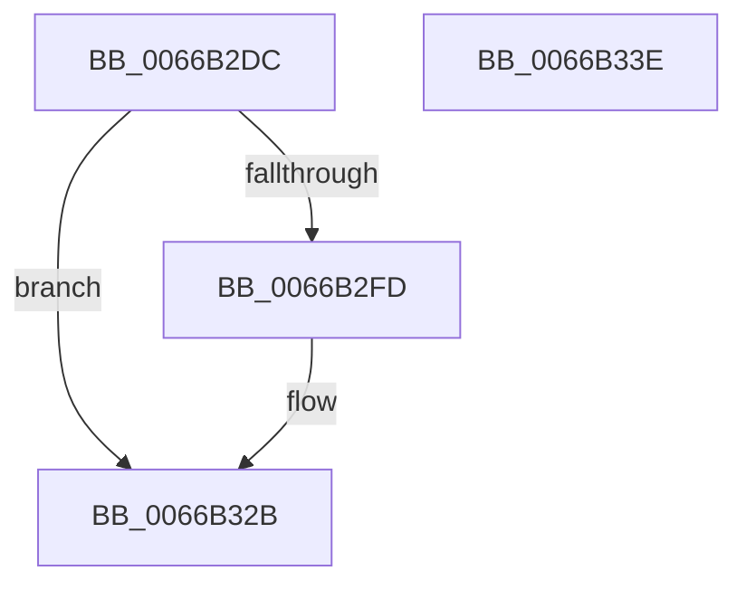

# CmFcpManagerArmFeatureUsageRetryTimer

- RVA: `0x0066B2DC`–`0x0066B33F` (길이 `99` bytes)
- VA: `0x000000014066B2DC`
- 실행 섹션: `.text`
- PDB 이름 있음: `예`; PDB Function 태그: `아니요`
- unwind 정보 RVA: `0x000AB2E4`
- 디코드: `23`개 명령, `99/99` bytes 표시
- 미해석 바이트: `0` (있으면 어셈블리에 `.byte`로 보존)

> 이 문서는 커널 이미지의 기계어와 PDB 기호를 분석해 생성했습니다. 4번과 5번은 함수 원형과 자료형을 바이너리 사용 방식에서 추정한 C 해석이며 원본 소스 복구 결과는 아닙니다.

## 1. Dependencies

- 직접 호출 지점: **2**; 고유 호출 대상: **2**
- 직접 호출자로 확인된 함수: **1**
- RIP 상대 이미지 참조: **1**

### Outgoing calls
- `0x0066B31F` → [ExSetTimer](../3A/ExSetTimer_function_003A0800.md) (function, `0x003A0800`)
- `0x0066B333` → [_security_check_cookie](../6A/_security_check_cookie_function_006AC640.md) (function, `0x006AC640`)

### Direct callers
- [CmFcpManagerDrainUsageNotifications](../../page/A4/CmFcpManagerDrainUsageNotifications_function_00A451BC.md) at `0x00A45251`

### Static image references
- `0x0066B2E2` → RVA `0x00E0A740` (`.data`; read)

## 2. Other-region calls and transfers

- 다른 실행 섹션으로 향하는 call: **0**
- 별도 외부 분기/꼬리 이동을 확인하지 못했습니다.

## 3. Assembly (complete function range)

```asm
0066B2DC  40 53                           push rbx
0066B2DE  48 83 EC 40                     sub rsp, 0x40
0066B2E2  48 8B 05 57 F4 79 00            mov rax, qword ptr [rip + 0x79f457]
0066B2E9  48 33 C4                        xor rax, rsp
0066B2EC  48 89 44 24 30                  mov qword ptr [rsp + 0x30], rax
0066B2F1  80 B9 99 01 00 00 00            cmp byte ptr [rcx + 0x199], 0
0066B2F8  48 8B D9                        mov rbx, rcx
0066B2FB  75 2E                           jne 0x14066b32b
0066B2FD  48 83 64 24 20 00               and qword ptr [rsp + 0x20], 0
0066B303  4C 8D 4C 24 20                  lea r9, [rsp + 0x20]
0066B308  48 83 4C 24 28 FF               or qword ptr [rsp + 0x28], 0xffffffffffffffff
0066B30E  45 33 C0                        xor r8d, r8d
0066B311  48 8B 89 30 02 00 00            mov rcx, qword ptr [rcx + 0x230]
0066B318  48 C7 C2 00 BA 3C DC            mov rdx, 0xffffffffdc3cba00
0066B31F  E8 DC 54 D3 FF                  call 0x1403a0800
0066B324  C6 83 99 01 00 00 01            mov byte ptr [rbx + 0x199], 1
0066B32B  48 8B 4C 24 30                  mov rcx, qword ptr [rsp + 0x30]
0066B330  48 33 CC                        xor rcx, rsp
0066B333  E8 08 13 04 00                  call 0x1406ac640
0066B338  48 83 C4 40                     add rsp, 0x40
0066B33C  5B                              pop rbx
0066B33D  C3                              ret
0066B33E  CC                              int3
```

## 4. C-style interpretation (structured pseudocode)

```c
__int64 __fastcall CmFcpManagerArmFeatureUsageRetryTimer(__int64 a1, __int64 a2, int a3)
{
    __int64 result;
    __int64 v_rsp;
    unsigned __int64 v_stack_m18;
    unsigned __int64 v_stack_m20;
    unsigned __int64 v_stack_m28;

    v_rsp = (v_rsp) - (64);
    result = (*(unsigned __int64 *)(v_rip + 7992407)) ^ (v_rsp);
    v_stack_m18 = result;
    if ((*(unsigned __int8 *)(a1 + 409)) == 0) {
        a4 = v_stack_m28;
        a3 = 0;
        a1 = *(unsigned __int64 *)(a1 + 560);
        a2 = 0xFFFFFFFFDC3CBA00ULL;
        result = ExSetTimer(a1, a2, a3, a4);
        *(unsigned __int8 *)(a1 + 409) = 1;
    }
    a1 = (v_stack_m18) ^ (v_rsp);
    result = _security_check_cookie(a1, a2, a3, a4);
    v_rsp = (v_rsp) + (64);
    return result;
}
```

## 5. (Beta) C Style

```c
int64_t CmFcpManagerArmFeatureUsageRetryTimer(void *Arg1, int64_t Arg2, int32_t Arg3)
{
    uint8_t *arg1 = (uint8_t *)Arg1;

    int64_t result;
    int64_t local_rsp;
    uint64_t v_stack_m18;
    uint64_t v_stack_m20;
    uint64_t v_stack_m28;

    local_rsp = (local_rsp) - (64);
    result = (*(uint64_t *)(v_rip + 0x79F457)) ^ (local_rsp);
    v_stack_m18 = result;
    if ((*(uint8_t *)(arg1 + 0x199)) == 0) {
        a4 = v_stack_m28;
        Arg3 = 0;
        Arg1 = *(uint64_t *)(arg1 + 0x230);
        Arg2 = 0xFFFFFFFFDC3CBA00ULL;
        result = ExSetTimer(Arg1, Arg2, Arg3, a4);
        *(uint8_t *)(arg1 + 0x199) = 1;
    }
    Arg1 = (v_stack_m18) ^ (local_rsp);
    result = _security_check_cookie(Arg1, Arg2, Arg3, a4);
    local_rsp = (local_rsp) + (64);
    return result;
}
```

### 관측된 메모리 오프셋

구조체 형식이 확인되지 않은 접근은 인자 기준의 오프셋으로만 기록했습니다.

| 기준 인자 | 오프셋 표현 | 폭 (bit) | 접근 |
|---|---:|---:|---|
| `Arg1` | `+ 0x199` | `8` | `R` |
| `Arg1` | `+ 0x199` | `8` | `W` |
| `Arg1` | `+ 0x230` | `64` | `R` |

## 6. Execution-region graph

[열기: 2D/3D 그래프와 함수 탐색 컨트롤 패널](../../../control-panel.html?section=text&rva=0x0066B2DC&view=graph)

- 2D 그래프는 위에서 아래로 흐르고, 3D 그래프는 빈 공간을 드래그해 회전합니다. Shift+드래그는 이동, 휠은 확대·축소, 함수 노드 선택은 대상 보고서 이동입니다.

### Static fallback


