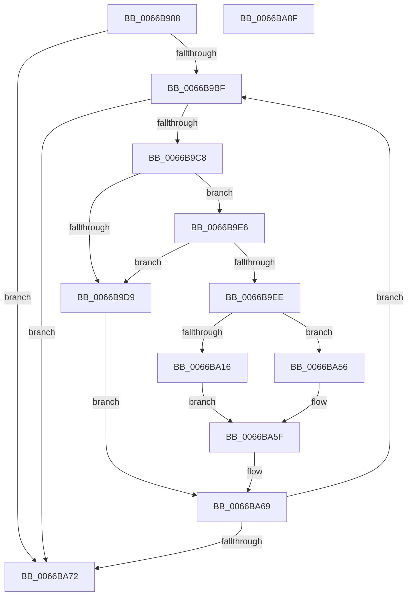

# CmFcpPopulateModuleFeatures

- RVA: `0x0066B988`–`0x0066BA90` (길이 `264` bytes)
- VA: `0x000000014066B988`
- 실행 섹션: `.text`
- PDB 이름 있음: `예`; PDB Function 태그: `예`
- unwind 정보 RVA: `0x00075C18`
- 디코드: `79`개 명령, `264/264` bytes 표시
- 미해석 바이트: `0` (있으면 어셈블리에 `.byte`로 보존)

> 이 문서는 커널 이미지의 기계어와 PDB 기호를 분석해 생성했습니다. 4번과 5번은 함수 원형과 자료형을 바이너리 사용 방식에서 추정한 C 해석이며 원본 소스 복구 결과는 아닙니다.

## 1. Dependencies

- 직접 호출 지점: **2**; 고유 호출 대상: **1**
- 직접 호출자로 확인된 함수: **1**
- RIP 상대 이미지 참조: **0**

### Outgoing calls
- `0x0066B9D0` → [CmFcpIsValidMemoryRange](CmFcpIsValidMemoryRange_function_0066B924.md) (function, `0x0066B924`)
- `0x0066BA08` → [CmFcpIsValidMemoryRange](CmFcpIsValidMemoryRange_function_0066B924.md) (function, `0x0066B924`)

### Direct callers
- [CmFcpSecondaryMultiPartDumpDataCallback](CmFcpSecondaryMultiPartDumpDataCallback_function_0066BAA0.md) at `0x0066BBD3`

### Static image references
- 디코드된 RIP-relative 메모리 참조가 없습니다.

## 2. Other-region calls and transfers

- 다른 실행 섹션으로 향하는 call: **0**
- 별도 외부 분기/꼬리 이동을 확인하지 못했습니다.

## 3. Assembly (complete function range)

```asm
0066B988  48 89 5C 24 08                  mov qword ptr [rsp + 8], rbx
0066B98D  48 89 6C 24 10                  mov qword ptr [rsp + 0x10], rbp
0066B992  48 89 74 24 18                  mov qword ptr [rsp + 0x18], rsi
0066B997  57                              push rdi
0066B998  41 54                           push r12
0066B99A  41 55                           push r13
0066B99C  41 56                           push r14
0066B99E  41 57                           push r15
0066B9A0  48 83 EC 20                     sub rsp, 0x20
0066B9A4  33 ED                           xor ebp, ebp
0066B9A6  48 8D 79 38                     lea rdi, [rcx + 0x38]
0066B9AA  45 8B E9                        mov r13d, r9d
0066B9AD  4D 8B F0                        mov r14, r8
0066B9B0  4C 8B E2                        mov r12, rdx
0066B9B3  48 8B D9                        mov rbx, rcx
0066B9B6  48 3B FA                        cmp rdi, rdx
0066B9B9  0F 87 B3 00 00 00               ja 0x14066ba72
0066B9BF  41 3B ED                        cmp ebp, r13d
0066B9C2  0F 83 AA 00 00 00               jae 0x14066ba72
0066B9C8  BA 38 00 00 00                  mov edx, 0x38
0066B9CD  48 8B CB                        mov rcx, rbx
0066B9D0  E8 4F FF FF FF                  call 0x14066b924
0066B9D5  84 C0                           test al, al
0066B9D7  75 0D                           jne 0x14066b9e6
0066B9D9  48 83 C3 08                     add rbx, 8
0066B9DD  48 83 C7 08                     add rdi, 8
0066B9E1  E9 83 00 00 00                  jmp 0x14066ba69
0066B9E6  4C 8B 3B                        mov r15, qword ptr [rbx]
0066B9E9  4D 85 FF                        test r15, r15
0066B9EC  74 EB                           je 0x14066b9d9
0066B9EE  8B F5                           mov esi, ebp
0066B9F0  BA 08 00 00 00                  mov edx, 8
0066B9F5  48 03 F6                        add rsi, rsi
0066B9F8  49 8B CF                        mov rcx, r15
0066B9FB  49 83 64 F6 08 00               and qword ptr [r14 + rsi*8 + 8], 0
0066BA01  8B 43 18                        mov eax, dword ptr [rbx + 0x18]
0066BA04  41 89 04 F6                     mov dword ptr [r14 + rsi*8], eax
0066BA08  E8 17 FF FF FF                  call 0x14066b924
0066BA0D  41 8B 4C F6 08                  mov ecx, dword ptr [r14 + rsi*8 + 8]
0066BA12  84 C0                           test al, al
0066BA14  74 40                           je 0x14066ba56
0066BA16  41 8B 07                        mov eax, dword ptr [r15]
0066BA19  C1 E8 11                        shr eax, 0x11
0066BA1C  33 C1                           xor eax, ecx
0066BA1E  83 E0 02                        and eax, 2
0066BA21  33 C1                           xor eax, ecx
0066BA23  41 89 44 F6 08                  mov dword ptr [r14 + rsi*8 + 8], eax
0066BA28  8B C8                           mov ecx, eax
0066BA2A  41 33 0F                        xor ecx, dword ptr [r15]
0066BA2D  83 E1 01                        and ecx, 1
0066BA30  33 C8                           xor ecx, eax
0066BA32  41 89 4C F6 08                  mov dword ptr [r14 + rsi*8 + 8], ecx
0066BA37  41 8B 07                        mov eax, dword ptr [r15]
0066BA3A  C1 E8 0A                        shr eax, 0xa
0066BA3D  33 C1                           xor eax, ecx
0066BA3F  25 FC 00 00 00                  and eax, 0xfc
0066BA44  33 C1                           xor eax, ecx
0066BA46  41 89 44 F6 08                  mov dword ptr [r14 + rsi*8 + 8], eax
0066BA4B  41 8B 47 04                     mov eax, dword ptr [r15 + 4]
0066BA4F  41 89 44 F6 0C                  mov dword ptr [r14 + rsi*8 + 0xc], eax
0066BA54  EB 09                           jmp 0x14066ba5f
0066BA56  0F BA E9 08                     bts ecx, 8
0066BA5A  41 89 4C F6 08                  mov dword ptr [r14 + rsi*8 + 8], ecx
0066BA5F  FF C5                           inc ebp
0066BA61  48 83 C3 38                     add rbx, 0x38
0066BA65  48 83 C7 38                     add rdi, 0x38
0066BA69  49 3B FC                        cmp rdi, r12
0066BA6C  0F 86 4D FF FF FF               jbe 0x14066b9bf
0066BA72  48 8B 5C 24 50                  mov rbx, qword ptr [rsp + 0x50]
0066BA77  48 8B 6C 24 58                  mov rbp, qword ptr [rsp + 0x58]
0066BA7C  48 8B 74 24 60                  mov rsi, qword ptr [rsp + 0x60]
0066BA81  48 83 C4 20                     add rsp, 0x20
0066BA85  41 5F                           pop r15
0066BA87  41 5E                           pop r14
0066BA89  41 5D                           pop r13
0066BA8B  41 5C                           pop r12
0066BA8D  5F                              pop rdi
0066BA8E  C3                              ret
0066BA8F  CC                              int3
```

## 4. C-style interpretation (structured pseudocode)

```c
__int64 __fastcall CmFcpPopulateModuleFeatures(__int64 a1, __int64 a2, __int64 a3, int a4)
{
    __int64 result;
    __int64 v_rbp;
    __int64 v_rbx;
    __int64 v_rdi;
    __int64 v_rsi;
    __int64 v_rsp;
    unsigned __int64 v_stack_p10;
    unsigned __int64 v_stack_p18;
    unsigned __int64 v_stack_p8;

    v_stack_p8 = v_rbx;
    v_stack_p10 = v_rbp;
    v_stack_p18 = v_rsi;
    v_rsp = (v_rsp) - (32);
    v_rbp = 0;
    if ((a1 + 56) > a2) goto loc_0066BA72;
loc_0066B9BF:
    if (0 >= ((unsigned int)((unsigned int)(a4)))) goto loc_0066BA72;
    result = CmFcpIsValidMemoryRange(a1, 56, a3, a4);
    if ((unsigned __int8)(result) != 0) goto loc_0066B9E6;
loc_0066B9D9:
    v_rbx = (a1) + (8);
    v_rdi = (a1 + 56) + (8);
    goto loc_0066BA69;
loc_0066B9E6:
    if (*(unsigned __int64 *)(v_rbx) == 0) goto loc_0066B9D9;
    v_rsi = (0) + (0);
    *(unsigned int *)(a3 + v_rsi * 8) = (unsigned int)((unsigned int)(*(unsigned int *)(v_rbx + 24)));
    result = CmFcpIsValidMemoryRange(*(unsigned __int64 *)(v_rbx), 8, a3, a4);
    if ((unsigned __int8)(result) == 0) goto loc_0066BA56;
    result = (unsigned int)(((unsigned int)(*(unsigned int *)(*(unsigned __int64 *)(v_rbx)))) >> (17));
    result = (unsigned int)((result) ^ ((unsigned int)((unsigned int)(*(unsigned int *)(a3 + v_rsi * 8 + 8)))));
    result = (unsigned int)((result) & (2));
    result = (unsigned int)((result) ^ ((unsigned int)((unsigned int)(*(unsigned int *)(a3 + v_rsi * 8 + 8)))));
    *(unsigned int *)(a3 + v_rsi * 8 + 8) = (unsigned int)(result);
    a1 = (unsigned int)(((unsigned int)((unsigned int)(result))) ^ (*(unsigned int *)(*(unsigned __int64 *)(v_rbx))));
    a1 = (unsigned int)((a1) & (1));
    a1 = (unsigned int)((a1) ^ ((unsigned int)(result)));
    *(unsigned int *)(a3 + v_rsi * 8 + 8) = (unsigned int)(a1);
    result = (unsigned int)(((unsigned int)(*(unsigned int *)(*(unsigned __int64 *)(v_rbx)))) >> (10));
    result = (unsigned int)((result) ^ ((unsigned int)(a1)));
    result = (unsigned int)((result) & (252));
    result = (unsigned int)((result) ^ ((unsigned int)(a1)));
    *(unsigned int *)(a3 + v_rsi * 8 + 8) = (unsigned int)(result);
    *(unsigned int *)(a3 + v_rsi * 8 + 12) = (unsigned int)((unsigned int)(*(unsigned int *)(*(unsigned __int64 *)(v_rbx) + 4)));
    goto loc_0066BA5F;
loc_0066BA56:
    *(unsigned int *)(a3 + v_rsi * 8 + 8) = (unsigned int)(a1);
loc_0066BA5F:
    v_rbp = (unsigned int)((v_rbp) + 1);
    v_rbx = (v_rbx) + (56);
    v_rdi = (v_rdi) + (56);
loc_0066BA69:
    if (v_rdi <= a2) goto loc_0066B9BF;
loc_0066BA72:
    v_rsp = (v_rsp) + (32);
    return (unsigned int)(*(unsigned int *)(*(unsigned __int64 *)(v_rbx) + 4));
}
```

## 5. (Beta) C Style

```c
int64_t CmFcpPopulateModuleFeatures(void *Arg1, int64_t Arg2, void *Arg3, int32_t Arg4)
{
    uint8_t *arg1 = (uint8_t *)Arg1;
    uint8_t *arg3 = (uint8_t *)Arg3;

    int64_t result;
    int64_t local_rbp;
    int64_t local_rbx;
    int64_t local_rdi;
    int64_t local_rsi;
    int64_t local_rsp;
    uint64_t v_stack_p10;
    uint64_t v_stack_p18;
    uint64_t v_stack_p8;

    v_stack_p8 = local_rbx;
    v_stack_p10 = local_rbp;
    v_stack_p18 = local_rsi;
    local_rsp = (local_rsp) - (32);
    local_rbp = 0;
    if ((Arg1 + 56) > Arg2) goto loc_0066BA72;
loc_0066B9BF:
    if (0 >= ((uint32_t)((uint32_t)(Arg4)))) goto loc_0066BA72;
    result = CmFcpIsValidMemoryRange(Arg1, 56, Arg3, Arg4);
    if ((uint8_t)(result) != 0) goto loc_0066B9E6;
loc_0066B9D9:
    local_rbx = (Arg1) + (8);
    local_rdi = (Arg1 + 56) + (8);
    goto loc_0066BA69;
loc_0066B9E6:
    if (*(uint64_t *)(local_rbx) == 0) goto loc_0066B9D9;
    local_rsi = (0) + (0);
    *(uint32_t *)(arg3 + local_rsi * 8) = (uint32_t)((uint32_t)(*(uint32_t *)(local_rbx + 0x18)));
    result = CmFcpIsValidMemoryRange(*(uint64_t *)(local_rbx), 8, Arg3, Arg4);
    if ((uint8_t)(result) == 0) goto loc_0066BA56;
    result = (uint32_t)(((uint32_t)(*(uint32_t *)(*(uint64_t *)(local_rbx)))) >> (17));
    result = (uint32_t)((result) ^ ((uint32_t)((uint32_t)(*(uint32_t *)(arg3 + local_rsi * 8 + 0x8)))));
    result = (uint32_t)((result) & (2));
    result = (uint32_t)((result) ^ ((uint32_t)((uint32_t)(*(uint32_t *)(arg3 + local_rsi * 8 + 0x8)))));
    *(uint32_t *)(arg3 + local_rsi * 8 + 0x8) = (uint32_t)(result);
    Arg1 = (uint32_t)(((uint32_t)((uint32_t)(result))) ^ (*(uint32_t *)(*(uint64_t *)(local_rbx))));
    Arg1 = (uint32_t)((Arg1) & (1));
    Arg1 = (uint32_t)((Arg1) ^ ((uint32_t)(result)));
    *(uint32_t *)(arg3 + local_rsi * 8 + 0x8) = (uint32_t)(Arg1);
    result = (uint32_t)(((uint32_t)(*(uint32_t *)(*(uint64_t *)(local_rbx)))) >> (10));
    result = (uint32_t)((result) ^ ((uint32_t)(Arg1)));
    result = (uint32_t)((result) & (252));
    result = (uint32_t)((result) ^ ((uint32_t)(Arg1)));
    *(uint32_t *)(arg3 + local_rsi * 8 + 0x8) = (uint32_t)(result);
    *(uint32_t *)(arg3 + local_rsi * 8 + 0xC) = (uint32_t)((uint32_t)(*(uint32_t *)(*(uint64_t *)(local_rbx) + 0x4)));
    goto loc_0066BA5F;
loc_0066BA56:
    *(uint32_t *)(arg3 + local_rsi * 8 + 0x8) = (uint32_t)(Arg1);
loc_0066BA5F:
    local_rbp = (uint32_t)((local_rbp) + 1);
    local_rbx = (local_rbx) + (56);
    local_rdi = (local_rdi) + (56);
loc_0066BA69:
    if (local_rdi <= Arg2) goto loc_0066B9BF;
loc_0066BA72:
    local_rsp = (local_rsp) + (32);
    return (uint32_t)(*(uint32_t *)(*(uint64_t *)(local_rbx) + 0x4));
}
```

### 관측된 메모리 오프셋

구조체 형식이 확인되지 않은 접근은 인자 기준의 오프셋으로만 기록했습니다.

| 기준 인자 | 오프셋 표현 | 폭 (bit) | 접근 |
|---|---:|---:|---|
| `Arg1` | `+ 0x0` | `64` | `R` |
| `Arg1` | `+ 0x18` | `32` | `R` |
| `Arg1` | `+ 0x38` | `64` | `R` |
| `Arg3` | `+ 0x0 + rsi*8` | `32` | `W` |
| `Arg3` | `+ 0x8 + rsi*8` | `32` | `R` |
| `Arg3` | `+ 0x8 + rsi*8` | `32` | `W` |
| `Arg3` | `+ 0x8 + rsi*8` | `64` | `R/W` |
| `Arg3` | `+ 0xC + rsi*8` | `32` | `W` |

## 6. Execution-region graph

[열기: 2D/3D 그래프와 함수 탐색 컨트롤 패널](../../../control-panel.html?section=text&rva=0x0066B988&view=graph)

- 2D 그래프는 위에서 아래로 흐르고, 3D 그래프는 빈 공간을 드래그해 회전합니다. Shift+드래그는 이동, 휠은 확대·축소, 함수 노드 선택은 대상 보고서 이동입니다.

### Static fallback


