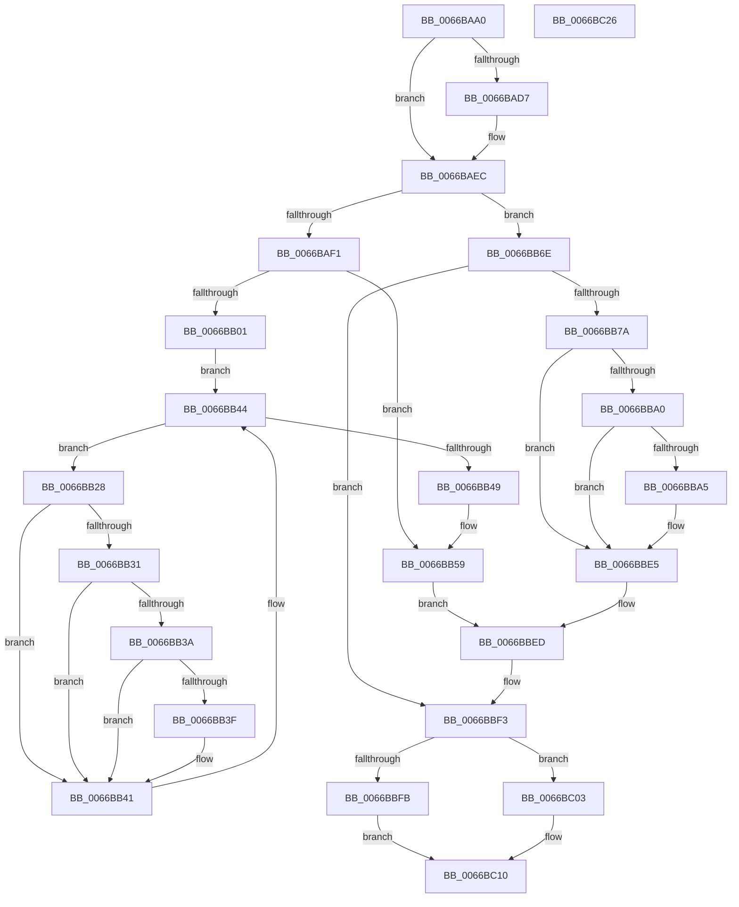

# CmFcpSecondaryMultiPartDumpDataCallback

- RVA: `0x0066BAA0`–`0x0066BC27` (길이 `391` bytes)
- VA: `0x000000014066BAA0`
- 실행 섹션: `.text`
- PDB 이름 있음: `예`; PDB Function 태그: `아니요`
- unwind 정보 RVA: `0x000BF8F0`
- 디코드: `109`개 명령, `391/391` bytes 표시
- 미해석 바이트: `0` (있으면 어셈블리에 `.byte`로 보존)

> 이 문서는 커널 이미지의 기계어와 PDB 기호를 분석해 생성했습니다. 4번과 5번은 함수 원형과 자료형을 바이너리 사용 방식에서 추정한 C 해석이며 원본 소스 복구 결과는 아닙니다.

## 1. Dependencies

- 직접 호출 지점: **4**; 고유 호출 대상: **3**
- 직접 호출자로 확인된 함수: **0**
- RIP 상대 이미지 참조: **4**

### Outgoing calls
- `0x0066BB63` → [CmFcpFindNextProviderWithDescriptors](CmFcpFindNextProviderWithDescriptors_function_0066B8E8.md) (function, `0x0066B8E8`)
- `0x0066BB87` → [CmFcpCountFeatureDescriptors](CmFcpCountFeatureDescriptors_function_0066B858.md) (function, `0x0066B858`)
- `0x0066BBD3` → [CmFcpPopulateModuleFeatures](CmFcpPopulateModuleFeatures_function_0066B988.md) (function, `0x0066B988`)
- `0x0066BBE8` → [CmFcpFindNextProviderWithDescriptors](CmFcpFindNextProviderWithDescriptors_function_0066B8E8.md) (function, `0x0066B8E8`)

### Direct callers
- 이 함수 시작 RVA로 연결되는 직접 call은 확인되지 않았습니다. 간접 호출은 완전히 역산할 수 없습니다.

### Static image references
- `0x0066BAB5` → RVA `0x0003AF50` (`.rdata`; read)
- `0x0066BADA` → RVA `0x00E624D0` (`.data`; read)
- `0x0066BB04` → RVA `0x00EF7880` (`.data`; read)
- `0x0066BB16` → RVA `0x00E3EE28` (`.data`; read)

## 2. Other-region calls and transfers

- 다른 실행 섹션으로 향하는 call: **0**
- 별도 외부 분기/꼬리 이동을 확인하지 못했습니다.

## 3. Assembly (complete function range)

```asm
0066BAA0  48 8B C4                        mov rax, rsp
0066BAA3  48 89 58 08                     mov qword ptr [rax + 8], rbx
0066BAA7  48 89 70 10                     mov qword ptr [rax + 0x10], rsi
0066BAAB  48 89 78 20                     mov qword ptr [rax + 0x20], rdi
0066BAAF  41 56                           push r14
0066BAB1  48 83 EC 20                     sub rsp, 0x20
0066BAB5  0F 10 05 94 F4 9C FF            movups xmm0, xmmword ptr [rip - 0x630b6c]
0066BABC  83 60 18 00                     and dword ptr [rax + 0x18], 0
0066BAC0  49 8B D8                        mov rbx, r8
0066BAC3  41 83 60 28 00                  and dword ptr [r8 + 0x28], 0
0066BAC8  49 8B 70 30                     mov rsi, qword ptr [r8 + 0x30]
0066BACC  F3 41 0F 7F 40 10               movdqu xmmword ptr [r8 + 0x10], xmm0
0066BAD2  48 85 F6                        test rsi, rsi
0066BAD5  75 15                           jne 0x14066baec
0066BAD7  0F 57 C0                        xorps xmm0, xmm0
0066BADA  48 8D 35 EF 69 7F 00            lea rsi, [rip + 0x7f69ef]
0066BAE1  0F 11 05 E8 69 7F 00            movups xmmword ptr [rip + 0x7f69e8], xmm0
0066BAE8  49 89 70 30                     mov qword ptr [r8 + 0x30], rsi
0066BAEC  80 3E 00                        cmp byte ptr [rsi], 0
0066BAEF  75 7D                           jne 0x14066bb6e
0066BAF1  41 83 78 08 00                  cmp dword ptr [r8 + 8], 0
0066BAF6  B8 10 00 00 00                  mov eax, 0x10
0066BAFB  41 89 40 28                     mov dword ptr [r8 + 0x28], eax
0066BAFF  74 58                           je 0x14066bb59
0066BB01  49 8B 08                        mov rcx, qword ptr [r8]
0066BB04  4C 8D 15 75 BD 88 00            lea r10, [rip + 0x88bd75]
0066BB0B  33 D2                           xor edx, edx
0066BB0D  89 01                           mov dword ptr [rcx], eax
0066BB0F  C7 41 04 01 00 00 00            mov dword ptr [rcx + 4], 1
0066BB16  8B 05 0C 33 7D 00               mov eax, dword ptr [rip + 0x7d330c]
0066BB1C  89 41 08                        mov dword ptr [rcx + 8], eax
0066BB1F  48 8B 05 5A BD 88 00            mov rax, qword ptr [rip + 0x88bd5a]
0066BB26  EB 1C                           jmp 0x14066bb44
0066BB28  4C 8B 40 70                     mov r8, qword ptr [rax + 0x70]
0066BB2C  4D 85 C0                        test r8, r8
0066BB2F  74 10                           je 0x14066bb41
0066BB31  4C 8B 48 78                     mov r9, qword ptr [rax + 0x78]
0066BB35  4D 85 C9                        test r9, r9
0066BB38  74 07                           je 0x14066bb41
0066BB3A  4D 3B C8                        cmp r9, r8
0066BB3D  76 02                           jbe 0x14066bb41
0066BB3F  FF C2                           inc edx
0066BB41  48 8B 00                        mov rax, qword ptr [rax]
0066BB44  49 3B C2                        cmp rax, r10
0066BB47  75 DF                           jne 0x14066bb28
0066BB49  89 51 0C                        mov dword ptr [rcx + 0xc], edx
0066BB4C  8B 43 28                        mov eax, dword ptr [rbx + 0x28]
0066BB4F  89 43 08                        mov dword ptr [rbx + 8], eax
0066BB52  48 8B 03                        mov rax, qword ptr [rbx]
0066BB55  48 89 43 20                     mov qword ptr [rbx + 0x20], rax
0066BB59  C6 06 01                        mov byte ptr [rsi], 1
0066BB5C  48 8B 0D 1D BD 88 00            mov rcx, qword ptr [rip + 0x88bd1d]
0066BB63  E8 80 FD FF FF                  call 0x14066b8e8
0066BB68  4C 8D 76 08                     lea r14, [rsi + 8]
0066BB6C  EB 7F                           jmp 0x14066bbed
0066BB6E  4C 8D 76 08                     lea r14, [rsi + 8]
0066BB72  49 8B 3E                        mov rdi, qword ptr [r14]
0066BB75  48 85 FF                        test rdi, rdi
0066BB78  74 79                           je 0x14066bbf3
0066BB7A  48 8B 57 78                     mov rdx, qword ptr [rdi + 0x78]
0066BB7E  4C 8D 44 24 40                  lea r8, [rsp + 0x40]
0066BB83  48 8B 4F 70                     mov rcx, qword ptr [rdi + 0x70]
0066BB87  E8 CC FC FF FF                  call 0x14066b858
0066BB8C  8B C8                           mov ecx, eax
0066BB8E  44 8B C8                        mov r9d, eax
0066BB91  C1 E1 04                        shl ecx, 4
0066BB94  83 C1 18                        add ecx, 0x18
0066BB97  83 7B 08 00                     cmp dword ptr [rbx + 8], 0
0066BB9B  89 4B 28                        mov dword ptr [rbx + 0x28], ecx
0066BB9E  74 45                           je 0x14066bbe5
0066BBA0  3B 4B 0C                        cmp ecx, dword ptr [rbx + 0xc]
0066BBA3  77 40                           ja 0x14066bbe5
0066BBA5  4C 8B 03                        mov r8, qword ptr [rbx]
0066BBA8  41 89 08                        mov dword ptr [r8], ecx
0066BBAB  41 C7 40 04 01 00 00 00         mov dword ptr [r8 + 4], 1
0066BBB3  48 8B 47 50                     mov rax, qword ptr [rdi + 0x50]
0066BBB7  49 89 40 08                     mov qword ptr [r8 + 8], rax
0066BBBB  8B 44 24 40                     mov eax, dword ptr [rsp + 0x40]
0066BBBF  41 89 40 10                     mov dword ptr [r8 + 0x10], eax
0066BBC3  45 89 48 14                     mov dword ptr [r8 + 0x14], r9d
0066BBC7  49 83 C0 18                     add r8, 0x18
0066BBCB  48 8B 57 78                     mov rdx, qword ptr [rdi + 0x78]
0066BBCF  48 8B 4F 70                     mov rcx, qword ptr [rdi + 0x70]
0066BBD3  E8 B0 FD FF FF                  call 0x14066b988
0066BBD8  8B 43 28                        mov eax, dword ptr [rbx + 0x28]
0066BBDB  89 43 08                        mov dword ptr [rbx + 8], eax
0066BBDE  48 8B 03                        mov rax, qword ptr [rbx]
0066BBE1  48 89 43 20                     mov qword ptr [rbx + 0x20], rax
0066BBE5  48 8B 0F                        mov rcx, qword ptr [rdi]
0066BBE8  E8 FB FC FF FF                  call 0x14066b8e8
0066BBED  49 89 06                        mov qword ptr [r14], rax
0066BBF0  48 8B F8                        mov rdi, rax
0066BBF3  8B 43 38                        mov eax, dword ptr [rbx + 0x38]
0066BBF6  48 85 FF                        test rdi, rdi
0066BBF9  74 08                           je 0x14066bc03
0066BBFB  83 C8 01                        or eax, 1
0066BBFE  89 43 38                        mov dword ptr [rbx + 0x38], eax
0066BC01  EB 0D                           jmp 0x14066bc10
0066BC03  83 E0 FE                        and eax, 0xfffffffe
0066BC06  89 43 38                        mov dword ptr [rbx + 0x38], eax
0066BC09  49 83 26 00                     and qword ptr [r14], 0
0066BC0D  C6 06 00                        mov byte ptr [rsi], 0
0066BC10  48 8B 5C 24 30                  mov rbx, qword ptr [rsp + 0x30]
0066BC15  48 8B 74 24 38                  mov rsi, qword ptr [rsp + 0x38]
0066BC1A  48 8B 7C 24 48                  mov rdi, qword ptr [rsp + 0x48]
0066BC1F  48 83 C4 20                     add rsp, 0x20
0066BC23  41 5E                           pop r14
0066BC25  C3                              ret
0066BC26  CC                              int3
```

## 4. C-style interpretation (structured pseudocode)

```c
__int64 __fastcall CmFcpSecondaryMultiPartDumpDataCallback(__int64 a1, int a2, __int64 a3)
{
    __int64 result;
    __int64 v_rsi;
    __int64 v_rsp;
    unsigned __int64 v_stack_p10;
    unsigned __int64 v_stack_p18;
    unsigned __int64 v_stack_p20;
    unsigned __int64 v_stack_p8;

    *(unsigned __int64 *)(v_rsp + 8) = v_rbx;
    *(unsigned __int64 *)(v_rsp + 16) = v_rsi;
    *(unsigned __int64 *)(v_rsp + 32) = v_rdi;
    v_rsp = (v_rsp) - (32);
    *(unsigned __int64 *)(a3 + 16) = v_xmm0;
    v_rsi = *(unsigned __int64 *)(a3 + 48);
    if (*(unsigned __int64 *)(a3 + 48) == 0) {
        v_rsi = v_rip + 8350191;
        *(unsigned __int64 *)(v_rip + 8350184) = v_xmm0;
        *(unsigned __int64 *)(a3 + 48) = v_rsi;
    }
    if ((*(unsigned __int8 *)(v_rsi)) != 0) goto loc_0066BB6E;
    *(unsigned int *)(a3 + 40) = 16;
    if ((*(unsigned int *)(a3 + 8)) == 0) goto loc_0066BB59;
    a2 = 0;
    *(unsigned int *)(*(unsigned __int64 *)(a3)) = 16;
    *(unsigned int *)(*(unsigned __int64 *)(a3) + 4) = 1;
    *(unsigned int *)(*(unsigned __int64 *)(a3) + 8) = (unsigned int)((unsigned int)(*(unsigned int *)(v_rip + 8205068)));
    goto loc_0066BB44;
loc_0066BB28:
    if (*(unsigned __int64 *)(*(unsigned __int64 *)(v_rip + 8961370) + 112) == 0) goto loc_0066BB41;
    if (*(unsigned __int64 *)(*(unsigned __int64 *)(v_rip + 8961370) + 120) == 0) goto loc_0066BB41;
    if ((*(unsigned __int64 *)(*(unsigned __int64 *)(v_rip + 8961370) + 120)) >= = (*(unsigned __int64 *)(*(unsigned __int64 *)(v_rip + 8961370) + 112))) {
        a2 = (unsigned int)((a2) + 1);
    }
loc_0066BB44:
    if ((*(unsigned __int64 *)(*(unsigned __int64 *)(v_rip + 8961370))) != (v_rip + 8961397)) goto loc_0066BB28;
    *(unsigned int *)(*(unsigned __int64 *)(a3) + 12) = a2;
    *(unsigned int *)(a3 + 8) = (unsigned int)((unsigned int)(*(unsigned int *)(a3 + 40)));
    *(unsigned __int64 *)(a3 + 32) = *(unsigned __int64 *)(a3);
loc_0066BB59:
    *(unsigned __int8 *)(v_rsi) = 1;
    result = CmFcpFindNextProviderWithDescriptors(*(unsigned __int64 *)(v_rip + 8961309), a2, *(unsigned __int64 *)(*(unsigned __int64 *)(v_rip + 8961370) + 112), *(unsigned __int64 *)(*(unsigned __int64 *)(v_rip + 8961370) + 120));
    goto loc_0066BBED;
loc_0066BB6E:
    if (*(unsigned __int64 *)(v_rsi + 8) == 0) goto loc_0066BBF3;
    result = CmFcpCountFeatureDescriptors(*(unsigned __int64 *)(*(unsigned __int64 *)(v_rsi + 8) + 112), *(unsigned __int64 *)(*(unsigned __int64 *)(v_rsi + 8) + 120), v_stack_p18, *(unsigned __int64 *)(*(unsigned __int64 *)(v_rip + 8961370) + 120));
    a1 = (unsigned int)(((unsigned int)((unsigned int)(result))) << (4));
    a1 = (unsigned int)((a1) + (24));
    *(unsigned int *)(a3 + 40) = (unsigned int)(a1);
    if ((*(unsigned int *)(a3 + 8)) == 0) goto loc_0066BBE5;
    if (((unsigned int)(a1)) <= (*(unsigned int *)(a3 + 12))) {
        a3 = *(unsigned __int64 *)(a3);
        *(unsigned int *)(a3) = (unsigned int)(a1);
        *(unsigned int *)(a3 + 4) = 1;
        result = *(unsigned __int64 *)(*(unsigned __int64 *)(v_rsi + 8) + 80);
        *(unsigned __int64 *)(a3 + 8) = result;
        result = v_stack_p18;
        *(unsigned int *)(a3 + 16) = (unsigned int)(result);
        *(unsigned int *)(a3 + 20) = (unsigned int)((unsigned int)((unsigned int)(result)));
        a3 = (a3) + (24);
        a2 = *(unsigned __int64 *)(*(unsigned __int64 *)(v_rsi + 8) + 120);
        a1 = *(unsigned __int64 *)(*(unsigned __int64 *)(v_rsi + 8) + 112);
        result = CmFcpPopulateModuleFeatures(a1, a2, a3, (unsigned int)((unsigned int)(result)));
        result = *(unsigned int *)(a3 + 40);
        *(unsigned int *)(a3 + 8) = (unsigned int)(result);
        result = *(unsigned __int64 *)(a3);
        *(unsigned __int64 *)(a3 + 32) = result;
    }
    result = CmFcpFindNextProviderWithDescriptors(*(unsigned __int64 *)(*(unsigned __int64 *)(v_rsi + 8)), a2, a3, (unsigned int)((unsigned int)(result)));
loc_0066BBED:
    *(unsigned __int64 *)(v_rsi + 8) = result;
loc_0066BBF3:
    if (result == 0) goto loc_0066BC03;
    result = (unsigned int)(((unsigned int)(*(unsigned int *)(a3 + 56))) | (1));
    *(unsigned int *)(a3 + 56) = (unsigned int)(result);
    goto loc_0066BC10;
loc_0066BC03:
    result = (unsigned int)((result) & (0xFFFFFFFEULL));
    *(unsigned int *)(a3 + 56) = (unsigned int)(result);
    *(unsigned __int8 *)(v_rsi) = 0;
loc_0066BC10:
    v_rsp = (v_rsp) + (32);
    return result;
}
```

## 5. (Beta) C Style

```c
int64_t CmFcpSecondaryMultiPartDumpDataCallback(int64_t Arg1, int32_t Arg2, void *Arg3)
{
    uint8_t *arg3 = (uint8_t *)Arg3;

    int64_t result;
    int64_t local_rsi;
    int64_t local_rsp;
    uint64_t v_stack_p10;
    uint64_t v_stack_p18;
    uint64_t v_stack_p20;
    uint64_t v_stack_p8;

    *(uint64_t *)(local_rsp + 0x8) = local_rbx;
    *(uint64_t *)(local_rsp + 0x10) = local_rsi;
    *(uint64_t *)(local_rsp + 0x20) = local_rdi;
    local_rsp = (local_rsp) - (32);
    *(uint64_t *)(arg3 + 0x10) = v_xmm0;
    local_rsi = *(uint64_t *)(arg3 + 0x30);
    if (*(uint64_t *)(arg3 + 0x30) == 0) {
        local_rsi = v_rip + 8350191;
        *(uint64_t *)(v_rip + 0x7F69E8) = v_xmm0;
        *(uint64_t *)(arg3 + 0x30) = local_rsi;
    }
    if ((*(uint8_t *)(local_rsi)) != 0) goto loc_0066BB6E;
    *(uint32_t *)(arg3 + 0x28) = 16;
    if ((*(uint32_t *)(arg3 + 0x8)) == 0) goto loc_0066BB59;
    Arg2 = 0;
    *(uint32_t *)(*(uint64_t *)(arg3)) = 16;
    *(uint32_t *)(*(uint64_t *)(arg3) + 0x4) = 1;
    *(uint32_t *)(*(uint64_t *)(arg3) + 0x8) = (uint32_t)((uint32_t)(*(uint32_t *)(v_rip + 0x7D330C)));
    goto loc_0066BB44;
loc_0066BB28:
    if (*(uint64_t *)(*(uint64_t *)(v_rip + 0x88BD5A) + 0x70) == 0) goto loc_0066BB41;
    if (*(uint64_t *)(*(uint64_t *)(v_rip + 0x88BD5A) + 0x78) == 0) goto loc_0066BB41;
    if ((*(uint64_t *)(*(uint64_t *)(v_rip + 0x88BD5A) + 0x78)) >= = (*(uint64_t *)(*(uint64_t *)(v_rip + 0x88BD5A) + 0x70))) {
        Arg2 = (uint32_t)((Arg2) + 1);
    }
loc_0066BB44:
    if ((*(uint64_t *)(*(uint64_t *)(v_rip + 0x88BD5A))) != (v_rip + 8961397)) goto loc_0066BB28;
    *(uint32_t *)(*(uint64_t *)(arg3) + 0xC) = Arg2;
    *(uint32_t *)(arg3 + 0x8) = (uint32_t)((uint32_t)(*(uint32_t *)(arg3 + 0x28)));
    *(uint64_t *)(arg3 + 0x20) = *(uint64_t *)(arg3);
loc_0066BB59:
    *(uint8_t *)(local_rsi) = 1;
    result = CmFcpFindNextProviderWithDescriptors(*(uint64_t *)(v_rip + 0x88BD1D), Arg2, *(uint64_t *)(*(uint64_t *)(v_rip + 0x88BD5A) + 0x70), *(uint64_t *)(*(uint64_t *)(v_rip + 0x88BD5A) + 0x78));
    goto loc_0066BBED;
loc_0066BB6E:
    if (*(uint64_t *)(local_rsi + 0x8) == 0) goto loc_0066BBF3;
    result = CmFcpCountFeatureDescriptors(*(uint64_t *)(*(uint64_t *)(local_rsi + 0x8) + 0x70), *(uint64_t *)(*(uint64_t *)(local_rsi + 0x8) + 0x78), v_stack_p18, *(uint64_t *)(*(uint64_t *)(v_rip + 0x88BD5A) + 0x78));
    Arg1 = (uint32_t)(((uint32_t)((uint32_t)(result))) << (4));
    Arg1 = (uint32_t)((Arg1) + (24));
    *(uint32_t *)(arg3 + 0x28) = (uint32_t)(Arg1);
    if ((*(uint32_t *)(arg3 + 0x8)) == 0) goto loc_0066BBE5;
    if (((uint32_t)(Arg1)) <= (*(uint32_t *)(arg3 + 0xC))) {
        Arg3 = *(uint64_t *)(arg3);
        *(uint32_t *)(arg3) = (uint32_t)(Arg1);
        *(uint32_t *)(arg3 + 0x4) = 1;
        result = *(uint64_t *)(*(uint64_t *)(local_rsi + 0x8) + 0x50);
        *(uint64_t *)(arg3 + 0x8) = result;
        result = v_stack_p18;
        *(uint32_t *)(arg3 + 0x10) = (uint32_t)(result);
        *(uint32_t *)(arg3 + 0x14) = (uint32_t)((uint32_t)((uint32_t)(result)));
        Arg3 = (Arg3) + (24);
        Arg2 = *(uint64_t *)(*(uint64_t *)(local_rsi + 0x8) + 0x78);
        Arg1 = *(uint64_t *)(*(uint64_t *)(local_rsi + 0x8) + 0x70);
        result = CmFcpPopulateModuleFeatures(Arg1, Arg2, Arg3, (uint32_t)((uint32_t)(result)));
        result = *(uint32_t *)(arg3 + 0x28);
        *(uint32_t *)(arg3 + 0x8) = (uint32_t)(result);
        result = *(uint64_t *)(arg3);
        *(uint64_t *)(arg3 + 0x20) = result;
    }
    result = CmFcpFindNextProviderWithDescriptors(*(uint64_t *)(*(uint64_t *)(local_rsi + 0x8)), Arg2, Arg3, (uint32_t)((uint32_t)(result)));
loc_0066BBED:
    *(uint64_t *)(local_rsi + 0x8) = result;
loc_0066BBF3:
    if (result == 0) goto loc_0066BC03;
    result = (uint32_t)(((uint32_t)(*(uint32_t *)(arg3 + 0x38))) | (1));
    *(uint32_t *)(arg3 + 0x38) = (uint32_t)(result);
    goto loc_0066BC10;
loc_0066BC03:
    result = (uint32_t)((result) & (0xFFFFFFFEULL));
    *(uint32_t *)(arg3 + 0x38) = (uint32_t)(result);
    *(uint8_t *)(local_rsi) = 0;
loc_0066BC10:
    local_rsp = (local_rsp) + (32);
    return result;
}
```

### 관측된 메모리 오프셋

구조체 형식이 확인되지 않은 접근은 인자 기준의 오프셋으로만 기록했습니다.

| 기준 인자 | 오프셋 표현 | 폭 (bit) | 접근 |
|---|---:|---:|---|
| `Arg3` | `+ 0x0` | `64` | `R` |
| `Arg3` | `+ 0x8` | `32` | `R` |
| `Arg3` | `+ 0x8` | `32` | `W` |
| `Arg3` | `+ 0xC` | `32` | `R` |
| `Arg3` | `+ 0x10` | `128` | `W` |
| `Arg3` | `+ 0x20` | `64` | `W` |
| `Arg3` | `+ 0x28` | `32` | `R` |
| `Arg3` | `+ 0x28` | `32` | `R/W` |
| `Arg3` | `+ 0x28` | `32` | `W` |
| `Arg3` | `+ 0x30` | `64` | `R` |
| `Arg3` | `+ 0x30` | `64` | `W` |
| `Arg3` | `+ 0x38` | `32` | `R` |
| `Arg3` | `+ 0x38` | `32` | `W` |

## 6. Execution-region graph

[열기: 2D/3D 그래프와 함수 탐색 컨트롤 패널](../../../control-panel.html?section=text&rva=0x0066BAA0&view=graph)

- 2D 그래프는 위에서 아래로 흐르고, 3D 그래프는 빈 공간을 드래그해 회전합니다. Shift+드래그는 이동, 휠은 확대·축소, 함수 노드 선택은 대상 보고서 이동입니다.

### Static fallback


