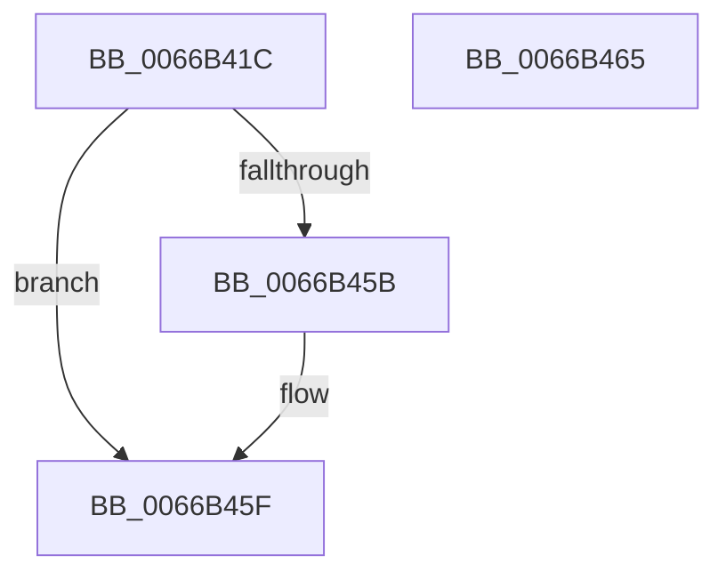

# CmFcpSubscribeScmWnfStateChange

- RVA: `0x0066B41C`–`0x0066B466` (길이 `74` bytes)
- VA: `0x000000014066B41C`
- 실행 섹션: `.text`
- PDB 이름 있음: `예`; PDB Function 태그: `아니요`
- unwind 정보 RVA: `0x00064C80`
- 디코드: `19`개 명령, `74/74` bytes 표시
- 미해석 바이트: `0` (있으면 어셈블리에 `.byte`로 보존)

> 이 문서는 커널 이미지의 기계어와 PDB 기호를 분석해 생성했습니다. 4번과 5번은 함수 원형과 자료형을 바이너리 사용 방식에서 추정한 C 해석이며 원본 소스 복구 결과는 아닙니다.

## 1. Dependencies

- 직접 호출 지점: **1**; 고유 호출 대상: **1**
- 직접 호출자로 확인된 함수: **1**
- RIP 상대 이미지 참조: **2**

### Outgoing calls
- `0x0066B452` → [ExSubscribeWnfStateChange](../../page/9D/ExSubscribeWnfStateChange_function_009D4BC0.md) (function, `0x009D4BC0`)

### Direct callers
- [CmFcpManagerSoftwareHiveReady](../../page/7F/CmFcpManagerSoftwareHiveReady_function_007F5790.md) at `0x007F57B7`

### Static image references
- `0x0066B438` → RVA `0x0066B560` (`CmFcpWnfScmStateChangeNotificationCallback`; read)
- `0x0066B442` → RVA `0x00020A60` (`.rdata`; read)

## 2. Other-region calls and transfers

- 다른 실행 섹션으로 향하는 call: **1**
  - `0x0066B452` → [ExSubscribeWnfStateChange](../../page/9D/ExSubscribeWnfStateChange_function_009D4BC0.md) (`.text` → `PAGE`)
- 별도 외부 분기/꼬리 이동을 확인하지 못했습니다.

## 3. Assembly (complete function range)

```asm
0066B41C  40 53                           push rbx
0066B41E  48 83 EC 30                     sub rsp, 0x30
0066B422  48 8D 81 40 07 00 00            lea rax, [rcx + 0x740]
0066B429  45 33 C9                        xor r9d, r9d
0066B42C  48 89 44 24 28                  mov qword ptr [rsp + 0x28], rax
0066B431  48 8D 99 38 07 00 00            lea rbx, [rcx + 0x738]
0066B438  48 8D 05 21 01 00 00            lea rax, [rip + 0x121]
0066B43F  48 8B CB                        mov rcx, rbx
0066B442  48 8D 15 17 56 9B FF            lea rdx, [rip - 0x64a9e9]
0066B449  48 89 44 24 20                  mov qword ptr [rsp + 0x20], rax
0066B44E  45 8D 41 01                     lea r8d, [r9 + 1]
0066B452  E8 69 97 36 00                  call 0x1409d4bc0
0066B457  85 C0                           test eax, eax
0066B459  79 04                           jns 0x14066b45f
0066B45B  48 83 23 00                     and qword ptr [rbx], 0
0066B45F  48 83 C4 30                     add rsp, 0x30
0066B463  5B                              pop rbx
0066B464  C3                              ret
0066B465  CC                              int3
```

## 4. C-style interpretation (structured pseudocode)

```c
__int64 __fastcall CmFcpSubscribeScmWnfStateChange(__int64 a1, __int64 a2, __int64 a3, int a4)
{
    __int64 result;
    __int64 v_rsp;
    unsigned __int64 v_stack_m10;
    unsigned __int64 v_stack_m18;

    v_rsp = (v_rsp) - (48);
    a4 = 0;
    v_stack_m10 = a1 + 1856;
    v_stack_m18 = v_rip + 289;
    result = ExSubscribeWnfStateChange(a1 + 1848, v_rip - 6597097, a4 + 1, a4);
    if (sign_flag) {
    }
    v_rsp = (v_rsp) + (48);
    return result;
}
```

## 5. (Beta) C Style

```c
int64_t CmFcpSubscribeScmWnfStateChange(void *Arg1, int64_t Arg2, int64_t Arg3, int32_t Arg4)
{
    uint8_t *arg1 = (uint8_t *)Arg1;

    int64_t result;
    int64_t local_rsp;
    uint64_t v_stack_m10;
    uint64_t v_stack_m18;

    local_rsp = (local_rsp) - (48);
    Arg4 = 0;
    v_stack_m10 = Arg1 + 1856;
    v_stack_m18 = v_rip + 289;
    result = ExSubscribeWnfStateChange(Arg1 + 1848, v_rip - 6597097, Arg4 + 1, Arg4);
    if (sign_flag) {
    }
    local_rsp = (local_rsp) + (48);
    return result;
}
```

### 관측된 메모리 오프셋

구조체 형식이 확인되지 않은 접근은 인자 기준의 오프셋으로만 기록했습니다.

| 기준 인자 | 오프셋 표현 | 폭 (bit) | 접근 |
|---|---:|---:|---|
| `Arg1` | `+ 0x0` | `64` | `R/W` |
| `Arg1` | `+ 0x738` | `64` | `R` |
| `Arg1` | `+ 0x740` | `64` | `R` |

## 6. Execution-region graph

[열기: 2D/3D 그래프와 함수 탐색 컨트롤 패널](../../../control-panel.html?section=text&rva=0x0066B41C&view=graph)

- 2D 그래프는 위에서 아래로 흐르고, 3D 그래프는 빈 공간을 드래그해 회전합니다. Shift+드래그는 이동, 휠은 확대·축소, 함수 노드 선택은 대상 보고서 이동입니다.

### Static fallback


