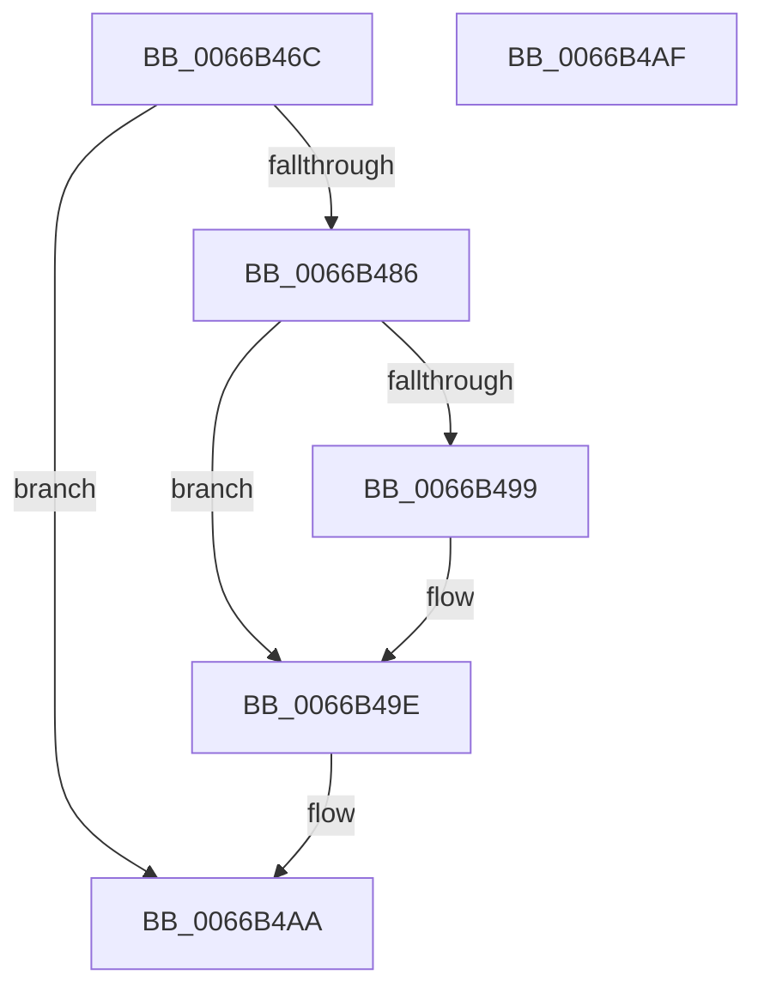

# CmFcpUsageProviderQueueWork

- RVA: `0x0066B46C`–`0x0066B4B0` (길이 `68` bytes)
- VA: `0x000000014066B46C`
- 실행 섹션: `.text`
- PDB 이름 있음: `예`; PDB Function 태그: `아니요`
- unwind 정보 RVA: `0x0005C788`
- 디코드: `20`개 명령, `68/68` bytes 표시
- 미해석 바이트: `0` (있으면 어셈블리에 `.byte`로 보존)

> 이 문서는 커널 이미지의 기계어와 PDB 기호를 분석해 생성했습니다. 4번과 5번은 함수 원형과 자료형을 바이너리 사용 방식에서 추정한 C 해석이며 원본 소스 복구 결과는 아닙니다.

## 1. Dependencies

- 직접 호출 지점: **1**; 고유 호출 대상: **1**
- 직접 호출자로 확인된 함수: **1**
- RIP 상대 이미지 참조: **0**

### Outgoing calls
- `0x0066B4A5` → [ExQueueWorkItem](../2F/ExQueueWorkItem_function_002F9520.md) (function, `0x002F9520`)

### Direct callers
- [CmFcpManagerProcessUsageDataProviders](../../page/AF/CmFcpManagerProcessUsageDataProviders_function_00AF7B6C.md) at `0x00AF7C9A`

### Static image references
- 디코드된 RIP-relative 메모리 참조가 없습니다.

## 2. Other-region calls and transfers

- 다른 실행 섹션으로 향하는 call: **0**
- 별도 외부 분기/꼬리 이동을 확인하지 못했습니다.

## 3. Assembly (complete function range)

```asm
0066B46C  48 83 EC 28                     sub rsp, 0x28
0066B470  4C 8D 41 10                     lea r8, [rcx + 0x10]
0066B474  B8 03 00 00 00                  mov eax, 3
0066B479  41 87 40 28                     xchg dword ptr [r8 + 0x28], eax
0066B47D  BA 01 00 00 00                  mov edx, 1
0066B482  84 C2                           test dl, al
0066B484  75 24                           jne 0x14066b4aa
0066B486  8B C2                           mov eax, edx
0066B488  F0 48 0F C1 81 88 00 00 00      lock xadd qword ptr [rcx + 0x88], rax
0066B491  48 03 C2                        add rax, rdx
0066B494  48 3B C2                        cmp rax, rdx
0066B497  7F 05                           jg 0x14066b49e
0066B499  8D 4A 0D                        lea ecx, [rdx + 0xd]
0066B49C  CD 29                           int 0x29
0066B49E  41 8B 50 2C                     mov edx, dword ptr [r8 + 0x2c]
0066B4A2  49 8B C8                        mov rcx, r8
0066B4A5  E8 76 E0 C8 FF                  call 0x1402f9520
0066B4AA  48 83 C4 28                     add rsp, 0x28
0066B4AE  C3                              ret
0066B4AF  CC                              int3
```

## 4. C-style interpretation (structured pseudocode)

```c
__int64 __fastcall CmFcpUsageProviderQueueWork(__int64 a1)
{
    __int64 result;
    __int64 v_rsp;

    v_rsp = (v_rsp) - (40);
    if (((1) & (3)) != 0) goto loc_0066B4AA;
    result = (1) + (1);
    if (result <= 1) {
        a1 = 1 + 13;
    }
    result = ExQueueWorkItem(a1 + 16, (unsigned int)(*(unsigned int *)(a1 + 16 + 44)), a1 + 16, a4);
loc_0066B4AA:
    v_rsp = (v_rsp) + (40);
    return result;
}
```

## 5. (Beta) C Style

```c
int64_t CmFcpUsageProviderQueueWork(void *Arg1)
{
    uint8_t *arg1 = (uint8_t *)Arg1;

    int64_t result;
    int64_t local_rsp;

    local_rsp = (local_rsp) - (40);
    if (((1) & (3)) != 0) goto loc_0066B4AA;
    result = (1) + (1);
    if (result <= 1) {
        Arg1 = 1 + 13;
    }
    result = ExQueueWorkItem(Arg1 + 16, (uint32_t)(*(uint32_t *)(arg1 + 0x10 + 0x2C)), Arg1 + 16, a4);
loc_0066B4AA:
    local_rsp = (local_rsp) + (40);
    return result;
}
```

### 관측된 메모리 오프셋

구조체 형식이 확인되지 않은 접근은 인자 기준의 오프셋으로만 기록했습니다.

| 기준 인자 | 오프셋 표현 | 폭 (bit) | 접근 |
|---|---:|---:|---|
| `Arg1` | `+ 0x10` | `64` | `R` |
| `Arg1` | `+ 0x28` | `32` | `R/W` |
| `Arg1` | `+ 0x2C` | `32` | `R` |
| `Arg1` | `+ 0x88` | `64` | `R/W` |

## 6. Execution-region graph

[열기: 2D/3D 그래프와 함수 탐색 컨트롤 패널](../../../control-panel.html?section=text&rva=0x0066B46C&view=graph)

- 2D 그래프는 위에서 아래로 흐르고, 3D 그래프는 빈 공간을 드래그해 회전합니다. Shift+드래그는 이동, 휠은 확대·축소, 함수 노드 선택은 대상 보고서 이동입니다.

### Static fallback


