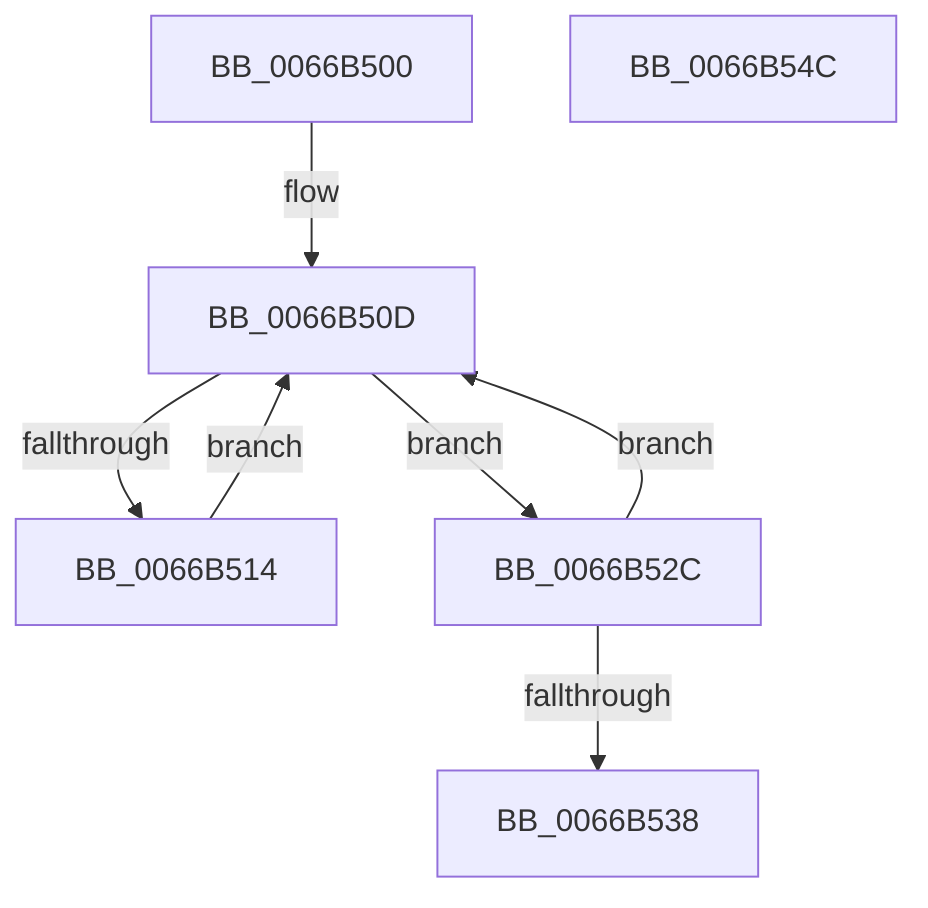

# CmFcpUsageProviderWorkItemWrapper

- RVA: `0x0066B500`–`0x0066B54D` (길이 `77` bytes)
- VA: `0x000000014066B500`
- 실행 섹션: `.text`
- PDB 이름 있음: `예`; PDB Function 태그: `아니요`
- unwind 정보 RVA: `0x00068D5C`
- 디코드: `24`개 명령, `77/77` bytes 표시
- 미해석 바이트: `0` (있으면 어셈블리에 `.byte`로 보존)

> 이 문서는 커널 이미지의 기계어와 PDB 기호를 분석해 생성했습니다. 4번과 5번은 함수 원형과 자료형을 바이너리 사용 방식에서 추정한 C 해석이며 원본 소스 복구 결과는 아닙니다.

## 1. Dependencies

- 직접 호출 지점: **2**; 고유 호출 대상: **2**
- 직접 호출자로 확인된 함수: **0**
- RIP 상대 이미지 참조: **0**

### Outgoing calls
- `0x0066B525` → [guard_dispatch_icall](../6B/guard_dispatch_icall_function_006BAAD0.md) (function, `0x006BAAD0`)
- `0x0066B53C` → [CmFcpReleaseUsageProviderSubscription](CmFcpReleaseUsageProviderSubscription_function_0066B3DC.md) (function, `0x0066B3DC`)

### Direct callers
- 이 함수 시작 RVA로 연결되는 직접 call은 확인되지 않았습니다. 간접 호출은 완전히 역산할 수 없습니다.

### Static image references
- 디코드된 RIP-relative 메모리 참조가 없습니다.

## 2. Other-region calls and transfers

- 다른 실행 섹션으로 향하는 call: **0**
- 별도 외부 분기/꼬리 이동을 확인하지 못했습니다.

## 3. Assembly (complete function range)

```asm
0066B500  48 89 5C 24 10                  mov qword ptr [rsp + 0x10], rbx
0066B505  57                              push rdi
0066B506  48 83 EC 20                     sub rsp, 0x20
0066B50A  48 8B D9                        mov rbx, rcx
0066B50D  8B 43 28                        mov eax, dword ptr [rbx + 0x28]
0066B510  A8 02                           test al, 2
0066B512  74 18                           je 0x14066b52c
0066B514  F0 0F BA 73 28 01               lock btr dword ptr [rbx + 0x28], 1
0066B51A  48 8B 43 30                     mov rax, qword ptr [rbx + 0x30]
0066B51E  48 8B CB                        mov rcx, rbx
0066B521  48 8B 53 38                     mov rdx, qword ptr [rbx + 0x38]
0066B525  E8 A6 F5 04 00                  call 0x1406baad0
0066B52A  EB E1                           jmp 0x14066b50d
0066B52C  8B D0                           mov edx, eax
0066B52E  83 E2 FE                        and edx, 0xfffffffe
0066B531  F0 0F B1 53 28                  lock cmpxchg dword ptr [rbx + 0x28], edx
0066B536  75 D5                           jne 0x14066b50d
0066B538  48 8D 4B F0                     lea rcx, [rbx - 0x10]
0066B53C  E8 9B FE FF FF                  call 0x14066b3dc
0066B541  48 8B 5C 24 38                  mov rbx, qword ptr [rsp + 0x38]
0066B546  48 83 C4 20                     add rsp, 0x20
0066B54A  5F                              pop rdi
0066B54B  C3                              ret
0066B54C  CC                              int3
```

## 4. C-style interpretation (structured pseudocode)

```c
__int64 __fastcall CmFcpUsageProviderWorkItemWrapper(__int64 a1)
{
    __int64 result;
    __int64 v_rsp;
    unsigned __int64 v_stack_p10;

    v_stack_p10 = v_rbx;
    v_rsp = (v_rsp) - (32);
loc_0066B50D:
    if ((((unsigned __int8)((unsigned int)(*(unsigned int *)(a1 + 40)))) & (2)) == 0) goto loc_0066B52C;
    result = guard_dispatch_icall(a1, *(unsigned __int64 *)(a1 + 56), a3, a4);
    goto loc_0066B50D;
loc_0066B52C:
    a2 = (unsigned int)(((unsigned int)((unsigned int)(result))) & (0xFFFFFFFEULL));
    if (condition_is_not_equal) goto loc_0066B50D;
    result = CmFcpReleaseUsageProviderSubscription(a1 - 16, a2, a3, a4);
    v_rsp = (v_rsp) + (32);
    return result;
}
```

## 5. (Beta) C Style

```c
int64_t CmFcpUsageProviderWorkItemWrapper(void *Arg1)
{
    uint8_t *arg1 = (uint8_t *)Arg1;

    int64_t result;
    int64_t local_rsp;
    uint64_t v_stack_p10;

    v_stack_p10 = local_rbx;
    local_rsp = (local_rsp) - (32);
loc_0066B50D:
    if ((((uint8_t)((uint32_t)(*(uint32_t *)(arg1 + 0x28)))) & (2)) == 0) goto loc_0066B52C;
    result = guard_dispatch_icall(Arg1, *(uint64_t *)(arg1 + 0x38), a3, a4);
    goto loc_0066B50D;
loc_0066B52C:
    a2 = (uint32_t)(((uint32_t)((uint32_t)(result))) & (0xFFFFFFFEULL));
    if (condition_is_not_equal) goto loc_0066B50D;
    result = CmFcpReleaseUsageProviderSubscription(Arg1 - 16, a2, a3, a4);
    local_rsp = (local_rsp) + (32);
    return result;
}
```

### 관측된 메모리 오프셋

구조체 형식이 확인되지 않은 접근은 인자 기준의 오프셋으로만 기록했습니다.

| 기준 인자 | 오프셋 표현 | 폭 (bit) | 접근 |
|---|---:|---:|---|
| `Arg1` | `- 0x10` | `64` | `R` |
| `Arg1` | `+ 0x28` | `32` | `R` |
| `Arg1` | `+ 0x28` | `32` | `R/W` |
| `Arg1` | `+ 0x30` | `64` | `R` |
| `Arg1` | `+ 0x38` | `64` | `R` |

## 6. Execution-region graph

[열기: 2D/3D 그래프와 함수 탐색 컨트롤 패널](../../../control-panel.html?section=text&rva=0x0066B500&view=graph)

- 2D 그래프는 위에서 아래로 흐르고, 3D 그래프는 빈 공간을 드래그해 회전합니다. Shift+드래그는 이동, 휠은 확대·축소, 함수 노드 선택은 대상 보고서 이동입니다.

### Static fallback


