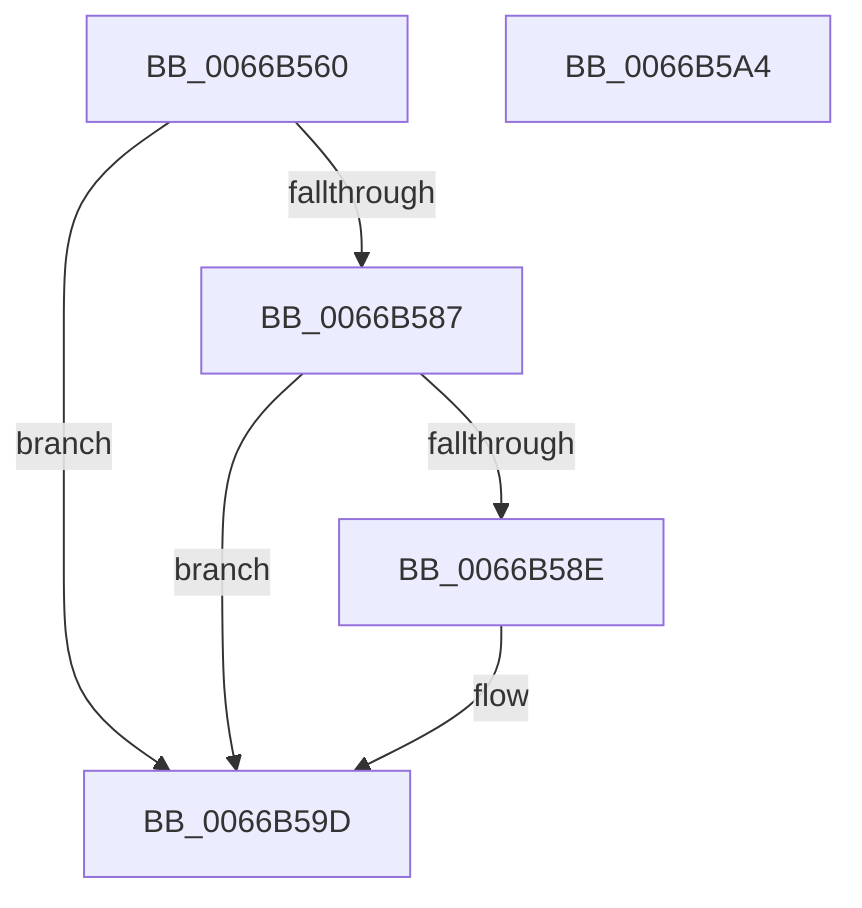

# CmFcpWnfScmStateChangeNotificationCallback

- RVA: `0x0066B560`–`0x0066B5A5` (길이 `69` bytes)
- VA: `0x000000014066B560`
- 실행 섹션: `.text`
- PDB 이름 있음: `예`; PDB Function 태그: `아니요`
- unwind 정보 RVA: `0x00097934`
- 디코드: `20`개 명령, `69/69` bytes 표시
- 미해석 바이트: `0` (있으면 어셈블리에 `.byte`로 보존)

> 이 문서는 커널 이미지의 기계어와 PDB 기호를 분석해 생성했습니다. 4번과 5번은 함수 원형과 자료형을 바이너리 사용 방식에서 추정한 C 해석이며 원본 소스 복구 결과는 아닙니다.

## 1. Dependencies

- 직접 호출 지점: **2**; 고유 호출 대상: **2**
- 직접 호출자로 확인된 함수: **0**
- RIP 상대 이미지 참조: **0**

### Outgoing calls
- `0x0066B57E` → [ExQueryWnfStateData](../../page/A4/ExQueryWnfStateData_function_00A4A480.md) (function, `0x00A4A480`)
- `0x0066B598` → [KeSetEvent](../33/KeSetEvent_function_0033F310.md) (function, `0x0033F310`)

### Direct callers
- 이 함수 시작 RVA로 연결되는 직접 call은 확인되지 않았습니다. 간접 호출은 완전히 역산할 수 없습니다.

### Static image references
- 디코드된 RIP-relative 메모리 참조가 없습니다.

## 2. Other-region calls and transfers

- 다른 실행 섹션으로 향하는 call: **1**
  - `0x0066B57E` → [ExQueryWnfStateData](../../page/A4/ExQueryWnfStateData_function_00A4A480.md) (`.text` → `PAGE`)
- 별도 외부 분기/꼬리 이동을 확인하지 못했습니다.

## 3. Assembly (complete function range)

```asm
0066B560  48 8B C4                        mov rax, rsp
0066B563  48 83 EC 38                     sub rsp, 0x38
0066B567  83 60 E8 00                     and dword ptr [rax - 0x18], 0
0066B56B  4C 8D 48 EC                     lea r9, [rax - 0x14]
0066B56F  4C 8D 40 E8                     lea r8, [rax - 0x18]
0066B573  C7 40 EC 04 00 00 00            mov dword ptr [rax - 0x14], 4
0066B57A  48 8D 50 20                     lea rdx, [rax + 0x20]
0066B57E  E8 FD EE 3D 00                  call 0x140a4a480
0066B583  85 C0                           test eax, eax
0066B585  78 16                           js 0x14066b59d
0066B587  83 7C 24 20 03                  cmp dword ptr [rsp + 0x20], 3
0066B58C  75 0F                           jne 0x14066b59d
0066B58E  48 8B 4C 24 68                  mov rcx, qword ptr [rsp + 0x68]
0066B593  45 33 C0                        xor r8d, r8d
0066B596  33 D2                           xor edx, edx
0066B598  E8 73 3D CD FF                  call 0x14033f310
0066B59D  33 C0                           xor eax, eax
0066B59F  48 83 C4 38                     add rsp, 0x38
0066B5A3  C3                              ret
0066B5A4  CC                              int3
```

## 4. C-style interpretation (structured pseudocode)

```c
__int64 __fastcall CmFcpWnfScmStateChangeNotificationCallback(__int64 a1, __int64 a2, __int64 a3, __int64 a4, __int64 a5, __int64 a6)
{
    __int64 result;
    __int64 v_rsp;
    unsigned int v_stack_m18;

    v_rsp = (v_rsp) - (56);
    *(unsigned int *)(v_rsp - 20) = 4;
    result = ExQueryWnfStateData(a1, v_rsp + 32, v_rsp - 24, v_rsp - 20);
    if (sign_flag) goto loc_0066B59D;
    if (v_stack_m18 == 3) {
        a1 = a6;
        a3 = 0;
        a2 = 0;
        result = KeSetEvent(a1, a2, a3, v_rsp - 20);
    }
    result = 0;
    v_rsp = (v_rsp) + (56);
    return result;
}
```

## 5. (Beta) C Style

```c
int64_t CmFcpWnfScmStateChangeNotificationCallback(int64_t Arg1, int64_t Arg2, int64_t Arg3, int64_t Arg4, uint64_t Arg5, int64_t Arg6)
{
    int64_t result;
    int64_t local_rsp;
    uint32_t v_stack_m18;

    local_rsp = (local_rsp) - (56);
    *(uint32_t *)(local_rsp - 0x14) = 4;
    result = ExQueryWnfStateData(Arg1, local_rsp + 32, local_rsp - 24, local_rsp - 20);
    if (sign_flag) goto loc_0066B59D;
    if (v_stack_m18 == 3) {
        Arg1 = Arg6;
        Arg3 = 0;
        Arg2 = 0;
        result = KeSetEvent(Arg1, Arg2, Arg3, local_rsp - 20);
    }
    result = 0;
    local_rsp = (local_rsp) + (56);
    return result;
}
```

## 6. Execution-region graph

[열기: 2D/3D 그래프와 함수 탐색 컨트롤 패널](../../../control-panel.html?section=text&rva=0x0066B560&view=graph)

- 2D 그래프는 위에서 아래로 흐르고, 3D 그래프는 빈 공간을 드래그해 회전합니다. Shift+드래그는 이동, 휠은 확대·축소, 함수 노드 선택은 대상 보고서 이동입니다.

### Static fallback


