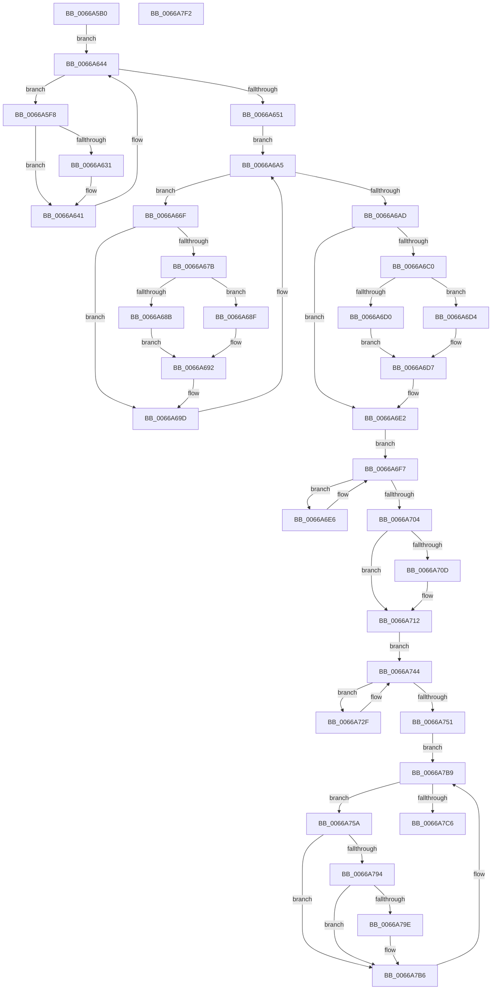

# CmShutdownSystem1

- RVA: `0x0066A5B0`–`0x0066A7F3` (길이 `579` bytes)
- VA: `0x000000014066A5B0`
- 실행 섹션: `.text`
- PDB 이름 있음: `예`; PDB Function 태그: `아니요`
- unwind 정보 RVA: `0x000BF7C4`
- 디코드: `151`개 명령, `579/579` bytes 표시
- 미해석 바이트: `0` (있으면 어셈블리에 `.byte`로 보존)

> 이 문서는 커널 이미지의 기계어와 PDB 기호를 분석해 생성했습니다. 4번과 5번은 함수 원형과 자료형을 바이너리 사용 방식에서 추정한 C 해석이며 원본 소스 복구 결과는 아닙니다.

## 1. Dependencies

- 직접 호출 지점: **41**; 고유 호출 대상: **27**
- 직접 호출자로 확인된 함수: **1**
- RIP 상대 이미지 참조: **5**

### Outgoing calls
- `0x0066A5E0` → [CmpTraceShutdownStart](../../page/7E/CmpTraceShutdownStart_function_007E699C.md) (function, `0x007E699C`)
- `0x0066A5E5` → [CmpWaitForHiveLoadUnloadRundownRelease](../../page/7F/CmpWaitForHiveLoadUnloadRundownRelease_function_007F133C.md) (function, `0x007F133C`)
- `0x0066A5EF` → [CmpAttachToRegistryProcess](../../pagecmrc/BC/CmpAttachToRegistryProcess_function_00BC98E0.md) (function, `0x00BC98E0`)
- `0x0066A5F8` → [LOCK_HIVE_LOAD](../../page/9B/LOCK_HIVE_LOAD_function_009B2300.md) (function, `0x009B2300`)
- `0x0066A5FD` → [CmpLockRegistryExclusive](../../page/84/CmpLockRegistryExclusive_function_0084F9B4.md) (function, `0x0084F9B4`)
- `0x0066A60B` → [CmCloseRmHandle](../../page/70/CmCloseRmHandle_function_00702DD8.md) (function, `0x00702DD8`)
- `0x0066A61A` → [CmCloseTmHandle](../../page/70/CmCloseTmHandle_function_00702DFC.md) (function, `0x00702DFC`)
- `0x0066A622` → [CmpUnlockRegistry](../../pagecmrc/BC/CmpUnlockRegistry_function_00BC9A84.md) (function, `0x00BC9A84`)
- `0x0066A627` → [UNLOCK_HIVE_LOAD](../../page/9B/UNLOCK_HIVE_LOAD_function_009B2EBC.md) (function, `0x009B2EBC`)
- `0x0066A634` → [ZwClose](../6A/ZwClose_function_006AD2B0.md) (function, `0x006AD2B0`)
- `0x0066A63C` → [ZwClose](../6A/ZwClose_function_006AD2B0.md) (function, `0x006AD2B0`)
- `0x0066A644` → [CmpGetNextActiveHive](../../page/84/CmpGetNextActiveHive_function_0084E2A0.md) (function, `0x0084E2A0`)
- `0x0066A651` → [LOCK_HIVE_LOAD](../../page/9B/LOCK_HIVE_LOAD_function_009B2300.md) (function, `0x009B2300`)
- `0x0066A656` → [CmpLockRegistryExclusive](../../page/84/CmpLockRegistryExclusive_function_0084F9B4.md) (function, `0x0084F9B4`)
- `0x0066A65E` → [CmpGetNextActiveHive](../../page/84/CmpGetNextActiveHive_function_0084E2A0.md) (function, `0x0084E2A0`)
- `0x0066A698` → [HvMarkBaseBlockDirty](../../page/87/HvMarkBaseBlockDirty_function_0087BD04.md) (function, `0x0087BD04`)
- `0x0066A6A0` → [CmpGetNextActiveHive](../../page/84/CmpGetNextActiveHive_function_0084E2A0.md) (function, `0x0084E2A0`)
- `0x0066A6DD` → [HvMarkBaseBlockDirty](../../page/87/HvMarkBaseBlockDirty_function_0087BD04.md) (function, `0x0087BD04`)
- `0x0066A6EF` → [CmShutdownCmRM](../../page/9B/CmShutdownCmRM_function_009B05E0.md) (function, `0x009B05E0`)
- `0x0066A6F7` → [CmpGetNextActiveHive](../../page/84/CmpGetNextActiveHive_function_0084E2A0.md) (function, `0x0084E2A0`)
- `0x0066A70D` → [CmpShutdownWorkers](../../page/7E/CmpShutdownWorkers_function_007E5AA0.md) (function, `0x007E5AA0`)
- `0x0066A712` → [CmpUnlockRegistry](../../pagecmrc/BC/CmpUnlockRegistry_function_00BC9A84.md) (function, `0x00BC9A84`)
- `0x0066A717` → [UNLOCK_HIVE_LOAD](../../page/9B/UNLOCK_HIVE_LOAD_function_009B2EBC.md) (function, `0x009B2EBC`)
- `0x0066A721` → [CmFcShutdownSystem](../../page/7E/CmFcShutdownSystem_function_007E5BC4.md) (function, `0x007E5BC4`)
- `0x0066A726` → [CmpRecordShutdownStopTime](../../page/7E/CmpRecordShutdownStopTime_function_007E551C.md) (function, `0x007E551C`)
- `0x0066A72F` → [CmpLockRegistry](../../pagecmrc/BC/CmpLockRegistry_function_00BC9B34.md) (function, `0x00BC9B34`)
- `0x0066A737` → [HvpMakeHiveReadOnly](HvpMakeHiveReadOnly_function_0066AF24.md) (function, `0x0066AF24`)
- `0x0066A73C` → [CmpUnlockRegistry](../../pagecmrc/BC/CmpUnlockRegistry_function_00BC9A84.md) (function, `0x00BC9A84`)
- `0x0066A744` → [CmpGetNextActiveHive](../../page/84/CmpGetNextActiveHive_function_0084E2A0.md) (function, `0x0084E2A0`)
- `0x0066A751` → [CmpTraceShutdownFlushStart](../../page/7E/CmpTraceShutdownFlushStart_function_007E6858.md) (function, `0x007E6858`)
- `0x0066A75D` → [CmpBecomeActiveFlusherAndReconciler](../../page/7E/CmpBecomeActiveFlusherAndReconciler_function_007E7E20.md) (function, `0x007E7E20`)
- `0x0066A762` → [CmpLockRegistry](../../pagecmrc/BC/CmpLockRegistry_function_00BC9B34.md) (function, `0x00BC9B34`)
- `0x0066A76A` → [HvLockHiveFlusherExclusive](../../pagecmrc/BC/HvLockHiveFlusherExclusive_function_00BC9C50.md) (function, `0x00BC9C50`)
- `0x0066A779` → [HvUnlockHiveFlusherExclusive](../../pagecmrc/BC/HvUnlockHiveFlusherExclusive_function_00BC9C34.md) (function, `0x00BC9C34`)
- `0x0066A77E` → [CmpUnlockRegistry](../../pagecmrc/BC/CmpUnlockRegistry_function_00BC9A84.md) (function, `0x00BC9A84`)
- `0x0066A786` → [CmpFinishBeingActiveFlusherAndReconciler](../../page/7E/CmpFinishBeingActiveFlusherAndReconciler_function_007E7EB0.md) (function, `0x007E7EB0`)
- `0x0066A7A6` → [CmpFlushHive](../../page/9B/CmpFlushHive_function_009B3DC0.md) (function, `0x009B3DC0`)
- `0x0066A7B9` → [CmpGetNextActiveHive](../../page/84/CmpGetNextActiveHive_function_0084E2A0.md) (function, `0x0084E2A0`)
- `0x0066A7C6` → [CmpTraceShutdownFlushStop](../../page/7E/CmpTraceShutdownFlushStop_function_007E68C4.md) (function, `0x007E68C4`)
- `0x0066A7D0` → [CmpDetachFromRegistryProcess](../../pagecmrc/BC/CmpDetachFromRegistryProcess_function_00BC9920.md) (function, `0x00BC9920`)
- `0x0066A7DD` → [_security_check_cookie](../6A/_security_check_cookie_function_006AC640.md) (function, `0x006AC640`)

### Direct callers
- [CmShutdownSystem](../../page/7E/CmShutdownSystem_function_007E5174.md) at `0x007E51AC`

### Static image references
- `0x0066A5BF` → RVA `0x00E0A740` (`.data`; read)
- `0x0066A6AD` → RVA `0x00EEFC78` (`.data`; read)
- `0x0066A6B4` → RVA `0x00E09AE0` (`.data`; read)
- `0x0066A704` → RVA `0x00FD80D0` (`PAGEDATA`; read)
- `0x0066A78B` → RVA `0x00FD8001` (`PAGEDATA`; read)

## 2. Other-region calls and transfers

- 다른 실행 섹션으로 향하는 call: **37**
  - `0x0066A5E0` → [CmpTraceShutdownStart](../../page/7E/CmpTraceShutdownStart_function_007E699C.md) (`.text` → `PAGE`)
  - `0x0066A5E5` → [CmpWaitForHiveLoadUnloadRundownRelease](../../page/7F/CmpWaitForHiveLoadUnloadRundownRelease_function_007F133C.md) (`.text` → `PAGE`)
  - `0x0066A5EF` → [CmpAttachToRegistryProcess](../../pagecmrc/BC/CmpAttachToRegistryProcess_function_00BC98E0.md) (`.text` → `PAGECMRC`)
  - `0x0066A5F8` → [LOCK_HIVE_LOAD](../../page/9B/LOCK_HIVE_LOAD_function_009B2300.md) (`.text` → `PAGE`)
  - `0x0066A5FD` → [CmpLockRegistryExclusive](../../page/84/CmpLockRegistryExclusive_function_0084F9B4.md) (`.text` → `PAGE`)
  - `0x0066A60B` → [CmCloseRmHandle](../../page/70/CmCloseRmHandle_function_00702DD8.md) (`.text` → `PAGE`)
  - `0x0066A61A` → [CmCloseTmHandle](../../page/70/CmCloseTmHandle_function_00702DFC.md) (`.text` → `PAGE`)
  - `0x0066A622` → [CmpUnlockRegistry](../../pagecmrc/BC/CmpUnlockRegistry_function_00BC9A84.md) (`.text` → `PAGECMRC`)
  - `0x0066A627` → [UNLOCK_HIVE_LOAD](../../page/9B/UNLOCK_HIVE_LOAD_function_009B2EBC.md) (`.text` → `PAGE`)
  - `0x0066A644` → [CmpGetNextActiveHive](../../page/84/CmpGetNextActiveHive_function_0084E2A0.md) (`.text` → `PAGE`)
  - `0x0066A651` → [LOCK_HIVE_LOAD](../../page/9B/LOCK_HIVE_LOAD_function_009B2300.md) (`.text` → `PAGE`)
  - `0x0066A656` → [CmpLockRegistryExclusive](../../page/84/CmpLockRegistryExclusive_function_0084F9B4.md) (`.text` → `PAGE`)
  - `0x0066A65E` → [CmpGetNextActiveHive](../../page/84/CmpGetNextActiveHive_function_0084E2A0.md) (`.text` → `PAGE`)
  - `0x0066A698` → [HvMarkBaseBlockDirty](../../page/87/HvMarkBaseBlockDirty_function_0087BD04.md) (`.text` → `PAGE`)
  - `0x0066A6A0` → [CmpGetNextActiveHive](../../page/84/CmpGetNextActiveHive_function_0084E2A0.md) (`.text` → `PAGE`)
  - `0x0066A6DD` → [HvMarkBaseBlockDirty](../../page/87/HvMarkBaseBlockDirty_function_0087BD04.md) (`.text` → `PAGE`)
  - `0x0066A6EF` → [CmShutdownCmRM](../../page/9B/CmShutdownCmRM_function_009B05E0.md) (`.text` → `PAGE`)
  - `0x0066A6F7` → [CmpGetNextActiveHive](../../page/84/CmpGetNextActiveHive_function_0084E2A0.md) (`.text` → `PAGE`)
  - `0x0066A70D` → [CmpShutdownWorkers](../../page/7E/CmpShutdownWorkers_function_007E5AA0.md) (`.text` → `PAGE`)
  - `0x0066A712` → [CmpUnlockRegistry](../../pagecmrc/BC/CmpUnlockRegistry_function_00BC9A84.md) (`.text` → `PAGECMRC`)
  - `0x0066A717` → [UNLOCK_HIVE_LOAD](../../page/9B/UNLOCK_HIVE_LOAD_function_009B2EBC.md) (`.text` → `PAGE`)
  - `0x0066A721` → [CmFcShutdownSystem](../../page/7E/CmFcShutdownSystem_function_007E5BC4.md) (`.text` → `PAGE`)
  - `0x0066A726` → [CmpRecordShutdownStopTime](../../page/7E/CmpRecordShutdownStopTime_function_007E551C.md) (`.text` → `PAGE`)
  - `0x0066A72F` → [CmpLockRegistry](../../pagecmrc/BC/CmpLockRegistry_function_00BC9B34.md) (`.text` → `PAGECMRC`)
  - `0x0066A73C` → [CmpUnlockRegistry](../../pagecmrc/BC/CmpUnlockRegistry_function_00BC9A84.md) (`.text` → `PAGECMRC`)
  - `0x0066A744` → [CmpGetNextActiveHive](../../page/84/CmpGetNextActiveHive_function_0084E2A0.md) (`.text` → `PAGE`)
  - `0x0066A751` → [CmpTraceShutdownFlushStart](../../page/7E/CmpTraceShutdownFlushStart_function_007E6858.md) (`.text` → `PAGE`)
  - `0x0066A75D` → [CmpBecomeActiveFlusherAndReconciler](../../page/7E/CmpBecomeActiveFlusherAndReconciler_function_007E7E20.md) (`.text` → `PAGE`)
  - `0x0066A762` → [CmpLockRegistry](../../pagecmrc/BC/CmpLockRegistry_function_00BC9B34.md) (`.text` → `PAGECMRC`)
  - `0x0066A76A` → [HvLockHiveFlusherExclusive](../../pagecmrc/BC/HvLockHiveFlusherExclusive_function_00BC9C50.md) (`.text` → `PAGECMRC`)
  - `0x0066A779` → [HvUnlockHiveFlusherExclusive](../../pagecmrc/BC/HvUnlockHiveFlusherExclusive_function_00BC9C34.md) (`.text` → `PAGECMRC`)
  - `0x0066A77E` → [CmpUnlockRegistry](../../pagecmrc/BC/CmpUnlockRegistry_function_00BC9A84.md) (`.text` → `PAGECMRC`)
  - `0x0066A786` → [CmpFinishBeingActiveFlusherAndReconciler](../../page/7E/CmpFinishBeingActiveFlusherAndReconciler_function_007E7EB0.md) (`.text` → `PAGE`)
  - `0x0066A7A6` → [CmpFlushHive](../../page/9B/CmpFlushHive_function_009B3DC0.md) (`.text` → `PAGE`)
  - `0x0066A7B9` → [CmpGetNextActiveHive](../../page/84/CmpGetNextActiveHive_function_0084E2A0.md) (`.text` → `PAGE`)
  - `0x0066A7C6` → [CmpTraceShutdownFlushStop](../../page/7E/CmpTraceShutdownFlushStop_function_007E68C4.md) (`.text` → `PAGE`)
  - `0x0066A7D0` → [CmpDetachFromRegistryProcess](../../pagecmrc/BC/CmpDetachFromRegistryProcess_function_00BC9920.md) (`.text` → `PAGECMRC`)
- 별도 외부 분기/꼬리 이동을 확인하지 못했습니다.

## 3. Assembly (complete function range)

```asm
0066A5B0  48 89 5C 24 08                  mov qword ptr [rsp + 8], rbx
0066A5B5  48 89 74 24 10                  mov qword ptr [rsp + 0x10], rsi
0066A5BA  57                              push rdi
0066A5BB  48 83 EC 60                     sub rsp, 0x60
0066A5BF  48 8B 05 7A 01 7A 00            mov rax, qword ptr [rip + 0x7a017a]
0066A5C6  48 33 C4                        xor rax, rsp
0066A5C9  48 89 44 24 50                  mov qword ptr [rsp + 0x50], rax
0066A5CE  0F 57 C0                        xorps xmm0, xmm0
0066A5D1  0F 11 44 24 20                  movups xmmword ptr [rsp + 0x20], xmm0
0066A5D6  0F 11 44 24 30                  movups xmmword ptr [rsp + 0x30], xmm0
0066A5DB  0F 11 44 24 40                  movups xmmword ptr [rsp + 0x40], xmm0
0066A5E0  E8 B7 C3 17 00                  call 0x1407e699c
0066A5E5  E8 52 6D 18 00                  call 0x1407f133c
0066A5EA  48 8D 4C 24 20                  lea rcx, [rsp + 0x20]
0066A5EF  E8 EC F2 55 00                  call 0x140bc98e0
0066A5F4  33 C9                           xor ecx, ecx
0066A5F6  EB 4C                           jmp 0x14066a644
0066A5F8  E8 03 7D 34 00                  call 0x1409b2300
0066A5FD  E8 B2 53 1E 00                  call 0x14084f9b4
0066A602  48 8B 8B 38 10 00 00            mov rcx, qword ptr [rbx + 0x1038]
0066A609  B2 01                           mov dl, 1
0066A60B  E8 C8 87 09 00                  call 0x140702dd8
0066A610  48 8B 8B 38 10 00 00            mov rcx, qword ptr [rbx + 0x1038]
0066A617  48 8B F8                        mov rdi, rax
0066A61A  E8 DD 87 09 00                  call 0x140702dfc
0066A61F  48 8B F0                        mov rsi, rax
0066A622  E8 5D F4 55 00                  call 0x140bc9a84
0066A627  E8 90 88 34 00                  call 0x1409b2ebc
0066A62C  48 85 FF                        test rdi, rdi
0066A62F  74 10                           je 0x14066a641
0066A631  48 8B CF                        mov rcx, rdi
0066A634  E8 77 2C 04 00                  call 0x1406ad2b0
0066A639  48 8B CE                        mov rcx, rsi
0066A63C  E8 6F 2C 04 00                  call 0x1406ad2b0
0066A641  48 8B CB                        mov rcx, rbx
0066A644  E8 57 3C 1E 00                  call 0x14084e2a0
0066A649  48 8B D8                        mov rbx, rax
0066A64C  48 85 C0                        test rax, rax
0066A64F  75 A7                           jne 0x14066a5f8
0066A651  E8 AA 7C 34 00                  call 0x1409b2300
0066A656  E8 59 53 1E 00                  call 0x14084f9b4
0066A65B  48 8B CB                        mov rcx, rbx
0066A65E  E8 3D 3C 1E 00                  call 0x14084e2a0
0066A663  BE 90 00 00 00                  mov esi, 0x90
0066A668  BF FE FF FF FF                  mov edi, 0xfffffffe
0066A66D  EB 36                           jmp 0x14066a6a5
0066A66F  48 8B 8B 38 10 00 00            mov rcx, qword ptr [rbx + 0x1038]
0066A676  48 85 C9                        test rcx, rcx
0066A679  74 22                           je 0x14066a69d
0066A67B  48 8B 53 40                     mov rdx, qword ptr [rbx + 0x40]
0066A67F  48 83 C1 10                     add rcx, 0x10
0066A683  8B 04 32                        mov eax, dword ptr [rdx + rsi]
0066A686  48 39 09                        cmp qword ptr [rcx], rcx
0066A689  75 04                           jne 0x14066a68f
0066A68B  23 C7                           and eax, edi
0066A68D  EB 03                           jmp 0x14066a692
0066A68F  83 C8 01                        or eax, 1
0066A692  48 8B CB                        mov rcx, rbx
0066A695  89 04 32                        mov dword ptr [rdx + rsi], eax
0066A698  E8 67 16 21 00                  call 0x14087bd04
0066A69D  48 8B CB                        mov rcx, rbx
0066A6A0  E8 FB 3B 1E 00                  call 0x14084e2a0
0066A6A5  48 8B D8                        mov rbx, rax
0066A6A8  48 85 C0                        test rax, rax
0066A6AB  75 C2                           jne 0x14066a66f
0066A6AD  48 8B 05 C4 55 88 00            mov rax, qword ptr [rip + 0x8855c4]
0066A6B4  4C 8B 05 25 F4 79 00            mov r8, qword ptr [rip + 0x79f425]
0066A6BB  48 85 C0                        test rax, rax
0066A6BE  74 22                           je 0x14066a6e2
0066A6C0  49 8B 50 40                     mov rdx, qword ptr [r8 + 0x40]
0066A6C4  48 83 C0 10                     add rax, 0x10
0066A6C8  8B 0C 32                        mov ecx, dword ptr [rdx + rsi]
0066A6CB  48 39 00                        cmp qword ptr [rax], rax
0066A6CE  75 04                           jne 0x14066a6d4
0066A6D0  23 CF                           and ecx, edi
0066A6D2  EB 03                           jmp 0x14066a6d7
0066A6D4  83 C9 01                        or ecx, 1
0066A6D7  89 0C 32                        mov dword ptr [rdx + rsi], ecx
0066A6DA  49 8B C8                        mov rcx, r8
0066A6DD  E8 22 16 21 00                  call 0x14087bd04
0066A6E2  33 C9                           xor ecx, ecx
0066A6E4  EB 11                           jmp 0x14066a6f7
0066A6E6  48 8B 8B 38 10 00 00            mov rcx, qword ptr [rbx + 0x1038]
0066A6ED  33 D2                           xor edx, edx
0066A6EF  E8 EC 5E 34 00                  call 0x1409b05e0
0066A6F4  48 8B CB                        mov rcx, rbx
0066A6F7  E8 A4 3B 1E 00                  call 0x14084e2a0
0066A6FC  48 8B D8                        mov rbx, rax
0066A6FF  48 85 C0                        test rax, rax
0066A702  75 E2                           jne 0x14066a6e6
0066A704  80 3D C5 D9 96 00 00            cmp byte ptr [rip + 0x96d9c5], 0
0066A70B  75 05                           jne 0x14066a712
0066A70D  E8 8E B3 17 00                  call 0x1407e5aa0
0066A712  E8 6D F3 55 00                  call 0x140bc9a84
0066A717  E8 A0 87 34 00                  call 0x1409b2ebc
0066A71C  B9 01 00 00 00                  mov ecx, 1
0066A721  E8 9E B4 17 00                  call 0x1407e5bc4
0066A726  E8 F1 AD 17 00                  call 0x1407e551c
0066A72B  33 C9                           xor ecx, ecx
0066A72D  EB 15                           jmp 0x14066a744
0066A72F  E8 00 F4 55 00                  call 0x140bc9b34
0066A734  48 8B CB                        mov rcx, rbx
0066A737  E8 E8 07 00 00                  call 0x14066af24
0066A73C  E8 43 F3 55 00                  call 0x140bc9a84
0066A741  48 8B CB                        mov rcx, rbx
0066A744  E8 57 3B 1E 00                  call 0x14084e2a0
0066A749  48 8B D8                        mov rbx, rax
0066A74C  48 85 C0                        test rax, rax
0066A74F  75 DE                           jne 0x14066a72f
0066A751  E8 02 C1 17 00                  call 0x1407e6858
0066A756  33 C9                           xor ecx, ecx
0066A758  EB 5F                           jmp 0x14066a7b9
0066A75A  48 8B CB                        mov rcx, rbx
0066A75D  E8 BE D6 17 00                  call 0x1407e7e20
0066A762  E8 CD F3 55 00                  call 0x140bc9b34
0066A767  48 8B CB                        mov rcx, rbx
0066A76A  E8 E1 F4 55 00                  call 0x140bc9c50
0066A76F  83 8B A4 00 00 00 04            or dword ptr [rbx + 0xa4], 4
0066A776  48 8B CB                        mov rcx, rbx
0066A779  E8 B6 F4 55 00                  call 0x140bc9c34
0066A77E  E8 01 F3 55 00                  call 0x140bc9a84
0066A783  48 8B CB                        mov rcx, rbx
0066A786  E8 25 D7 17 00                  call 0x1407e7eb0
0066A78B  80 3D 6F D8 96 00 00            cmp byte ptr [rip + 0x96d86f], 0
0066A792  75 22                           jne 0x14066a7b6
0066A794  8B 83 A0 00 00 00               mov eax, dword ptr [rbx + 0xa0]
0066A79A  A8 02                           test al, 2
0066A79C  75 18                           jne 0x14066a7b6
0066A79E  BA 4C 00 00 00                  mov edx, 0x4c
0066A7A3  48 8B CB                        mov rcx, rbx
0066A7A6  E8 15 96 34 00                  call 0x1409b3dc0
0066A7AB  C1 E8 1F                        shr eax, 0x1f
0066A7AE  34 01                           xor al, 1
0066A7B0  88 83 B0 12 00 00               mov byte ptr [rbx + 0x12b0], al
0066A7B6  48 8B CB                        mov rcx, rbx
0066A7B9  E8 E2 3A 1E 00                  call 0x14084e2a0
0066A7BE  48 8B D8                        mov rbx, rax
0066A7C1  48 85 C0                        test rax, rax
0066A7C4  75 94                           jne 0x14066a75a
0066A7C6  E8 F9 C0 17 00                  call 0x1407e68c4
0066A7CB  48 8D 4C 24 20                  lea rcx, [rsp + 0x20]
0066A7D0  E8 4B F1 55 00                  call 0x140bc9920
0066A7D5  48 8B 4C 24 50                  mov rcx, qword ptr [rsp + 0x50]
0066A7DA  48 33 CC                        xor rcx, rsp
0066A7DD  E8 5E 1E 04 00                  call 0x1406ac640
0066A7E2  48 8B 5C 24 70                  mov rbx, qword ptr [rsp + 0x70]
0066A7E7  48 8B 74 24 78                  mov rsi, qword ptr [rsp + 0x78]
0066A7EC  48 83 C4 60                     add rsp, 0x60
0066A7F0  5F                              pop rdi
0066A7F1  C3                              ret
0066A7F2  CC                              int3
```

## 4. C-style interpretation (structured pseudocode)

```c
__int64 __fastcall CmShutdownSystem1(void)
{
    __int64 result;
    __int64 v_rsp;
    unsigned __int64 v_stack_m18;
    unsigned __int64 v_stack_m28;
    unsigned __int64 v_stack_m38;
    unsigned __int64 v_stack_m48;
    unsigned __int64 v_stack_p10;
    unsigned __int64 v_stack_p8;

    v_stack_p8 = v_rbx;
    v_stack_p10 = v_rsi;
    v_rsp = (v_rsp) - (96);
    result = (*(unsigned __int64 *)(v_rip + 7995770)) ^ (v_rsp);
    v_stack_m18 = result;
    v_stack_m48 = v_xmm0;
    v_stack_m38 = v_xmm0;
    v_stack_m28 = v_xmm0;
    result = CmpTraceShutdownStart(a1, a2, a3, a4);
    result = CmpWaitForHiveLoadUnloadRundownRelease(a1, a2, a3, a4);
    result = CmpAttachToRegistryProcess(v_stack_m48, a2, a3, a4);
    a1 = 0;
    goto loc_0066A644;
loc_0066A5F8:
    result = LOCK_HIVE_LOAD(a1, a2, a3, a4);
    result = CmpLockRegistryExclusive(a1, a2, a3, a4);
    result = CmCloseRmHandle(*(unsigned __int64 *)(v_rbx + 4152), 1, a3, a4);
    result = CmCloseTmHandle(*(unsigned __int64 *)(v_rbx + 4152), 1, a3, a4);
    result = CmpUnlockRegistry(*(unsigned __int64 *)(v_rbx + 4152), 1, a3, a4);
    result = UNLOCK_HIVE_LOAD(*(unsigned __int64 *)(v_rbx + 4152), 1, a3, a4);
    if (result != 0) {
        a1 = result;
        result = ZwClose(a1, 1, a3, a4);
        a1 = result;
        result = ZwClose(a1, 1, a3, a4);
    }
loc_0066A644:
    result = CmpGetNextActiveHive(v_rbx, 1, a3, a4);
    if (result != 0) goto loc_0066A5F8;
    result = LOCK_HIVE_LOAD(v_rbx, 1, a3, a4);
    result = CmpLockRegistryExclusive(v_rbx, 1, a3, a4);
    result = CmpGetNextActiveHive(result, 1, a3, a4);
    goto loc_0066A6A5;
loc_0066A66F:
    if (*(unsigned __int64 *)(result + 4152) == 0) goto loc_0066A69D;
    a1 = (*(unsigned __int64 *)(result + 4152)) + (16);
    if ((*(unsigned __int64 *)(a1)) != a1) goto loc_0066A68F;
    result = (unsigned int)(((unsigned int)(*(unsigned int *)(*(unsigned __int64 *)(result + 64) + 144 * 1))) & ((unsigned int)((unsigned int)(0xFFFFFFFEULL))));
    goto loc_0066A692;
loc_0066A68F:
    result = (unsigned int)((result) | (1));
loc_0066A692:
    *(unsigned int *)(*(unsigned __int64 *)(result + 64) + 144 * 1) = (unsigned int)(result);
    result = HvMarkBaseBlockDirty(result, *(unsigned __int64 *)(result + 64), a3, a4);
loc_0066A69D:
    result = CmpGetNextActiveHive(result, *(unsigned __int64 *)(result + 64), a3, a4);
loc_0066A6A5:
    if (result != 0) goto loc_0066A66F;
    if (*(unsigned __int64 *)(v_rip + 8934852) == 0) goto loc_0066A6E2;
    result = (*(unsigned __int64 *)(v_rip + 8934852)) + (16);
    if ((*(unsigned __int64 *)(result)) != result) goto loc_0066A6D4;
    a1 = (unsigned int)(((unsigned int)(*(unsigned int *)(*(unsigned __int64 *)(*(unsigned __int64 *)(v_rip + 7992357) + 64) + 144 * 1))) & ((unsigned int)((unsigned int)(0xFFFFFFFEULL))));
    goto loc_0066A6D7;
loc_0066A6D4:
    a1 = (unsigned int)((a1) | (1));
loc_0066A6D7:
    *(unsigned int *)(*(unsigned __int64 *)(*(unsigned __int64 *)(v_rip + 7992357) + 64) + 144 * 1) = (unsigned int)(a1);
    result = HvMarkBaseBlockDirty(*(unsigned __int64 *)(v_rip + 7992357), *(unsigned __int64 *)(*(unsigned __int64 *)(v_rip + 7992357) + 64), *(unsigned __int64 *)(v_rip + 7992357), a4);
loc_0066A6E2:
    a1 = 0;
    goto loc_0066A6F7;
loc_0066A6E6:
    a2 = 0;
    result = CmShutdownCmRM(*(unsigned __int64 *)(result + 4152), a2, *(unsigned __int64 *)(v_rip + 7992357), a4);
loc_0066A6F7:
    result = CmpGetNextActiveHive(result, a2, *(unsigned __int64 *)(v_rip + 7992357), a4);
    if (result != 0) goto loc_0066A6E6;
    if ((*(unsigned __int8 *)(v_rip + 9886149)) == 0) {
        result = CmpShutdownWorkers(result, a2, *(unsigned __int64 *)(v_rip + 7992357), a4);
    }
    result = CmpUnlockRegistry(result, a2, *(unsigned __int64 *)(v_rip + 7992357), a4);
    result = UNLOCK_HIVE_LOAD(result, a2, *(unsigned __int64 *)(v_rip + 7992357), a4);
    result = CmFcShutdownSystem(1, a2, *(unsigned __int64 *)(v_rip + 7992357), a4);
    result = CmpRecordShutdownStopTime(1, a2, *(unsigned __int64 *)(v_rip + 7992357), a4);
    a1 = 0;
    goto loc_0066A744;
loc_0066A72F:
    result = CmpLockRegistry(a1, a2, *(unsigned __int64 *)(v_rip + 7992357), a4);
    result = HvpMakeHiveReadOnly(result, a2, *(unsigned __int64 *)(v_rip + 7992357), a4);
    result = CmpUnlockRegistry(result, a2, *(unsigned __int64 *)(v_rip + 7992357), a4);
loc_0066A744:
    result = CmpGetNextActiveHive(result, a2, *(unsigned __int64 *)(v_rip + 7992357), a4);
    if (result != 0) goto loc_0066A72F;
    result = CmpTraceShutdownFlushStart(result, a2, *(unsigned __int64 *)(v_rip + 7992357), a4);
    a1 = 0;
    goto loc_0066A7B9;
loc_0066A75A:
    result = CmpBecomeActiveFlusherAndReconciler(result, a2, *(unsigned __int64 *)(v_rip + 7992357), a4);
    result = CmpLockRegistry(result, a2, *(unsigned __int64 *)(v_rip + 7992357), a4);
    result = HvLockHiveFlusherExclusive(result, a2, *(unsigned __int64 *)(v_rip + 7992357), a4);
    result = HvUnlockHiveFlusherExclusive(result, a2, *(unsigned __int64 *)(v_rip + 7992357), a4);
    result = CmpUnlockRegistry(result, a2, *(unsigned __int64 *)(v_rip + 7992357), a4);
    result = CmpFinishBeingActiveFlusherAndReconciler(result, a2, *(unsigned __int64 *)(v_rip + 7992357), a4);
    if ((*(unsigned __int8 *)(v_rip + 9885807)) != 0) goto loc_0066A7B6;
    result = (unsigned int)(*(unsigned int *)(result + 160));
    if ((((unsigned __int8)((unsigned int)(*(unsigned int *)(result + 160)))) & (2)) == 0) {
        a2 = 76;
        a1 = result;
        result = CmpFlushHive(a1, a2, *(unsigned __int64 *)(v_rip + 7992357), a4);
        result = (unsigned int)((result) >> (31));
        result = (unsigned __int8)((result) ^ (1));
        *(unsigned __int8 *)(result + 4784) = (unsigned __int8)(result);
    }
loc_0066A7B9:
    result = CmpGetNextActiveHive(result, a2, *(unsigned __int64 *)(v_rip + 7992357), a4);
    if (result != 0) goto loc_0066A75A;
    result = CmpTraceShutdownFlushStop(result, a2, *(unsigned __int64 *)(v_rip + 7992357), a4);
    result = CmpDetachFromRegistryProcess(v_stack_m48, a2, *(unsigned __int64 *)(v_rip + 7992357), a4);
    a1 = (v_stack_m18) ^ (v_rsp);
    result = _security_check_cookie(a1, a2, *(unsigned __int64 *)(v_rip + 7992357), a4);
    v_rsp = (v_rsp) + (96);
    return result;
}
```

## 5. (Beta) C Style

```c
void CmShutdownSystem1(void)
{
    int64_t result;
    int64_t local_rsp;
    uint64_t v_stack_m18;
    uint64_t v_stack_m28;
    uint64_t v_stack_m38;
    uint64_t v_stack_m48;
    uint64_t v_stack_p10;
    uint64_t v_stack_p8;

    v_stack_p8 = local_rbx;
    v_stack_p10 = local_rsi;
    local_rsp = (local_rsp) - (96);
    result = (*(uint64_t *)(v_rip + 0x7A017A)) ^ (local_rsp);
    v_stack_m18 = result;
    v_stack_m48 = v_xmm0;
    v_stack_m38 = v_xmm0;
    v_stack_m28 = v_xmm0;
    result = CmpTraceShutdownStart(a1, a2, a3, a4);
    result = CmpWaitForHiveLoadUnloadRundownRelease(a1, a2, a3, a4);
    result = CmpAttachToRegistryProcess(v_stack_m48, a2, a3, a4);
    a1 = 0;
    goto loc_0066A644;
loc_0066A5F8:
    result = LOCK_HIVE_LOAD(a1, a2, a3, a4);
    result = CmpLockRegistryExclusive(a1, a2, a3, a4);
    result = CmCloseRmHandle(*(uint64_t *)(local_rbx + 0x1038), 1, a3, a4);
    result = CmCloseTmHandle(*(uint64_t *)(local_rbx + 0x1038), 1, a3, a4);
    result = CmpUnlockRegistry(*(uint64_t *)(local_rbx + 0x1038), 1, a3, a4);
    result = UNLOCK_HIVE_LOAD(*(uint64_t *)(local_rbx + 0x1038), 1, a3, a4);
    if (result != 0) {
        a1 = result;
        result = ZwClose(a1, 1, a3, a4);
        a1 = result;
        result = ZwClose(a1, 1, a3, a4);
    }
loc_0066A644:
    result = CmpGetNextActiveHive(local_rbx, 1, a3, a4);
    if (result != 0) goto loc_0066A5F8;
    result = LOCK_HIVE_LOAD(local_rbx, 1, a3, a4);
    result = CmpLockRegistryExclusive(local_rbx, 1, a3, a4);
    result = CmpGetNextActiveHive(result, 1, a3, a4);
    goto loc_0066A6A5;
loc_0066A66F:
    if (*(uint64_t *)(result + 0x1038) == 0) goto loc_0066A69D;
    a1 = (*(uint64_t *)(result + 0x1038)) + (16);
    if ((*(uint64_t *)(a1)) != a1) goto loc_0066A68F;
    result = (uint32_t)(((uint32_t)(*(uint32_t *)(*(uint64_t *)(result + 0x40) + 0x90 * 1))) & ((uint32_t)((uint32_t)(0xFFFFFFFEULL))));
    goto loc_0066A692;
loc_0066A68F:
    result = (uint32_t)((result) | (1));
loc_0066A692:
    *(uint32_t *)(*(uint64_t *)(result + 0x40) + 0x90 * 1) = (uint32_t)(result);
    result = HvMarkBaseBlockDirty(result, *(uint64_t *)(result + 0x40), a3, a4);
loc_0066A69D:
    result = CmpGetNextActiveHive(result, *(uint64_t *)(result + 0x40), a3, a4);
loc_0066A6A5:
    if (result != 0) goto loc_0066A66F;
    if (*(uint64_t *)(v_rip + 0x8855C4) == 0) goto loc_0066A6E2;
    result = (*(uint64_t *)(v_rip + 0x8855C4)) + (16);
    if ((*(uint64_t *)(result)) != result) goto loc_0066A6D4;
    a1 = (uint32_t)(((uint32_t)(*(uint32_t *)(*(uint64_t *)(*(uint64_t *)(v_rip + 0x79F425) + 0x40) + 0x90 * 1))) & ((uint32_t)((uint32_t)(0xFFFFFFFEULL))));
    goto loc_0066A6D7;
loc_0066A6D4:
    a1 = (uint32_t)((a1) | (1));
loc_0066A6D7:
    *(uint32_t *)(*(uint64_t *)(*(uint64_t *)(v_rip + 0x79F425) + 0x40) + 0x90 * 1) = (uint32_t)(a1);
    result = HvMarkBaseBlockDirty(*(uint64_t *)(v_rip + 0x79F425), *(uint64_t *)(*(uint64_t *)(v_rip + 0x79F425) + 0x40), *(uint64_t *)(v_rip + 0x79F425), a4);
loc_0066A6E2:
    a1 = 0;
    goto loc_0066A6F7;
loc_0066A6E6:
    a2 = 0;
    result = CmShutdownCmRM(*(uint64_t *)(result + 0x1038), a2, *(uint64_t *)(v_rip + 0x79F425), a4);
loc_0066A6F7:
    result = CmpGetNextActiveHive(result, a2, *(uint64_t *)(v_rip + 0x79F425), a4);
    if (result != 0) goto loc_0066A6E6;
    if ((*(uint8_t *)(v_rip + 0x96D9C5)) == 0) {
        result = CmpShutdownWorkers(result, a2, *(uint64_t *)(v_rip + 0x79F425), a4);
    }
    result = CmpUnlockRegistry(result, a2, *(uint64_t *)(v_rip + 0x79F425), a4);
    result = UNLOCK_HIVE_LOAD(result, a2, *(uint64_t *)(v_rip + 0x79F425), a4);
    result = CmFcShutdownSystem(1, a2, *(uint64_t *)(v_rip + 0x79F425), a4);
    result = CmpRecordShutdownStopTime(1, a2, *(uint64_t *)(v_rip + 0x79F425), a4);
    a1 = 0;
    goto loc_0066A744;
loc_0066A72F:
    result = CmpLockRegistry(a1, a2, *(uint64_t *)(v_rip + 0x79F425), a4);
    result = HvpMakeHiveReadOnly(result, a2, *(uint64_t *)(v_rip + 0x79F425), a4);
    result = CmpUnlockRegistry(result, a2, *(uint64_t *)(v_rip + 0x79F425), a4);
loc_0066A744:
    result = CmpGetNextActiveHive(result, a2, *(uint64_t *)(v_rip + 0x79F425), a4);
    if (result != 0) goto loc_0066A72F;
    result = CmpTraceShutdownFlushStart(result, a2, *(uint64_t *)(v_rip + 0x79F425), a4);
    a1 = 0;
    goto loc_0066A7B9;
loc_0066A75A:
    result = CmpBecomeActiveFlusherAndReconciler(result, a2, *(uint64_t *)(v_rip + 0x79F425), a4);
    result = CmpLockRegistry(result, a2, *(uint64_t *)(v_rip + 0x79F425), a4);
    result = HvLockHiveFlusherExclusive(result, a2, *(uint64_t *)(v_rip + 0x79F425), a4);
    result = HvUnlockHiveFlusherExclusive(result, a2, *(uint64_t *)(v_rip + 0x79F425), a4);
    result = CmpUnlockRegistry(result, a2, *(uint64_t *)(v_rip + 0x79F425), a4);
    result = CmpFinishBeingActiveFlusherAndReconciler(result, a2, *(uint64_t *)(v_rip + 0x79F425), a4);
    if ((*(uint8_t *)(v_rip + 0x96D86F)) != 0) goto loc_0066A7B6;
    result = (uint32_t)(*(uint32_t *)(result + 0xA0));
    if ((((uint8_t)((uint32_t)(*(uint32_t *)(result + 0xA0)))) & (2)) == 0) {
        a2 = 76;
        a1 = result;
        result = CmpFlushHive(a1, a2, *(uint64_t *)(v_rip + 0x79F425), a4);
        result = (uint32_t)((result) >> (31));
        result = (uint8_t)((result) ^ (1));
        *(uint8_t *)(result + 0x12B0) = (uint8_t)(result);
    }
loc_0066A7B9:
    result = CmpGetNextActiveHive(result, a2, *(uint64_t *)(v_rip + 0x79F425), a4);
    if (result != 0) goto loc_0066A75A;
    result = CmpTraceShutdownFlushStop(result, a2, *(uint64_t *)(v_rip + 0x79F425), a4);
    result = CmpDetachFromRegistryProcess(v_stack_m48, a2, *(uint64_t *)(v_rip + 0x79F425), a4);
    a1 = (v_stack_m18) ^ (local_rsp);
    result = _security_check_cookie(a1, a2, *(uint64_t *)(v_rip + 0x79F425), a4);
    local_rsp = (local_rsp) + (96);
    return result;
}
```

## 6. Execution-region graph

[열기: 2D/3D 그래프와 함수 탐색 컨트롤 패널](../../../control-panel.html?section=text&rva=0x0066A5B0&view=graph)

- 2D 그래프는 위에서 아래로 흐르고, 3D 그래프는 빈 공간을 드래그해 회전합니다. Shift+드래그는 이동, 휠은 확대·축소, 함수 노드 선택은 대상 보고서 이동입니다.

### Static fallback


