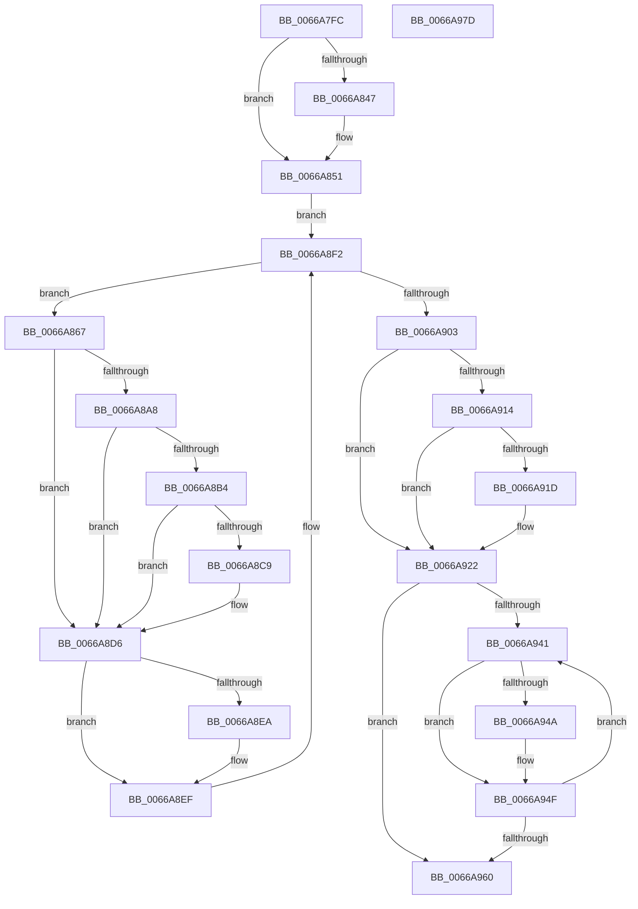

# CmShutdownSystem2

- RVA: `0x0066A7FC`–`0x0066A97E` (길이 `386` bytes)
- VA: `0x000000014066A7FC`
- 실행 섹션: `.text`
- PDB 이름 있음: `예`; PDB Function 태그: `아니요`
- unwind 정보 RVA: `0x000BBED8`
- 디코드: `93`개 명령, `386/386` bytes 표시
- 미해석 바이트: `0` (있으면 어셈블리에 `.byte`로 보존)

> 이 문서는 커널 이미지의 기계어와 PDB 기호를 분석해 생성했습니다. 4번과 5번은 함수 원형과 자료형을 바이너리 사용 방식에서 추정한 C 해석이며 원본 소스 복구 결과는 아닙니다.

## 1. Dependencies

- 직접 호출 지점: **22**; 고유 호출 대상: **21**
- 직접 호출자로 확인된 함수: **1**
- RIP 상대 이미지 참조: **6**

### Outgoing calls
- `0x0066A82C` → [CmFcShutdownSystem](../../page/7E/CmFcShutdownSystem_function_007E5BC4.md) (function, `0x007E5BC4`)
- `0x0066A831` → [CmpWaitForShutdownRundownRelease](../../page/7F/CmpWaitForShutdownRundownRelease_function_007F1364.md) (function, `0x007F1364`)
- `0x0066A836` → [CmpTraceShutdownRundownComplete](../../page/7E/CmpTraceShutdownRundownComplete_function_007E6930.md) (function, `0x007E6930`)
- `0x0066A84C` → [ObfDereferenceObjectWithTag](../2F/ObfDereferenceObjectWithTag_function_002F78E0.md) (function, `0x002F78E0`)
- `0x0066A851` → [CmpFlushTraceLoggingProvider](../../page/7E/CmpFlushTraceLoggingProvider_function_007E6138.md) (function, `0x007E6138`)
- `0x0066A856` → [LOCK_HIVE_LOAD](../../page/9B/LOCK_HIVE_LOAD_function_009B2300.md) (function, `0x009B2300`)
- `0x0066A85B` → [CmpLockRegistryExclusive](../../page/84/CmpLockRegistryExclusive_function_0084F9B4.md) (function, `0x0084F9B4`)
- `0x0066A86A` → [CmpUnJoinClassOfTrust](../4A/CmpUnJoinClassOfTrust_function_004A27C0.md) (function, `0x004A27C0`)
- `0x0066A872` → [CmpVERemoveHiveFromSIDMappingTable](../../page/9B/CmpVERemoveHiveFromSIDMappingTable_function_009B3244.md) (function, `0x009B3244`)
- `0x0066A888` → [CmpAttachToRegistryProcess](../../pagecmrc/BC/CmpAttachToRegistryProcess_function_00BC98E0.md) (function, `0x00BC98E0`)
- `0x0066A890` → [HvHiveCleanup](../../page/84/HvHiveCleanup_function_0084D918.md) (function, `0x0084D918`)
- `0x0066A89A` → [CmpDetachFromRegistryProcess](../../pagecmrc/BC/CmpDetachFromRegistryProcess_function_00BC9920.md) (function, `0x00BC9920`)
- `0x0066A8D1` → [CmpDoFileSetSizeEx](../../page/9B/CmpDoFileSetSizeEx_function_009B2A4C.md) (function, `0x009B2A4C`)
- `0x0066A8D9` → [CmpCmdHiveClose](../../page/9B/CmpCmdHiveClose_function_009B3948.md) (function, `0x009B3948`)
- `0x0066A8EA` → [CmpVolumeContextDecrementRefCount](../../page/9B/CmpVolumeContextDecrementRefCount_function_009B2E14.md) (function, `0x009B2E14`)
- `0x0066A8F2` → [CmpGetNextActiveHive](../../page/84/CmpGetNextActiveHive_function_0084E2A0.md) (function, `0x0084E2A0`)
- `0x0066A91D` → [CmpFreeAllMemory](../../page/7E/CmpFreeAllMemory_function_007E51D0.md) (function, `0x007E51D0`)
- `0x0066A922` → [CmpUnlockRegistry](../../pagecmrc/BC/CmpUnlockRegistry_function_00BC9A84.md) (function, `0x00BC9A84`)
- `0x0066A927` → [UNLOCK_HIVE_LOAD](../../page/9B/UNLOCK_HIVE_LOAD_function_009B2EBC.md) (function, `0x009B2EBC`)
- `0x0066A94A` → [CmpVolumeContextDecrementRefCount](../../page/9B/CmpVolumeContextDecrementRefCount_function_009B2E14.md) (function, `0x009B2E14`)
- `0x0066A960` → [CmpTraceShutdownStop](../../page/7E/CmpTraceShutdownStop_function_007E6A08.md) (function, `0x007E6A08`)
- `0x0066A96D` → [_security_check_cookie](../6A/_security_check_cookie_function_006AC640.md) (function, `0x006AC640`)

### Direct callers
- [CmShutdownSystem](../../page/7E/CmShutdownSystem_function_007E5174.md) at `0x007E51A5`

### Static image references
- `0x0066A806` → RVA `0x00E0A740` (`.data`; read)
- `0x0066A83B` → RVA `0x00FD9B68` (`PAGEDATA`; read)
- `0x0066A903` → RVA `0x00F0C8B0` (`.data`; read)
- `0x0066A909` → RVA `0x00FD9A67` (`PAGEDATA`; write)
- `0x0066A914` → RVA `0x00FD80D0` (`PAGEDATA`; read)
- `0x0066A92E` → RVA `0x00FD8678` (`PAGEDATA`; read)

## 2. Other-region calls and transfers

- 다른 실행 섹션으로 향하는 call: **19**
  - `0x0066A82C` → [CmFcShutdownSystem](../../page/7E/CmFcShutdownSystem_function_007E5BC4.md) (`.text` → `PAGE`)
  - `0x0066A831` → [CmpWaitForShutdownRundownRelease](../../page/7F/CmpWaitForShutdownRundownRelease_function_007F1364.md) (`.text` → `PAGE`)
  - `0x0066A836` → [CmpTraceShutdownRundownComplete](../../page/7E/CmpTraceShutdownRundownComplete_function_007E6930.md) (`.text` → `PAGE`)
  - `0x0066A851` → [CmpFlushTraceLoggingProvider](../../page/7E/CmpFlushTraceLoggingProvider_function_007E6138.md) (`.text` → `PAGE`)
  - `0x0066A856` → [LOCK_HIVE_LOAD](../../page/9B/LOCK_HIVE_LOAD_function_009B2300.md) (`.text` → `PAGE`)
  - `0x0066A85B` → [CmpLockRegistryExclusive](../../page/84/CmpLockRegistryExclusive_function_0084F9B4.md) (`.text` → `PAGE`)
  - `0x0066A872` → [CmpVERemoveHiveFromSIDMappingTable](../../page/9B/CmpVERemoveHiveFromSIDMappingTable_function_009B3244.md) (`.text` → `PAGE`)
  - `0x0066A888` → [CmpAttachToRegistryProcess](../../pagecmrc/BC/CmpAttachToRegistryProcess_function_00BC98E0.md) (`.text` → `PAGECMRC`)
  - `0x0066A890` → [HvHiveCleanup](../../page/84/HvHiveCleanup_function_0084D918.md) (`.text` → `PAGE`)
  - `0x0066A89A` → [CmpDetachFromRegistryProcess](../../pagecmrc/BC/CmpDetachFromRegistryProcess_function_00BC9920.md) (`.text` → `PAGECMRC`)
  - `0x0066A8D1` → [CmpDoFileSetSizeEx](../../page/9B/CmpDoFileSetSizeEx_function_009B2A4C.md) (`.text` → `PAGE`)
  - `0x0066A8D9` → [CmpCmdHiveClose](../../page/9B/CmpCmdHiveClose_function_009B3948.md) (`.text` → `PAGE`)
  - `0x0066A8EA` → [CmpVolumeContextDecrementRefCount](../../page/9B/CmpVolumeContextDecrementRefCount_function_009B2E14.md) (`.text` → `PAGE`)
  - `0x0066A8F2` → [CmpGetNextActiveHive](../../page/84/CmpGetNextActiveHive_function_0084E2A0.md) (`.text` → `PAGE`)
  - `0x0066A91D` → [CmpFreeAllMemory](../../page/7E/CmpFreeAllMemory_function_007E51D0.md) (`.text` → `PAGE`)
  - `0x0066A922` → [CmpUnlockRegistry](../../pagecmrc/BC/CmpUnlockRegistry_function_00BC9A84.md) (`.text` → `PAGECMRC`)
  - `0x0066A927` → [UNLOCK_HIVE_LOAD](../../page/9B/UNLOCK_HIVE_LOAD_function_009B2EBC.md) (`.text` → `PAGE`)
  - `0x0066A94A` → [CmpVolumeContextDecrementRefCount](../../page/9B/CmpVolumeContextDecrementRefCount_function_009B2E14.md) (`.text` → `PAGE`)
  - `0x0066A960` → [CmpTraceShutdownStop](../../page/7E/CmpTraceShutdownStop_function_007E6A08.md) (`.text` → `PAGE`)
- 별도 외부 분기/꼬리 이동을 확인하지 못했습니다.

## 3. Assembly (complete function range)

```asm
0066A7FC  48 89 5C 24 08                  mov qword ptr [rsp + 8], rbx
0066A801  57                              push rdi
0066A802  48 83 EC 60                     sub rsp, 0x60
0066A806  48 8B 05 33 FF 79 00            mov rax, qword ptr [rip + 0x79ff33]
0066A80D  48 33 C4                        xor rax, rsp
0066A810  48 89 44 24 50                  mov qword ptr [rsp + 0x50], rax
0066A815  0F 57 C0                        xorps xmm0, xmm0
0066A818  B9 02 00 00 00                  mov ecx, 2
0066A81D  0F 11 44 24 20                  movups xmmword ptr [rsp + 0x20], xmm0
0066A822  0F 11 44 24 30                  movups xmmword ptr [rsp + 0x30], xmm0
0066A827  0F 11 44 24 40                  movups xmmword ptr [rsp + 0x40], xmm0
0066A82C  E8 93 B3 17 00                  call 0x1407e5bc4
0066A831  E8 2E 6B 18 00                  call 0x1407f1364
0066A836  E8 F5 C0 17 00                  call 0x1407e6930
0066A83B  48 8B 0D 26 F3 96 00            mov rcx, qword ptr [rip + 0x96f326]
0066A842  48 85 C9                        test rcx, rcx
0066A845  74 0A                           je 0x14066a851
0066A847  BA 44 66 6C 74                  mov edx, 0x746c6644
0066A84C  E8 8F D0 C8 FF                  call 0x1402f78e0
0066A851  E8 E2 B8 17 00                  call 0x1407e6138
0066A856  E8 A5 7A 34 00                  call 0x1409b2300
0066A85B  E8 54 51 1E 00                  call 0x14084f9b4
0066A860  33 C9                           xor ecx, ecx
0066A862  E9 8B 00 00 00                  jmp 0x14066a8f2
0066A867  48 8B CB                        mov rcx, rbx
0066A86A  E8 51 7F E3 FF                  call 0x1404a27c0
0066A86F  48 8B CB                        mov rcx, rbx
0066A872  E8 CD 89 34 00                  call 0x1409b3244
0066A877  8B BB 18 01 00 00               mov edi, dword ptr [rbx + 0x118]
0066A87D  48 8D 4C 24 20                  lea rcx, [rsp + 0x20]
0066A882  81 C7 00 10 00 00               add edi, 0x1000
0066A888  E8 53 F0 55 00                  call 0x140bc98e0
0066A88D  48 8B CB                        mov rcx, rbx
0066A890  E8 83 30 1E 00                  call 0x14084d918
0066A895  48 8D 4C 24 20                  lea rcx, [rsp + 0x20]
0066A89A  E8 81 F0 55 00                  call 0x140bc9920
0066A89F  80 BB B0 12 00 00 00            cmp byte ptr [rbx + 0x12b0], 0
0066A8A6  74 2E                           je 0x14066a8d6
0066A8A8  F7 83 A0 00 00 00 00 80 00 00   test dword ptr [rbx + 0xa0], 0x8000
0066A8B2  75 22                           jne 0x14066a8d6
0066A8B4  48 8B 83 08 07 00 00            mov rax, qword ptr [rbx + 0x708]
0066A8BB  44 8B C7                        mov r8d, edi
0066A8BE  49 2B C0                        sub rax, r8
0066A8C1  48 3D 00 00 10 00               cmp rax, 0x100000
0066A8C7  7E 0D                           jle 0x14066a8d6
0066A8C9  45 33 C9                        xor r9d, r9d
0066A8CC  33 D2                           xor edx, edx
0066A8CE  48 8B CB                        mov rcx, rbx
0066A8D1  E8 76 81 34 00                  call 0x1409b2a4c
0066A8D6  48 8B CB                        mov rcx, rbx
0066A8D9  E8 6A 90 34 00                  call 0x1409b3948
0066A8DE  48 8B 8B B8 12 00 00            mov rcx, qword ptr [rbx + 0x12b8]
0066A8E5  48 85 C9                        test rcx, rcx
0066A8E8  74 05                           je 0x14066a8ef
0066A8EA  E8 25 85 34 00                  call 0x1409b2e14
0066A8EF  48 8B CB                        mov rcx, rbx
0066A8F2  E8 A9 39 1E 00                  call 0x14084e2a0
0066A8F7  48 8B D8                        mov rbx, rax
0066A8FA  48 85 C0                        test rax, rax
0066A8FD  0F 85 64 FF FF FF               jne 0x14066a867
0066A903  8B 05 A7 1F 8A 00               mov eax, dword ptr [rip + 0x8a1fa7]
0066A909  C6 05 57 F1 96 00 01            mov byte ptr [rip + 0x96f157], 1
0066A910  A8 08                           test al, 8
0066A912  74 0E                           je 0x14066a922
0066A914  80 3D B5 D7 96 00 00            cmp byte ptr [rip + 0x96d7b5], 0
0066A91B  75 05                           jne 0x14066a922
0066A91D  E8 AE A8 17 00                  call 0x1407e51d0
0066A922  E8 5D F1 55 00                  call 0x140bc9a84
0066A927  E8 90 85 34 00                  call 0x1409b2ebc
0066A92C  33 DB                           xor ebx, ebx
0066A92E  48 8D 3D 43 DD 96 00            lea rdi, [rip + 0x96dd43]
0066A935  48 39 1D 3C DD 96 00            cmp qword ptr [rip + 0x96dd3c], rbx
0066A93C  48 8B C7                        mov rax, rdi
0066A93F  74 1F                           je 0x14066a960
0066A941  48 8B 48 08                     mov rcx, qword ptr [rax + 8]
0066A945  48 85 C9                        test rcx, rcx
0066A948  74 05                           je 0x14066a94f
0066A94A  E8 C5 84 34 00                  call 0x1409b2e14
0066A94F  FF C3                           inc ebx
0066A951  8B C3                           mov eax, ebx
0066A953  48 C1 E0 04                     shl rax, 4
0066A957  48 03 C7                        add rax, rdi
0066A95A  48 83 38 00                     cmp qword ptr [rax], 0
0066A95E  75 E1                           jne 0x14066a941
0066A960  E8 A3 C0 17 00                  call 0x1407e6a08
0066A965  48 8B 4C 24 50                  mov rcx, qword ptr [rsp + 0x50]
0066A96A  48 33 CC                        xor rcx, rsp
0066A96D  E8 CE 1C 04 00                  call 0x1406ac640
0066A972  48 8B 5C 24 70                  mov rbx, qword ptr [rsp + 0x70]
0066A977  48 83 C4 60                     add rsp, 0x60
0066A97B  5F                              pop rdi
0066A97C  C3                              ret
0066A97D  CC                              int3
```

## 4. C-style interpretation (structured pseudocode)

```c
__int64 __fastcall CmShutdownSystem2(__int64 a1, __int64 a2, __int64 a3, int a4)
{
    __int64 result;
    __int64 v_rbx;
    __int64 v_rdi;
    __int64 v_rsp;
    unsigned __int64 v_stack_m18;
    unsigned __int64 v_stack_m28;
    unsigned __int64 v_stack_m38;
    unsigned __int64 v_stack_m48;
    unsigned __int64 v_stack_p8;

    v_stack_p8 = v_rbx;
    v_rsp = (v_rsp) - (96);
    result = (*(unsigned __int64 *)(v_rip + 7995187)) ^ (v_rsp);
    v_stack_m18 = result;
    v_stack_m48 = v_xmm0;
    v_stack_m38 = v_xmm0;
    v_stack_m28 = v_xmm0;
    result = CmFcShutdownSystem(2, a2, a3, a4);
    result = CmpWaitForShutdownRundownRelease(2, a2, a3, a4);
    result = CmpTraceShutdownRundownComplete(2, a2, a3, a4);
    if (*(unsigned __int64 *)(v_rip + 9892646) != 0) {
        a2 = 0x746C6644ULL;
        result = ObfDereferenceObjectWithTag(*(unsigned __int64 *)(v_rip + 9892646), a2, a3, a4);
    }
    result = CmpFlushTraceLoggingProvider(*(unsigned __int64 *)(v_rip + 9892646), a2, a3, a4);
    result = LOCK_HIVE_LOAD(*(unsigned __int64 *)(v_rip + 9892646), a2, a3, a4);
    result = CmpLockRegistryExclusive(*(unsigned __int64 *)(v_rip + 9892646), a2, a3, a4);
    a1 = 0;
    goto loc_0066A8F2;
loc_0066A867:
    result = CmpUnJoinClassOfTrust(v_rbx, a2, a3, a4);
    result = CmpVERemoveHiveFromSIDMappingTable(v_rbx, a2, a3, a4);
    v_rdi = (unsigned int)(((unsigned int)(*(unsigned int *)(v_rbx + 280))) + (0x1000ULL));
    result = CmpAttachToRegistryProcess(v_stack_m48, a2, a3, a4);
    result = HvHiveCleanup(v_rbx, a2, a3, a4);
    result = CmpDetachFromRegistryProcess(v_stack_m48, a2, a3, a4);
    if ((*(unsigned __int8 *)(v_rbx + 4784)) == 0) goto loc_0066A8D6;
    if (((*(unsigned int *)(v_rbx + 160)) & (0x8000ULL)) != 0) goto loc_0066A8D6;
    result = (*(unsigned __int64 *)(v_rbx + 1800)) - ((unsigned int)((unsigned int)(v_rdi)));
    if (result >= = 0x100000ULL) {
        a4 = 0;
        a2 = 0;
        a1 = v_rbx;
        result = CmpDoFileSetSizeEx(a1, a2, (unsigned int)((unsigned int)(v_rdi)), a4);
    }
    result = CmpCmdHiveClose(v_rbx, a2, (unsigned int)((unsigned int)(v_rdi)), a4);
    if (*(unsigned __int64 *)(v_rbx + 4792) != 0) {
        result = CmpVolumeContextDecrementRefCount(*(unsigned __int64 *)(v_rbx + 4792), a2, (unsigned int)((unsigned int)(v_rdi)), a4);
    }
loc_0066A8F2:
    result = CmpGetNextActiveHive(v_rbx, a2, (unsigned int)((unsigned int)(v_rdi)), a4);
    if (result != 0) goto loc_0066A867;
    *(unsigned __int8 *)(v_rip + 9892183) = 1;
    if ((((unsigned __int8)((unsigned int)(*(unsigned int *)(v_rip + 9052071)))) & (8)) == 0) goto loc_0066A922;
    result = (unsigned int)(*(unsigned int *)(v_rip + 9052071));
    if ((*(unsigned __int8 *)(v_rip + 9885621)) == 0) {
        result = CmpFreeAllMemory(v_rbx, a2, (unsigned int)((unsigned int)(v_rdi)), a4);
    }
    result = CmpUnlockRegistry(v_rbx, a2, (unsigned int)((unsigned int)(v_rdi)), a4);
    result = UNLOCK_HIVE_LOAD(v_rbx, a2, (unsigned int)((unsigned int)(v_rdi)), a4);
    v_rbx = 0;
    if ((*(unsigned __int64 *)(v_rip + 9887036)) == 0) goto loc_0066A960;
loc_0066A941:
    result = v_rip + 9887043;
    if (*(unsigned __int64 *)(v_rip + 9887043 + 8) != 0) {
        result = CmpVolumeContextDecrementRefCount(*(unsigned __int64 *)(v_rip + 9887043 + 8), a2, (unsigned int)((unsigned int)(v_rdi)), a4);
    }
    v_rbx = (unsigned int)((v_rbx) + 1);
    result = ((unsigned int)((unsigned int)(v_rbx))) << (4);
    result = (result) + (v_rip + 9887043);
    if ((*(unsigned __int64 *)(result)) != 0) goto loc_0066A941;
loc_0066A960:
    result = CmpTraceShutdownStop(*(unsigned __int64 *)(v_rip + 9887043 + 8), a2, (unsigned int)((unsigned int)(v_rdi)), a4);
    a1 = (v_stack_m18) ^ (v_rsp);
    result = _security_check_cookie(a1, a2, (unsigned int)((unsigned int)(v_rdi)), a4);
    v_rsp = (v_rsp) + (96);
    return result;
}
```

## 5. (Beta) C Style

```c
int64_t CmShutdownSystem2(int64_t Arg1, int64_t Arg2, int64_t Arg3, int32_t Arg4)
{
    int64_t result;
    int64_t local_rbx;
    int64_t local_rdi;
    int64_t local_rsp;
    uint64_t v_stack_m18;
    uint64_t v_stack_m28;
    uint64_t v_stack_m38;
    uint64_t v_stack_m48;
    uint64_t v_stack_p8;

    v_stack_p8 = local_rbx;
    local_rsp = (local_rsp) - (96);
    result = (*(uint64_t *)(v_rip + 0x79FF33)) ^ (local_rsp);
    v_stack_m18 = result;
    v_stack_m48 = v_xmm0;
    v_stack_m38 = v_xmm0;
    v_stack_m28 = v_xmm0;
    result = CmFcShutdownSystem(2, Arg2, Arg3, Arg4);
    result = CmpWaitForShutdownRundownRelease(2, Arg2, Arg3, Arg4);
    result = CmpTraceShutdownRundownComplete(2, Arg2, Arg3, Arg4);
    if (*(uint64_t *)(v_rip + 0x96F326) != 0) {
        Arg2 = 0x746C6644ULL;
        result = ObfDereferenceObjectWithTag(*(uint64_t *)(v_rip + 0x96F326), Arg2, Arg3, Arg4);
    }
    result = CmpFlushTraceLoggingProvider(*(uint64_t *)(v_rip + 0x96F326), Arg2, Arg3, Arg4);
    result = LOCK_HIVE_LOAD(*(uint64_t *)(v_rip + 0x96F326), Arg2, Arg3, Arg4);
    result = CmpLockRegistryExclusive(*(uint64_t *)(v_rip + 0x96F326), Arg2, Arg3, Arg4);
    Arg1 = 0;
    goto loc_0066A8F2;
loc_0066A867:
    result = CmpUnJoinClassOfTrust(local_rbx, Arg2, Arg3, Arg4);
    result = CmpVERemoveHiveFromSIDMappingTable(local_rbx, Arg2, Arg3, Arg4);
    local_rdi = (uint32_t)(((uint32_t)(*(uint32_t *)(local_rbx + 0x118))) + (0x1000ULL));
    result = CmpAttachToRegistryProcess(v_stack_m48, Arg2, Arg3, Arg4);
    result = HvHiveCleanup(local_rbx, Arg2, Arg3, Arg4);
    result = CmpDetachFromRegistryProcess(v_stack_m48, Arg2, Arg3, Arg4);
    if ((*(uint8_t *)(local_rbx + 0x12B0)) == 0) goto loc_0066A8D6;
    if (((*(uint32_t *)(local_rbx + 0xA0)) & (0x8000ULL)) != 0) goto loc_0066A8D6;
    result = (*(uint64_t *)(local_rbx + 0x708)) - ((uint32_t)((uint32_t)(local_rdi)));
    if (result >= = 0x100000ULL) {
        Arg4 = 0;
        Arg2 = 0;
        Arg1 = local_rbx;
        result = CmpDoFileSetSizeEx(Arg1, Arg2, (uint32_t)((uint32_t)(local_rdi)), Arg4);
    }
    result = CmpCmdHiveClose(local_rbx, Arg2, (uint32_t)((uint32_t)(local_rdi)), Arg4);
    if (*(uint64_t *)(local_rbx + 0x12B8) != 0) {
        result = CmpVolumeContextDecrementRefCount(*(uint64_t *)(local_rbx + 0x12B8), Arg2, (uint32_t)((uint32_t)(local_rdi)), Arg4);
    }
loc_0066A8F2:
    result = CmpGetNextActiveHive(local_rbx, Arg2, (uint32_t)((uint32_t)(local_rdi)), Arg4);
    if (result != 0) goto loc_0066A867;
    *(uint8_t *)(v_rip + 0x96F157) = 1;
    if ((((uint8_t)((uint32_t)(*(uint32_t *)(v_rip + 0x8A1FA7)))) & (8)) == 0) goto loc_0066A922;
    result = (uint32_t)(*(uint32_t *)(v_rip + 0x8A1FA7));
    if ((*(uint8_t *)(v_rip + 0x96D7B5)) == 0) {
        result = CmpFreeAllMemory(local_rbx, Arg2, (uint32_t)((uint32_t)(local_rdi)), Arg4);
    }
    result = CmpUnlockRegistry(local_rbx, Arg2, (uint32_t)((uint32_t)(local_rdi)), Arg4);
    result = UNLOCK_HIVE_LOAD(local_rbx, Arg2, (uint32_t)((uint32_t)(local_rdi)), Arg4);
    local_rbx = 0;
    if ((*(uint64_t *)(v_rip + 0x96DD3C)) == 0) goto loc_0066A960;
loc_0066A941:
    result = v_rip + 9887043;
    if (*(uint64_t *)(v_rip + 0x96DD43 + 0x8) != 0) {
        result = CmpVolumeContextDecrementRefCount(*(uint64_t *)(v_rip + 0x96DD43 + 0x8), Arg2, (uint32_t)((uint32_t)(local_rdi)), Arg4);
    }
    local_rbx = (uint32_t)((local_rbx) + 1);
    result = ((uint32_t)((uint32_t)(local_rbx))) << (4);
    result = (result) + (v_rip + 9887043);
    if ((*(uint64_t *)(result)) != 0) goto loc_0066A941;
loc_0066A960:
    result = CmpTraceShutdownStop(*(uint64_t *)(v_rip + 0x96DD43 + 0x8), Arg2, (uint32_t)((uint32_t)(local_rdi)), Arg4);
    Arg1 = (v_stack_m18) ^ (local_rsp);
    result = _security_check_cookie(Arg1, Arg2, (uint32_t)((uint32_t)(local_rdi)), Arg4);
    local_rsp = (local_rsp) + (96);
    return result;
}
```

## 6. Execution-region graph

[열기: 2D/3D 그래프와 함수 탐색 컨트롤 패널](../../../control-panel.html?section=text&rva=0x0066A7FC&view=graph)

- 2D 그래프는 위에서 아래로 흐르고, 3D 그래프는 빈 공간을 드래그해 회전합니다. Shift+드래그는 이동, 휠은 확대·축소, 함수 노드 선택은 대상 보고서 이동입니다.

### Static fallback


