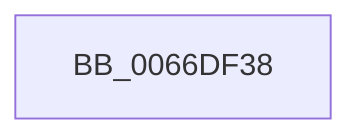

# CmSiBugCheck

- RVA: `0x0066DF38`–`0x0066DF55` (길이 `29` bytes)
- VA: `0x000000014066DF38`
- 실행 섹션: `.text`
- PDB 이름 있음: `예`; PDB Function 태그: `아니요`
- unwind 정보 RVA: `0x000622F0`
- 디코드: `8`개 명령, `29/29` bytes 표시
- 미해석 바이트: `0` (있으면 어셈블리에 `.byte`로 보존)

> 이 문서는 커널 이미지의 기계어와 PDB 기호를 분석해 생성했습니다. 4번과 5번은 함수 원형과 자료형을 바이너리 사용 방식에서 추정한 C 해석이며 원본 소스 복구 결과는 아닙니다.

## 1. Dependencies

- 직접 호출 지점: **1**; 고유 호출 대상: **1**
- 직접 호출자로 확인된 함수: **5**
- RIP 상대 이미지 참조: **0**

### Outgoing calls
- `0x0066DF4F` → [KeBugCheckEx](../4F/KeBugCheckEx_function_004FD660.md) (function, `0x004FD660`)

### Direct callers
- [HvpAllExceptionsFatalFilter](../../page/7E/HvpAllExceptionsFatalFilter_function_007EEBA4.md) at `0x007EEBB7`
- [HvpInpageErrorFilter](../../page/7E/HvpInpageErrorFilter_function_007EEBC4.md) at `0x007EEBE8`
- [CmpOpenHiveFile](../../page/87/CmpOpenHiveFile_function_0087A71C.md) at `0x0087AC3C`
- [CmpInitializeValueNameString](../../page/A0/CmpInitializeValueNameString_function_00A0F644.md) at `0x00A0F6C8`
- [CmpInitializeKeyNameString](../../page/A8/CmpInitializeKeyNameString_function_00A8B734.md) at `0x00A8B7B2`

### Static image references
- 디코드된 RIP-relative 메모리 참조가 없습니다.

## 2. Other-region calls and transfers

- 다른 실행 섹션으로 향하는 call: **0**
- 별도 외부 분기/꼬리 이동을 확인하지 못했습니다.

## 3. Assembly (complete function range)

```asm
0066DF38  48 83 EC 38                     sub rsp, 0x38
0066DF3C  4C 89 4C 24 20                  mov qword ptr [rsp + 0x20], r9
0066DF41  4D 8B C8                        mov r9, r8
0066DF44  4C 8B C2                        mov r8, rdx
0066DF47  48 8B D1                        mov rdx, rcx
0066DF4A  B9 51 00 00 00                  mov ecx, 0x51
0066DF4F  E8 0C F7 E8 FF                  call 0x1404fd660
0066DF54  CC                              int3
```

## 4. C-style interpretation (structured pseudocode)

```c
__int64 __fastcall CmSiBugCheck(__int64 a1, __int64 a2, __int64 a3, __int64 a4)
{
    __int64 result;
    __int64 v_rsp;
    unsigned __int64 v_stack_m18;

    v_rsp = (v_rsp) - (56);
    v_stack_m18 = a4;
    result = KeBugCheckEx(81, a1, a2, a3);
    return result;
}
```

## 5. (Beta) C Style

```c
int64_t CmSiBugCheck(int64_t Arg1, int64_t Arg2, int64_t Arg3, int64_t Arg4)
{
    int64_t result;
    int64_t local_rsp;
    uint64_t v_stack_m18;

    local_rsp = (local_rsp) - (56);
    v_stack_m18 = Arg4;
    result = KeBugCheckEx(81, Arg1, Arg2, Arg3);
    return result;
}
```

## 6. Execution-region graph

[열기: 2D/3D 그래프와 함수 탐색 컨트롤 패널](../../../control-panel.html?section=text&rva=0x0066DF38&view=graph)

- 2D 그래프는 위에서 아래로 흐르고, 3D 그래프는 빈 공간을 드래그해 회전합니다. Shift+드래그는 이동, 휠은 확대·축소, 함수 노드 선택은 대상 보고서 이동입니다.

### Static fallback


