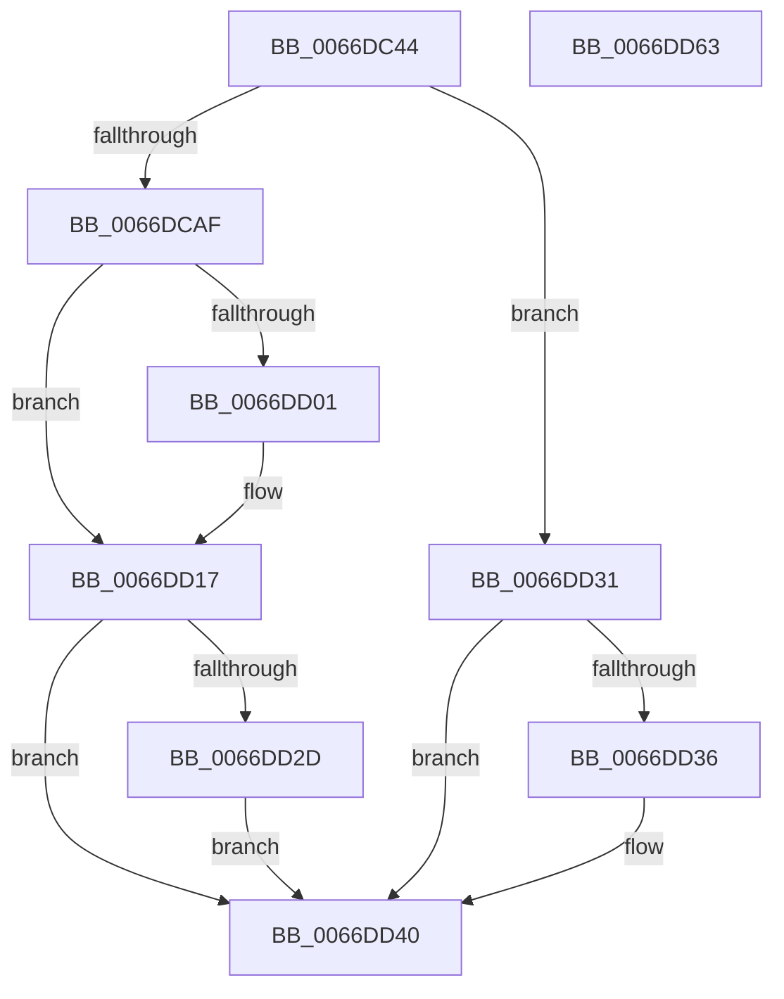

# CmSiProcessTupleStartFromHandle

- RVA: `0x0066DC44`–`0x0066DD64` (길이 `288` bytes)
- VA: `0x000000014066DC44`
- 실행 섹션: `.text`
- PDB 이름 있음: `예`; PDB Function 태그: `아니요`
- unwind 정보 RVA: `0x000D74A8`
- 디코드: `75`개 명령, `288/288` bytes 표시
- 미해석 바이트: `0` (있으면 어셈블리에 `.byte`로 보존)

> 이 문서는 커널 이미지의 기계어와 PDB 기호를 분석해 생성했습니다. 4번과 5번은 함수 원형과 자료형을 바이너리 사용 방식에서 추정한 C 해석이며 원본 소스 복구 결과는 아닙니다.

## 1. Dependencies

- 직접 호출 지점: **6**; 고유 호출 대상: **6**
- 직접 호출자로 확인된 함수: **1**
- RIP 상대 이미지 참조: **5**

### Outgoing calls
- `0x0066DC9C` → [ObReferenceObjectByHandle](../../page/86/ObReferenceObjectByHandle_function_00868DB0.md) (function, `0x00868DB0`)
- `0x0066DCC3` → [KiStackAttachProcess](../21/KiStackAttachProcess_function_00216820.md) (function, `0x00216820`)
- `0x0066DCF8` → [MmQueryWorkingSetInformation](../41/MmQueryWorkingSetInformation_function_0041CB20.md) (function, `0x0041CB20`)
- `0x0066DD24` → [KiUnstackDetachProcess](../21/KiUnstackDetachProcess_function_00217D30.md) (function, `0x00217D30`)
- `0x0066DD3B` → [ObfDereferenceObjectWithTag](../2F/ObfDereferenceObjectWithTag_function_002F78E0.md) (function, `0x002F78E0`)
- `0x0066DD49` → [_security_check_cookie](../6A/_security_check_cookie_function_006AC640.md) (function, `0x006AC640`)

### Direct callers
- [CmpInitializeRegistryProcess](../../page/7E/CmpInitializeRegistryProcess_function_007E8180.md) at `0x007E8272`

### Static image references
- `0x0066DC5B` → RVA `0x00E0A740` (`.data`; read)
- `0x0066DCB3` → RVA `0x00EF7200` (`.data`; write)
- `0x0066DCBC` → RVA `0x00EF7208` (`.data`; write)
- `0x0066DD05` → RVA `0x00EF7220` (`.data`; write)
- `0x0066DD10` → RVA `0x00EF7228` (`.data`; write)

## 2. Other-region calls and transfers

- 다른 실행 섹션으로 향하는 call: **1**
  - `0x0066DC9C` → [ObReferenceObjectByHandle](../../page/86/ObReferenceObjectByHandle_function_00868DB0.md) (`.text` → `PAGE`)
- 별도 외부 분기/꼬리 이동을 확인하지 못했습니다.

## 3. Assembly (complete function range)

```asm
0066DC44  4C 8B DC                        mov r11, rsp
0066DC47  49 89 5B 08                     mov qword ptr [r11 + 8], rbx
0066DC4B  49 89 7B 18                     mov qword ptr [r11 + 0x18], rdi
0066DC4F  55                              push rbp
0066DC50  49 8D 6B A1                     lea rbp, [r11 - 0x5f]
0066DC54  48 81 EC A0 00 00 00            sub rsp, 0xa0
0066DC5B  48 8B 05 DE CA 79 00            mov rax, qword ptr [rip + 0x79cade]
0066DC62  48 33 C4                        xor rax, rsp
0066DC65  48 89 45 47                     mov qword ptr [rbp + 0x47], rax
0066DC69  49 83 63 80 00                  and qword ptr [r11 - 0x80], 0
0066DC6E  48 8D 45 E7                     lea rax, [rbp - 0x19]
0066DC72  48 83 65 E7 00                  and qword ptr [rbp - 0x19], 0
0066DC77  0F 57 C0                        xorps xmm0, xmm0
0066DC7A  48 8B FA                        mov rdi, rdx
0066DC7D  48 89 44 24 20                  mov qword ptr [rsp + 0x20], rax
0066DC82  48 8B CF                        mov rcx, rdi
0066DC85  45 33 C9                        xor r9d, r9d
0066DC88  45 33 C0                        xor r8d, r8d
0066DC8B  BA FF FF 1F 00                  mov edx, 0x1fffff
0066DC90  0F 11 45 17                     movups xmmword ptr [rbp + 0x17], xmm0
0066DC94  0F 11 45 27                     movups xmmword ptr [rbp + 0x27], xmm0
0066DC98  0F 11 45 37                     movups xmmword ptr [rbp + 0x37], xmm0
0066DC9C  E8 0F B1 1F 00                  call 0x140868db0
0066DCA1  48 8B 4D E7                     mov rcx, qword ptr [rbp - 0x19]
0066DCA5  8B D8                           mov ebx, eax
0066DCA7  85 C0                           test eax, eax
0066DCA9  0F 88 82 00 00 00               js 0x14066dd31
0066DCAF  4C 8D 45 17                     lea r8, [rbp + 0x17]
0066DCB3  48 89 3D 46 95 88 00            mov qword ptr [rip + 0x889546], rdi
0066DCBA  33 D2                           xor edx, edx
0066DCBC  48 89 0D 45 95 88 00            mov qword ptr [rip + 0x889545], rcx
0066DCC3  E8 58 8B BA FF                  call 0x140216820
0066DCC8  48 83 65 EF 00                  and qword ptr [rbp - 0x11], 0
0066DCCD  48 8D 45 E7                     lea rax, [rbp - 0x19]
0066DCD1  48 83 65 F7 00                  and qword ptr [rbp - 9], 0
0066DCD6  4C 8D 4D EF                     lea r9, [rbp - 0x11]
0066DCDA  83 65 E7 00                     and dword ptr [rbp - 0x19], 0
0066DCDE  4C 8D 45 FF                     lea r8, [rbp - 1]
0066DCE2  48 89 44 24 28                  mov qword ptr [rsp + 0x28], rax
0066DCE7  48 8D 55 07                     lea rdx, [rbp + 7]
0066DCEB  48 8D 45 F7                     lea rax, [rbp - 9]
0066DCEF  48 8D 4D 0F                     lea rcx, [rbp + 0xf]
0066DCF3  48 89 44 24 20                  mov qword ptr [rsp + 0x20], rax
0066DCF8  E8 23 EE DA FF                  call 0x14041cb20
0066DCFD  85 C0                           test eax, eax
0066DCFF  78 16                           js 0x14066dd17
0066DD01  48 8B 4D EF                     mov rcx, qword ptr [rbp - 0x11]
0066DD05  48 89 0D 14 95 88 00            mov qword ptr [rip + 0x889514], rcx
0066DD0C  48 8B 4D F7                     mov rcx, qword ptr [rbp - 9]
0066DD10  48 89 0D 11 95 88 00            mov qword ptr [rip + 0x889511], rcx
0066DD17  33 DB                           xor ebx, ebx
0066DD19  48 8D 4D 17                     lea rcx, [rbp + 0x17]
0066DD1D  85 C0                           test eax, eax
0066DD1F  0F 48 D8                        cmovs ebx, eax
0066DD22  33 D2                           xor edx, edx
0066DD24  E8 07 A0 BA FF                  call 0x140217d30
0066DD29  85 DB                           test ebx, ebx
0066DD2B  78 13                           js 0x14066dd40
0066DD2D  33 DB                           xor ebx, ebx
0066DD2F  EB 0F                           jmp 0x14066dd40
0066DD31  48 85 C9                        test rcx, rcx
0066DD34  74 0A                           je 0x14066dd40
0066DD36  BA 44 66 6C 74                  mov edx, 0x746c6644
0066DD3B  E8 A0 9B C8 FF                  call 0x1402f78e0
0066DD40  8B C3                           mov eax, ebx
0066DD42  48 8B 4D 47                     mov rcx, qword ptr [rbp + 0x47]
0066DD46  48 33 CC                        xor rcx, rsp
0066DD49  E8 F2 E8 03 00                  call 0x1406ac640
0066DD4E  4C 8D 9C 24 A0 00 00 00         lea r11, [rsp + 0xa0]
0066DD56  49 8B 5B 10                     mov rbx, qword ptr [r11 + 0x10]
0066DD5A  49 8B 7B 20                     mov rdi, qword ptr [r11 + 0x20]
0066DD5E  49 8B E3                        mov rsp, r11
0066DD61  5D                              pop rbp
0066DD62  C3                              ret
0066DD63  CC                              int3
```

## 4. C-style interpretation (structured pseudocode)

```c
__int64 __fastcall CmSiProcessTupleStartFromHandle(__int64 a1, __int64 a2, int a3, int a4)
{
    __int64 result;
    __int64 v_rbx;
    __int64 v_rsp;
    unsigned __int64 v_stack_m8;
    unsigned __int64 v_stack_m80;
    unsigned __int64 v_stack_m88;

    *(unsigned __int64 *)(v_rsp + 8) = v_rbx;
    *(unsigned __int64 *)(v_rsp + 24) = v_rdi;
    v_rsp = (v_rsp) - (160);
    result = (*(unsigned __int64 *)(v_rip + 7981790)) ^ (v_rsp);
    *(unsigned __int64 *)(v_rsp - 95 + 71) = result;
    v_stack_m88 = v_rsp - 95 - 25;
    a4 = 0;
    a3 = 0;
    *(unsigned __int64 *)(v_rsp - 95 + 23) = v_xmm0;
    *(unsigned __int64 *)(v_rsp - 95 + 39) = v_xmm0;
    *(unsigned __int64 *)(v_rsp - 95 + 55) = v_xmm0;
    result = ObReferenceObjectByHandle(a2, (unsigned int)(0x1FFFFFULL), a3, a4);
    if (sign_flag) goto loc_0066DD31;
    *(unsigned __int64 *)(v_rip + 8951110) = a2;
    a2 = 0;
    *(unsigned __int64 *)(v_rip + 8951109) = *(unsigned __int64 *)(v_rsp - 95 - 25);
    result = KiStackAttachProcess(*(unsigned __int64 *)(v_rsp - 95 - 25), a2, v_rsp - 95 + 23, a4);
    v_stack_m80 = v_rsp - 95 - 25;
    v_stack_m88 = v_rsp - 95 - 9;
    result = MmQueryWorkingSetInformation(v_rsp - 95 + 15, v_rsp - 95 + 7, v_rsp - 95 - 1, v_rsp - 95 - 17);
    if (!(sign_flag)) {
        a1 = *(unsigned __int64 *)(v_rsp - 95 - 17);
        *(unsigned __int64 *)(v_rip + 8951060) = a1;
        a1 = *(unsigned __int64 *)(v_rsp - 95 - 9);
        *(unsigned __int64 *)(v_rip + 8951057) = a1;
    }
    v_rbx = 0;
    if (sign_flag) { v_rbx = (unsigned int)(result); }
    a2 = 0;
    result = KiUnstackDetachProcess(v_rsp - 95 + 23, a2, v_rsp - 95 - 1, v_rsp - 95 - 17);
    if (sign_flag) goto loc_0066DD40;
    v_rbx = 0;
    goto loc_0066DD40;
loc_0066DD31:
    if (v_rsp - 95 + 23 != 0) {
        a2 = 0x746C6644ULL;
        result = ObfDereferenceObjectWithTag(v_rsp - 95 + 23, a2, v_rsp - 95 - 1, v_rsp - 95 - 17);
    }
    a1 = (*(unsigned __int64 *)(v_rsp - 95 + 71)) ^ (v_rsp);
    result = _security_check_cookie(a1, a2, v_rsp - 95 - 1, v_rsp - 95 - 17);
    return result;
}
```

## 5. (Beta) C Style

```c
int64_t CmSiProcessTupleStartFromHandle(int64_t Arg1, int64_t Arg2, int32_t Arg3, int32_t Arg4)
{
    int64_t result;
    int64_t local_rbx;
    int64_t local_rsp;
    uint64_t v_stack_m8;
    uint64_t v_stack_m80;
    uint64_t v_stack_m88;

    *(uint64_t *)(local_rsp + 0x8) = local_rbx;
    *(uint64_t *)(local_rsp + 0x18) = local_rdi;
    local_rsp = (local_rsp) - (160);
    result = (*(uint64_t *)(v_rip + 0x79CADE)) ^ (local_rsp);
    *(uint64_t *)(local_rsp - 0x5F + 0x47) = result;
    v_stack_m88 = local_rsp - 95 - 25;
    Arg4 = 0;
    Arg3 = 0;
    *(uint64_t *)(local_rsp - 0x5F + 0x17) = v_xmm0;
    *(uint64_t *)(local_rsp - 0x5F + 0x27) = v_xmm0;
    *(uint64_t *)(local_rsp - 0x5F + 0x37) = v_xmm0;
    result = ObReferenceObjectByHandle(Arg2, (uint32_t)(0x1FFFFFULL), Arg3, Arg4);
    if (sign_flag) goto loc_0066DD31;
    *(uint64_t *)(v_rip + 0x889546) = Arg2;
    Arg2 = 0;
    *(uint64_t *)(v_rip + 0x889545) = *(uint64_t *)(local_rsp - 0x5F - 0x19);
    result = KiStackAttachProcess(*(uint64_t *)(local_rsp - 0x5F - 0x19), Arg2, local_rsp - 95 + 23, Arg4);
    v_stack_m80 = local_rsp - 95 - 25;
    v_stack_m88 = local_rsp - 95 - 9;
    result = MmQueryWorkingSetInformation(local_rsp - 95 + 15, local_rsp - 95 + 7, local_rsp - 95 - 1, local_rsp - 95 - 17);
    if (!(sign_flag)) {
        Arg1 = *(uint64_t *)(local_rsp - 0x5F - 0x11);
        *(uint64_t *)(v_rip + 0x889514) = Arg1;
        Arg1 = *(uint64_t *)(local_rsp - 0x5F - 0x9);
        *(uint64_t *)(v_rip + 0x889511) = Arg1;
    }
    local_rbx = 0;
    if (sign_flag) { local_rbx = (uint32_t)(result); }
    Arg2 = 0;
    result = KiUnstackDetachProcess(local_rsp - 95 + 23, Arg2, local_rsp - 95 - 1, local_rsp - 95 - 17);
    if (sign_flag) goto loc_0066DD40;
    local_rbx = 0;
    goto loc_0066DD40;
loc_0066DD31:
    if (local_rsp - 95 + 23 != 0) {
        Arg2 = 0x746C6644ULL;
        result = ObfDereferenceObjectWithTag(local_rsp - 95 + 23, Arg2, local_rsp - 95 - 1, local_rsp - 95 - 17);
    }
    Arg1 = (*(uint64_t *)(local_rsp - 0x5F + 0x47)) ^ (local_rsp);
    result = _security_check_cookie(Arg1, Arg2, local_rsp - 95 - 1, local_rsp - 95 - 17);
    return result;
}
```

## 6. Execution-region graph

[열기: 2D/3D 그래프와 함수 탐색 컨트롤 패널](../../../control-panel.html?section=text&rva=0x0066DC44&view=graph)

- 2D 그래프는 위에서 아래로 흐르고, 3D 그래프는 빈 공간을 드래그해 회전합니다. Shift+드래그는 이동, 휠은 확대·축소, 함수 노드 선택은 대상 보고서 이동입니다.

### Static fallback


