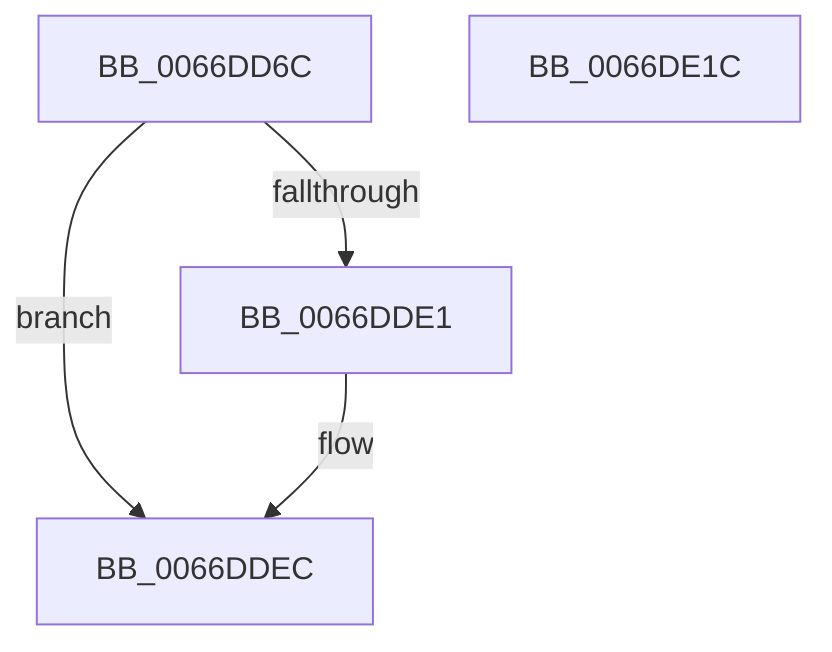

# CmSiSetProcessWorkingSetMaximum

- RVA: `0x0066DD6C`–`0x0066DE1D` (길이 `177` bytes)
- VA: `0x000000014066DD6C`
- 실행 섹션: `.text`
- PDB 이름 있음: `예`; PDB Function 태그: `아니요`
- unwind 정보 RVA: `0x0009DFE8`
- 디코드: `42`개 명령, `177/177` bytes 표시
- 미해석 바이트: `0` (있으면 어셈블리에 `.byte`로 보존)

> 이 문서는 커널 이미지의 기계어와 PDB 기호를 분석해 생성했습니다. 4번과 5번은 함수 원형과 자료형을 바이너리 사용 방식에서 추정한 C 해석이며 원본 소스 복구 결과는 아닙니다.

## 1. Dependencies

- 직접 호출 지점: **6**; 고유 호출 대상: **6**
- 직접 호출자로 확인된 함수: **1**
- RIP 상대 이미지 참조: **5**

### Outgoing calls
- `0x0066DDA1` → [KiStackAttachProcess](../21/KiStackAttachProcess_function_00216820.md) (function, `0x00216820`)
- `0x0066DDAD` → [CmSiRWLockAcquireExclusive](../../page/A1/CmSiRWLockAcquireExclusive_function_00A1679C.md) (function, `0x00A1679C`)
- `0x0066DDD8` → [MmAdjustWorkingSetSizeEx](../47/MmAdjustWorkingSetSizeEx_function_0047D8D4.md) (function, `0x0047D8D4`)
- `0x0066DDF6` → [CmSiRWLockReleaseExclusive](../../page/A0/CmSiRWLockReleaseExclusive_function_00A0DAB0.md) (function, `0x00A0DAB0`)
- `0x0066DE02` → [KiUnstackDetachProcess](../21/KiUnstackDetachProcess_function_00217D30.md) (function, `0x00217D30`)
- `0x0066DE11` → [_security_check_cookie](../6A/_security_check_cookie_function_006AC640.md) (function, `0x006AC640`)

### Direct callers
- [CmpInitializeRegistryProcess](../../page/7E/CmpInitializeRegistryProcess_function_007E8180.md) at `0x007E8280`

### Static image references
- `0x0066DD72` → RVA `0x00E0A740` (`.data`; read)
- `0x0066DD81` → RVA `0x00EF7208` (`.data`; read)
- `0x0066DDA6` → RVA `0x00EF7210` (`.data`; read)
- `0x0066DDB2` → RVA `0x00EF7220` (`.data`; read)
- `0x0066DDE1` → RVA `0x00EF7228` (`.data`; write)

## 2. Other-region calls and transfers

- 다른 실행 섹션으로 향하는 call: **2**
  - `0x0066DDAD` → [CmSiRWLockAcquireExclusive](../../page/A1/CmSiRWLockAcquireExclusive_function_00A1679C.md) (`.text` → `PAGE`)
  - `0x0066DDF6` → [CmSiRWLockReleaseExclusive](../../page/A0/CmSiRWLockReleaseExclusive_function_00A0DAB0.md) (`.text` → `PAGE`)
- 별도 외부 분기/꼬리 이동을 확인하지 못했습니다.

## 3. Assembly (complete function range)

```asm
0066DD6C  40 53                           push rbx
0066DD6E  48 83 EC 70                     sub rsp, 0x70
0066DD72  48 8B 05 C7 C9 79 00            mov rax, qword ptr [rip + 0x79c9c7]
0066DD79  48 33 C4                        xor rax, rsp
0066DD7C  48 89 44 24 68                  mov qword ptr [rsp + 0x68], rax
0066DD81  48 8B 0D 80 94 88 00            mov rcx, qword ptr [rip + 0x889480]
0066DD88  4C 8D 44 24 38                  lea r8, [rsp + 0x38]
0066DD8D  0F 57 C0                        xorps xmm0, xmm0
0066DD90  33 D2                           xor edx, edx
0066DD92  0F 11 44 24 38                  movups xmmword ptr [rsp + 0x38], xmm0
0066DD97  0F 11 44 24 48                  movups xmmword ptr [rsp + 0x48], xmm0
0066DD9C  0F 11 44 24 58                  movups xmmword ptr [rsp + 0x58], xmm0
0066DDA1  E8 7A 8A BA FF                  call 0x140216820
0066DDA6  48 8D 0D 63 94 88 00            lea rcx, [rip + 0x889463]
0066DDAD  E8 EA 89 3A 00                  call 0x140a1679c
0066DDB2  48 8B 0D 67 94 88 00            mov rcx, qword ptr [rip + 0x889467]
0066DDB9  48 8D 44 24 30                  lea rax, [rsp + 0x30]
0066DDBE  33 DB                           xor ebx, ebx
0066DDC0  48 89 44 24 28                  mov qword ptr [rsp + 0x28], rax
0066DDC5  41 B1 01                        mov r9b, 1
0066DDC8  89 5C 24 20                     mov dword ptr [rsp + 0x20], ebx
0066DDCC  45 33 C0                        xor r8d, r8d
0066DDCF  88 5C 24 30                     mov byte ptr [rsp + 0x30], bl
0066DDD3  BA 00 00 00 04                  mov edx, 0x4000000
0066DDD8  E8 F7 FA E0 FF                  call 0x14047d8d4
0066DDDD  85 C0                           test eax, eax
0066DDDF  78 0B                           js 0x14066ddec
0066DDE1  48 C7 05 3C 94 88 00 00 00 00 04  mov qword ptr [rip + 0x88943c], 0x4000000
0066DDEC  48 8D 0D 1D 94 88 00            lea rcx, [rip + 0x88941d]
0066DDF3  0F 48 D8                        cmovs ebx, eax
0066DDF6  E8 B5 FC 39 00                  call 0x140a0dab0
0066DDFB  33 D2                           xor edx, edx
0066DDFD  48 8D 4C 24 38                  lea rcx, [rsp + 0x38]
0066DE02  E8 29 9F BA FF                  call 0x140217d30
0066DE07  8B C3                           mov eax, ebx
0066DE09  48 8B 4C 24 68                  mov rcx, qword ptr [rsp + 0x68]
0066DE0E  48 33 CC                        xor rcx, rsp
0066DE11  E8 2A E8 03 00                  call 0x1406ac640
0066DE16  48 83 C4 70                     add rsp, 0x70
0066DE1A  5B                              pop rbx
0066DE1B  C3                              ret
0066DE1C  CC                              int3
```

## 4. C-style interpretation (structured pseudocode)

```c
__int64 __fastcall CmSiSetProcessWorkingSetMaximum(__int64 a1, int a2)
{
    __int64 result;
    __int64 v_rbx;
    __int64 v_rsp;
    unsigned __int64 v_stack_m10;
    unsigned __int64 v_stack_m20;
    unsigned __int64 v_stack_m30;
    unsigned __int64 v_stack_m40;
    unsigned __int64 v_stack_m48;
    unsigned __int64 v_stack_m50;
    unsigned int v_stack_m58;

    v_rsp = (v_rsp) - (112);
    result = (*(unsigned __int64 *)(v_rip + 7981511)) ^ (v_rsp);
    v_stack_m10 = result;
    a2 = 0;
    v_stack_m40 = v_xmm0;
    v_stack_m30 = v_xmm0;
    v_stack_m20 = v_xmm0;
    result = KiStackAttachProcess(*(unsigned __int64 *)(v_rip + 8950912), a2, v_stack_m40, a4);
    result = CmSiRWLockAcquireExclusive(v_rip + 8950883, a2, v_stack_m40, a4);
    v_rbx = 0;
    v_stack_m50 = v_stack_m48;
    v_stack_m58 = 0;
    a3 = 0;
    v_stack_m48 = 0;
    result = MmAdjustWorkingSetSizeEx(*(unsigned __int64 *)(v_rip + 8950887), (unsigned int)(0x4000000ULL), a3, 1);
    if (!(sign_flag)) {
        *(unsigned __int64 *)(v_rip + 8950844) = 0x4000000ULL;
    }
    if (sign_flag) { v_rbx = (unsigned int)(result); }
    result = CmSiRWLockReleaseExclusive(v_rip + 8950813, (unsigned int)(0x4000000ULL), a3, 1);
    a2 = 0;
    result = KiUnstackDetachProcess(v_stack_m40, a2, a3, 1);
    a1 = (v_stack_m10) ^ (v_rsp);
    result = _security_check_cookie(a1, a2, a3, 1);
    v_rsp = (v_rsp) + (112);
    return result;
}
```

## 5. (Beta) C Style

```c
int64_t CmSiSetProcessWorkingSetMaximum(int64_t Arg1, int32_t Arg2)
{
    int64_t result;
    int64_t local_rbx;
    int64_t local_rsp;
    uint64_t v_stack_m10;
    uint64_t v_stack_m20;
    uint64_t v_stack_m30;
    uint64_t v_stack_m40;
    uint64_t v_stack_m48;
    uint64_t v_stack_m50;
    uint32_t v_stack_m58;

    local_rsp = (local_rsp) - (112);
    result = (*(uint64_t *)(v_rip + 0x79C9C7)) ^ (local_rsp);
    v_stack_m10 = result;
    Arg2 = 0;
    v_stack_m40 = v_xmm0;
    v_stack_m30 = v_xmm0;
    v_stack_m20 = v_xmm0;
    result = KiStackAttachProcess(*(uint64_t *)(v_rip + 0x889480), Arg2, v_stack_m40, a4);
    result = CmSiRWLockAcquireExclusive(v_rip + 8950883, Arg2, v_stack_m40, a4);
    local_rbx = 0;
    v_stack_m50 = v_stack_m48;
    v_stack_m58 = 0;
    a3 = 0;
    v_stack_m48 = 0;
    result = MmAdjustWorkingSetSizeEx(*(uint64_t *)(v_rip + 0x889467), (uint32_t)(0x4000000ULL), a3, 1);
    if (!(sign_flag)) {
        *(uint64_t *)(v_rip + 0x88943C) = 0x4000000ULL;
    }
    if (sign_flag) { local_rbx = (uint32_t)(result); }
    result = CmSiRWLockReleaseExclusive(v_rip + 8950813, (uint32_t)(0x4000000ULL), a3, 1);
    Arg2 = 0;
    result = KiUnstackDetachProcess(v_stack_m40, Arg2, a3, 1);
    Arg1 = (v_stack_m10) ^ (local_rsp);
    result = _security_check_cookie(Arg1, Arg2, a3, 1);
    local_rsp = (local_rsp) + (112);
    return result;
}
```

## 6. Execution-region graph

[열기: 2D/3D 그래프와 함수 탐색 컨트롤 패널](../../../control-panel.html?section=text&rva=0x0066DD6C&view=graph)

- 2D 그래프는 위에서 아래로 흐르고, 3D 그래프는 빈 공간을 드래그해 회전합니다. Shift+드래그는 이동, 휠은 확대·축소, 함수 노드 선택은 대상 보고서 이동입니다.

### Static fallback


