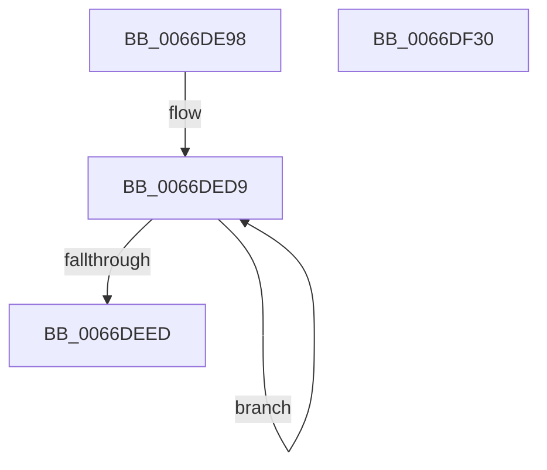

# CmSiWaitForMultipleEvents

- RVA: `0x0066DE98`–`0x0066DF31` (길이 `153` bytes)
- VA: `0x000000014066DE98`
- 실행 섹션: `.text`
- PDB 이름 있음: `예`; PDB Function 태그: `아니요`
- unwind 정보 RVA: `0x000D7540`
- 디코드: `36`개 명령, `153/153` bytes 표시
- 미해석 바이트: `0` (있으면 어셈블리에 `.byte`로 보존)

> 이 문서는 커널 이미지의 기계어와 PDB 기호를 분석해 생성했습니다. 4번과 5번은 함수 원형과 자료형을 바이너리 사용 방식에서 추정한 C 해석이며 원본 소스 복구 결과는 아닙니다.

## 1. Dependencies

- 직접 호출 지점: **3**; 고유 호출 대상: **3**
- 직접 호출자로 확인된 함수: **1**
- RIP 상대 이미지 참조: **1**

### Outgoing calls
- `0x0066DEC3` → [memset](../6C/memset_function_006C6C40.md) (function, `0x006C6C40`)
- `0x0066DF12` → [KeWaitForMultipleObjects](../20/KeWaitForMultipleObjects_function_0020D110.md) (function, `0x0020D110`)
- `0x0066DF22` → [_security_check_cookie](../6A/_security_check_cookie_function_006AC640.md) (function, `0x006AC640`)

### Direct callers
- [CmpHiveCachePopulateHiveEntryThread](../../page/7F/CmpHiveCachePopulateHiveEntryThread_function_007F5FD0.md) at `0x007F629F`

### Static image references
- `0x0066DEA1` → RVA `0x00E0A740` (`.data`; read)

## 2. Other-region calls and transfers

- 다른 실행 섹션으로 향하는 call: **0**
- 별도 외부 분기/꼬리 이동을 확인하지 못했습니다.

## 3. Assembly (complete function range)

```asm
0066DE98  40 53                           push rbx
0066DE9A  48 81 EC 50 0E 00 00            sub rsp, 0xe50
0066DEA1  48 8B 05 98 C8 79 00            mov rax, qword ptr [rip + 0x79c898]
0066DEA8  48 33 C4                        xor rax, rsp
0066DEAB  48 89 84 24 40 0E 00 00         mov qword ptr [rsp + 0xe40], rax
0066DEB3  48 8B DA                        mov rbx, rdx
0066DEB6  48 8D 4C 24 48                  lea rcx, [rsp + 0x48]
0066DEBB  33 D2                           xor edx, edx
0066DEBD  41 B8 F8 01 00 00               mov r8d, 0x1f8
0066DEC3  E8 78 8D 05 00                  call 0x1406c6c40
0066DEC8  B9 04 00 00 00                  mov ecx, 4
0066DECD  48 8D 54 24 40                  lea rdx, [rsp + 0x40]
0066DED2  44 8B C9                        mov r9d, ecx
0066DED5  48 83 C3 08                     add rbx, 8
0066DED9  48 8B 03                        mov rax, qword ptr [rbx]
0066DEDC  48 8D 5B 10                     lea rbx, [rbx + 0x10]
0066DEE0  48 89 02                        mov qword ptr [rdx], rax
0066DEE3  48 8D 52 08                     lea rdx, [rdx + 8]
0066DEE7  49 83 E9 01                     sub r9, 1
0066DEEB  75 EC                           jne 0x14066ded9
0066DEED  48 8D 84 24 40 02 00 00         lea rax, [rsp + 0x240]
0066DEF5  48 89 44 24 38                  mov qword ptr [rsp + 0x38], rax
0066DEFA  45 8D 41 01                     lea r8d, [r9 + 1]
0066DEFE  33 C0                           xor eax, eax
0066DF00  48 8D 54 24 40                  lea rdx, [rsp + 0x40]
0066DF05  48 89 44 24 30                  mov qword ptr [rsp + 0x30], rax
0066DF0A  88 44 24 28                     mov byte ptr [rsp + 0x28], al
0066DF0E  88 44 24 20                     mov byte ptr [rsp + 0x20], al
0066DF12  E8 F9 F1 B9 FF                  call 0x14020d110
0066DF17  48 8B 8C 24 40 0E 00 00         mov rcx, qword ptr [rsp + 0xe40]
0066DF1F  48 33 CC                        xor rcx, rsp
0066DF22  E8 19 E7 03 00                  call 0x1406ac640
0066DF27  48 81 C4 50 0E 00 00            add rsp, 0xe50
0066DF2E  5B                              pop rbx
0066DF2F  C3                              ret
0066DF30  CC                              int3
```

## 4. C-style interpretation (structured pseudocode)

```c
__int64 __fastcall CmSiWaitForMultipleEvents(__int64 a1, __int64 a2)
{
    __int64 result;
    __int64 v_rbx;
    __int64 v_rsp;
    unsigned __int64 v_stack_m18;
    unsigned __int64 v_stack_mC18;
    unsigned __int64 v_stack_mE10;
    unsigned __int64 v_stack_mE18;
    unsigned __int64 v_stack_mE20;
    unsigned __int64 v_stack_mE28;
    unsigned __int8 v_stack_mE30;
    unsigned __int8 v_stack_mE38;

    v_rsp = (v_rsp) - (0xE50ULL);
    result = (*(unsigned __int64 *)(v_rip + 7981208)) ^ (v_rsp);
    v_stack_m18 = result;
    a2 = 0;
    result = memset(v_stack_mE10, a2, 504, a4);
    v_rbx = (a2) + (8);
loc_0066DED9:
    *(unsigned __int64 *)(v_stack_mE18) = *(unsigned __int64 *)(v_rbx);
    a4 = (4) - (1);
    if (condition_is_not_equal) goto loc_0066DED9;
    v_stack_mE20 = v_stack_mC18;
    result = 0;
    v_stack_mE28 = 0;
    v_stack_mE30 = 0;
    v_stack_mE38 = 0;
    result = KeWaitForMultipleObjects(4, v_stack_mE18, a4 + 1, a4);
    a1 = (v_stack_m18) ^ (v_rsp);
    result = _security_check_cookie(a1, v_stack_mE18, a4 + 1, a4);
    v_rsp = (v_rsp) + (0xE50ULL);
    return result;
}
```

## 5. (Beta) C Style

```c
int64_t CmSiWaitForMultipleEvents(int64_t Arg1, void *Arg2)
{
    uint8_t *arg2 = (uint8_t *)Arg2;

    int64_t result;
    int64_t local_rbx;
    int64_t local_rsp;
    uint64_t v_stack_m18;
    uint64_t v_stack_mC18;
    uint64_t v_stack_mE10;
    uint64_t v_stack_mE18;
    uint64_t v_stack_mE20;
    uint64_t v_stack_mE28;
    uint8_t v_stack_mE30;
    uint8_t v_stack_mE38;

    local_rsp = (local_rsp) - (0xE50ULL);
    result = (*(uint64_t *)(v_rip + 0x79C898)) ^ (local_rsp);
    v_stack_m18 = result;
    Arg2 = 0;
    result = memset(v_stack_mE10, Arg2, 504, a4);
    local_rbx = (Arg2) + (8);
loc_0066DED9:
    *(uint64_t *)(v_stack_mE18) = *(uint64_t *)(local_rbx);
    a4 = (4) - (1);
    if (condition_is_not_equal) goto loc_0066DED9;
    v_stack_mE20 = v_stack_mC18;
    result = 0;
    v_stack_mE28 = 0;
    v_stack_mE30 = 0;
    v_stack_mE38 = 0;
    result = KeWaitForMultipleObjects(4, v_stack_mE18, a4 + 1, a4);
    Arg1 = (v_stack_m18) ^ (local_rsp);
    result = _security_check_cookie(Arg1, v_stack_mE18, a4 + 1, a4);
    local_rsp = (local_rsp) + (0xE50ULL);
    return result;
}
```

### 관측된 메모리 오프셋

구조체 형식이 확인되지 않은 접근은 인자 기준의 오프셋으로만 기록했습니다.

| 기준 인자 | 오프셋 표현 | 폭 (bit) | 접근 |
|---|---:|---:|---|
| `Arg2` | `+ 0x0` | `64` | `R` |
| `Arg2` | `+ 0x10` | `64` | `R` |

## 6. Execution-region graph

[열기: 2D/3D 그래프와 함수 탐색 컨트롤 패널](../../../control-panel.html?section=text&rva=0x0066DE98&view=graph)

- 2D 그래프는 위에서 아래로 흐르고, 3D 그래프는 빈 공간을 드래그해 회전합니다. Shift+드래그는 이동, 휠은 확대·축소, 함수 노드 선택은 대상 보고서 이동입니다.

### Static fallback


