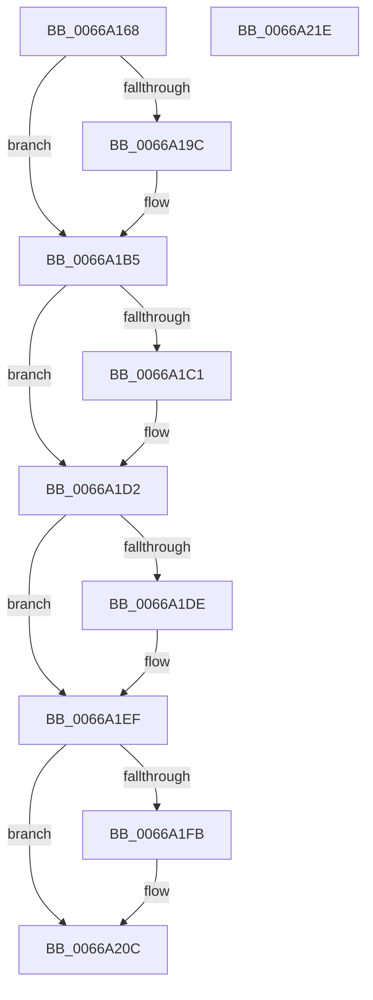

# CmpApplyAdminSdOnHiveFiles

- RVA: `0x0066A168`–`0x0066A21F` (길이 `183` bytes)
- VA: `0x000000014066A168`
- 실행 섹션: `.text`
- PDB 이름 있음: `예`; PDB Function 태그: `아니요`
- unwind 정보 RVA: `0x000794E0`
- 디코드: `45`개 명령, `183/183` bytes 표시
- 미해석 바이트: `0` (있으면 어셈블리에 `.byte`로 보존)

> 이 문서는 커널 이미지의 기계어와 PDB 기호를 분석해 생성했습니다. 4번과 5번은 함수 원형과 자료형을 바이너리 사용 방식에서 추정한 C 해석이며 원본 소스 복구 결과는 아닙니다.

## 1. Dependencies

- 직접 호출 지점: **5**; 고유 호출 대상: **2**
- 직접 호출자로 확인된 함수: **1**
- RIP 상대 이미지 참조: **1**

### Outgoing calls
- `0x0066A190` → [ZwSetSecurityObject](../6B/ZwSetSecurityObject_function_006B0810.md) (function, `0x006B0810`)
- `0x0066A1AF` → [KeBugCheckEx](../4F/KeBugCheckEx_function_004FD660.md) (function, `0x004FD660`)
- `0x0066A1CD` → [ZwSetSecurityObject](../6B/ZwSetSecurityObject_function_006B0810.md) (function, `0x006B0810`)
- `0x0066A1EA` → [ZwSetSecurityObject](../6B/ZwSetSecurityObject_function_006B0810.md) (function, `0x006B0810`)
- `0x0066A207` → [ZwSetSecurityObject](../6B/ZwSetSecurityObject_function_006B0810.md) (function, `0x006B0810`)

### Direct callers
- [CmpLoadHiveThread](../../page/7D/CmpLoadHiveThread_function_007DB040.md) at `0x007DBB70`

### Static image references
- `0x0066A177` → RVA `0x00EEFC28` (`.data`; read)

## 2. Other-region calls and transfers

- 다른 실행 섹션으로 향하는 call: **0**
- 별도 외부 분기/꼬리 이동을 확인하지 못했습니다.

## 3. Assembly (complete function range)

```asm
0066A168  48 89 5C 24 08                  mov qword ptr [rsp + 8], rbx
0066A16D  48 89 74 24 10                  mov qword ptr [rsp + 0x10], rsi
0066A172  57                              push rdi
0066A173  48 83 EC 30                     sub rsp, 0x30
0066A177  4C 8B 05 AA 5A 88 00            mov r8, qword ptr [rip + 0x885aaa]
0066A17E  48 8B F2                        mov rsi, rdx
0066A181  48 8B D9                        mov rbx, rcx
0066A184  BA 04 00 00 00                  mov edx, 4
0066A189  48 8B 89 08 06 00 00            mov rcx, qword ptr [rcx + 0x608]
0066A190  E8 7B 66 04 00                  call 0x1406b0810
0066A195  48 63 F8                        movsxd rdi, eax
0066A198  85 C0                           test eax, eax
0066A19A  79 19                           jns 0x14066a1b5
0066A19C  BA 13 00 00 00                  mov edx, 0x13
0066A1A1  48 89 7C 24 20                  mov qword ptr [rsp + 0x20], rdi
0066A1A6  4C 8B CE                        mov r9, rsi
0066A1A9  4C 8B C3                        mov r8, rbx
0066A1AC  8D 4A 3E                        lea ecx, [rdx + 0x3e]
0066A1AF  E8 AC 34 E9 FF                  call 0x1404fd660
0066A1B4  CC                              int3
0066A1B5  48 8B 8B 28 06 00 00            mov rcx, qword ptr [rbx + 0x628]
0066A1BC  48 85 C9                        test rcx, rcx
0066A1BF  74 11                           je 0x14066a1d2
0066A1C1  4C 8B 05 60 5A 88 00            mov r8, qword ptr [rip + 0x885a60]
0066A1C8  BA 04 00 00 00                  mov edx, 4
0066A1CD  E8 3E 66 04 00                  call 0x1406b0810
0066A1D2  48 8B 8B 30 06 00 00            mov rcx, qword ptr [rbx + 0x630]
0066A1D9  48 85 C9                        test rcx, rcx
0066A1DC  74 11                           je 0x14066a1ef
0066A1DE  4C 8B 05 43 5A 88 00            mov r8, qword ptr [rip + 0x885a43]
0066A1E5  BA 04 00 00 00                  mov edx, 4
0066A1EA  E8 21 66 04 00                  call 0x1406b0810
0066A1EF  48 8B 8B 10 06 00 00            mov rcx, qword ptr [rbx + 0x610]
0066A1F6  48 85 C9                        test rcx, rcx
0066A1F9  74 11                           je 0x14066a20c
0066A1FB  4C 8B 05 26 5A 88 00            mov r8, qword ptr [rip + 0x885a26]
0066A202  BA 04 00 00 00                  mov edx, 4
0066A207  E8 04 66 04 00                  call 0x1406b0810
0066A20C  48 8B 5C 24 40                  mov rbx, qword ptr [rsp + 0x40]
0066A211  8B C7                           mov eax, edi
0066A213  48 8B 74 24 48                  mov rsi, qword ptr [rsp + 0x48]
0066A218  48 83 C4 30                     add rsp, 0x30
0066A21C  5F                              pop rdi
0066A21D  C3                              ret
0066A21E  CC                              int3
```

## 4. C-style interpretation (structured pseudocode)

```c
__int64 __fastcall CmpApplyAdminSdOnHiveFiles(__int64 a1, __int64 a2)
{
    __int64 result;
    __int64 v_rsp;
    unsigned __int64 v_stack_m18;
    unsigned __int64 v_stack_p10;
    unsigned __int64 v_stack_p8;

    v_stack_p8 = v_rbx;
    v_stack_p10 = v_rsi;
    v_rsp = (v_rsp) - (48);
    result = ZwSetSecurityObject(*(unsigned __int64 *)(a1 + 1544), 4, *(unsigned __int64 *)(v_rip + 8936106), a4);
    if (sign_flag) {
        a2 = 19;
        v_stack_m18 = (int)((unsigned int)(result));
        a4 = a2;
        a3 = a1;
        a1 = a2 + 62;
        result = KeBugCheckEx(a1, a2, a3, a4);
    }
    if (*(unsigned __int64 *)(a1 + 1576) != 0) {
        a3 = *(unsigned __int64 *)(v_rip + 8936032);
        a2 = 4;
        result = ZwSetSecurityObject(*(unsigned __int64 *)(a1 + 1576), a2, a3, a4);
    }
    if (*(unsigned __int64 *)(a1 + 1584) != 0) {
        a3 = *(unsigned __int64 *)(v_rip + 8936003);
        a2 = 4;
        result = ZwSetSecurityObject(*(unsigned __int64 *)(a1 + 1584), a2, a3, a4);
    }
    if (*(unsigned __int64 *)(a1 + 1552) != 0) {
        a3 = *(unsigned __int64 *)(v_rip + 8935974);
        a2 = 4;
        result = ZwSetSecurityObject(*(unsigned __int64 *)(a1 + 1552), a2, a3, a4);
    }
    v_rsp = (v_rsp) + (48);
    return (unsigned int)((unsigned int)((int)((unsigned int)(result))));
}
```

## 5. (Beta) C Style

```c
int64_t CmpApplyAdminSdOnHiveFiles(void *Arg1, int64_t Arg2)
{
    uint8_t *arg1 = (uint8_t *)Arg1;

    int64_t result;
    int64_t local_rsp;
    uint64_t v_stack_m18;
    uint64_t v_stack_p10;
    uint64_t v_stack_p8;

    v_stack_p8 = local_rbx;
    v_stack_p10 = local_rsi;
    local_rsp = (local_rsp) - (48);
    result = ZwSetSecurityObject(*(uint64_t *)(arg1 + 0x608), 4, *(uint64_t *)(v_rip + 0x885AAA), a4);
    if (sign_flag) {
        Arg2 = 19;
        v_stack_m18 = (int32_t)((uint32_t)(result));
        a4 = Arg2;
        a3 = Arg1;
        Arg1 = Arg2 + 62;
        result = KeBugCheckEx(Arg1, Arg2, a3, a4);
    }
    if (*(uint64_t *)(arg1 + 0x628) != 0) {
        a3 = *(uint64_t *)(v_rip + 0x885A60);
        Arg2 = 4;
        result = ZwSetSecurityObject(*(uint64_t *)(arg1 + 0x628), Arg2, a3, a4);
    }
    if (*(uint64_t *)(arg1 + 0x630) != 0) {
        a3 = *(uint64_t *)(v_rip + 0x885A43);
        Arg2 = 4;
        result = ZwSetSecurityObject(*(uint64_t *)(arg1 + 0x630), Arg2, a3, a4);
    }
    if (*(uint64_t *)(arg1 + 0x610) != 0) {
        a3 = *(uint64_t *)(v_rip + 0x885A26);
        Arg2 = 4;
        result = ZwSetSecurityObject(*(uint64_t *)(arg1 + 0x610), Arg2, a3, a4);
    }
    local_rsp = (local_rsp) + (48);
    return (uint32_t)((uint32_t)((int32_t)((uint32_t)(result))));
}
```

### 관측된 메모리 오프셋

구조체 형식이 확인되지 않은 접근은 인자 기준의 오프셋으로만 기록했습니다.

| 기준 인자 | 오프셋 표현 | 폭 (bit) | 접근 |
|---|---:|---:|---|
| `Arg1` | `+ 0x608` | `64` | `R` |
| `Arg1` | `+ 0x610` | `64` | `R` |
| `Arg1` | `+ 0x628` | `64` | `R` |
| `Arg1` | `+ 0x630` | `64` | `R` |

## 6. Execution-region graph

[열기: 2D/3D 그래프와 함수 탐색 컨트롤 패널](../../../control-panel.html?section=text&rva=0x0066A168&view=graph)

- 2D 그래프는 위에서 아래로 흐르고, 3D 그래프는 빈 공간을 드래그해 회전합니다. Shift+드래그는 이동, 휠은 확대·축소, 함수 노드 선택은 대상 보고서 이동입니다.

### Static fallback


