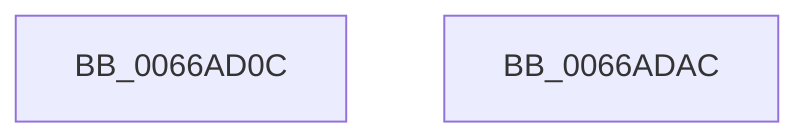

# CmpCheckHivePrimaryFileReadWriteAccess

- RVA: `0x0066AD0C`–`0x0066ADAD` (길이 `161` bytes)
- VA: `0x000000014066AD0C`
- 실행 섹션: `.text`
- PDB 이름 있음: `예`; PDB Function 태그: `아니요`
- unwind 정보 RVA: `0x000D29B0`
- 디코드: `37`개 명령, `161/161` bytes 표시
- 미해석 바이트: `0` (있으면 어셈블리에 `.byte`로 보존)

> 이 문서는 커널 이미지의 기계어와 PDB 기호를 분석해 생성했습니다. 4번과 5번은 함수 원형과 자료형을 바이너리 사용 방식에서 추정한 C 해석이며 원본 소스 복구 결과는 아닙니다.

## 1. Dependencies

- 직접 호출 지점: **4**; 고유 호출 대상: **4**
- 직접 호출자로 확인된 함수: **1**
- RIP 상대 이미지 참조: **0**

### Outgoing calls
- `0x0066AD42` → [SeCaptureSubjectContext](../../page/86/SeCaptureSubjectContext_function_0086B820.md) (function, `0x0086B820`)
- `0x0066AD47` → [IoGetFileObjectGenericMapping](../../page/A1/IoGetFileObjectGenericMapping_function_00A11E80.md) (function, `0x00A11E80`)
- `0x0066AD8B` → [SeAccessCheck](../3A/SeAccessCheck_function_003A6BC0.md) (function, `0x003A6BC0`)
- `0x0066AD97` → [SeReleaseSubjectContext](../../page/86/SeReleaseSubjectContext_function_0086B710.md) (function, `0x0086B710`)

### Direct callers
- [CmLoadAppKey](../../page/87/CmLoadAppKey_function_00876FFC.md) at `0x00877826`

### Static image references
- 디코드된 RIP-relative 메모리 참조가 없습니다.

## 2. Other-region calls and transfers

- 다른 실행 섹션으로 향하는 call: **3**
  - `0x0066AD42` → [SeCaptureSubjectContext](../../page/86/SeCaptureSubjectContext_function_0086B820.md) (`.text` → `PAGE`)
  - `0x0066AD47` → [IoGetFileObjectGenericMapping](../../page/A1/IoGetFileObjectGenericMapping_function_00A11E80.md) (`.text` → `PAGE`)
  - `0x0066AD97` → [SeReleaseSubjectContext](../../page/86/SeReleaseSubjectContext_function_0086B710.md) (`.text` → `PAGE`)
- 별도 외부 분기/꼬리 이동을 확인하지 못했습니다.

## 3. Assembly (complete function range)

```asm
0066AD0C  48 8B C4                        mov rax, rsp
0066AD0F  48 89 58 08                     mov qword ptr [rax + 8], rbx
0066AD13  57                              push rdi
0066AD14  48 83 EC 70                     sub rsp, 0x70
0066AD18  83 60 10 00                     and dword ptr [rax + 0x10], 0
0066AD1C  0F 57 C0                        xorps xmm0, xmm0
0066AD1F  83 60 18 00                     and dword ptr [rax + 0x18], 0
0066AD23  48 8B F9                        mov rdi, rcx
0066AD26  0F 11 40 D8                     movups xmmword ptr [rax - 0x28], xmm0
0066AD2A  48 8D 4C 24 50                  lea rcx, [rsp + 0x50]
0066AD2F  0F 11 40 E8                     movups xmmword ptr [rax - 0x18], xmm0
0066AD33  65 48 8B 04 25 88 01 00 00      mov rax, qword ptr gs:[0x188]
0066AD3C  8A 98 32 02 00 00               mov bl, byte ptr [rax + 0x232]
0066AD42  E8 D9 0A 20 00                  call 0x14086b820
0066AD47  E8 34 71 3A 00                  call 0x140a11e80
0066AD4C  48 8D 8C 24 88 00 00 00         lea rcx, [rsp + 0x88]
0066AD54  41 B9 03 00 00 00               mov r9d, 3
0066AD5A  48 89 4C 24 48                  mov qword ptr [rsp + 0x48], rcx
0066AD5F  48 8D 54 24 50                  lea rdx, [rsp + 0x50]
0066AD64  48 8D 8C 24 90 00 00 00         lea rcx, [rsp + 0x90]
0066AD6C  45 33 C0                        xor r8d, r8d
0066AD6F  48 89 4C 24 40                  mov qword ptr [rsp + 0x40], rcx
0066AD74  48 8B CF                        mov rcx, rdi
0066AD77  88 5C 24 38                     mov byte ptr [rsp + 0x38], bl
0066AD7B  48 89 44 24 30                  mov qword ptr [rsp + 0x30], rax
0066AD80  48 83 64 24 28 00               and qword ptr [rsp + 0x28], 0
0066AD86  83 64 24 20 00                  and dword ptr [rsp + 0x20], 0
0066AD8B  E8 30 BE D3 FF                  call 0x1403a6bc0
0066AD90  48 8D 4C 24 50                  lea rcx, [rsp + 0x50]
0066AD95  8A D8                           mov bl, al
0066AD97  E8 74 09 20 00                  call 0x14086b710
0066AD9C  8A C3                           mov al, bl
0066AD9E  48 8B 9C 24 80 00 00 00         mov rbx, qword ptr [rsp + 0x80]
0066ADA6  48 83 C4 70                     add rsp, 0x70
0066ADAA  5F                              pop rdi
0066ADAB  C3                              ret
0066ADAC  CC                              int3
```

## 4. C-style interpretation (structured pseudocode)

```c
__int64 __fastcall CmpCheckHivePrimaryFileReadWriteAccess(__int64 a1, __int64 a2, int a3)
{
    __int64 result;
    __int64 v_rsp;
    unsigned __int64 v_stack_m28;
    unsigned __int64 v_stack_m30;
    unsigned __int64 v_stack_m38;
    unsigned __int8 v_stack_m40;
    unsigned __int64 v_stack_m48;
    unsigned __int64 v_stack_m50;
    unsigned int v_stack_m58;
    unsigned __int64 v_stack_p10;
    unsigned __int64 v_stack_p18;
    unsigned __int64 v_stack_p8;

    *(unsigned __int64 *)(v_rsp + 8) = v_rbx;
    v_rsp = (v_rsp) - (112);
    *(unsigned __int64 *)(v_rsp - 40) = v_xmm0;
    *(unsigned __int64 *)(v_rsp - 24) = v_xmm0;
    result = SeCaptureSubjectContext(v_stack_m28, a2, a3, a4);
    result = IoGetFileObjectGenericMapping(v_stack_m28, a2, a3, a4);
    v_stack_m30 = v_stack_p10;
    a3 = 0;
    v_stack_m38 = v_stack_p18;
    v_stack_m40 = (unsigned __int8)(*(unsigned __int8 *)(*(unsigned __int64 *)(gs_base + (0 + 392)) + 562));
    v_stack_m48 = result;
    result = SeAccessCheck(a1, v_stack_m28, a3, 3);
    result = SeReleaseSubjectContext(v_stack_m28, v_stack_m28, a3, 3);
    v_rsp = (v_rsp) + (112);
    return (unsigned __int8)((unsigned __int8)(result));
}
```

## 5. (Beta) C Style

```c
int64_t CmpCheckHivePrimaryFileReadWriteAccess(int64_t Arg1, int64_t Arg2, int32_t Arg3)
{
    int64_t result;
    int64_t local_rsp;
    uint64_t v_stack_m28;
    uint64_t v_stack_m30;
    uint64_t v_stack_m38;
    uint8_t v_stack_m40;
    uint64_t v_stack_m48;
    uint64_t v_stack_m50;
    uint32_t v_stack_m58;
    uint64_t v_stack_p10;
    uint64_t v_stack_p18;
    uint64_t v_stack_p8;

    *(uint64_t *)(local_rsp + 0x8) = local_rbx;
    local_rsp = (local_rsp) - (112);
    *(uint64_t *)(local_rsp - 0x28) = v_xmm0;
    *(uint64_t *)(local_rsp - 0x18) = v_xmm0;
    result = SeCaptureSubjectContext(v_stack_m28, Arg2, Arg3, a4);
    result = IoGetFileObjectGenericMapping(v_stack_m28, Arg2, Arg3, a4);
    v_stack_m30 = v_stack_p10;
    Arg3 = 0;
    v_stack_m38 = v_stack_p18;
    v_stack_m40 = (uint8_t)(*(uint8_t *)(*(uint64_t *)(gs_base + (0 + 0x188)) + 0x232));
    v_stack_m48 = result;
    result = SeAccessCheck(Arg1, v_stack_m28, Arg3, 3);
    result = SeReleaseSubjectContext(v_stack_m28, v_stack_m28, Arg3, 3);
    local_rsp = (local_rsp) + (112);
    return (uint8_t)((uint8_t)(result));
}
```

## 6. Execution-region graph

[열기: 2D/3D 그래프와 함수 탐색 컨트롤 패널](../../../control-panel.html?section=text&rva=0x0066AD0C&view=graph)

- 2D 그래프는 위에서 아래로 흐르고, 3D 그래프는 빈 공간을 드래그해 회전합니다. Shift+드래그는 이동, 휠은 확대·축소, 함수 노드 선택은 대상 보고서 이동입니다.

### Static fallback


