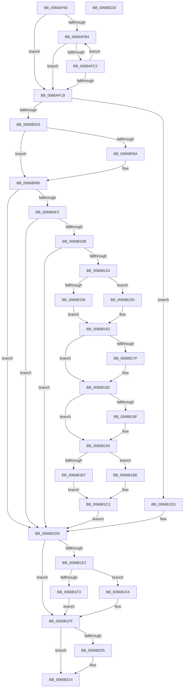

# CmpCreateTombstone

- RVA: `0x0066AF50`–`0x0066B231` (길이 `737` bytes)
- VA: `0x000000014066AF50`
- 실행 섹션: `.text`
- PDB 이름 있음: `예`; PDB Function 태그: `아니요`
- unwind 정보 RVA: `0x000D7420`
- 디코드: `207`개 명령, `737/737` bytes 표시
- 미해석 바이트: `0` (있으면 어셈블리에 `.byte`로 보존)

> 이 문서는 커널 이미지의 기계어와 PDB 기호를 분석해 생성했습니다. 4번과 5번은 함수 원형과 자료형을 바이너리 사용 방식에서 추정한 C 해석이며 원본 소스 복구 결과는 아닙니다.

## 1. Dependencies

- 직접 호출 지점: **28**; 고유 호출 대상: **23**
- 직접 호출자로 확인된 함수: **1**
- RIP 상대 이미지 참조: **0**

### Outgoing calls
- `0x0066AF86` → [HvpGetCellContextInitialize](../../page/85/HvpGetCellContextInitialize_function_00855F10.md) (function, `0x00855F10`)
- `0x0066AF8F` → [HvpGetCellContextInitialize](../../page/85/HvpGetCellContextInitialize_function_00855F10.md) (function, `0x00855F10`)
- `0x0066AF9B` → [CmpGetKcbAtLayerHeight](../../page/94/CmpGetKcbAtLayerHeight_function_00949210.md) (function, `0x00949210`)
- `0x0066AFB7` → [CmpGetKcbAtLayerHeight](../../page/94/CmpGetKcbAtLayerHeight_function_00949210.md) (function, `0x00949210`)
- `0x0066AFDE` → [HvLockHiveFlusherShared](../../page/84/HvLockHiveFlusherShared_function_0084F95C.md) (function, `0x0084F95C`)
- `0x0066B010` → [HvAllocateCell](../../page/85/HvAllocateCell_function_00859C94.md) (function, `0x00859C94`)
- `0x0066B02B` → [memset](../6C/memset_function_006C6C40.md) (function, `0x006C6C40`)
- `0x0066B036` → [CmpGetPhaseAccessBit](../../page/70/CmpGetPhaseAccessBit_function_00703180.md) (function, `0x00703180`)
- `0x0066B0AE` → [memcpy](../6C/memcpy_function_006C6840.md) (function, `0x006C6840`)
- `0x0066B0B8` → [CmpGetSecurityDescriptorForKcbStack](../../page/99/CmpGetSecurityDescriptorForKcbStack_function_0099DC80.md) (function, `0x0099DC80`)
- `0x0066B0C4` → [CmLockHiveSecurityExclusive](../../page/84/CmLockHiveSecurityExclusive_function_0084B1A8.md) (function, `0x0084B1A8`)
- `0x0066B0DA` → [CmpAssignSecurityDescriptor](../../page/94/CmpAssignSecurityDescriptor_function_00949234.md) (function, `0x00949234`)
- `0x0066B0E5` → [CmUnlockHiveSecurity](../../pagecmrc/BC/CmUnlockHiveSecurity_function_00BC99C8.md) (function, `0x00BC99C8`)
- `0x0066B0FC` → [HvMarkCellDirty](../../page/85/HvMarkCellDirty_function_00859758.md) (function, `0x00859758`)
- `0x0066B115` → [CmpAddSubKey](../../page/84/CmpAddSubKey_function_0084BA94.md) (function, `0x0084BA94`)
- `0x0066B127` → [CmpIncrementKcbSequenceNumber](../../page/A4/CmpIncrementKcbSequenceNumber_function_00A49D7C.md) (function, `0x00A49D7C`)
- `0x0066B13D` → [CmpRebuildKcbCacheFromNode](../../page/84/CmpRebuildKcbCacheFromNode_function_0084C5A8.md) (function, `0x0084C5A8`)
- `0x0066B156` → [HvpGetCellFlat](../../page/85/HvpGetCellFlat_function_00854C60.md) (function, `0x00854C60`)
- `0x0066B15D` → [HvpGetCellPaged](../../page/85/HvpGetCellPaged_function_00854CB0.md) (function, `0x00854CB0`)
- `0x0066B170` → [CmpUpdateKeyNodeAccessBits](../../page/84/CmpUpdateKeyNodeAccessBits_function_0084864C.md) (function, `0x0084864C`)
- `0x0066B196` → [CmpIncrementKcbSequenceNumber](../../page/A4/CmpIncrementKcbSequenceNumber_function_00A49D7C.md) (function, `0x00A49D7C`)
- `0x0066B1B7` → [HvpReleaseCellFlat](../../page/85/HvpReleaseCellFlat_function_0085CC20.md) (function, `0x0085CC20`)
- `0x0066B1BE` → [HvpReleaseCellPaged](../../page/85/HvpReleaseCellPaged_function_00855F40.md) (function, `0x00855F40`)
- `0x0066B1C9` → [CmpCleanUpSubKeyInfo](../../page/84/CmpCleanUpSubKeyInfo_function_0084C6F4.md) (function, `0x0084C6F4`)
- `0x0066B1F3` → [HvpReleaseCellFlat](../../page/85/HvpReleaseCellFlat_function_0085CC20.md) (function, `0x0085CC20`)
- `0x0066B1FA` → [HvpReleaseCellPaged](../../page/85/HvpReleaseCellPaged_function_00855F40.md) (function, `0x00855F40`)
- `0x0066B20F` → [CmpFreeKeyByCell](../../page/84/CmpFreeKeyByCell_function_0084AD70.md) (function, `0x0084AD70`)
- `0x0066B218` → [HvUnlockHiveFlusherShared](../../page/84/HvUnlockHiveFlusherShared_function_00848738.md) (function, `0x00848738`)

### Direct callers
- [sub_006ED542](../6E/Unknown_function_006ED542.md) at `0x006ED5F7`

### Static image references
- 디코드된 RIP-relative 메모리 참조가 없습니다.

## 2. Other-region calls and transfers

- 다른 실행 섹션으로 향하는 call: **26**
  - `0x0066AF86` → [HvpGetCellContextInitialize](../../page/85/HvpGetCellContextInitialize_function_00855F10.md) (`.text` → `PAGE`)
  - `0x0066AF8F` → [HvpGetCellContextInitialize](../../page/85/HvpGetCellContextInitialize_function_00855F10.md) (`.text` → `PAGE`)
  - `0x0066AF9B` → [CmpGetKcbAtLayerHeight](../../page/94/CmpGetKcbAtLayerHeight_function_00949210.md) (`.text` → `PAGE`)
  - `0x0066AFB7` → [CmpGetKcbAtLayerHeight](../../page/94/CmpGetKcbAtLayerHeight_function_00949210.md) (`.text` → `PAGE`)
  - `0x0066AFDE` → [HvLockHiveFlusherShared](../../page/84/HvLockHiveFlusherShared_function_0084F95C.md) (`.text` → `PAGE`)
  - `0x0066B010` → [HvAllocateCell](../../page/85/HvAllocateCell_function_00859C94.md) (`.text` → `PAGE`)
  - `0x0066B036` → [CmpGetPhaseAccessBit](../../page/70/CmpGetPhaseAccessBit_function_00703180.md) (`.text` → `PAGE`)
  - `0x0066B0B8` → [CmpGetSecurityDescriptorForKcbStack](../../page/99/CmpGetSecurityDescriptorForKcbStack_function_0099DC80.md) (`.text` → `PAGE`)
  - `0x0066B0C4` → [CmLockHiveSecurityExclusive](../../page/84/CmLockHiveSecurityExclusive_function_0084B1A8.md) (`.text` → `PAGE`)
  - `0x0066B0DA` → [CmpAssignSecurityDescriptor](../../page/94/CmpAssignSecurityDescriptor_function_00949234.md) (`.text` → `PAGE`)
  - `0x0066B0E5` → [CmUnlockHiveSecurity](../../pagecmrc/BC/CmUnlockHiveSecurity_function_00BC99C8.md) (`.text` → `PAGECMRC`)
  - `0x0066B0FC` → [HvMarkCellDirty](../../page/85/HvMarkCellDirty_function_00859758.md) (`.text` → `PAGE`)
  - `0x0066B115` → [CmpAddSubKey](../../page/84/CmpAddSubKey_function_0084BA94.md) (`.text` → `PAGE`)
  - `0x0066B127` → [CmpIncrementKcbSequenceNumber](../../page/A4/CmpIncrementKcbSequenceNumber_function_00A49D7C.md) (`.text` → `PAGE`)
  - `0x0066B13D` → [CmpRebuildKcbCacheFromNode](../../page/84/CmpRebuildKcbCacheFromNode_function_0084C5A8.md) (`.text` → `PAGE`)
  - `0x0066B156` → [HvpGetCellFlat](../../page/85/HvpGetCellFlat_function_00854C60.md) (`.text` → `PAGE`)
  - `0x0066B15D` → [HvpGetCellPaged](../../page/85/HvpGetCellPaged_function_00854CB0.md) (`.text` → `PAGE`)
  - `0x0066B170` → [CmpUpdateKeyNodeAccessBits](../../page/84/CmpUpdateKeyNodeAccessBits_function_0084864C.md) (`.text` → `PAGE`)
  - `0x0066B196` → [CmpIncrementKcbSequenceNumber](../../page/A4/CmpIncrementKcbSequenceNumber_function_00A49D7C.md) (`.text` → `PAGE`)
  - `0x0066B1B7` → [HvpReleaseCellFlat](../../page/85/HvpReleaseCellFlat_function_0085CC20.md) (`.text` → `PAGE`)
  - `0x0066B1BE` → [HvpReleaseCellPaged](../../page/85/HvpReleaseCellPaged_function_00855F40.md) (`.text` → `PAGE`)
  - `0x0066B1C9` → [CmpCleanUpSubKeyInfo](../../page/84/CmpCleanUpSubKeyInfo_function_0084C6F4.md) (`.text` → `PAGE`)
  - `0x0066B1F3` → [HvpReleaseCellFlat](../../page/85/HvpReleaseCellFlat_function_0085CC20.md) (`.text` → `PAGE`)
  - `0x0066B1FA` → [HvpReleaseCellPaged](../../page/85/HvpReleaseCellPaged_function_00855F40.md) (`.text` → `PAGE`)
  - `0x0066B20F` → [CmpFreeKeyByCell](../../page/84/CmpFreeKeyByCell_function_0084AD70.md) (`.text` → `PAGE`)
  - `0x0066B218` → [HvUnlockHiveFlusherShared](../../page/84/HvUnlockHiveFlusherShared_function_00848738.md) (`.text` → `PAGE`)
- 별도 외부 분기/꼬리 이동을 확인하지 못했습니다.

## 3. Assembly (complete function range)

```asm
0066AF50  48 89 4C 24 08                  mov qword ptr [rsp + 8], rcx
0066AF55  55                              push rbp
0066AF56  53                              push rbx
0066AF57  56                              push rsi
0066AF58  57                              push rdi
0066AF59  41 54                           push r12
0066AF5B  41 55                           push r13
0066AF5D  41 56                           push r14
0066AF5F  41 57                           push r15
0066AF61  48 8B EC                        mov rbp, rsp
0066AF64  48 83 EC 38                     sub rsp, 0x38
0066AF68  45 33 ED                        xor r13d, r13d
0066AF6B  48 8D 4D 58                     lea rcx, [rbp + 0x58]
0066AF6F  41 83 C8 FF                     or r8d, 0xffffffff
0066AF73  4C 89 6D 58                     mov qword ptr [rbp + 0x58], r13
0066AF77  4C 89 6D 50                     mov qword ptr [rbp + 0x50], r13
0066AF7B  4C 8B FA                        mov r15, rdx
0066AF7E  44 89 45 48                     mov dword ptr [rbp + 0x48], r8d
0066AF82  4C 89 6D 60                     mov qword ptr [rbp + 0x60], r13
0066AF86  E8 85 AF 1E 00                  call 0x140855f10
0066AF8B  48 8D 4D 50                     lea rcx, [rbp + 0x50]
0066AF8F  E8 7C AF 1E 00                  call 0x140855f10
0066AF94  0F B7 52 02                     movzx edx, word ptr [rdx + 2]
0066AF98  49 8B CF                        mov rcx, r15
0066AF9B  E8 70 E2 2D 00                  call 0x140949210
0066AFA0  4C 8B F0                        mov r14, rax
0066AFA3  48 8B 78 48                     mov rdi, qword ptr [rax + 0x48]
0066AFA7  41 8B C5                        mov eax, r13d
0066AFAA  41 0F B7 56 42                  movzx edx, word ptr [r14 + 0x42]
0066AFAF  66 85 D2                        test dx, dx
0066AFB2  78 14                           js 0x14066afc8
0066AFB4  49 8B CF                        mov rcx, r15
0066AFB7  E8 54 E2 2D 00                  call 0x140949210
0066AFBC  44 39 40 28                     cmp dword ptr [rax + 0x28], r8d
0066AFC0  75 06                           jne 0x14066afc8
0066AFC2  66 83 EA 01                     sub dx, 1
0066AFC6  79 EC                           jns 0x14066afb4
0066AFC8  8B 58 28                        mov ebx, dword ptr [rax + 0x28]
0066AFCB  B8 01 00 00 00                  mov eax, 1
0066AFD0  49 8B 4E 20                     mov rcx, qword ptr [r14 + 0x20]
0066AFD4  C1 EB 1F                        shr ebx, 0x1f
0066AFD7  44 39 6F 28                     cmp dword ptr [rdi + 0x28], r13d
0066AFDB  0F 4C D8                        cmovl ebx, eax
0066AFDE  E8 79 49 1E 00                  call 0x14084f95c
0066AFE3  49 8B 46 50                     mov rax, qword ptr [r14 + 0x50]
0066AFE7  4C 8D 4D 48                     lea r9, [rbp + 0x48]
0066AFEB  49 8B 4E 20                     mov rcx, qword ptr [r14 + 0x20]
0066AFEF  44 8B C3                        mov r8d, ebx
0066AFF2  44 0F B7 60 18                  movzx r12d, word ptr [rax + 0x18]
0066AFF7  48 8D 45 58                     lea rax, [rbp + 0x58]
0066AFFB  48 89 44 24 28                  mov qword ptr [rsp + 0x28], rax
0066B000  41 83 C4 4C                     add r12d, 0x4c
0066B004  48 8D 45 60                     lea rax, [rbp + 0x60]
0066B008  41 8B D4                        mov edx, r12d
0066B00B  48 89 44 24 20                  mov qword ptr [rsp + 0x20], rax
0066B010  E8 7F EC 1E 00                  call 0x140859c94
0066B015  48 8B 75 60                     mov rsi, qword ptr [rbp + 0x60]
0066B019  8B D8                           mov ebx, eax
0066B01B  85 C0                           test eax, eax
0066B01D  0F 88 B0 01 00 00               js 0x14066b1d3
0066B023  45 8B C4                        mov r8d, r12d
0066B026  33 D2                           xor edx, edx
0066B028  48 8B CE                        mov rcx, rsi
0066B02B  E8 10 BC 05 00                  call 0x1406c6c40
0066B030  C7 06 6E 6B 00 00               mov dword ptr [rsi], 0x6b6e
0066B036  E8 45 81 09 00                  call 0x140703180
0066B03B  88 46 0C                        mov byte ptr [rsi + 0xc], al
0066B03E  41 BC 01 00 00 00               mov r12d, 1
0066B044  8A 46 0D                        mov al, byte ptr [rsi + 0xd]
0066B047  24 FD                           and al, 0xfd
0066B049  41 0A C4                        or al, r12b
0066B04C  88 46 0D                        mov byte ptr [rsi + 0xd], al
0066B04F  49 8B 46 50                     mov rax, qword ptr [r14 + 0x50]
0066B053  8B 08                           mov ecx, dword ptr [rax]
0066B055  41 84 CC                        test r12b, cl
0066B058  74 06                           je 0x14066b060
0066B05A  66 C7 46 02 20 00               mov word ptr [rsi + 2], 0x20
0066B060  4C 89 6E 04                     mov qword ptr [rsi + 4], r13
0066B064  8B 47 28                        mov eax, dword ptr [rdi + 0x28]
0066B067  89 46 10                        mov dword ptr [rsi + 0x10], eax
0066B06A  83 C8 FF                        or eax, 0xffffffff
0066B06D  89 46 1C                        mov dword ptr [rsi + 0x1c], eax
0066B070  89 46 20                        mov dword ptr [rsi + 0x20], eax
0066B073  89 46 28                        mov dword ptr [rsi + 0x28], eax
0066B076  89 46 2C                        mov dword ptr [rsi + 0x2c], eax
0066B079  89 46 30                        mov dword ptr [rsi + 0x30], eax
0066B07C  66 44 89 6E 4A                  mov word ptr [rsi + 0x4a], r13w
0066B081  81 66 34 FF FF F0 FF            and dword ptr [rsi + 0x34], 0xfff0ffff
0066B088  44 88 6E 37                     mov byte ptr [rsi + 0x37], r13b
0066B08C  81 66 34 FF FF 0F FF            and dword ptr [rsi + 0x34], 0xff0fffff
0066B093  49 8B 46 50                     mov rax, qword ptr [r14 + 0x50]
0066B097  0F B7 48 18                     movzx ecx, word ptr [rax + 0x18]
0066B09B  66 89 4E 48                     mov word ptr [rsi + 0x48], cx
0066B09F  44 8B C1                        mov r8d, ecx
0066B0A2  49 8B 56 50                     mov rdx, qword ptr [r14 + 0x50]
0066B0A6  48 8D 4E 4C                     lea rcx, [rsi + 0x4c]
0066B0AA  48 83 C2 1A                     add rdx, 0x1a
0066B0AE  E8 8D B7 05 00                  call 0x1406c6840
0066B0B3  33 D2                           xor edx, edx
0066B0B5  49 8B CF                        mov rcx, r15
0066B0B8  E8 C3 2B 33 00                  call 0x14099dc80
0066B0BD  49 8B 4E 20                     mov rcx, qword ptr [r14 + 0x20]
0066B0C1  48 8B D8                        mov rbx, rax
0066B0C4  E8 DF 00 1E 00                  call 0x14084b1a8
0066B0C9  44 8B 7D 48                     mov r15d, dword ptr [rbp + 0x48]
0066B0CD  4C 8B CB                        mov r9, rbx
0066B0D0  49 8B 4E 20                     mov rcx, qword ptr [r14 + 0x20]
0066B0D4  4C 8B C6                        mov r8, rsi
0066B0D7  41 8B D7                        mov edx, r15d
0066B0DA  E8 55 E1 2D 00                  call 0x140949234
0066B0DF  49 8B 4E 20                     mov rcx, qword ptr [r14 + 0x20]
0066B0E3  8B D8                           mov ebx, eax
0066B0E5  E8 DE E8 55 00                  call 0x140bc99c8
0066B0EA  85 DB                           test ebx, ebx
0066B0EC  0F 88 EB 00 00 00               js 0x14066b1dd
0066B0F2  8B 57 28                        mov edx, dword ptr [rdi + 0x28]
0066B0F5  45 33 C0                        xor r8d, r8d
0066B0F8  48 8B 4F 20                     mov rcx, qword ptr [rdi + 0x20]
0066B0FC  E8 57 E6 1E 00                  call 0x140859758
0066B101  8B D8                           mov ebx, eax
0066B103  85 C0                           test eax, eax
0066B105  0F 88 D2 00 00 00               js 0x14066b1dd
0066B10B  8B 57 28                        mov edx, dword ptr [rdi + 0x28]
0066B10E  45 8B C7                        mov r8d, r15d
0066B111  48 8B 4F 20                     mov rcx, qword ptr [rdi + 0x20]
0066B115  E8 7A 09 1E 00                  call 0x14084ba94
0066B11A  8B D8                           mov ebx, eax
0066B11C  85 C0                           test eax, eax
0066B11E  0F 88 B9 00 00 00               js 0x14066b1dd
0066B124  49 8B CE                        mov rcx, r14
0066B127  E8 50 EC 3D 00                  call 0x140a49d7c
0066B12C  45 89 7E 28                     mov dword ptr [r14 + 0x28], r15d
0066B130  45 33 C9                        xor r9d, r9d
0066B133  45 33 C0                        xor r8d, r8d
0066B136  48 8B D6                        mov rdx, rsi
0066B139  41 83 CF FF                     or r15d, 0xffffffff
0066B13D  E8 66 14 1E 00                  call 0x14084c5a8
0066B142  48 8B 4F 20                     mov rcx, qword ptr [rdi + 0x20]
0066B146  4C 8D 45 50                     lea r8, [rbp + 0x50]
0066B14A  8B 57 28                        mov edx, dword ptr [rdi + 0x28]
0066B14D  44 84 A1 8C 00 00 00            test byte ptr [rcx + 0x8c], r12b
0066B154  74 07                           je 0x14066b15d
0066B156  E8 05 9B 1E 00                  call 0x140854c60
0066B15B  EB 05                           jmp 0x14066b162
0066B15D  E8 4E 9B 1E 00                  call 0x140854cb0
0066B162  44 8B 47 28                     mov r8d, dword ptr [rdi + 0x28]
0066B166  48 8B D0                        mov rdx, rax
0066B169  48 8B 4F 20                     mov rcx, qword ptr [rdi + 0x20]
0066B16D  48 8B D8                        mov rbx, rax
0066B170  E8 D7 D4 1D 00                  call 0x14084864c
0066B175  F6 46 02 20                     test byte ptr [rsi + 2], 0x20
0066B179  0F B7 56 48                     movzx edx, word ptr [rsi + 0x48]
0066B17D  74 03                           je 0x14066b182
0066B17F  66 03 D2                        add dx, dx
0066B182  8B 43 34                        mov eax, dword ptr [rbx + 0x34]
0066B185  0F B7 C8                        movzx ecx, ax
0066B188  0F B7 C2                        movzx eax, dx
0066B18B  3B C8                           cmp ecx, eax
0066B18D  73 04                           jae 0x14066b193
0066B18F  66 89 53 34                     mov word ptr [rbx + 0x34], dx
0066B193  48 8B CF                        mov rcx, rdi
0066B196  E8 E1 EB 3D 00                  call 0x140a49d7c
0066B19B  48 8B 4F 20                     mov rcx, qword ptr [rdi + 0x20]
0066B19F  48 8D 55 50                     lea rdx, [rbp + 0x50]
0066B1A3  0F B7 43 34                     movzx eax, word ptr [rbx + 0x34]
0066B1A7  66 89 87 B0 00 00 00            mov word ptr [rdi + 0xb0], ax
0066B1AE  44 84 A1 8C 00 00 00            test byte ptr [rcx + 0x8c], r12b
0066B1B5  74 07                           je 0x14066b1be
0066B1B7  E8 64 1A 1F 00                  call 0x14085cc20
0066B1BC  EB 05                           jmp 0x14066b1c3
0066B1BE  E8 7D AD 1E 00                  call 0x140855f40
0066B1C3  41 8A D4                        mov dl, r12b
0066B1C6  48 8B CF                        mov rcx, rdi
0066B1C9  E8 26 15 1E 00                  call 0x14084c6f4
0066B1CE  41 8B DD                        mov ebx, r13d
0066B1D1  EB 0A                           jmp 0x14066b1dd
0066B1D3  44 8B 7D 48                     mov r15d, dword ptr [rbp + 0x48]
0066B1D7  41 BC 01 00 00 00               mov r12d, 1
0066B1DD  48 85 F6                        test rsi, rsi
0066B1E0  74 1D                           je 0x14066b1ff
0066B1E2  49 8B 4E 20                     mov rcx, qword ptr [r14 + 0x20]
0066B1E6  48 8D 55 58                     lea rdx, [rbp + 0x58]
0066B1EA  44 84 A1 8C 00 00 00            test byte ptr [rcx + 0x8c], r12b
0066B1F1  74 07                           je 0x14066b1fa
0066B1F3  E8 28 1A 1F 00                  call 0x14085cc20
0066B1F8  EB 05                           jmp 0x14066b1ff
0066B1FA  E8 41 AD 1E 00                  call 0x140855f40
0066B1FF  41 83 FF FF                     cmp r15d, -1
0066B203  74 0F                           je 0x14066b214
0066B205  49 8B 4E 20                     mov rcx, qword ptr [r14 + 0x20]
0066B209  45 33 C0                        xor r8d, r8d
0066B20C  41 8B D7                        mov edx, r15d
0066B20F  E8 5C FB 1D 00                  call 0x14084ad70
0066B214  49 8B 4E 20                     mov rcx, qword ptr [r14 + 0x20]
0066B218  E8 1B D5 1D 00                  call 0x140848738
0066B21D  8B C3                           mov eax, ebx
0066B21F  48 83 C4 38                     add rsp, 0x38
0066B223  41 5F                           pop r15
0066B225  41 5E                           pop r14
0066B227  41 5D                           pop r13
0066B229  41 5C                           pop r12
0066B22B  5F                              pop rdi
0066B22C  5E                              pop rsi
0066B22D  5B                              pop rbx
0066B22E  5D                              pop rbp
0066B22F  C3                              ret
0066B230  CC                              int3
```

## 4. C-style interpretation (structured pseudocode)

```c
__int64 __fastcall CmpCreateTombstone(__int64 a1, __int64 a2, int a3)
{
    __int64 result;
    __int64 v_r12;
    __int64 v_r13;
    __int64 v_r15;
    __int64 v_rbx;
    __int64 v_rsp;
    unsigned __int64 v_stack_m50;
    unsigned __int64 v_stack_m58;
    unsigned __int64 v_stack_p10;
    unsigned __int64 v_stack_p18;
    unsigned __int64 v_stack_p20;
    unsigned __int64 v_stack_p8;

    v_stack_p8 = a1;
    v_rsp = (v_rsp) - (56);
    v_r13 = 0;
    a3 = (unsigned int)((a3) | (0xFFFFFFFFULL));
    v_stack_p18 = 0;
    v_stack_p10 = 0;
    v_stack_p8 = a3;
    v_stack_p20 = 0;
    result = HvpGetCellContextInitialize(v_stack_p18, a2, a3, a4);
    result = HvpGetCellContextInitialize(v_stack_p10, a2, a3, a4);
    result = CmpGetKcbAtLayerHeight(a2, *(unsigned __int16 *)(a2 + 2), a3, a4);
    if (sign_flag) goto loc_0066AFC8;
loc_0066AFB4:
    result = CmpGetKcbAtLayerHeight(a2, *(unsigned __int16 *)(result + 66), a3, a4);
    if ((*(unsigned int *)(result + 40)) != a3) goto loc_0066AFC8;
    a2 = (unsigned __int16)((*(unsigned __int16 *)(result + 66)) - (1));
    if (!sign_flag) goto loc_0066AFB4;
loc_0066AFC8:
    v_rbx = (unsigned int)(((unsigned int)(*(unsigned int *)(result + 40))) >> (31));
    if ((*(unsigned int *)(*(unsigned __int64 *)(result + 72) + 40)) < 0) { v_rbx = 1; }
    result = HvLockHiveFlusherShared(*(unsigned __int64 *)(result + 32), a2, a3, a4);
    v_stack_m50 = v_stack_p18;
    v_r12 = (unsigned int)((*(unsigned __int16 *)(*(unsigned __int64 *)(result + 80) + 24)) + (76));
    v_stack_m58 = v_stack_p20;
    result = HvAllocateCell(*(unsigned __int64 *)(result + 32), (unsigned int)((unsigned int)(v_r12)), (unsigned int)((unsigned int)(v_rbx)), v_stack_p8);
    if (sign_flag) goto loc_0066B1D3;
    a2 = 0;
    result = memset(v_stack_p20, a2, (unsigned int)((unsigned int)(v_r12)), v_stack_p8);
    *(unsigned int *)(v_stack_p20) = 0x6B6EULL;
    result = CmpGetPhaseAccessBit(v_stack_p20, a2, (unsigned int)((unsigned int)(v_r12)), v_stack_p8);
    *(unsigned __int8 *)(v_stack_p20 + 12) = (unsigned __int8)(result);
    result = (unsigned __int8)((*(unsigned __int8 *)(v_stack_p20 + 13)) & (253));
    result = (unsigned __int8)((result) | (1));
    *(unsigned __int8 *)(v_stack_p20 + 13) = (unsigned __int8)(result);
    if (((1) & ((unsigned __int8)((unsigned int)(*(unsigned int *)(*(unsigned __int64 *)(result + 80)))))) != 0) {
        *(unsigned __int16 *)(v_stack_p20 + 2) = 32;
    }
    *(unsigned __int64 *)(v_stack_p20 + 4) = 0;
    *(unsigned int *)(v_stack_p20 + 16) = (unsigned int)((unsigned int)(*(unsigned int *)(*(unsigned __int64 *)(result + 72) + 40)));
    result = (unsigned int)(((unsigned int)(*(unsigned int *)(*(unsigned __int64 *)(result + 72) + 40))) | (0xFFFFFFFFULL));
    *(unsigned int *)(v_stack_p20 + 28) = (unsigned int)(result);
    *(unsigned int *)(v_stack_p20 + 32) = (unsigned int)(result);
    *(unsigned int *)(v_stack_p20 + 40) = (unsigned int)(result);
    *(unsigned int *)(v_stack_p20 + 44) = (unsigned int)(result);
    *(unsigned int *)(v_stack_p20 + 48) = (unsigned int)(result);
    *(unsigned __int16 *)(v_stack_p20 + 74) = 0;
    *(unsigned __int8 *)(v_stack_p20 + 55) = 0;
    *(unsigned __int16 *)(v_stack_p20 + 72) = (unsigned __int16)(*(unsigned __int16 *)(*(unsigned __int64 *)(result + 80) + 24));
    a2 = (*(unsigned __int64 *)(result + 80)) + (26);
    result = memcpy(v_stack_p20 + 76, a2, (unsigned int)((unsigned int)(*(unsigned __int16 *)(*(unsigned __int64 *)(result + 80) + 24))), v_stack_p8);
    a2 = 0;
    result = CmpGetSecurityDescriptorForKcbStack(0, a2, (unsigned int)((unsigned int)(*(unsigned __int16 *)(*(unsigned __int64 *)(result + 80) + 24))), v_stack_p8);
    result = CmLockHiveSecurityExclusive(*(unsigned __int64 *)(result + 32), a2, (unsigned int)((unsigned int)(*(unsigned __int16 *)(*(unsigned __int64 *)(result + 80) + 24))), v_stack_p8);
    result = CmpAssignSecurityDescriptor(*(unsigned __int64 *)(result + 32), (unsigned int)((unsigned int)((unsigned int)(v_stack_p8))), v_stack_p20, result);
    result = CmUnlockHiveSecurity(*(unsigned __int64 *)(result + 32), (unsigned int)((unsigned int)((unsigned int)(v_stack_p8))), v_stack_p20, result);
    if (sign_flag) goto loc_0066B1DD;
    a3 = 0;
    result = HvMarkCellDirty(*(unsigned __int64 *)(*(unsigned __int64 *)(result + 72) + 32), (unsigned int)(*(unsigned int *)(*(unsigned __int64 *)(result + 72) + 40)), a3, result);
    if (sign_flag) goto loc_0066B1DD;
    result = CmpAddSubKey(*(unsigned __int64 *)(*(unsigned __int64 *)(result + 72) + 32), (unsigned int)(*(unsigned int *)(*(unsigned __int64 *)(result + 72) + 40)), (unsigned int)((unsigned int)((unsigned int)(v_stack_p8))), result);
    if (sign_flag) goto loc_0066B1DD;
    result = CmpIncrementKcbSequenceNumber(result, (unsigned int)(*(unsigned int *)(*(unsigned __int64 *)(result + 72) + 40)), (unsigned int)((unsigned int)((unsigned int)(v_stack_p8))), result);
    *(unsigned int *)(result + 40) = (unsigned int)((unsigned int)(v_stack_p8));
    a4 = 0;
    a3 = 0;
    v_r15 = (unsigned int)(((unsigned int)(v_stack_p8)) | (0xFFFFFFFFULL));
    result = CmpRebuildKcbCacheFromNode(result, v_stack_p20, a3, a4);
    if (((*(unsigned __int8 *)(*(unsigned __int64 *)(*(unsigned __int64 *)(result + 72) + 32) + 140)) & (1)) == 0) goto loc_0066B15D;
    result = HvpGetCellFlat(*(unsigned __int64 *)(*(unsigned __int64 *)(result + 72) + 32), (unsigned int)(*(unsigned int *)(*(unsigned __int64 *)(result + 72) + 40)), v_stack_p10, a4);
    goto loc_0066B162;
loc_0066B15D:
    result = HvpGetCellPaged(*(unsigned __int64 *)(*(unsigned __int64 *)(result + 72) + 32), (unsigned int)(*(unsigned int *)(*(unsigned __int64 *)(result + 72) + 40)), v_stack_p10, a4);
loc_0066B162:
    result = CmpUpdateKeyNodeAccessBits(*(unsigned __int64 *)(*(unsigned __int64 *)(result + 72) + 32), result, (unsigned int)(*(unsigned int *)(*(unsigned __int64 *)(result + 72) + 40)), a4);
    if (((*(unsigned __int8 *)(v_stack_p20 + 2)) & (32)) != 0) {
        a2 = (unsigned __int16)((*(unsigned __int16 *)(v_stack_p20 + 72)) + ((unsigned __int16)(*(unsigned __int16 *)(v_stack_p20 + 72))));
    }
    if (((unsigned int)((unsigned __int16)((unsigned int)(*(unsigned int *)(result + 52))))) < ((unsigned int)((unsigned __int16)(a2)))) {
        *(unsigned __int16 *)(result + 52) = (unsigned __int16)(a2);
    }
    result = CmpIncrementKcbSequenceNumber(*(unsigned __int64 *)(result + 72), a2, (unsigned int)(*(unsigned int *)(*(unsigned __int64 *)(result + 72) + 40)), a4);
    *(unsigned __int16 *)(*(unsigned __int64 *)(result + 72) + 176) = (unsigned __int16)(*(unsigned __int16 *)(result + 52));
    if (((*(unsigned __int8 *)(*(unsigned __int64 *)(*(unsigned __int64 *)(result + 72) + 32) + 140)) & (1)) == 0) goto loc_0066B1BE;
    result = HvpReleaseCellFlat(*(unsigned __int64 *)(*(unsigned __int64 *)(result + 72) + 32), v_stack_p10, (unsigned int)(*(unsigned int *)(*(unsigned __int64 *)(result + 72) + 40)), a4);
    goto loc_0066B1C3;
loc_0066B1BE:
    result = HvpReleaseCellPaged(*(unsigned __int64 *)(*(unsigned __int64 *)(result + 72) + 32), v_stack_p10, (unsigned int)(*(unsigned int *)(*(unsigned __int64 *)(result + 72) + 40)), a4);
loc_0066B1C3:
    result = CmpCleanUpSubKeyInfo(*(unsigned __int64 *)(result + 72), 1, (unsigned int)(*(unsigned int *)(*(unsigned __int64 *)(result + 72) + 40)), a4);
    goto loc_0066B1DD;
loc_0066B1D3:
loc_0066B1DD:
    if (v_stack_p20 == 0) goto loc_0066B1FF;
    if (((*(unsigned __int8 *)(*(unsigned __int64 *)(result + 32) + 140)) & (1)) == 0) goto loc_0066B1FA;
    result = HvpReleaseCellFlat(*(unsigned __int64 *)(result + 32), v_stack_p18, (unsigned int)(*(unsigned int *)(*(unsigned __int64 *)(result + 72) + 40)), a4);
    goto loc_0066B1FF;
loc_0066B1FA:
    result = HvpReleaseCellPaged(*(unsigned __int64 *)(result + 32), v_stack_p18, (unsigned int)(*(unsigned int *)(*(unsigned __int64 *)(result + 72) + 40)), a4);
loc_0066B1FF:
    if (((unsigned int)((unsigned int)(v_stack_p8))) != -1) {
        a1 = *(unsigned __int64 *)(result + 32);
        a3 = 0;
        a2 = (unsigned int)((unsigned int)(v_stack_p8));
        result = CmpFreeKeyByCell(a1, a2, a3, a4);
    }
    result = HvUnlockHiveFlusherShared(*(unsigned __int64 *)(result + 32), a2, a3, a4);
    v_rsp = (v_rsp) + (56);
    return 0;
}
```

## 5. (Beta) C Style

```c
int64_t CmpCreateTombstone(int64_t Arg1, int64_t Arg2, int32_t Arg3)
{
    int64_t result;
    int64_t local_r12;
    int64_t local_r13;
    int64_t local_r15;
    int64_t local_rbx;
    int64_t local_rsp;
    uint64_t v_stack_m50;
    uint64_t v_stack_m58;
    uint64_t v_stack_p10;
    uint64_t v_stack_p18;
    uint64_t v_stack_p20;
    uint64_t v_stack_p8;

    v_stack_p8 = Arg1;
    local_rsp = (local_rsp) - (56);
    local_r13 = 0;
    Arg3 = (uint32_t)((Arg3) | (0xFFFFFFFFULL));
    v_stack_p18 = 0;
    v_stack_p10 = 0;
    v_stack_p8 = Arg3;
    v_stack_p20 = 0;
    result = HvpGetCellContextInitialize(v_stack_p18, Arg2, Arg3, a4);
    result = HvpGetCellContextInitialize(v_stack_p10, Arg2, Arg3, a4);
    result = CmpGetKcbAtLayerHeight(Arg2, *(uint16_t *)(Arg2 + 0x2), Arg3, a4);
    if (sign_flag) goto loc_0066AFC8;
loc_0066AFB4:
    result = CmpGetKcbAtLayerHeight(Arg2, *(uint16_t *)(result + 0x42), Arg3, a4);
    if ((*(uint32_t *)(result + 0x28)) != Arg3) goto loc_0066AFC8;
    Arg2 = (uint16_t)((*(uint16_t *)(result + 0x42)) - (1));
    if (!sign_flag) goto loc_0066AFB4;
loc_0066AFC8:
    local_rbx = (uint32_t)(((uint32_t)(*(uint32_t *)(result + 0x28))) >> (31));
    if ((*(uint32_t *)(*(uint64_t *)(result + 0x48) + 0x28)) < 0) { local_rbx = 1; }
    result = HvLockHiveFlusherShared(*(uint64_t *)(result + 0x20), Arg2, Arg3, a4);
    v_stack_m50 = v_stack_p18;
    local_r12 = (uint32_t)((*(uint16_t *)(*(uint64_t *)(result + 0x50) + 0x18)) + (76));
    v_stack_m58 = v_stack_p20;
    result = HvAllocateCell(*(uint64_t *)(result + 0x20), (uint32_t)((uint32_t)(local_r12)), (uint32_t)((uint32_t)(local_rbx)), v_stack_p8);
    if (sign_flag) goto loc_0066B1D3;
    Arg2 = 0;
    result = memset(v_stack_p20, Arg2, (uint32_t)((uint32_t)(local_r12)), v_stack_p8);
    *(uint32_t *)(v_stack_p20) = 0x6B6EULL;
    result = CmpGetPhaseAccessBit(v_stack_p20, Arg2, (uint32_t)((uint32_t)(local_r12)), v_stack_p8);
    *(uint8_t *)(v_stack_p20 + 0xC) = (uint8_t)(result);
    result = (uint8_t)((*(uint8_t *)(v_stack_p20 + 0xD)) & (253));
    result = (uint8_t)((result) | (1));
    *(uint8_t *)(v_stack_p20 + 0xD) = (uint8_t)(result);
    if (((1) & ((uint8_t)((uint32_t)(*(uint32_t *)(*(uint64_t *)(result + 0x50)))))) != 0) {
        *(uint16_t *)(v_stack_p20 + 0x2) = 32;
    }
    *(uint64_t *)(v_stack_p20 + 0x4) = 0;
    *(uint32_t *)(v_stack_p20 + 0x10) = (uint32_t)((uint32_t)(*(uint32_t *)(*(uint64_t *)(result + 0x48) + 0x28)));
    result = (uint32_t)(((uint32_t)(*(uint32_t *)(*(uint64_t *)(result + 0x48) + 0x28))) | (0xFFFFFFFFULL));
    *(uint32_t *)(v_stack_p20 + 0x1C) = (uint32_t)(result);
    *(uint32_t *)(v_stack_p20 + 0x20) = (uint32_t)(result);
    *(uint32_t *)(v_stack_p20 + 0x28) = (uint32_t)(result);
    *(uint32_t *)(v_stack_p20 + 0x2C) = (uint32_t)(result);
    *(uint32_t *)(v_stack_p20 + 0x30) = (uint32_t)(result);
    *(uint16_t *)(v_stack_p20 + 0x4A) = 0;
    *(uint8_t *)(v_stack_p20 + 0x37) = 0;
    *(uint16_t *)(v_stack_p20 + 0x48) = (uint16_t)(*(uint16_t *)(*(uint64_t *)(result + 0x50) + 0x18));
    Arg2 = (*(uint64_t *)(result + 0x50)) + (26);
    result = memcpy(v_stack_p20 + 76, Arg2, (uint32_t)((uint32_t)(*(uint16_t *)(*(uint64_t *)(result + 0x50) + 0x18))), v_stack_p8);
    Arg2 = 0;
    result = CmpGetSecurityDescriptorForKcbStack(0, Arg2, (uint32_t)((uint32_t)(*(uint16_t *)(*(uint64_t *)(result + 0x50) + 0x18))), v_stack_p8);
    result = CmLockHiveSecurityExclusive(*(uint64_t *)(result + 0x20), Arg2, (uint32_t)((uint32_t)(*(uint16_t *)(*(uint64_t *)(result + 0x50) + 0x18))), v_stack_p8);
    result = CmpAssignSecurityDescriptor(*(uint64_t *)(result + 0x20), (uint32_t)((uint32_t)((uint32_t)(v_stack_p8))), v_stack_p20, result);
    result = CmUnlockHiveSecurity(*(uint64_t *)(result + 0x20), (uint32_t)((uint32_t)((uint32_t)(v_stack_p8))), v_stack_p20, result);
    if (sign_flag) goto loc_0066B1DD;
    Arg3 = 0;
    result = HvMarkCellDirty(*(uint64_t *)(*(uint64_t *)(result + 0x48) + 0x20), (uint32_t)(*(uint32_t *)(*(uint64_t *)(result + 0x48) + 0x28)), Arg3, result);
    if (sign_flag) goto loc_0066B1DD;
    result = CmpAddSubKey(*(uint64_t *)(*(uint64_t *)(result + 0x48) + 0x20), (uint32_t)(*(uint32_t *)(*(uint64_t *)(result + 0x48) + 0x28)), (uint32_t)((uint32_t)((uint32_t)(v_stack_p8))), result);
    if (sign_flag) goto loc_0066B1DD;
    result = CmpIncrementKcbSequenceNumber(result, (uint32_t)(*(uint32_t *)(*(uint64_t *)(result + 0x48) + 0x28)), (uint32_t)((uint32_t)((uint32_t)(v_stack_p8))), result);
    *(uint32_t *)(result + 0x28) = (uint32_t)((uint32_t)(v_stack_p8));
    a4 = 0;
    Arg3 = 0;
    local_r15 = (uint32_t)(((uint32_t)(v_stack_p8)) | (0xFFFFFFFFULL));
    result = CmpRebuildKcbCacheFromNode(result, v_stack_p20, Arg3, a4);
    if (((*(uint8_t *)(*(uint64_t *)(*(uint64_t *)(result + 0x48) + 0x20) + 0x8C)) & (1)) == 0) goto loc_0066B15D;
    result = HvpGetCellFlat(*(uint64_t *)(*(uint64_t *)(result + 0x48) + 0x20), (uint32_t)(*(uint32_t *)(*(uint64_t *)(result + 0x48) + 0x28)), v_stack_p10, a4);
    goto loc_0066B162;
loc_0066B15D:
    result = HvpGetCellPaged(*(uint64_t *)(*(uint64_t *)(result + 0x48) + 0x20), (uint32_t)(*(uint32_t *)(*(uint64_t *)(result + 0x48) + 0x28)), v_stack_p10, a4);
loc_0066B162:
    result = CmpUpdateKeyNodeAccessBits(*(uint64_t *)(*(uint64_t *)(result + 0x48) + 0x20), result, (uint32_t)(*(uint32_t *)(*(uint64_t *)(result + 0x48) + 0x28)), a4);
    if (((*(uint8_t *)(v_stack_p20 + 0x2)) & (32)) != 0) {
        Arg2 = (uint16_t)((*(uint16_t *)(v_stack_p20 + 0x48)) + ((uint16_t)(*(uint16_t *)(v_stack_p20 + 0x48))));
    }
    if (((uint32_t)((uint16_t)((uint32_t)(*(uint32_t *)(result + 0x34))))) < ((uint32_t)((uint16_t)(Arg2)))) {
        *(uint16_t *)(result + 0x34) = (uint16_t)(Arg2);
    }
    result = CmpIncrementKcbSequenceNumber(*(uint64_t *)(result + 0x48), Arg2, (uint32_t)(*(uint32_t *)(*(uint64_t *)(result + 0x48) + 0x28)), a4);
    *(uint16_t *)(*(uint64_t *)(result + 0x48) + 0xB0) = (uint16_t)(*(uint16_t *)(result + 0x34));
    if (((*(uint8_t *)(*(uint64_t *)(*(uint64_t *)(result + 0x48) + 0x20) + 0x8C)) & (1)) == 0) goto loc_0066B1BE;
    result = HvpReleaseCellFlat(*(uint64_t *)(*(uint64_t *)(result + 0x48) + 0x20), v_stack_p10, (uint32_t)(*(uint32_t *)(*(uint64_t *)(result + 0x48) + 0x28)), a4);
    goto loc_0066B1C3;
loc_0066B1BE:
    result = HvpReleaseCellPaged(*(uint64_t *)(*(uint64_t *)(result + 0x48) + 0x20), v_stack_p10, (uint32_t)(*(uint32_t *)(*(uint64_t *)(result + 0x48) + 0x28)), a4);
loc_0066B1C3:
    result = CmpCleanUpSubKeyInfo(*(uint64_t *)(result + 0x48), 1, (uint32_t)(*(uint32_t *)(*(uint64_t *)(result + 0x48) + 0x28)), a4);
    goto loc_0066B1DD;
loc_0066B1D3:
loc_0066B1DD:
    if (v_stack_p20 == 0) goto loc_0066B1FF;
    if (((*(uint8_t *)(*(uint64_t *)(result + 0x20) + 0x8C)) & (1)) == 0) goto loc_0066B1FA;
    result = HvpReleaseCellFlat(*(uint64_t *)(result + 0x20), v_stack_p18, (uint32_t)(*(uint32_t *)(*(uint64_t *)(result + 0x48) + 0x28)), a4);
    goto loc_0066B1FF;
loc_0066B1FA:
    result = HvpReleaseCellPaged(*(uint64_t *)(result + 0x20), v_stack_p18, (uint32_t)(*(uint32_t *)(*(uint64_t *)(result + 0x48) + 0x28)), a4);
loc_0066B1FF:
    if (((uint32_t)((uint32_t)(v_stack_p8))) != -1) {
        Arg1 = *(uint64_t *)(result + 0x20);
        Arg3 = 0;
        Arg2 = (uint32_t)((uint32_t)(v_stack_p8));
        result = CmpFreeKeyByCell(Arg1, Arg2, Arg3, a4);
    }
    result = HvUnlockHiveFlusherShared(*(uint64_t *)(result + 0x20), Arg2, Arg3, a4);
    local_rsp = (local_rsp) + (56);
    return 0;
}
```

## 6. Execution-region graph

[열기: 2D/3D 그래프와 함수 탐색 컨트롤 패널](../../../control-panel.html?section=text&rva=0x0066AF50&view=graph)

- 2D 그래프는 위에서 아래로 흐르고, 3D 그래프는 빈 공간을 드래그해 회전합니다. Shift+드래그는 이동, 휠은 확대·축소, 함수 노드 선택은 대상 보고서 이동입니다.

### Static fallback


