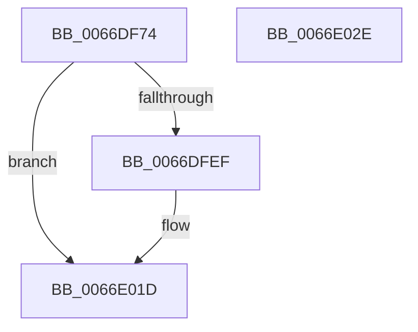

# CmpDeleteCorruptedFile

- RVA: `0x0066DF74`–`0x0066E02F` (길이 `187` bytes)
- VA: `0x000000014066DF74`
- 실행 섹션: `.text`
- PDB 이름 있음: `예`; PDB Function 태그: `예`
- unwind 정보 RVA: `0x000D7558`
- 디코드: `44`개 명령, `187/187` bytes 표시
- 미해석 바이트: `0` (있으면 어셈블리에 `.byte`로 보존)

> 이 문서는 커널 이미지의 기계어와 PDB 기호를 분석해 생성했습니다. 4번과 5번은 함수 원형과 자료형을 바이너리 사용 방식에서 추정한 C 해석이며 원본 소스 복구 결과는 아닙니다.

## 1. Dependencies

- 직접 호출 지점: **3**; 고유 호출 대상: **3**
- 직접 호출자로 확인된 함수: **1**
- RIP 상대 이미지 참조: **0**

### Outgoing calls
- `0x0066DFE6` → [ZwCreateFile](../6A/ZwCreateFile_function_006ADB70.md) (function, `0x006ADB70`)
- `0x0066E00B` → [ZwSetInformationFile](../6A/ZwSetInformationFile_function_006AD5B0.md) (function, `0x006AD5B0`)
- `0x0066E016` → [ZwClose](../6A/ZwClose_function_006AD2B0.md) (function, `0x006AD2B0`)

### Direct callers
- [CmpDeleteCorruptedLogfile](../../page/7F/CmpDeleteCorruptedLogfile_function_007F6C80.md) at `0x007F70F9`
- [CmpDeleteCorruptedLogfile](../../page/7F/CmpDeleteCorruptedLogfile_function_007F6C80.md) at `0x007F712A`
- [CmpDeleteCorruptedLogfile](../../page/7F/CmpDeleteCorruptedLogfile_function_007F6C80.md) at `0x007F71A7`
- [CmpDeleteCorruptedLogfile](../../page/7F/CmpDeleteCorruptedLogfile_function_007F6C80.md) at `0x007F71D6`

### Static image references
- 디코드된 RIP-relative 메모리 참조가 없습니다.

## 2. Other-region calls and transfers

- 다른 실행 섹션으로 향하는 call: **0**
- 별도 외부 분기/꼬리 이동을 확인하지 못했습니다.

## 3. Assembly (complete function range)

```asm
0066DF74  48 8B C4                        mov rax, rsp
0066DF77  48 89 58 18                     mov qword ptr [rax + 0x18], rbx
0066DF7B  55                              push rbp
0066DF7C  48 8D 68 A1                     lea rbp, [rax - 0x5f]
0066DF80  48 81 EC A0 00 00 00            sub rsp, 0xa0
0066DF87  33 DB                           xor ebx, ebx
0066DF89  48 89 4D 37                     mov qword ptr [rbp + 0x37], rcx
0066DF8D  89 58 A8                        mov dword ptr [rax - 0x58], ebx
0066DF90  4C 8D 4D 17                     lea r9, [rbp + 0x17]
0066DF94  48 89 58 A0                     mov qword ptr [rax - 0x60], rbx
0066DF98  4C 8D 45 27                     lea r8, [rbp + 0x27]
0066DF9C  C7 40 98 40 00 20 00            mov dword ptr [rax - 0x68], 0x200040
0066DFA3  48 8D 4D 6F                     lea rcx, [rbp + 0x6f]
0066DFA7  C7 40 90 01 00 00 00            mov dword ptr [rax - 0x70], 1
0066DFAE  0F 57 C0                        xorps xmm0, xmm0
0066DFB1  89 58 88                        mov dword ptr [rax - 0x78], ebx
0066DFB4  BA 00 01 11 00                  mov edx, 0x110100
0066DFB9  C7 40 80 02 00 00 00            mov dword ptr [rax - 0x80], 2
0066DFC0  48 89 5C 24 20                  mov qword ptr [rsp + 0x20], rbx
0066DFC5  48 C7 45 27 30 00 00 00         mov qword ptr [rbp + 0x27], 0x30
0066DFCD  48 C7 45 3F 40 02 00 00         mov qword ptr [rbp + 0x3f], 0x240
0066DFD5  48 89 5D 6F                     mov qword ptr [rbp + 0x6f], rbx
0066DFD9  0F 11 45 17                     movups xmmword ptr [rbp + 0x17], xmm0
0066DFDD  48 89 5D 2F                     mov qword ptr [rbp + 0x2f], rbx
0066DFE1  F3 0F 7F 45 47                  movdqu xmmword ptr [rbp + 0x47], xmm0
0066DFE6  E8 85 FB 03 00                  call 0x1406adb70
0066DFEB  85 C0                           test eax, eax
0066DFED  78 2E                           js 0x14066e01d
0066DFEF  48 8B 4D 6F                     mov rcx, qword ptr [rbp + 0x6f]
0066DFF3  44 8D 4B 01                     lea r9d, [rbx + 1]
0066DFF7  4C 8D 45 67                     lea r8, [rbp + 0x67]
0066DFFB  C6 45 67 01                     mov byte ptr [rbp + 0x67], 1
0066DFFF  48 8D 55 17                     lea rdx, [rbp + 0x17]
0066E003  C7 44 24 20 0D 00 00 00         mov dword ptr [rsp + 0x20], 0xd
0066E00B  E8 A0 F5 03 00                  call 0x1406ad5b0
0066E010  48 8B 4D 6F                     mov rcx, qword ptr [rbp + 0x6f]
0066E014  8B D8                           mov ebx, eax
0066E016  E8 95 F2 03 00                  call 0x1406ad2b0
0066E01B  8B C3                           mov eax, ebx
0066E01D  48 8B 9C 24 C0 00 00 00         mov rbx, qword ptr [rsp + 0xc0]
0066E025  48 81 C4 A0 00 00 00            add rsp, 0xa0
0066E02C  5D                              pop rbp
0066E02D  C3                              ret
0066E02E  CC                              int3
```

## 4. C-style interpretation (structured pseudocode)

```c
__int64 __fastcall CmpDeleteCorruptedFile(__int64 a1)
{
    __int64 result;
    __int64 v_rbx;
    __int64 v_rsp;
    unsigned __int64 v_stack_m88;
    unsigned __int64 v_stack_p18;

    *(unsigned __int64 *)(v_rsp + 24) = v_rbx;
    v_rsp = (v_rsp) - (160);
    v_rbx = 0;
    *(unsigned __int64 *)(v_rsp - 95 + 55) = a1;
    *(unsigned int *)(v_rsp - 88) = 0;
    *(unsigned __int64 *)(v_rsp - 96) = 0;
    *(unsigned int *)(v_rsp - 104) = 0x200040ULL;
    *(unsigned int *)(v_rsp - 112) = 1;
    *(unsigned int *)(v_rsp - 120) = 0;
    *(unsigned int *)(v_rsp - 128) = 2;
    v_stack_m88 = 0;
    *(unsigned __int64 *)(v_rsp - 95 + 39) = 48;
    *(unsigned __int64 *)(v_rsp - 95 + 63) = 576;
    *(unsigned __int64 *)(v_rsp - 95 + 111) = 0;
    *(unsigned __int64 *)(v_rsp - 95 + 23) = v_xmm0;
    *(unsigned __int64 *)(v_rsp - 95 + 47) = 0;
    *(unsigned __int64 *)(v_rsp - 95 + 71) = v_xmm0;
    result = ZwCreateFile(v_rsp - 95 + 111, (unsigned int)(0x110100ULL), v_rsp - 95 + 39, v_rsp - 95 + 23);
    if (!(sign_flag)) {
        a1 = *(unsigned __int64 *)(v_rsp - 95 + 111);
        a4 = v_rbx + 1;
        a3 = v_rsp - 95 + 103;
        *(unsigned __int8 *)(v_rsp - 95 + 103) = 1;
        a2 = v_rsp - 95 + 23;
        v_stack_m88 = 13;
        result = ZwSetInformationFile(a1, a2, a3, a4);
        a1 = *(unsigned __int64 *)(v_rsp - 95 + 111);
        v_rbx = (unsigned int)(result);
        result = ZwClose(a1, a2, a3, a4);
        result = (unsigned int)(v_rbx);
    }
    v_rsp = (v_rsp) + (160);
    return result;
}
```

## 5. (Beta) C Style

```c
int64_t CmpDeleteCorruptedFile(int64_t Arg1)
{
    int64_t result;
    int64_t local_rbx;
    int64_t local_rsp;
    uint64_t v_stack_m88;
    uint64_t v_stack_p18;

    *(uint64_t *)(local_rsp + 0x18) = local_rbx;
    local_rsp = (local_rsp) - (160);
    local_rbx = 0;
    *(uint64_t *)(local_rsp - 0x5F + 0x37) = Arg1;
    *(uint32_t *)(local_rsp - 0x58) = 0;
    *(uint64_t *)(local_rsp - 0x60) = 0;
    *(uint32_t *)(local_rsp - 0x68) = 0x200040ULL;
    *(uint32_t *)(local_rsp - 0x70) = 1;
    *(uint32_t *)(local_rsp - 0x78) = 0;
    *(uint32_t *)(local_rsp - 0x80) = 2;
    v_stack_m88 = 0;
    *(uint64_t *)(local_rsp - 0x5F + 0x27) = 48;
    *(uint64_t *)(local_rsp - 0x5F + 0x3F) = 576;
    *(uint64_t *)(local_rsp - 0x5F + 0x6F) = 0;
    *(uint64_t *)(local_rsp - 0x5F + 0x17) = v_xmm0;
    *(uint64_t *)(local_rsp - 0x5F + 0x2F) = 0;
    *(uint64_t *)(local_rsp - 0x5F + 0x47) = v_xmm0;
    result = ZwCreateFile(local_rsp - 95 + 111, (uint32_t)(0x110100ULL), local_rsp - 95 + 39, local_rsp - 95 + 23);
    if (!(sign_flag)) {
        Arg1 = *(uint64_t *)(local_rsp - 0x5F + 0x6F);
        a4 = local_rbx + 1;
        a3 = local_rsp - 95 + 103;
        *(uint8_t *)(local_rsp - 0x5F + 0x67) = 1;
        a2 = local_rsp - 95 + 23;
        v_stack_m88 = 13;
        result = ZwSetInformationFile(Arg1, a2, a3, a4);
        Arg1 = *(uint64_t *)(local_rsp - 0x5F + 0x6F);
        local_rbx = (uint32_t)(result);
        result = ZwClose(Arg1, a2, a3, a4);
        result = (uint32_t)(local_rbx);
    }
    local_rsp = (local_rsp) + (160);
    return result;
}
```

## 6. Execution-region graph

[열기: 2D/3D 그래프와 함수 탐색 컨트롤 패널](../../../control-panel.html?section=text&rva=0x0066DF74&view=graph)

- 2D 그래프는 위에서 아래로 흐르고, 3D 그래프는 빈 공간을 드래그해 회전합니다. Shift+드래그는 이동, 휠은 확대·축소, 함수 노드 선택은 대상 보고서 이동입니다.

### Static fallback


