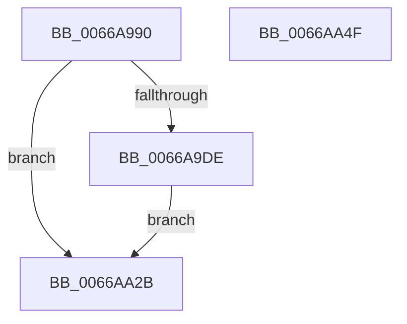

# CmpEnableLazyFlushDpcRoutine

- RVA: `0x0066A990`–`0x0066AA50` (길이 `192` bytes)
- VA: `0x000000014066A990`
- 실행 섹션: `.text`
- PDB 이름 있음: `예`; PDB Function 태그: `아니요`
- unwind 정보 RVA: `0x000D6B60`
- 디코드: `50`개 명령, `192/192` bytes 표시
- 미해석 바이트: `0` (있으면 어셈블리에 `.byte`로 보존)

> 이 문서는 커널 이미지의 기계어와 PDB 기호를 분석해 생성했습니다. 4번과 5번은 함수 원형과 자료형을 바이너리 사용 방식에서 추정한 C 해석이며 원본 소스 복구 결과는 아닙니다.

## 1. Dependencies

- 직접 호출 지점: **3**; 고유 호출 대상: **3**
- 직접 호출자로 확인된 함수: **0**
- RIP 상대 이미지 참조: **0**

### Outgoing calls
- `0x0066A9C9` → [memset](../6C/memset_function_006C6C40.md) (function, `0x006C6C40`)
- `0x0066AA22` → [KiCustomAccessRoutine4](../6B/KiCustomAccessRoutine4_function_006BC640.md) (function, `0x006BC640`)
- `0x0066AA30` → [CmpEnableLazyFlush](../4B/CmpEnableLazyFlush_function_004B7874.md) (function, `0x004B7874`)

### Direct callers
- 이 함수 시작 RVA로 연결되는 직접 call은 확인되지 않았습니다. 간접 호출은 완전히 역산할 수 없습니다.

### Static image references
- 디코드된 RIP-relative 메모리 참조가 없습니다.

## 2. Other-region calls and transfers

- 다른 실행 섹션으로 향하는 call: **0**
- 별도 외부 분기/꼬리 이동을 확인하지 못했습니다.

## 3. Assembly (complete function range)

```asm
0066A990  48 8B C4                        mov rax, rsp
0066A993  48 89 58 08                     mov qword ptr [rax + 8], rbx
0066A997  48 89 70 18                     mov qword ptr [rax + 0x18], rsi
0066A99B  48 89 78 20                     mov qword ptr [rax + 0x20], rdi
0066A99F  41 56                           push r14
0066A9A1  48 81 EC 00 01 00 00            sub rsp, 0x100
0066A9A8  48 89 A4 24 E0 00 00 00         mov qword ptr [rsp + 0xe0], rsp
0066A9B0  4D 8B F1                        mov r14, r9
0066A9B3  49 8B F8                        mov rdi, r8
0066A9B6  48 8B F2                        mov rsi, rdx
0066A9B9  48 8B D9                        mov rbx, rcx
0066A9BC  33 D2                           xor edx, edx
0066A9BE  44 8D 42 5D                     lea r8d, [rdx + 0x5d]
0066A9C2  48 8D 88 78 FF FF FF            lea rcx, [rax - 0x88]
0066A9C9  E8 72 C2 05 00                  call 0x1406c6c40
0066A9CE  48 8B C6                        mov rax, rsi
0066A9D1  48 C1 F8 2F                     sar rax, 0x2f
0066A9D5  48 FF C0                        inc rax
0066A9D8  48 83 F8 01                     cmp rax, 1
0066A9DC  76 4D                           jbe 0x14066aa2b
0066A9DE  83 64 24 30 00                  and dword ptr [rsp + 0x30], 0
0066A9E3  C6 03 00                        mov byte ptr [rbx], 0
0066A9E6  49 8B C6                        mov rax, r14
0066A9E9  48 C1 E8 08                     shr rax, 8
0066A9ED  48 89 43 20                     mov qword ptr [rbx + 0x20], rax
0066A9F1  48 89 BC 24 D5 00 00 00         mov qword ptr [rsp + 0xd5], rdi
0066A9F9  8B CF                           mov ecx, edi
0066A9FB  48 8B C6                        mov rax, rsi
0066A9FE  48 D3 C0                        rol rax, cl
0066AA01  48 89 84 24 A5 00 00 00         mov qword ptr [rsp + 0xa5], rax
0066AA09  48 8B C3                        mov rax, rbx
0066AA0C  48 D3 C8                        ror rax, cl
0066AA0F  48 89 84 24 AD 00 00 00         mov qword ptr [rsp + 0xad], rax
0066AA17  4C 31 73 28                     xor qword ptr [rbx + 0x28], r14
0066AA1B  48 31 7B 30                     xor qword ptr [rbx + 0x30], rdi
0066AA1F  48 8B CE                        mov rcx, rsi
0066AA22  E8 19 1C 05 00                  call 0x1406bc640
0066AA27  90                              nop
0066AA28  90                              nop
0066AA29  EB 00                           jmp 0x14066aa2b
0066AA2B  B9 01 00 00 00                  mov ecx, 1
0066AA30  E8 3F CE E4 FF                  call 0x1404b7874
0066AA35  4C 8D 9C 24 00 01 00 00         lea r11, [rsp + 0x100]
0066AA3D  49 8B 5B 10                     mov rbx, qword ptr [r11 + 0x10]
0066AA41  49 8B 73 20                     mov rsi, qword ptr [r11 + 0x20]
0066AA45  49 8B 7B 28                     mov rdi, qword ptr [r11 + 0x28]
0066AA49  49 8B E3                        mov rsp, r11
0066AA4C  41 5E                           pop r14
0066AA4E  C3                              ret
0066AA4F  CC                              int3
```

## 4. C-style interpretation (structured pseudocode)

```c
__int64 __fastcall CmpEnableLazyFlushDpcRoutine(__int64 a1, __int64 a2, __int64 a3, __int64 a4)
{
    __int64 result;
    __int64 v_rsp;
    unsigned __int64 v_stack_m28;
    unsigned __int64 v_stack_m33;
    unsigned __int64 v_stack_m5B;
    unsigned __int64 v_stack_m63;
    unsigned __int64 v_stack_m8;
    unsigned int v_stack_mD8;

    *(unsigned __int64 *)(v_rsp + 8) = v_rbx;
    *(unsigned __int64 *)(v_rsp + 24) = v_rsi;
    *(unsigned __int64 *)(v_rsp + 32) = v_rdi;
    v_rsp = (v_rsp) - (256);
    v_stack_m28 = v_rsp;
    a2 = 0;
    result = memset(v_rsp - 136, a2, a2 + 93, a4);
    result = (0) >> (47);
    result = (result) + 1;
    if (result <= 1) goto loc_0066AA2B;
    *(unsigned __int8 *)(a1) = 0;
    result = (a4) >> (8);
    *(unsigned __int64 *)(a1 + 32) = result;
    v_stack_m33 = a3;
    v_stack_m63 = 0;
    v_stack_m5B = a1;
    result = KiCustomAccessRoutine4(0, a2, a2 + 93, a4);
    goto loc_0066AA2B;
loc_0066AA2B:
    result = CmpEnableLazyFlush(1, a2, a2 + 93, a4);
    return result;
}
```

## 5. (Beta) C Style

```c
int64_t CmpEnableLazyFlushDpcRoutine(void *Arg1, int64_t Arg2, int64_t Arg3, int64_t Arg4)
{
    uint8_t *arg1 = (uint8_t *)Arg1;

    int64_t result;
    int64_t local_rsp;
    uint64_t v_stack_m28;
    uint64_t v_stack_m33;
    uint64_t v_stack_m5B;
    uint64_t v_stack_m63;
    uint64_t v_stack_m8;
    uint32_t v_stack_mD8;

    *(uint64_t *)(local_rsp + 0x8) = local_rbx;
    *(uint64_t *)(local_rsp + 0x18) = local_rsi;
    *(uint64_t *)(local_rsp + 0x20) = local_rdi;
    local_rsp = (local_rsp) - (256);
    v_stack_m28 = local_rsp;
    Arg2 = 0;
    result = memset(local_rsp - 136, Arg2, Arg2 + 93, Arg4);
    result = (0) >> (47);
    result = (result) + 1;
    if (result <= 1) goto loc_0066AA2B;
    *(uint8_t *)(arg1) = 0;
    result = (Arg4) >> (8);
    *(uint64_t *)(arg1 + 0x20) = result;
    v_stack_m33 = Arg3;
    v_stack_m63 = 0;
    v_stack_m5B = Arg1;
    result = KiCustomAccessRoutine4(0, Arg2, Arg2 + 93, Arg4);
    goto loc_0066AA2B;
loc_0066AA2B:
    result = CmpEnableLazyFlush(1, Arg2, Arg2 + 93, Arg4);
    return result;
}
```

### 관측된 메모리 오프셋

구조체 형식이 확인되지 않은 접근은 인자 기준의 오프셋으로만 기록했습니다.

| 기준 인자 | 오프셋 표현 | 폭 (bit) | 접근 |
|---|---:|---:|---|
| `Arg1` | `+ 0x0` | `8` | `W` |
| `Arg1` | `+ 0x20` | `64` | `W` |
| `Arg1` | `+ 0x28` | `64` | `R/W` |
| `Arg1` | `+ 0x30` | `64` | `R/W` |

## 6. Execution-region graph

[열기: 2D/3D 그래프와 함수 탐색 컨트롤 패널](../../../control-panel.html?section=text&rva=0x0066A990&view=graph)

- 2D 그래프는 위에서 아래로 흐르고, 3D 그래프는 빈 공간을 드래그해 회전합니다. Shift+드래그는 이동, 휠은 확대·축소, 함수 노드 선택은 대상 보고서 이동입니다.

### Static fallback


