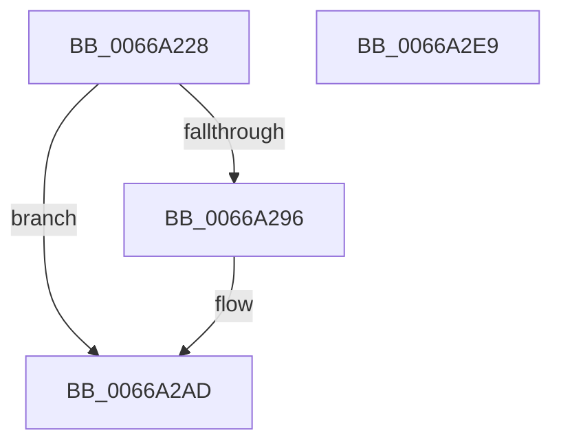

# CmpInitializeLoadOptions

- RVA: `0x0066A228`–`0x0066A2EA` (길이 `194` bytes)
- VA: `0x000000014066A228`
- 실행 섹션: `.text`
- PDB 이름 있음: `예`; PDB Function 태그: `아니요`
- unwind 정보 RVA: `0x000D6494`
- 디코드: `48`개 명령, `194/194` bytes 표시
- 미해석 바이트: `0` (있으면 어셈블리에 `.byte`로 보존)

> 이 문서는 커널 이미지의 기계어와 PDB 기호를 분석해 생성했습니다. 4번과 5번은 함수 원형과 자료형을 바이너리 사용 방식에서 추정한 C 해석이며 원본 소스 복구 결과는 아닙니다.

## 1. Dependencies

- 직접 호출 지점: **4**; 고유 호출 대상: **4**
- 직접 호출자로 확인된 함수: **1**
- RIP 상대 이미지 참조: **6**

### Outgoing calls
- `0x0066A24D` → [RtlInitAnsiString](../47/RtlInitAnsiString_function_00470F40.md) (function, `0x00470F40`)
- `0x0066A285` → [CmpAllocatePool](../3C/CmpAllocatePool_function_003CD504.md) (function, `0x003CD504`)
- `0x0066A2A7` → [KeBugCheckEx](../4F/KeBugCheckEx_function_004FD660.md) (function, `0x004FD660`)
- `0x0066A2BC` → [RtlAnsiStringToUnicodeString](../../page/90/RtlAnsiStringToUnicodeString_function_0090BEA0.md) (function, `0x0090BEA0`)

### Direct callers
- [CmInitSystem1](../../init/C5/CmInitSystem1_function_00C559CC.md) at `0x00C56064`

### Static image references
- `0x0066A269` → RVA `0x010086D8` (`INITDATA`; write)
- `0x0066A27E` → RVA `0x010086DA` (`INITDATA`; write)
- `0x0066A28A` → RVA `0x010086E0` (`INITDATA`; write)
- `0x0066A2B5` → RVA `0x010086D8` (`INITDATA`; read)
- `0x0066A2C6` → RVA `0x010086E0` (`INITDATA`; read)
- `0x0066A2D6` → RVA `0x010086D8` (`INITDATA`; read/write)

## 2. Other-region calls and transfers

- 다른 실행 섹션으로 향하는 call: **1**
  - `0x0066A2BC` → [RtlAnsiStringToUnicodeString](../../page/90/RtlAnsiStringToUnicodeString_function_0090BEA0.md) (`.text` → `PAGE`)
- 별도 외부 분기/꼬리 이동을 확인하지 못했습니다.

## 3. Assembly (complete function range)

```asm
0066A228  48 8B C4                        mov rax, rsp
0066A22B  48 89 68 08                     mov qword ptr [rax + 8], rbp
0066A22F  48 89 70 10                     mov qword ptr [rax + 0x10], rsi
0066A233  57                              push rdi
0066A234  48 83 EC 40                     sub rsp, 0x40
0066A238  48 8B 91 D8 00 00 00            mov rdx, qword ptr [rcx + 0xd8]
0066A23F  48 8B F9                        mov rdi, rcx
0066A242  0F 57 C0                        xorps xmm0, xmm0
0066A245  48 8D 48 E8                     lea rcx, [rax - 0x18]
0066A249  0F 11 40 E8                     movups xmmword ptr [rax - 0x18], xmm0
0066A24D  E8 EE 6C E0 FF                  call 0x140470f40
0066A252  0F B7 44 24 30                  movzx eax, word ptr [rsp + 0x30]
0066A257  33 F6                           xor esi, esi
0066A259  0F B7 54 24 30                  movzx edx, word ptr [rsp + 0x30]
0066A25E  B9 00 01 00 00                  mov ecx, 0x100
0066A263  41 B8 43 4D 39 30               mov r8d, 0x30394d43
0066A269  66 89 35 68 E4 99 00            mov word ptr [rip + 0x99e468], si
0066A270  8D 6E 01                        lea ebp, [rsi + 1]
0066A273  66 03 C5                        add ax, bp
0066A276  03 D5                           add edx, ebp
0066A278  66 03 C0                        add ax, ax
0066A27B  48 03 D2                        add rdx, rdx
0066A27E  66 89 05 55 E4 99 00            mov word ptr [rip + 0x99e455], ax
0066A285  E8 7A 32 D6 FF                  call 0x1403cd504
0066A28A  48 89 05 4F E4 99 00            mov qword ptr [rip + 0x99e44f], rax
0066A291  48 85 C0                        test rax, rax
0066A294  75 17                           jne 0x14066a2ad
0066A296  4C 8B CF                        mov r9, rdi
0066A299  48 89 74 24 20                  mov qword ptr [rsp + 0x20], rsi
0066A29E  44 8B C5                        mov r8d, ebp
0066A2A1  8D 56 03                        lea edx, [rsi + 3]
0066A2A4  8D 4E 74                        lea ecx, [rsi + 0x74]
0066A2A7  E8 B4 33 E9 FF                  call 0x1404fd660
0066A2AC  CC                              int3
0066A2AD  45 33 C0                        xor r8d, r8d
0066A2B0  48 8D 54 24 30                  lea rdx, [rsp + 0x30]
0066A2B5  48 8D 0D 1C E4 99 00            lea rcx, [rip + 0x99e41c]
0066A2BC  E8 DF 1B 2A 00                  call 0x14090bea0
0066A2C1  0F B7 4C 24 30                  movzx ecx, word ptr [rsp + 0x30]
0066A2C6  48 8B 05 13 E4 99 00            mov rax, qword ptr [rip + 0x99e413]
0066A2CD  48 8B 6C 24 50                  mov rbp, qword ptr [rsp + 0x50]
0066A2D2  66 89 34 48                     mov word ptr [rax + rcx*2], si
0066A2D6  66 83 05 FA E3 99 00 02         add word ptr [rip + 0x99e3fa], 2
0066A2DE  48 8B 74 24 58                  mov rsi, qword ptr [rsp + 0x58]
0066A2E3  48 83 C4 40                     add rsp, 0x40
0066A2E7  5F                              pop rdi
0066A2E8  C3                              ret
0066A2E9  CC                              int3
```

## 4. C-style interpretation (structured pseudocode)

```c
__int64 __fastcall CmpInitializeLoadOptions(__int64 a1)
{
    __int64 result;
    __int64 v_rsi;
    __int64 v_rsp;
    unsigned __int16 v_stack_m18;
    unsigned __int64 v_stack_m28;
    unsigned __int64 v_stack_p10;
    unsigned __int64 v_stack_p8;

    *(unsigned __int64 *)(v_rsp + 8) = v_rbp;
    *(unsigned __int64 *)(v_rsp + 16) = v_rsi;
    v_rsp = (v_rsp) - (64);
    *(unsigned __int64 *)(v_rsp - 24) = v_xmm0;
    result = RtlInitAnsiString(v_rsp - 24, *(unsigned __int64 *)(a1 + 216), a3, a4);
    v_rsi = 0;
    *(unsigned __int16 *)(v_rip + 10085480) = 0;
    result = (unsigned __int16)((v_stack_m18) + ((unsigned __int16)(v_rsi + 1)));
    a2 = (unsigned int)((v_stack_m18) + ((unsigned int)(v_rsi + 1)));
    result = (unsigned __int16)((result) + ((unsigned __int16)(result)));
    a2 = (a2) + (a2);
    *(unsigned __int16 *)(v_rip + 10085461) = (unsigned __int16)(result);
    result = CmpAllocatePool(256, a2, (unsigned int)(0x30394D43ULL), a4);
    *(unsigned __int64 *)(v_rip + 10085455) = result;
    if (result == 0) {
        a4 = a1;
        v_stack_m28 = 0;
        a3 = (unsigned int)(v_rsi + 1);
        a2 = v_rsi + 3;
        a1 = v_rsi + 116;
        result = KeBugCheckEx(a1, a2, a3, a4);
    }
    a3 = 0;
    result = RtlAnsiStringToUnicodeString(v_rip + 10085404, v_stack_m18, a3, a4);
    *(unsigned __int16 *)(*(unsigned __int64 *)(v_rip + 10085395) + v_stack_m18 * 2) = 0;
    v_rsp = (v_rsp) + (64);
    return *(unsigned __int64 *)(v_rip + 10085395);
}
```

## 5. (Beta) C Style

```c
int64_t CmpInitializeLoadOptions(void *Arg1)
{
    uint8_t *arg1 = (uint8_t *)Arg1;

    int64_t result;
    int64_t local_rsi;
    int64_t local_rsp;
    uint16_t v_stack_m18;
    uint64_t v_stack_m28;
    uint64_t v_stack_p10;
    uint64_t v_stack_p8;

    *(uint64_t *)(local_rsp + 0x8) = local_rbp;
    *(uint64_t *)(local_rsp + 0x10) = local_rsi;
    local_rsp = (local_rsp) - (64);
    *(uint64_t *)(local_rsp - 0x18) = v_xmm0;
    result = RtlInitAnsiString(local_rsp - 24, *(uint64_t *)(arg1 + 0xD8), a3, a4);
    local_rsi = 0;
    *(uint16_t *)(v_rip + 0x99E468) = 0;
    result = (uint16_t)((v_stack_m18) + ((uint16_t)(local_rsi + 1)));
    a2 = (uint32_t)((v_stack_m18) + ((uint32_t)(local_rsi + 1)));
    result = (uint16_t)((result) + ((uint16_t)(result)));
    a2 = (a2) + (a2);
    *(uint16_t *)(v_rip + 0x99E455) = (uint16_t)(result);
    result = CmpAllocatePool(256, a2, (uint32_t)(0x30394D43ULL), a4);
    *(uint64_t *)(v_rip + 0x99E44F) = result;
    if (result == 0) {
        a4 = Arg1;
        v_stack_m28 = 0;
        a3 = (uint32_t)(local_rsi + 1);
        a2 = local_rsi + 3;
        Arg1 = local_rsi + 116;
        result = KeBugCheckEx(Arg1, a2, a3, a4);
    }
    a3 = 0;
    result = RtlAnsiStringToUnicodeString(v_rip + 10085404, v_stack_m18, a3, a4);
    *(uint16_t *)(*(uint64_t *)(v_rip + 0x99E413) + v_stack_m18 * 2) = 0;
    local_rsp = (local_rsp) + (64);
    return *(uint64_t *)(v_rip + 0x99E413);
}
```

### 관측된 메모리 오프셋

구조체 형식이 확인되지 않은 접근은 인자 기준의 오프셋으로만 기록했습니다.

| 기준 인자 | 오프셋 표현 | 폭 (bit) | 접근 |
|---|---:|---:|---|
| `Arg1` | `+ 0xD8` | `64` | `R` |

## 6. Execution-region graph

[열기: 2D/3D 그래프와 함수 탐색 컨트롤 패널](../../../control-panel.html?section=text&rva=0x0066A228&view=graph)

- 2D 그래프는 위에서 아래로 흐르고, 3D 그래프는 빈 공간을 드래그해 회전합니다. Shift+드래그는 이동, 휠은 확대·축소, 함수 노드 선택은 대상 보고서 이동입니다.

### Static fallback


