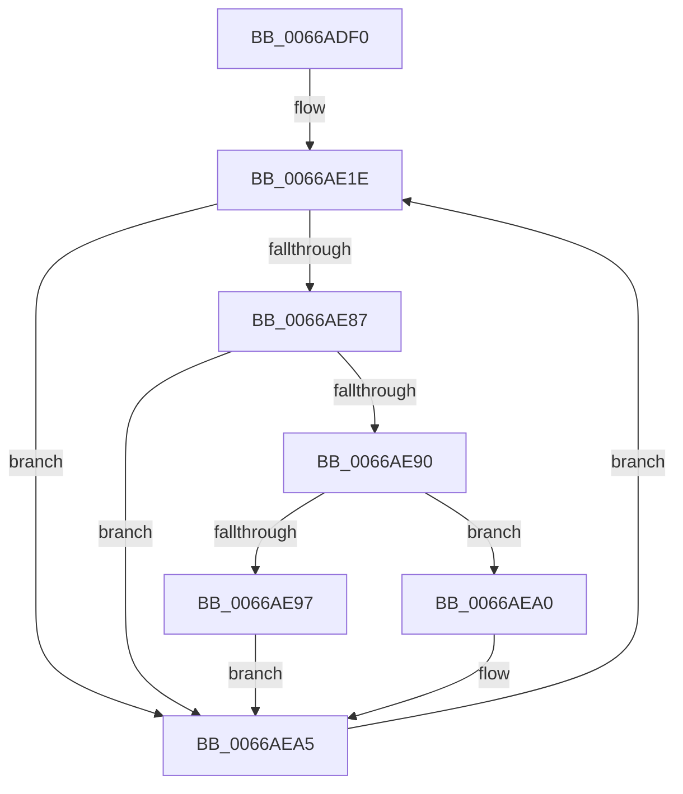

# CmpLazyWriteWorker

- RVA: `0x0066ADF0`–`0x0066AED8` (길이 `232` bytes)
- VA: `0x000000014066ADF0`
- 실행 섹션: `.text`
- PDB 이름 있음: `예`; PDB Function 태그: `아니요`
- unwind 정보 RVA: `0x000D7078`
- 디코드: `53`개 명령, `232/232` bytes 표시
- 미해석 바이트: `0` (있으면 어셈블리에 `.byte`로 보존)

> 이 문서는 커널 이미지의 기계어와 PDB 기호를 분석해 생성했습니다. 4번과 5번은 함수 원형과 자료형을 바이너리 사용 방식에서 추정한 C 해석이며 원본 소스 복구 결과는 아닙니다.

## 1. Dependencies

- 직접 호출 지점: **7**; 고유 호출 대상: **7**
- 직접 호출자로 확인된 함수: **0**
- RIP 상대 이미지 참조: **3**

### Outgoing calls
- `0x0066AE23` → [CmpInitializeThreadInfo](../3F/CmpInitializeThreadInfo_function_003FBE70.md) (function, `0x003FBE70`)
- `0x0066AE3D` → [KeWaitForSingleObject](../20/KeWaitForSingleObject_function_0020E6B0.md) (function, `0x0020E6B0`)
- `0x0066AE45` → [KeAcquireSpinLockRaiseToDpc](../20/KeAcquireSpinLockRaiseToDpc_function_00208470.md) (function, `0x00208470`)
- `0x0066AE5A` → [KeReleaseSpinLock](../39/KeReleaseSpinLock_function_00392BA0.md) (function, `0x00392BA0`)
- `0x0066AE73` → [guard_dispatch_icall](../6B/guard_dispatch_icall_function_006BAAD0.md) (function, `0x006BAAD0`)
- `0x0066AEA0` → [CmpDiskFullWarning](../../page/7E/CmpDiskFullWarning_function_007E59E0.md) (function, `0x007E59E0`)
- `0x0066AEB9` → [CmpCompleteLazyWrite](../22/CmpCompleteLazyWrite_function_0022FA10.md) (function, `0x0022FA10`)

### Direct callers
- 이 함수 시작 RVA로 연결되는 직접 call은 확인되지 않았습니다. 간접 호출은 완전히 역산할 수 없습니다.

### Static image references
- `0x0066AE7B` → RVA `0x00E03710` (`.data`; read)
- `0x0066AE87` → RVA `0x00FD9A63` (`PAGEDATA`; read)
- `0x0066AE97` → RVA `0x00FD9A63` (`PAGEDATA`; write)

## 2. Other-region calls and transfers

- 다른 실행 섹션으로 향하는 call: **1**
  - `0x0066AEA0` → [CmpDiskFullWarning](../../page/7E/CmpDiskFullWarning_function_007E59E0.md) (`.text` → `PAGE`)
- 별도 외부 분기/꼬리 이동을 확인하지 못했습니다.

## 3. Assembly (complete function range)

```asm
0066ADF0  4C 8B DC                        mov r11, rsp
0066ADF3  49 89 5B 08                     mov qword ptr [r11 + 8], rbx
0066ADF7  55                              push rbp
0066ADF8  56                              push rsi
0066ADF9  57                              push rdi
0066ADFA  48 83 EC 50                     sub rsp, 0x50
0066ADFE  33 C0                           xor eax, eax
0066AE00  48 8D B1 98 00 00 00            lea rsi, [rcx + 0x98]
0066AE07  49 21 43 18                     and qword ptr [r11 + 0x18], rax
0066AE0B  0F 57 C0                        xorps xmm0, xmm0
0066AE0E  0F 11 44 24 30                  movups xmmword ptr [rsp + 0x30], xmm0
0066AE13  49 89 43 D8                     mov qword ptr [r11 - 0x28], rax
0066AE17  48 8B D9                        mov rbx, rcx
0066AE1A  88 44 24 78                     mov byte ptr [rsp + 0x78], al
0066AE1E  48 8D 4C 24 30                  lea rcx, [rsp + 0x30]
0066AE23  E8 48 10 D9 FF                  call 0x1403fbe70
0066AE28  48 83 64 24 20 00               and qword ptr [rsp + 0x20], 0
0066AE2E  48 8D 8B 80 00 00 00            lea rcx, [rbx + 0x80]
0066AE35  41 B0 01                        mov r8b, 1
0066AE38  33 D2                           xor edx, edx
0066AE3A  45 33 C9                        xor r9d, r9d
0066AE3D  E8 6E 38 BA FF                  call 0x14020e6b0
0066AE42  48 8B CE                        mov rcx, rsi
0066AE45  E8 26 D6 B9 FF                  call 0x140208470
0066AE4A  8A D0                           mov dl, al
0066AE4C  48 C7 83 A8 00 00 00 02 00 00 00  mov qword ptr [rbx + 0xa8], 2
0066AE57  48 8B CE                        mov rcx, rsi
0066AE5A  E8 41 7D D2 FF                  call 0x140392ba0
0066AE5F  48 8B 83 A0 00 00 00            mov rax, qword ptr [rbx + 0xa0]
0066AE66  48 8D 94 24 80 00 00 00         lea rdx, [rsp + 0x80]
0066AE6E  48 8D 4C 24 78                  lea rcx, [rsp + 0x78]
0066AE73  E8 58 FC 04 00                  call 0x1406baad0
0066AE78  40 8A F8                        mov dil, al
0066AE7B  48 8D 05 8E 88 79 00            lea rax, [rip + 0x79888e]
0066AE82  48 3B D8                        cmp rbx, rax
0066AE85  75 1E                           jne 0x14066aea5
0066AE87  80 3D D5 EB 96 00 00            cmp byte ptr [rip + 0x96ebd5], 0
0066AE8E  74 15                           je 0x14066aea5
0066AE90  80 7C 24 78 00                  cmp byte ptr [rsp + 0x78], 0
0066AE95  75 09                           jne 0x14066aea0
0066AE97  C6 05 C5 EB 96 00 00            mov byte ptr [rip + 0x96ebc5], 0
0066AE9E  EB 05                           jmp 0x14066aea5
0066AEA0  E8 3B AB 17 00                  call 0x1407e59e0
0066AEA5  40 F6 DF                        neg dil
0066AEA8  48 8D 84 24 80 00 00 00         lea rax, [rsp + 0x80]
0066AEB0  48 8B CB                        mov rcx, rbx
0066AEB3  48 1B D2                        sbb rdx, rdx
0066AEB6  48 23 D0                        and rdx, rax
0066AEB9  E8 52 4B BC FF                  call 0x14022fa10
0066AEBE  65 48 8B 0C 25 88 01 00 00      mov rcx, qword ptr gs:[0x188]
0066AEC7  48 8B 44 24 30                  mov rax, qword ptr [rsp + 0x30]
0066AECC  48 89 81 E8 06 00 00            mov qword ptr [rcx + 0x6e8], rax
0066AED3  E9 46 FF FF FF                  jmp 0x14066ae1e
```

## 4. C-style interpretation (structured pseudocode)

```c
__int64 __fastcall CmpLazyWriteWorker(__int64 a1, int a2, __int64 a3, int a4)
{
    __int64 result;
    __int64 v_rdi;
    __int64 v_rsp;
    unsigned __int64 v_stack_m38;
    unsigned __int64 v_stack_m48;
    unsigned __int8 v_stack_p10;
    unsigned __int64 v_stack_p18;

    *(unsigned __int64 *)(v_rsp + 8) = v_rbx;
    v_rsp = (v_rsp) - (80);
    result = 0;
    v_stack_m38 = v_xmm0;
    *(unsigned __int64 *)(v_rsp - 40) = 0;
    v_stack_p10 = 0;
loc_0066AE1E:
    result = CmpInitializeThreadInfo(v_stack_m38, a2, a3, a4);
    a2 = 0;
    a4 = 0;
    result = KeWaitForSingleObject(a1 + 128, a2, 1, a4);
    result = KeAcquireSpinLockRaiseToDpc(a1 + 152, a2, 1, a4);
    *(unsigned __int64 *)(a1 + 168) = 2;
    result = KeReleaseSpinLock(a1 + 152, (unsigned __int8)(result), 1, a4);
    result = guard_dispatch_icall(v_stack_p10, v_stack_p18, 1, a4);
    if (a1 != (v_rip + 7964814)) goto loc_0066AEA5;
    if ((*(unsigned __int8 *)(v_rip + 9890773)) == 0) goto loc_0066AEA5;
    if (v_stack_p10 != 0) goto loc_0066AEA0;
    *(unsigned __int8 *)(v_rip + 9890757) = 0;
    goto loc_0066AEA5;
loc_0066AEA0:
    result = CmpDiskFullWarning(v_stack_p10, v_stack_p18, 1, a4);
loc_0066AEA5:
    v_rdi = (unsigned __int8)(-((unsigned __int8)(result)));
    a2 = (v_stack_p18) & (v_stack_p18);
    result = CmpCompleteLazyWrite(a1, a2, 1, a4);
    *(unsigned __int64 *)(*(unsigned __int64 *)(gs_base + (0 + 392)) + 1768) = v_stack_m38;
    goto loc_0066AE1E;
}
```

## 5. (Beta) C Style

```c
int64_t CmpLazyWriteWorker(void *Arg1, int32_t Arg2, int64_t Arg3, int32_t Arg4)
{
    uint8_t *arg1 = (uint8_t *)Arg1;

    int64_t result;
    int64_t local_rdi;
    int64_t local_rsp;
    uint64_t v_stack_m38;
    uint64_t v_stack_m48;
    uint8_t v_stack_p10;
    uint64_t v_stack_p18;

    *(uint64_t *)(local_rsp + 0x8) = local_rbx;
    local_rsp = (local_rsp) - (80);
    result = 0;
    v_stack_m38 = v_xmm0;
    *(uint64_t *)(local_rsp - 0x28) = 0;
    v_stack_p10 = 0;
loc_0066AE1E:
    result = CmpInitializeThreadInfo(v_stack_m38, Arg2, Arg3, Arg4);
    Arg2 = 0;
    Arg4 = 0;
    result = KeWaitForSingleObject(Arg1 + 128, Arg2, 1, Arg4);
    result = KeAcquireSpinLockRaiseToDpc(Arg1 + 152, Arg2, 1, Arg4);
    *(uint64_t *)(arg1 + 0xA8) = 2;
    result = KeReleaseSpinLock(Arg1 + 152, (uint8_t)(result), 1, Arg4);
    result = guard_dispatch_icall(v_stack_p10, v_stack_p18, 1, Arg4);
    if (Arg1 != (v_rip + 7964814)) goto loc_0066AEA5;
    if ((*(uint8_t *)(v_rip + 0x96EBD5)) == 0) goto loc_0066AEA5;
    if (v_stack_p10 != 0) goto loc_0066AEA0;
    *(uint8_t *)(v_rip + 0x96EBC5) = 0;
    goto loc_0066AEA5;
loc_0066AEA0:
    result = CmpDiskFullWarning(v_stack_p10, v_stack_p18, 1, Arg4);
loc_0066AEA5:
    local_rdi = (uint8_t)(-((uint8_t)(result)));
    Arg2 = (v_stack_p18) & (v_stack_p18);
    result = CmpCompleteLazyWrite(Arg1, Arg2, 1, Arg4);
    *(uint64_t *)(*(uint64_t *)(gs_base + (0 + 0x188)) + 0x6E8) = v_stack_m38;
    goto loc_0066AE1E;
}
```

### 관측된 메모리 오프셋

구조체 형식이 확인되지 않은 접근은 인자 기준의 오프셋으로만 기록했습니다.

| 기준 인자 | 오프셋 표현 | 폭 (bit) | 접근 |
|---|---:|---:|---|
| `Arg1` | `+ 0x98` | `64` | `R` |

## 6. Execution-region graph

[열기: 2D/3D 그래프와 함수 탐색 컨트롤 패널](../../../control-panel.html?section=text&rva=0x0066ADF0&view=graph)

- 2D 그래프는 위에서 아래로 흐르고, 3D 그래프는 빈 공간을 드래그해 회전합니다. Shift+드래그는 이동, 휠은 확대·축소, 함수 노드 선택은 대상 보고서 이동입니다.

### Static fallback


