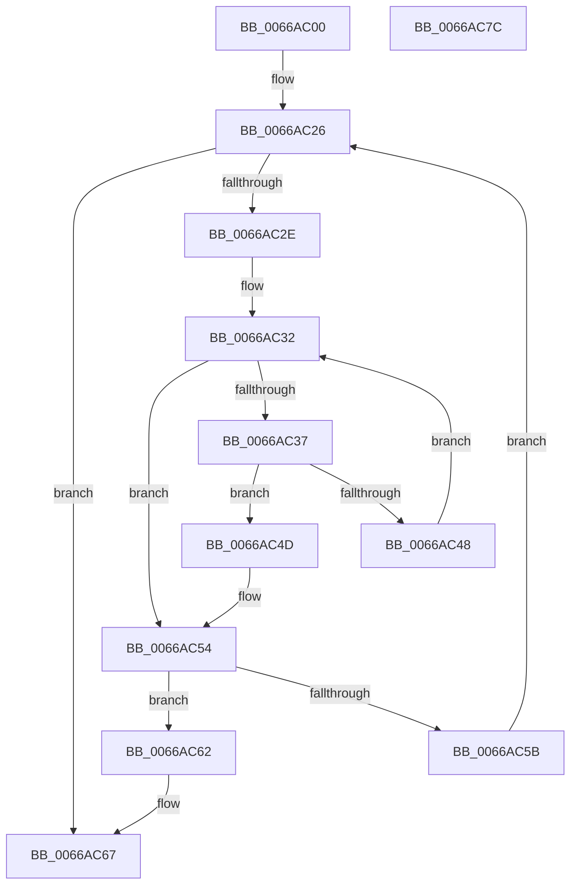

# CmpLockKcbStackFlusherLocksExclusive

- RVA: `0x0066AC00`–`0x0066AC7D` (길이 `125` bytes)
- VA: `0x000000014066AC00`
- 실행 섹션: `.text`
- PDB 이름 있음: `예`; PDB Function 태그: `아니요`
- unwind 정보 RVA: `0x0005C954`
- 디코드: `39`개 명령, `125/125` bytes 표시
- 미해석 바이트: `0` (있으면 어셈블리에 `.byte`로 보존)

> 이 문서는 커널 이미지의 기계어와 PDB 기호를 분석해 생성했습니다. 4번과 5번은 함수 원형과 자료형을 바이너리 사용 방식에서 추정한 C 해석이며 원본 소스 복구 결과는 아닙니다.

## 1. Dependencies

- 직접 호출 지점: **5**; 고유 호출 대상: **4**
- 직접 호출자로 확인된 함수: **1**
- RIP 상대 이미지 참조: **0**

### Outgoing calls
- `0x0066AC1F` → [CmpGetNextActiveHive](../../page/84/CmpGetNextActiveHive_function_0084E2A0.md) (function, `0x0084E2A0`)
- `0x0066AC3A` → [CmpGetKcbAtLayerHeight](../../page/94/CmpGetKcbAtLayerHeight_function_00949210.md) (function, `0x00949210`)
- `0x0066AC4D` → [HvLockHiveFlusherExclusive](../../pagecmrc/BC/HvLockHiveFlusherExclusive_function_00BC9C50.md) (function, `0x00BC9C50`)
- `0x0066AC5B` → [CmpGetNextActiveHive](../../page/84/CmpGetNextActiveHive_function_0084E2A0.md) (function, `0x0084E2A0`)
- `0x0066AC62` → [CmpQuitNextActiveHive](../../page/A8/CmpQuitNextActiveHive_function_00A85AA4.md) (function, `0x00A85AA4`)

### Direct callers
- [CmSaveKey](../../page/7D/CmSaveKey_function_007DDBDC.md) at `0x007DDD48`

### Static image references
- 디코드된 RIP-relative 메모리 참조가 없습니다.

## 2. Other-region calls and transfers

- 다른 실행 섹션으로 향하는 call: **5**
  - `0x0066AC1F` → [CmpGetNextActiveHive](../../page/84/CmpGetNextActiveHive_function_0084E2A0.md) (`.text` → `PAGE`)
  - `0x0066AC3A` → [CmpGetKcbAtLayerHeight](../../page/94/CmpGetKcbAtLayerHeight_function_00949210.md) (`.text` → `PAGE`)
  - `0x0066AC4D` → [HvLockHiveFlusherExclusive](../../pagecmrc/BC/HvLockHiveFlusherExclusive_function_00BC9C50.md) (`.text` → `PAGECMRC`)
  - `0x0066AC5B` → [CmpGetNextActiveHive](../../page/84/CmpGetNextActiveHive_function_0084E2A0.md) (`.text` → `PAGE`)
  - `0x0066AC62` → [CmpQuitNextActiveHive](../../page/A8/CmpQuitNextActiveHive_function_00A85AA4.md) (`.text` → `PAGE`)
- 별도 외부 분기/꼬리 이동을 확인하지 못했습니다.

## 3. Assembly (complete function range)

```asm
0066AC00  48 89 5C 24 08                  mov qword ptr [rsp + 8], rbx
0066AC05  48 89 6C 24 10                  mov qword ptr [rsp + 0x10], rbp
0066AC0A  48 89 74 24 18                  mov qword ptr [rsp + 0x18], rsi
0066AC0F  57                              push rdi
0066AC10  48 83 EC 20                     sub rsp, 0x20
0066AC14  0F BF 79 02                     movsx edi, word ptr [rcx + 2]
0066AC18  48 8B F1                        mov rsi, rcx
0066AC1B  33 C9                           xor ecx, ecx
0066AC1D  FF C7                           inc edi
0066AC1F  E8 7C 36 1E 00                  call 0x14084e2a0
0066AC24  33 ED                           xor ebp, ebp
0066AC26  48 8B D8                        mov rbx, rax
0066AC29  48 85 C0                        test rax, rax
0066AC2C  74 39                           je 0x14066ac67
0066AC2E  0F B7 56 02                     movzx edx, word ptr [rsi + 2]
0066AC32  66 85 D2                        test dx, dx
0066AC35  78 1D                           js 0x14066ac54
0066AC37  48 8B CE                        mov rcx, rsi
0066AC3A  E8 D1 E5 2D 00                  call 0x140949210
0066AC3F  48 8B 48 20                     mov rcx, qword ptr [rax + 0x20]
0066AC43  48 3B CB                        cmp rcx, rbx
0066AC46  74 05                           je 0x14066ac4d
0066AC48  66 FF CA                        dec dx
0066AC4B  EB E5                           jmp 0x14066ac32
0066AC4D  E8 FE EF 55 00                  call 0x140bc9c50
0066AC52  FF CF                           dec edi
0066AC54  48 8B CB                        mov rcx, rbx
0066AC57  85 FF                           test edi, edi
0066AC59  74 07                           je 0x14066ac62
0066AC5B  E8 40 36 1E 00                  call 0x14084e2a0
0066AC60  EB C4                           jmp 0x14066ac26
0066AC62  E8 3D AE 41 00                  call 0x140a85aa4
0066AC67  48 8B 5C 24 30                  mov rbx, qword ptr [rsp + 0x30]
0066AC6C  48 8B 6C 24 38                  mov rbp, qword ptr [rsp + 0x38]
0066AC71  48 8B 74 24 40                  mov rsi, qword ptr [rsp + 0x40]
0066AC76  48 83 C4 20                     add rsp, 0x20
0066AC7A  5F                              pop rdi
0066AC7B  C3                              ret
0066AC7C  CC                              int3
```

## 4. C-style interpretation (structured pseudocode)

```c
__int64 __fastcall CmpLockKcbStackFlusherLocksExclusive(__int64 a1)
{
    __int64 result;
    __int64 v_rbp;
    __int64 v_rdi;
    __int64 v_rsp;
    unsigned __int64 v_stack_p10;
    unsigned __int64 v_stack_p18;
    unsigned __int64 v_stack_p8;

    v_stack_p8 = v_rbx;
    v_stack_p10 = v_rbp;
    v_stack_p18 = v_rsi;
    v_rsp = (v_rsp) - (32);
    a1 = 0;
    v_rdi = (unsigned int)(((__int16)(*(unsigned __int16 *)(a1 + 2))) + 1);
    result = CmpGetNextActiveHive(a1, a2, a3, a4);
    v_rbp = 0;
loc_0066AC26:
    if (result == 0) goto loc_0066AC67;
loc_0066AC32:
    if (sign_flag) goto loc_0066AC54;
    result = CmpGetKcbAtLayerHeight(0, *(unsigned __int16 *)(a1 + 2), a3, a4);
    if ((*(unsigned __int64 *)(result + 32)) == result) goto loc_0066AC4D;
    a2 = (unsigned __int16)((*(unsigned __int16 *)(a1 + 2)) - 1);
    goto loc_0066AC32;
loc_0066AC4D:
    result = HvLockHiveFlusherExclusive(*(unsigned __int64 *)(result + 32), a2, a3, a4);
    v_rdi = (unsigned int)((v_rdi) - 1);
loc_0066AC54:
    if ((unsigned int)(v_rdi) == 0) goto loc_0066AC62;
    result = CmpGetNextActiveHive(result, a2, a3, a4);
    goto loc_0066AC26;
loc_0066AC62:
    result = CmpQuitNextActiveHive(result, a2, a3, a4);
loc_0066AC67:
    v_rsp = (v_rsp) + (32);
    return result;
}
```

## 5. (Beta) C Style

```c
int64_t CmpLockKcbStackFlusherLocksExclusive(void *Arg1)
{
    uint8_t *arg1 = (uint8_t *)Arg1;

    int64_t result;
    int64_t local_rbp;
    int64_t local_rdi;
    int64_t local_rsp;
    uint64_t v_stack_p10;
    uint64_t v_stack_p18;
    uint64_t v_stack_p8;

    v_stack_p8 = local_rbx;
    v_stack_p10 = local_rbp;
    v_stack_p18 = local_rsi;
    local_rsp = (local_rsp) - (32);
    Arg1 = 0;
    local_rdi = (uint32_t)(((int16_t)(*(uint16_t *)(arg1 + 0x2))) + 1);
    result = CmpGetNextActiveHive(Arg1, a2, a3, a4);
    local_rbp = 0;
loc_0066AC26:
    if (result == 0) goto loc_0066AC67;
loc_0066AC32:
    if (sign_flag) goto loc_0066AC54;
    result = CmpGetKcbAtLayerHeight(0, *(uint16_t *)(arg1 + 0x2), a3, a4);
    if ((*(uint64_t *)(result + 0x20)) == result) goto loc_0066AC4D;
    a2 = (uint16_t)((*(uint16_t *)(arg1 + 0x2)) - 1);
    goto loc_0066AC32;
loc_0066AC4D:
    result = HvLockHiveFlusherExclusive(*(uint64_t *)(result + 0x20), a2, a3, a4);
    local_rdi = (uint32_t)((local_rdi) - 1);
loc_0066AC54:
    if ((uint32_t)(local_rdi) == 0) goto loc_0066AC62;
    result = CmpGetNextActiveHive(result, a2, a3, a4);
    goto loc_0066AC26;
loc_0066AC62:
    result = CmpQuitNextActiveHive(result, a2, a3, a4);
loc_0066AC67:
    local_rsp = (local_rsp) + (32);
    return result;
}
```

### 관측된 메모리 오프셋

구조체 형식이 확인되지 않은 접근은 인자 기준의 오프셋으로만 기록했습니다.

| 기준 인자 | 오프셋 표현 | 폭 (bit) | 접근 |
|---|---:|---:|---|
| `Arg1` | `+ 0x2` | `16` | `R` |

## 6. Execution-region graph

[열기: 2D/3D 그래프와 함수 탐색 컨트롤 패널](../../../control-panel.html?section=text&rva=0x0066AC00&view=graph)

- 2D 그래프는 위에서 아래로 흐르고, 3D 그래프는 빈 공간을 드래그해 회전합니다. Shift+드래그는 이동, 휠은 확대·축소, 함수 노드 선택은 대상 보고서 이동입니다.

### Static fallback


