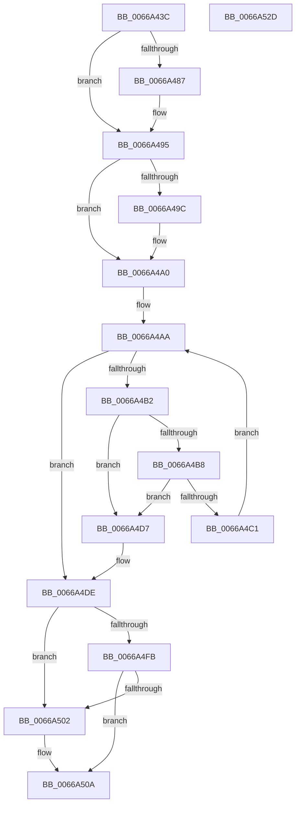

# CmpNotifyMachineHiveLoaded

- RVA: `0x0066A43C`–`0x0066A52E` (길이 `242` bytes)
- VA: `0x000000014066A43C`
- 실행 섹션: `.text`
- PDB 이름 있음: `예`; PDB Function 태그: `아니요`
- unwind 정보 RVA: `0x0005E6B4`
- 디코드: `68`개 명령, `242/242` bytes 표시
- 미해석 바이트: `0` (있으면 어셈블리에 `.byte`로 보존)

> 이 문서는 커널 이미지의 기계어와 PDB 기호를 분석해 생성했습니다. 4번과 5번은 함수 원형과 자료형을 바이너리 사용 방식에서 추정한 C 해석이며 원본 소스 복구 결과는 아닙니다.

## 1. Dependencies

- 직접 호출 지점: **5**; 고유 호출 대상: **5**
- 직접 호출자로 확인된 함수: **1**
- RIP 상대 이미지 참조: **1**

### Outgoing calls
- `0x0066A477` → [KeAbPreAcquire](../21/KeAbPreAcquire_function_00210230.md) (function, `0x00210230`)
- `0x0066A490` → [ExfAcquirePushLockExclusiveEx](../20/ExfAcquirePushLockExclusiveEx_function_0020FC90.md) (function, `0x0020FC90`)
- `0x0066A4D0` → [CmpWorkItemQueueWork](../37/CmpWorkItemQueueWork_function_00378D4C.md) (function, `0x00378D4C`)
- `0x0066A505` → [ExfReleasePushLock](../26/ExfReleasePushLock_function_002638D0.md) (function, `0x002638D0`)
- `0x0066A50D` → [KeAbPostRelease](../2E/KeAbPostRelease_function_002E1600.md) (function, `0x002E1600`)

### Direct callers
- [CmpFinishSystemHivesLoad](../../page/7D/CmpFinishSystemHivesLoad_function_007DA210.md) at `0x007DA6A4`
- [CmpFinishSystemHivesLoad](../../page/7D/CmpFinishSystemHivesLoad_function_007DA210.md) at `0x007DA7B0`
- [CmpFinishSystemHivesLoad](../../page/7D/CmpFinishSystemHivesLoad_function_007DA210.md) at `0x007DA8CF`
- [CmpFinishSystemHivesLoad](../../page/7D/CmpFinishSystemHivesLoad_function_007DA210.md) at `0x007DA9D7`
- [CmpFinishSystemHivesLoad](../../page/7D/CmpFinishSystemHivesLoad_function_007DA210.md) at `0x007DAB30`

### Static image references
- `0x0066A457` → RVA `0x00E098A0` (`.data`; read)

## 2. Other-region calls and transfers

- 다른 실행 섹션으로 향하는 call: **0**
- 별도 외부 분기/꼬리 이동을 확인하지 못했습니다.

## 3. Assembly (complete function range)

```asm
0066A43C  48 8B C4                        mov rax, rsp
0066A43F  48 89 58 08                     mov qword ptr [rax + 8], rbx
0066A443  48 89 68 10                     mov qword ptr [rax + 0x10], rbp
0066A447  48 89 70 18                     mov qword ptr [rax + 0x18], rsi
0066A44B  48 89 78 20                     mov qword ptr [rax + 0x20], rdi
0066A44F  41 56                           push r14
0066A451  48 83 EC 20                     sub rsp, 0x20
0066A455  8B C1                           mov eax, ecx
0066A457  4C 8D 35 42 F4 79 00            lea r14, [rip + 0x79f442]
0066A45E  48 69 F0 B8 00 00 00            imul rsi, rax, 0xb8
0066A465  49 8D 9E 90 00 00 00            lea rbx, [r14 + 0x90]
0066A46C  45 33 C0                        xor r8d, r8d
0066A46F  48 03 DE                        add rbx, rsi
0066A472  33 D2                           xor edx, edx
0066A474  48 8B CB                        mov rcx, rbx
0066A477  E8 B4 5D BA FF                  call 0x140210230
0066A47C  F0 48 0F BA 2B 00               lock bts qword ptr [rbx], 0
0066A482  48 8B F8                        mov rdi, rax
0066A485  73 0E                           jae 0x14066a495
0066A487  4C 8B C3                        mov r8, rbx
0066A48A  48 8B D0                        mov rdx, rax
0066A48D  48 8B CB                        mov rcx, rbx
0066A490  E8 FB 57 BA FF                  call 0x14020fc90
0066A495  33 ED                           xor ebp, ebp
0066A497  48 85 FF                        test rdi, rdi
0066A49A  74 04                           je 0x14066a4a0
0066A49C  C6 47 0A 01                     mov byte ptr [rdi + 0xa], 1
0066A4A0  49 8D BE 98 00 00 00            lea rdi, [r14 + 0x98]
0066A4A7  48 03 FE                        add rdi, rsi
0066A4AA  48 8B 0F                        mov rcx, qword ptr [rdi]
0066A4AD  48 3B CF                        cmp rcx, rdi
0066A4B0  74 2C                           je 0x14066a4de
0066A4B2  48 39 79 08                     cmp qword ptr [rcx + 8], rdi
0066A4B6  75 1F                           jne 0x14066a4d7
0066A4B8  48 8B 01                        mov rax, qword ptr [rcx]
0066A4BB  48 39 48 08                     cmp qword ptr [rax + 8], rcx
0066A4BF  75 16                           jne 0x14066a4d7
0066A4C1  48 89 07                        mov qword ptr [rdi], rax
0066A4C4  48 89 78 08                     mov qword ptr [rax + 8], rdi
0066A4C8  40 88 69 6D                     mov byte ptr [rcx + 0x6d], bpl
0066A4CC  48 83 C1 10                     add rcx, 0x10
0066A4D0  E8 77 E8 D0 FF                  call 0x140378d4c
0066A4D5  EB D3                           jmp 0x14066a4aa
0066A4D7  B9 03 00 00 00                  mov ecx, 3
0066A4DC  CD 29                           int 0x29
0066A4DE  0F 0D 0B                        prefetchw byte ptr [rbx]
0066A4E1  48 8B 03                        mov rax, qword ptr [rbx]
0066A4E4  48 8B C8                        mov rcx, rax
0066A4E7  48 83 E1 F0                     and rcx, 0xfffffffffffffff0
0066A4EB  48 83 F9 10                     cmp rcx, 0x10
0066A4EF  48 8D 50 F0                     lea rdx, [rax - 0x10]
0066A4F3  48 0F 46 D5                     cmovbe rdx, rbp
0066A4F7  A8 02                           test al, 2
0066A4F9  75 07                           jne 0x14066a502
0066A4FB  F0 48 0F B1 13                  lock cmpxchg qword ptr [rbx], rdx
0066A500  74 08                           je 0x14066a50a
0066A502  48 8B CB                        mov rcx, rbx
0066A505  E8 C6 93 BF FF                  call 0x1402638d0
0066A50A  48 8B CB                        mov rcx, rbx
0066A50D  E8 EE 70 C7 FF                  call 0x1402e1600
0066A512  48 8B 5C 24 30                  mov rbx, qword ptr [rsp + 0x30]
0066A517  48 8B 6C 24 38                  mov rbp, qword ptr [rsp + 0x38]
0066A51C  48 8B 74 24 40                  mov rsi, qword ptr [rsp + 0x40]
0066A521  48 8B 7C 24 48                  mov rdi, qword ptr [rsp + 0x48]
0066A526  48 83 C4 20                     add rsp, 0x20
0066A52A  41 5E                           pop r14
0066A52C  C3                              ret
0066A52D  CC                              int3
```

## 4. C-style interpretation (structured pseudocode)

```c
__int64 __fastcall CmpNotifyMachineHiveLoaded(int a1, int a2, int a3)
{
    __int64 result;
    __int64 v_rbp;
    __int64 v_rbx;
    __int64 v_rdi;
    __int64 v_rsi;
    __int64 v_rsp;
    unsigned __int64 v_stack_p10;
    unsigned __int64 v_stack_p18;
    unsigned __int64 v_stack_p20;
    unsigned __int64 v_stack_p8;

    *(unsigned __int64 *)(v_rsp + 8) = v_rbx;
    *(unsigned __int64 *)(v_rsp + 16) = v_rbp;
    *(unsigned __int64 *)(v_rsp + 24) = v_rsi;
    *(unsigned __int64 *)(v_rsp + 32) = v_rdi;
    v_rsp = (v_rsp) - (32);
    v_rsi = (v_rsi) * ((unsigned int)(a1));
    a3 = 0;
    v_rbx = (v_rip + 7992386 + 144) + (v_rsi);
    a2 = 0;
    result = KeAbPreAcquire(v_rbx, a2, a3, a4);
    if (!(condition_is_above_or_equal)) {
        a3 = v_rbx;
        a2 = result;
        a1 = v_rbx;
        result = ExfAcquirePushLockExclusiveEx(a1, a2, a3, a4);
    }
    v_rbp = 0;
    if (result != 0) {
        *(unsigned __int8 *)(result + 10) = 1;
    }
    v_rdi = (v_rip + 7992386 + 152) + (v_rsi);
loc_0066A4AA:
    if ((*(unsigned __int64 *)(v_rdi)) == v_rdi) goto loc_0066A4DE;
    if ((*(unsigned __int64 *)(*(unsigned __int64 *)(v_rdi) + 8)) != v_rdi) goto loc_0066A4D7;
    if ((*(unsigned __int64 *)(*(unsigned __int64 *)(*(unsigned __int64 *)(v_rdi)) + 8)) != (*(unsigned __int64 *)(v_rdi))) goto loc_0066A4D7;
    *(unsigned __int64 *)(v_rdi) = *(unsigned __int64 *)(*(unsigned __int64 *)(v_rdi));
    *(unsigned __int64 *)(*(unsigned __int64 *)(*(unsigned __int64 *)(v_rdi)) + 8) = v_rdi;
    *(unsigned __int8 *)(*(unsigned __int64 *)(v_rdi) + 109) = 0;
    a1 = (*(unsigned __int64 *)(v_rdi)) + (16);
    result = CmpWorkItemQueueWork(a1, a2, a3, a4);
    goto loc_0066A4AA;
loc_0066A4D7:
loc_0066A4DE:
    a1 = (*(unsigned __int64 *)(v_rbx)) & (-16);
    a2 = *(unsigned __int64 *)(v_rbx) - 16;
    if (a1 <= 16) { a2 = 0; }
    if ((((unsigned __int8)(*(unsigned __int64 *)(v_rbx))) & (2)) != 0) goto loc_0066A502;
    result = *(unsigned __int64 *)(v_rbx);
    if ((((unsigned __int8)(*(unsigned __int64 *)(v_rbx))) & (2)) != 0) {
        a1 = v_rbx;
        result = ExfReleasePushLock(a1, a2, a3, a4);
    }
    result = KeAbPostRelease(v_rbx, a2, a3, a4);
    v_rsp = (v_rsp) + (32);
    return result;
}
```

## 5. (Beta) C Style

```c
int64_t CmpNotifyMachineHiveLoaded(int32_t Arg1, int32_t Arg2, int32_t Arg3)
{
    int64_t result;
    int64_t local_rbp;
    int64_t local_rbx;
    int64_t local_rdi;
    int64_t local_rsi;
    int64_t local_rsp;
    uint64_t v_stack_p10;
    uint64_t v_stack_p18;
    uint64_t v_stack_p20;
    uint64_t v_stack_p8;

    *(uint64_t *)(local_rsp + 0x8) = local_rbx;
    *(uint64_t *)(local_rsp + 0x10) = local_rbp;
    *(uint64_t *)(local_rsp + 0x18) = local_rsi;
    *(uint64_t *)(local_rsp + 0x20) = local_rdi;
    local_rsp = (local_rsp) - (32);
    local_rsi = (local_rsi) * ((uint32_t)(Arg1));
    Arg3 = 0;
    local_rbx = (v_rip + 7992386 + 144) + (local_rsi);
    Arg2 = 0;
    result = KeAbPreAcquire(local_rbx, Arg2, Arg3, a4);
    if (!(condition_is_above_or_equal)) {
        Arg3 = local_rbx;
        Arg2 = result;
        Arg1 = local_rbx;
        result = ExfAcquirePushLockExclusiveEx(Arg1, Arg2, Arg3, a4);
    }
    local_rbp = 0;
    if (result != 0) {
        *(uint8_t *)(result + 0xA) = 1;
    }
    local_rdi = (v_rip + 7992386 + 152) + (local_rsi);
loc_0066A4AA:
    if ((*(uint64_t *)(local_rdi)) == local_rdi) goto loc_0066A4DE;
    if ((*(uint64_t *)(*(uint64_t *)(local_rdi) + 0x8)) != local_rdi) goto loc_0066A4D7;
    if ((*(uint64_t *)(*(uint64_t *)(*(uint64_t *)(local_rdi)) + 0x8)) != (*(uint64_t *)(local_rdi))) goto loc_0066A4D7;
    *(uint64_t *)(local_rdi) = *(uint64_t *)(*(uint64_t *)(local_rdi));
    *(uint64_t *)(*(uint64_t *)(*(uint64_t *)(local_rdi)) + 0x8) = local_rdi;
    *(uint8_t *)(*(uint64_t *)(local_rdi) + 0x6D) = 0;
    Arg1 = (*(uint64_t *)(local_rdi)) + (16);
    result = CmpWorkItemQueueWork(Arg1, Arg2, Arg3, a4);
    goto loc_0066A4AA;
loc_0066A4D7:
loc_0066A4DE:
    Arg1 = (*(uint64_t *)(local_rbx)) & (-16);
    Arg2 = *(uint64_t *)(local_rbx) - 16;
    if (Arg1 <= 16) { Arg2 = 0; }
    if ((((uint8_t)(*(uint64_t *)(local_rbx))) & (2)) != 0) goto loc_0066A502;
    result = *(uint64_t *)(local_rbx);
    if ((((uint8_t)(*(uint64_t *)(local_rbx))) & (2)) != 0) {
        Arg1 = local_rbx;
        result = ExfReleasePushLock(Arg1, Arg2, Arg3, a4);
    }
    result = KeAbPostRelease(local_rbx, Arg2, Arg3, a4);
    local_rsp = (local_rsp) + (32);
    return result;
}
```

## 6. Execution-region graph

[열기: 2D/3D 그래프와 함수 탐색 컨트롤 패널](../../../control-panel.html?section=text&rva=0x0066A43C&view=graph)

- 2D 그래프는 위에서 아래로 흐르고, 3D 그래프는 빈 공간을 드래그해 회전합니다. Shift+드래그는 이동, 휠은 확대·축소, 함수 노드 선택은 대상 보고서 이동입니다.

### Static fallback


