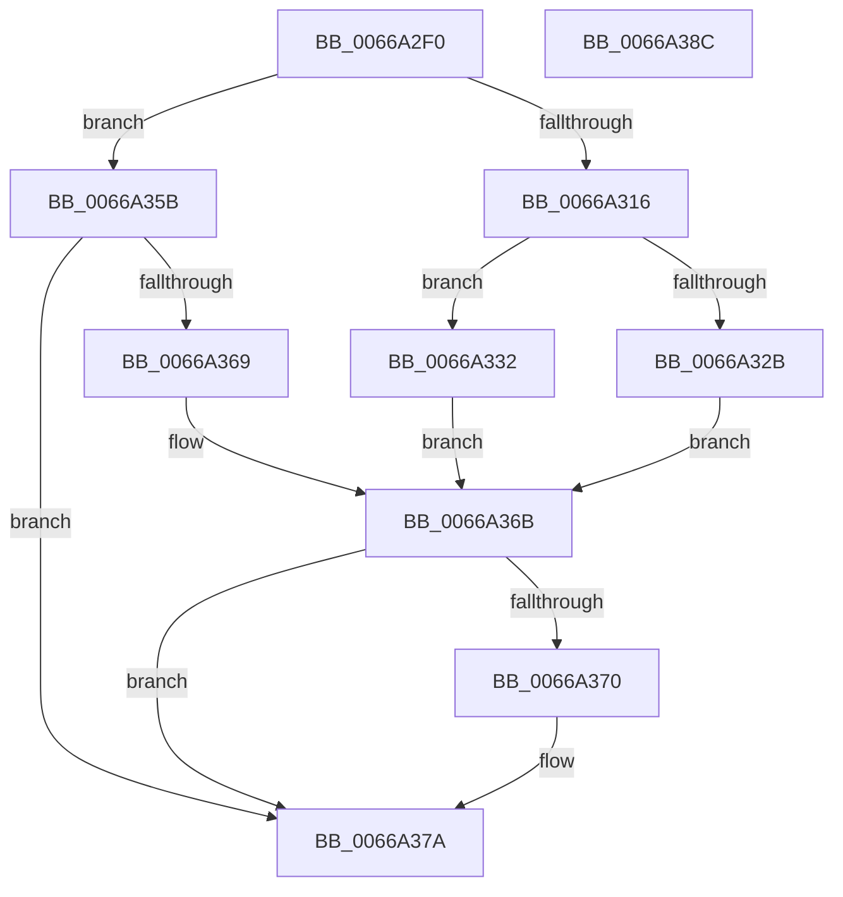

# CmpSetSystemRegistryString

- RVA: `0x0066A2F0`–`0x0066A38D` (길이 `157` bytes)
- VA: `0x000000014066A2F0`
- 실행 섹션: `.text`
- PDB 이름 있음: `예`; PDB Function 태그: `아니요`
- unwind 정보 RVA: `0x000718AC`
- 디코드: `47`개 명령, `157/157` bytes 표시
- 미해석 바이트: `0` (있으면 어셈블리에 `.byte`로 보존)

> 이 문서는 커널 이미지의 기계어와 PDB 기호를 분석해 생성했습니다. 4번과 5번은 함수 원형과 자료형을 바이너리 사용 방식에서 추정한 C 해석이며 원본 소스 복구 결과는 아닙니다.

## 1. Dependencies

- 직접 호출 지점: **4**; 고유 호출 대상: **4**
- 직접 호출자로 확인된 함수: **1**
- RIP 상대 이미지 참조: **0**

### Outgoing calls
- `0x0066A31D` → [RtlCreateUnicodeStringFromAsciiz](../../page/78/RtlCreateUnicodeStringFromAsciiz_function_0078B990.md) (function, `0x0078B990`)
- `0x0066A352` → [ZwSetValueKey](../6A/ZwSetValueKey_function_006ADCD0.md) (function, `0x006ADCD0`)
- `0x0066A35B` → [ZwDeleteValueKey](../6A/ZwDeleteValueKey_function_006AECB0.md) (function, `0x006AECB0`)
- `0x0066A375` → [RtlFreeAnsiString](../../page/9C/RtlFreeAnsiString_function_009C0800.md) (function, `0x009C0800`)

### Direct callers
- [CmpSetSystemValues](../../init/C5/CmpSetSystemValues_function_00C58BB0.md) at `0x00C58C99`
- [CmpSetSystemValues](../../init/C5/CmpSetSystemValues_function_00C58BB0.md) at `0x00C58CBB`
- [CmpSetSystemValues](../../init/C5/CmpSetSystemValues_function_00C58BB0.md) at `0x00C58CDD`
- [CmpSetSystemValues](../../init/C5/CmpSetSystemValues_function_00C58BB0.md) at `0x00C58CFF`

### Static image references
- 디코드된 RIP-relative 메모리 참조가 없습니다.

## 2. Other-region calls and transfers

- 다른 실행 섹션으로 향하는 call: **2**
  - `0x0066A31D` → [RtlCreateUnicodeStringFromAsciiz](../../page/78/RtlCreateUnicodeStringFromAsciiz_function_0078B990.md) (`.text` → `PAGE`)
  - `0x0066A375` → [RtlFreeAnsiString](../../page/9C/RtlFreeAnsiString_function_009C0800.md) (`.text` → `PAGE`)
- 별도 외부 분기/꼬리 이동을 확인하지 못했습니다.

## 3. Assembly (complete function range)

```asm
0066A2F0  48 8B C4                        mov rax, rsp
0066A2F3  48 89 58 08                     mov qword ptr [rax + 8], rbx
0066A2F7  48 89 70 10                     mov qword ptr [rax + 0x10], rsi
0066A2FB  57                              push rdi
0066A2FC  48 83 EC 40                     sub rsp, 0x40
0066A300  48 83 60 E8 00                  and qword ptr [rax - 0x18], 0
0066A305  33 FF                           xor edi, edi
0066A307  48 89 78 F0                     mov qword ptr [rax - 0x10], rdi
0066A30B  48 8B DA                        mov rbx, rdx
0066A30E  48 8B F1                        mov rsi, rcx
0066A311  4D 85 C0                        test r8, r8
0066A314  74 45                           je 0x14066a35b
0066A316  49 8B D0                        mov rdx, r8
0066A319  48 8D 48 E8                     lea rcx, [rax - 0x18]
0066A31D  E8 6E 16 12 00                  call 0x14078b990
0066A322  48 8B 7C 24 38                  mov rdi, qword ptr [rsp + 0x38]
0066A327  84 C0                           test al, al
0066A329  75 07                           jne 0x14066a332
0066A32B  BB 01 00 00 C0                  mov ebx, 0xc0000001
0066A330  EB 39                           jmp 0x14066a36b
0066A332  0F B7 44 24 30                  movzx eax, word ptr [rsp + 0x30]
0066A337  41 B9 01 00 00 00               mov r9d, 1
0066A33D  83 C0 02                        add eax, 2
0066A340  45 33 C0                        xor r8d, r8d
0066A343  89 44 24 28                     mov dword ptr [rsp + 0x28], eax
0066A347  48 8B D3                        mov rdx, rbx
0066A34A  48 8B CE                        mov rcx, rsi
0066A34D  48 89 7C 24 20                  mov qword ptr [rsp + 0x20], rdi
0066A352  E8 79 39 04 00                  call 0x1406adcd0
0066A357  8B D8                           mov ebx, eax
0066A359  EB 10                           jmp 0x14066a36b
0066A35B  E8 50 49 04 00                  call 0x1406aecb0
0066A360  8B D8                           mov ebx, eax
0066A362  3D 34 00 00 C0                  cmp eax, 0xc0000034
0066A367  75 11                           jne 0x14066a37a
0066A369  33 DB                           xor ebx, ebx
0066A36B  48 85 FF                        test rdi, rdi
0066A36E  74 0A                           je 0x14066a37a
0066A370  48 8D 4C 24 30                  lea rcx, [rsp + 0x30]
0066A375  E8 86 64 35 00                  call 0x1409c0800
0066A37A  48 8B 74 24 58                  mov rsi, qword ptr [rsp + 0x58]
0066A37F  8B C3                           mov eax, ebx
0066A381  48 8B 5C 24 50                  mov rbx, qword ptr [rsp + 0x50]
0066A386  48 83 C4 40                     add rsp, 0x40
0066A38A  5F                              pop rdi
0066A38B  C3                              ret
0066A38C  CC                              int3
```

## 4. C-style interpretation (structured pseudocode)

```c
__int64 __fastcall CmpSetSystemRegistryString(__int64 a1, __int64 a2, __int64 a3)
{
    __int64 result;
    __int64 v_rbx;
    __int64 v_rdi;
    __int64 v_rsp;
    unsigned __int64 v_stack_m10;
    unsigned __int16 v_stack_m18;
    unsigned int v_stack_m20;
    unsigned __int64 v_stack_m28;
    unsigned __int64 v_stack_p10;
    unsigned __int64 v_stack_p8;

    *(unsigned __int64 *)(v_rsp + 8) = v_rbx;
    *(unsigned __int64 *)(v_rsp + 16) = v_rsi;
    v_rsp = (v_rsp) - (64);
    v_rdi = 0;
    *(unsigned __int64 *)(v_rsp - 16) = 0;
    if (a3 == 0) goto loc_0066A35B;
    result = RtlCreateUnicodeStringFromAsciiz(v_rsp - 24, a3, a3, a4);
    if ((unsigned __int8)(result) != 0) goto loc_0066A332;
    goto loc_0066A36B;
loc_0066A332:
    result = (unsigned int)((v_stack_m18) + (2));
    a3 = 0;
    v_stack_m20 = (unsigned int)(result);
    v_stack_m28 = v_stack_m10;
    result = ZwSetValueKey(a1, (unsigned int)(0xC0000001ULL), a3, 1);
    goto loc_0066A36B;
loc_0066A35B:
    result = ZwDeleteValueKey(a1, (unsigned int)(0xC0000001ULL), a3, 1);
    if (((unsigned int)(result)) != 0xC0000034ULL) goto loc_0066A37A;
    v_rbx = 0;
loc_0066A36B:
    if (v_stack_m10 != 0) {
        a1 = v_stack_m18;
        result = RtlFreeAnsiString(a1, (unsigned int)(0xC0000001ULL), a3, 1);
    }
    v_rsp = (v_rsp) + (64);
    return 0;
}
```

## 5. (Beta) C Style

```c
int64_t CmpSetSystemRegistryString(int64_t Arg1, int64_t Arg2, int64_t Arg3)
{
    int64_t result;
    int64_t local_rbx;
    int64_t local_rdi;
    int64_t local_rsp;
    uint64_t v_stack_m10;
    uint16_t v_stack_m18;
    uint32_t v_stack_m20;
    uint64_t v_stack_m28;
    uint64_t v_stack_p10;
    uint64_t v_stack_p8;

    *(uint64_t *)(local_rsp + 0x8) = local_rbx;
    *(uint64_t *)(local_rsp + 0x10) = local_rsi;
    local_rsp = (local_rsp) - (64);
    local_rdi = 0;
    *(uint64_t *)(local_rsp - 0x10) = 0;
    if (Arg3 == 0) goto loc_0066A35B;
    result = RtlCreateUnicodeStringFromAsciiz(local_rsp - 24, Arg3, Arg3, a4);
    if ((uint8_t)(result) != 0) goto loc_0066A332;
    goto loc_0066A36B;
loc_0066A332:
    result = (uint32_t)((v_stack_m18) + (2));
    Arg3 = 0;
    v_stack_m20 = (uint32_t)(result);
    v_stack_m28 = v_stack_m10;
    result = ZwSetValueKey(Arg1, (uint32_t)(0xC0000001ULL), Arg3, 1);
    goto loc_0066A36B;
loc_0066A35B:
    result = ZwDeleteValueKey(Arg1, (uint32_t)(0xC0000001ULL), Arg3, 1);
    if (((uint32_t)(result)) != 0xC0000034ULL) goto loc_0066A37A;
    local_rbx = 0;
loc_0066A36B:
    if (v_stack_m10 != 0) {
        Arg1 = v_stack_m18;
        result = RtlFreeAnsiString(Arg1, (uint32_t)(0xC0000001ULL), Arg3, 1);
    }
    local_rsp = (local_rsp) + (64);
    return 0;
}
```

## 6. Execution-region graph

[열기: 2D/3D 그래프와 함수 탐색 컨트롤 패널](../../../control-panel.html?section=text&rva=0x0066A2F0&view=graph)

- 2D 그래프는 위에서 아래로 흐르고, 3D 그래프는 빈 공간을 드래그해 회전합니다. Shift+드래그는 이동, 휠은 확대·축소, 함수 노드 선택은 대상 보고서 이동입니다.

### Static fallback


