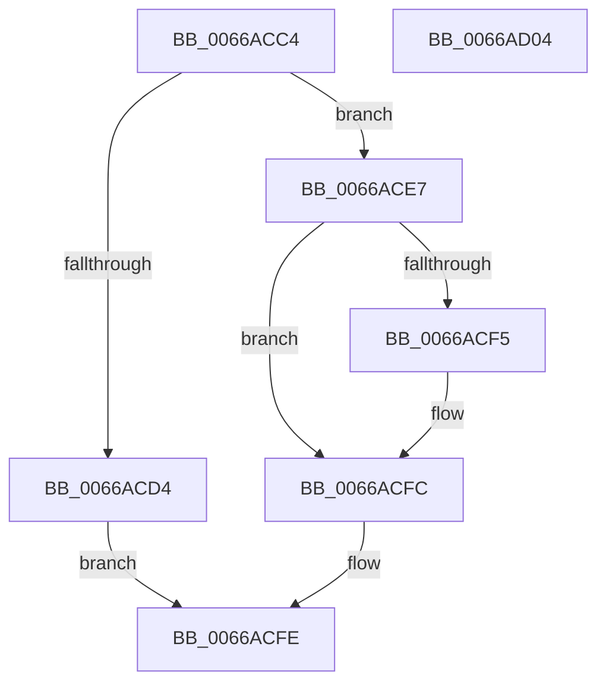

# CmpTestRegistryLockExclusive

- RVA: `0x0066ACC4`–`0x0066AD05` (길이 `65` bytes)
- VA: `0x000000014066ACC4`
- 실행 섹션: `.text`
- PDB 이름 있음: `예`; PDB Function 태그: `아니요`
- unwind 정보 RVA: `0x0005CF00`
- 디코드: `21`개 명령, `65/65` bytes 표시
- 미해석 바이트: `0` (있으면 어셈블리에 `.byte`로 보존)

> 이 문서는 커널 이미지의 기계어와 PDB 기호를 분석해 생성했습니다. 4번과 5번은 함수 원형과 자료형을 바이너리 사용 방식에서 추정한 C 해석이며 원본 소스 복구 결과는 아닙니다.

## 1. Dependencies

- 직접 호출 지점: **2**; 고유 호출 대상: **2**
- 직접 호출자로 확인된 함수: **2**
- RIP 상대 이미지 참조: **2**

### Outgoing calls
- `0x0066ACDB` → [ExIsResourceAcquiredExclusiveLite](../40/ExIsResourceAcquiredExclusiveLite_function_0040B750.md) (function, `0x0040B750`)
- `0x0066ACE7` → [CmpGetThreadInfo](../45/CmpGetThreadInfo_function_00456AB8.md) (function, `0x00456AB8`)

### Direct callers
- [HvpTruncateBins](../../page/9B/HvpTruncateBins_function_009B64F0.md) at `0x009B65A0`
- [CmpUnlockRegistry](../../pagecmrc/BC/CmpUnlockRegistry_function_00BC9A84.md) at `0x00BC9AF9`

### Static image references
- `0x0066ACCC` → RVA `0x00EF7108` (`.data`; read)
- `0x0066ACD4` → RVA `0x00EF7110` (`.data`; read)

## 2. Other-region calls and transfers

- 다른 실행 섹션으로 향하는 call: **0**
- 별도 외부 분기/꼬리 이동을 확인하지 못했습니다.

## 3. Assembly (complete function range)

```asm
0066ACC4  40 53                           push rbx
0066ACC6  48 83 EC 20                     sub rsp, 0x20
0066ACCA  33 DB                           xor ebx, ebx
0066ACCC  39 1D 36 C4 88 00               cmp dword ptr [rip + 0x88c436], ebx
0066ACD2  75 13                           jne 0x14066ace7
0066ACD4  48 8B 0D 35 C4 88 00            mov rcx, qword ptr [rip + 0x88c435]
0066ACDB  E8 70 0A DA FF                  call 0x14040b750
0066ACE0  84 C0                           test al, al
0066ACE2  0F 95 C0                        setne al
0066ACE5  EB 17                           jmp 0x14066acfe
0066ACE7  E8 CC BD DE FF                  call 0x140456ab8
0066ACEC  48 8B 48 08                     mov rcx, qword ptr [rax + 8]
0066ACF0  48 85 C9                        test rcx, rcx
0066ACF3  74 07                           je 0x14066acfc
0066ACF5  48 83 F9 01                     cmp rcx, 1
0066ACF9  0F 94 C3                        sete bl
0066ACFC  8A C3                           mov al, bl
0066ACFE  48 83 C4 20                     add rsp, 0x20
0066AD02  5B                              pop rbx
0066AD03  C3                              ret
0066AD04  CC                              int3
```

## 4. C-style interpretation (structured pseudocode)

```c
__int64 __fastcall CmpTestRegistryLockExclusive(void)
{
    __int64 result;
    __int64 v_rbx;
    __int64 v_rsp;

    v_rsp = (v_rsp) - (32);
    v_rbx = 0;
    if ((*(unsigned int *)(v_rip + 8963126)) != 0) goto loc_0066ACE7;
    result = ExIsResourceAcquiredExclusiveLite(*(unsigned __int64 *)(v_rip + 8963125), a2, a3, a4);
    result = ((unsigned __int8)(result) != 0) ? 1 : 0;
    goto loc_0066ACFE;
loc_0066ACE7:
    result = CmpGetThreadInfo(*(unsigned __int64 *)(v_rip + 8963125), a2, a3, a4);
    if (*(unsigned __int64 *)(result + 8) != 0) {
        v_rbx = ((*(unsigned __int64 *)(result + 8)) == 1) ? 1 : 0;
    }
loc_0066ACFE:
    v_rsp = (v_rsp) + (32);
    return (unsigned __int8)(v_rbx);
}
```

## 5. (Beta) C Style

```c
void CmpTestRegistryLockExclusive(void)
{
    int64_t result;
    int64_t local_rbx;
    int64_t local_rsp;

    local_rsp = (local_rsp) - (32);
    local_rbx = 0;
    if ((*(uint32_t *)(v_rip + 0x88C436)) != 0) goto loc_0066ACE7;
    result = ExIsResourceAcquiredExclusiveLite(*(uint64_t *)(v_rip + 0x88C435), a2, a3, a4);
    result = ((uint8_t)(result) != 0) ? 1 : 0;
    goto loc_0066ACFE;
loc_0066ACE7:
    result = CmpGetThreadInfo(*(uint64_t *)(v_rip + 0x88C435), a2, a3, a4);
    if (*(uint64_t *)(result + 0x8) != 0) {
        local_rbx = ((*(uint64_t *)(result + 0x8)) == 1) ? 1 : 0;
    }
loc_0066ACFE:
    local_rsp = (local_rsp) + (32);
    return (uint8_t)(local_rbx);
}
```

## 6. Execution-region graph

[열기: 2D/3D 그래프와 함수 탐색 컨트롤 패널](../../../control-panel.html?section=text&rva=0x0066ACC4&view=graph)

- 2D 그래프는 위에서 아래로 흐르고, 3D 그래프는 빈 공간을 드래그해 회전합니다. Shift+드래그는 이동, 휠은 확대·축소, 함수 노드 선택은 대상 보고서 이동입니다.

### Static fallback


