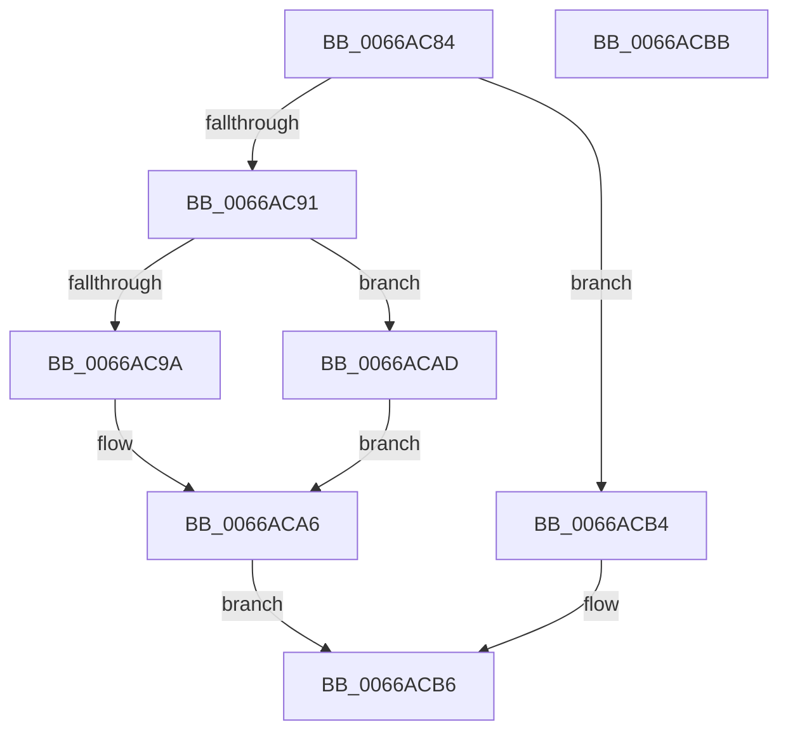

# CmpTestRegistryLock

- RVA: `0x0066AC84`–`0x0066ACBC` (길이 `56` bytes)
- VA: `0x000000014066AC84`
- 실행 섹션: `.text`
- PDB 이름 있음: `예`; PDB Function 태그: `아니요`
- unwind 정보 RVA: `0x0005C788`
- 디코드: `16`개 명령, `56/56` bytes 표시
- 미해석 바이트: `0` (있으면 어셈블리에 `.byte`로 보존)

> 이 문서는 커널 이미지의 기계어와 PDB 기호를 분석해 생성했습니다. 4번과 5번은 함수 원형과 자료형을 바이너리 사용 방식에서 추정한 C 해석이며 원본 소스 복구 결과는 아닙니다.

## 1. Dependencies

- 직접 호출 지점: **2**; 고유 호출 대상: **2**
- 직접 호출자로 확인된 함수: **3**
- RIP 상대 이미지 참조: **3**

### Outgoing calls
- `0x0066ACA1` → [ExIsResourceAcquiredSharedLite](../34/ExIsResourceAcquiredSharedLite_function_00341B10.md) (function, `0x00341B10`)
- `0x0066ACAD` → [CmpIsRegistryLockAcquired](../45/CmpIsRegistryLockAcquired_function_00456A7C.md) (function, `0x00456A7C`)

### Direct callers
- [CmpDoReOpenTransKey](../../page/7F/CmpDoReOpenTransKey_function_007F78E8.md) at `0x007F796A`
- [CmpLockRegistryExclusive](../../page/84/CmpLockRegistryExclusive_function_0084F9B4.md) at `0x0084FA22`
- [CmpLockRegistry](../../pagecmrc/BC/CmpLockRegistry_function_00BC9B34.md) at `0x00BC9BFE`

### Static image references
- `0x0066AC88` → RVA `0x00FD8005` (`PAGEDATA`; read)
- `0x0066AC91` → RVA `0x00EF7108` (`.data`; read)
- `0x0066AC9A` → RVA `0x00EF7110` (`.data`; read)

## 2. Other-region calls and transfers

- 다른 실행 섹션으로 향하는 call: **0**
- 별도 외부 분기/꼬리 이동을 확인하지 못했습니다.

## 3. Assembly (complete function range)

```asm
0066AC84  48 83 EC 28                     sub rsp, 0x28
0066AC88  80 3D 76 D3 96 00 00            cmp byte ptr [rip + 0x96d376], 0
0066AC8F  75 23                           jne 0x14066acb4
0066AC91  83 3D 70 C4 88 00 00            cmp dword ptr [rip + 0x88c470], 0
0066AC98  75 13                           jne 0x14066acad
0066AC9A  48 8B 0D 6F C4 88 00            mov rcx, qword ptr [rip + 0x88c46f]
0066ACA1  E8 6A 6E CD FF                  call 0x140341b10
0066ACA6  85 C0                           test eax, eax
0066ACA8  0F 95 C0                        setne al
0066ACAB  EB 09                           jmp 0x14066acb6
0066ACAD  E8 CA BD DE FF                  call 0x140456a7c
0066ACB2  EB F2                           jmp 0x14066aca6
0066ACB4  B0 01                           mov al, 1
0066ACB6  48 83 C4 28                     add rsp, 0x28
0066ACBA  C3                              ret
0066ACBB  CC                              int3
```

## 4. C-style interpretation (structured pseudocode)

```c
__int64 __fastcall CmpTestRegistryLock(void)
{
    __int64 result;
    __int64 v_rsp;

    v_rsp = (v_rsp) - (40);
    if ((*(unsigned __int8 *)(v_rip + 9884534)) != 0) goto loc_0066ACB4;
    if ((*(unsigned int *)(v_rip + 8963184)) != 0) goto loc_0066ACAD;
    result = ExIsResourceAcquiredSharedLite(*(unsigned __int64 *)(v_rip + 8963183), a2, a3, a4);
loc_0066ACA6:
    result = ((unsigned int)(result) != 0) ? 1 : 0;
    goto loc_0066ACB6;
loc_0066ACAD:
    result = CmpIsRegistryLockAcquired(*(unsigned __int64 *)(v_rip + 8963183), a2, a3, a4);
    goto loc_0066ACA6;
loc_0066ACB4:
loc_0066ACB6:
    v_rsp = (v_rsp) + (40);
    return 1;
}
```

## 5. (Beta) C Style

```c
void CmpTestRegistryLock(void)
{
    int64_t result;
    int64_t local_rsp;

    local_rsp = (local_rsp) - (40);
    if ((*(uint8_t *)(v_rip + 0x96D376)) != 0) goto loc_0066ACB4;
    if ((*(uint32_t *)(v_rip + 0x88C470)) != 0) goto loc_0066ACAD;
    result = ExIsResourceAcquiredSharedLite(*(uint64_t *)(v_rip + 0x88C46F), a2, a3, a4);
loc_0066ACA6:
    result = ((uint32_t)(result) != 0) ? 1 : 0;
    goto loc_0066ACB6;
loc_0066ACAD:
    result = CmpIsRegistryLockAcquired(*(uint64_t *)(v_rip + 0x88C46F), a2, a3, a4);
    goto loc_0066ACA6;
loc_0066ACB4:
loc_0066ACB6:
    local_rsp = (local_rsp) + (40);
    return 1;
}
```

## 6. Execution-region graph

[열기: 2D/3D 그래프와 함수 탐색 컨트롤 패널](../../../control-panel.html?section=text&rva=0x0066AC84&view=graph)

- 2D 그래프는 위에서 아래로 흐르고, 3D 그래프는 빈 공간을 드래그해 회전합니다. Shift+드래그는 이동, 휠은 확대·축소, 함수 노드 선택은 대상 보고서 이동입니다.

### Static fallback


