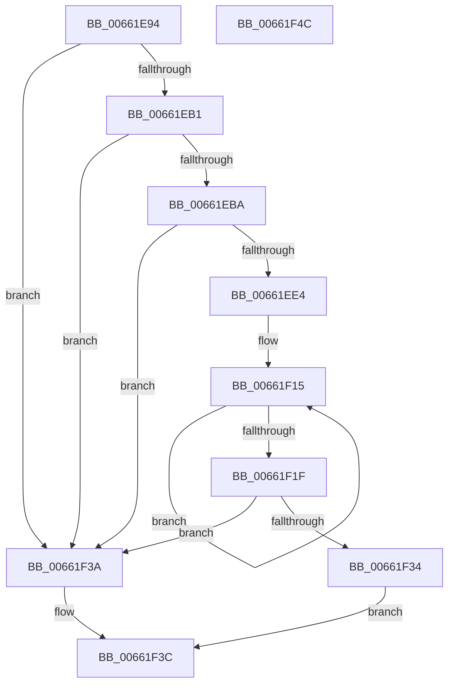

# DownLevelGetParentLanguageName

- RVA: `0x00661E94`–`0x00661F4D` (길이 `185` bytes)
- VA: `0x0000000140661E94`
- 실행 섹션: `.text`
- PDB 이름 있음: `예`; PDB Function 태그: `아니요`
- unwind 정보 RVA: `0x000794E0`
- 디코드: `46`개 명령, `185/185` bytes 표시
- 미해석 바이트: `0` (있으면 어셈블리에 `.byte`로 보존)

> 이 문서는 커널 이미지의 기계어와 PDB 기호를 분석해 생성했습니다. 4번과 5번은 함수 원형과 자료형을 바이너리 사용 방식에서 추정한 C 해석이며 원본 소스 복구 결과는 아닙니다.

## 1. Dependencies

- 직접 호출 지점: **2**; 고유 호출 대상: **2**
- 직접 호출자로 확인된 함수: **1**
- RIP 상대 이미지 참조: **3**

### Outgoing calls
- `0x00661EDA` → [bsearch](../50/bsearch_function_00500430.md) (function, `0x00500430`)
- `0x00661F2B` → [StringCchCopyNW](../4D/StringCchCopyNW_function_004D0F68.md) (function, `0x004D0F68`)

### Direct callers
- [LdrpGetParentLangId](../4B/LdrpGetParentLangId_function_004BDAC0.md) at `0x004BDB87`

### Static image references
- `0x00661EBA` → RVA `0x004A8610` (`CompareLangName`; read)
- `0x00661EC7` → RVA `0x00005610` (`.rdata`; read)
- `0x00661EE7` → RVA `0x00000000` (`image boundary/outside`; read)

## 2. Other-region calls and transfers

- 다른 실행 섹션으로 향하는 call: **0**
- 별도 외부 분기/꼬리 이동을 확인하지 못했습니다.

## 3. Assembly (complete function range)

```asm
00661E94  48 89 5C 24 08                  mov qword ptr [rsp + 8], rbx
00661E99  48 89 74 24 10                  mov qword ptr [rsp + 0x10], rsi
00661E9E  57                              push rdi
00661E9F  48 83 EC 30                     sub rsp, 0x30
00661EA3  33 FF                           xor edi, edi
00661EA5  48 8B DA                        mov rbx, rdx
00661EA8  48 85 C9                        test rcx, rcx
00661EAB  0F 84 89 00 00 00               je 0x140661f3a
00661EB1  48 85 D2                        test rdx, rdx
00661EB4  0F 84 80 00 00 00               je 0x140661f3a
00661EBA  48 8D 05 4F 67 E4 FF            lea rax, [rip - 0x1b98b1]
00661EC1  41 B8 B3 01 00 00               mov r8d, 0x1b3
00661EC7  48 8D 35 42 37 9A FF            lea rsi, [rip - 0x65c8be]
00661ECE  48 89 44 24 20                  mov qword ptr [rsp + 0x20], rax
00661ED3  48 8B D6                        mov rdx, rsi
00661ED6  44 8D 4F 08                     lea r9d, [rdi + 8]
00661EDA  E8 51 E5 E9 FF                  call 0x140500430
00661EDF  48 85 C0                        test rax, rax
00661EE2  74 56                           je 0x140661f3a
00661EE4  48 2B C6                        sub rax, rsi
00661EE7  4C 8D 05 12 E1 99 FF            lea r8, [rip - 0x661eee]
00661EEE  48 C1 F8 03                     sar rax, 3
00661EF2  49 0F BF 84 40 B0 99 03 00      movsx rax, word ptr [r8 + rax*2 + 0x399b0]
00661EFB  48 03 C0                        add rax, rax
00661EFE  49 63 84 C0 9C 3A 00 00         movsxd rax, dword ptr [r8 + rax*8 + 0x3a9c]
00661F06  48 03 C0                        add rax, rax
00661F09  49 83 CB FF                     or r11, 0xffffffffffffffff
00661F0D  4D 8B 84 C0 90 3A 00 00         mov r8, qword ptr [r8 + rax*8 + 0x3a90]
00661F15  49 FF C3                        inc r11
00661F18  66 43 39 3C 58                  cmp word ptr [r8 + r11*2], di
00661F1D  75 F6                           jne 0x140661f15
00661F1F  4D 8D 4B 01                     lea r9, [r11 + 1]
00661F23  BA 55 00 00 00                  mov edx, 0x55
00661F28  48 8B CB                        mov rcx, rbx
00661F2B  E8 38 F0 E6 FF                  call 0x1404d0f68
00661F30  85 C0                           test eax, eax
00661F32  78 06                           js 0x140661f3a
00661F34  41 8D 43 01                     lea eax, [r11 + 1]
00661F38  EB 02                           jmp 0x140661f3c
00661F3A  33 C0                           xor eax, eax
00661F3C  48 8B 5C 24 40                  mov rbx, qword ptr [rsp + 0x40]
00661F41  48 8B 74 24 48                  mov rsi, qword ptr [rsp + 0x48]
00661F46  48 83 C4 30                     add rsp, 0x30
00661F4A  5F                              pop rdi
00661F4B  C3                              ret
00661F4C  CC                              int3
```

## 4. C-style interpretation (structured pseudocode)

```c
__int64 __fastcall DownLevelGetParentLanguageName(__int64 a1, __int64 a2)
{
    __int64 result;
    __int64 v_r11;
    __int64 v_rdi;
    __int64 v_rsp;
    unsigned __int64 v_stack_m18;
    unsigned __int64 v_stack_p10;
    unsigned __int64 v_stack_p8;

    v_stack_p8 = v_rbx;
    v_stack_p10 = v_rsi;
    v_rsp = (v_rsp) - (48);
    v_rdi = 0;
    if (a1 == 0) goto loc_00661F3A;
    if (a2 == 0) goto loc_00661F3A;
    v_stack_m18 = v_rip - 1808561;
    result = bsearch(a1, v_rip - 6670526, 435, v_rdi + 8);
    if (result == 0) goto loc_00661F3A;
    result = (result) - (v_rip - 6670526);
    result = (result) >> (3);
    result = ((__int16)(*(unsigned __int16 *)(v_rip - 6692590 + result * 2 + 235952))) + ((__int16)(*(unsigned __int16 *)(v_rip - 6692590 + result * 2 + 235952)));
    result = ((int)(*(unsigned int *)(v_rip - 6692590 + result * 8 + 15004))) + ((int)(*(unsigned int *)(v_rip - 6692590 + result * 8 + 15004)));
    v_r11 = (v_r11) | (-1);
loc_00661F15:
    v_r11 = (v_r11) + 1;
    if ((*(unsigned __int16 *)(*(unsigned __int64 *)(v_rip - 6692590 + result * 8 + 14992) + v_r11 * 2)) != 0) goto loc_00661F15;
    result = StringCchCopyNW(a2, 85, *(unsigned __int64 *)(v_rip - 6692590 + result * 8 + 14992), v_r11 + 1);
    if (sign_flag) goto loc_00661F3A;
    goto loc_00661F3C;
loc_00661F3A:
    result = 0;
loc_00661F3C:
    v_rsp = (v_rsp) + (48);
    return result;
}
```

## 5. (Beta) C Style

```c
int64_t DownLevelGetParentLanguageName(int64_t Arg1, int64_t Arg2)
{
    int64_t result;
    int64_t local_r11;
    int64_t local_rdi;
    int64_t local_rsp;
    uint64_t v_stack_m18;
    uint64_t v_stack_p10;
    uint64_t v_stack_p8;

    v_stack_p8 = local_rbx;
    v_stack_p10 = local_rsi;
    local_rsp = (local_rsp) - (48);
    local_rdi = 0;
    if (Arg1 == 0) goto loc_00661F3A;
    if (Arg2 == 0) goto loc_00661F3A;
    v_stack_m18 = v_rip - 1808561;
    result = bsearch(Arg1, v_rip - 6670526, 435, local_rdi + 8);
    if (result == 0) goto loc_00661F3A;
    result = (result) - (v_rip - 6670526);
    result = (result) >> (3);
    result = ((int16_t)(*(uint16_t *)(v_rip - 0x661EEE + result * 2 + 0x399B0))) + ((int16_t)(*(uint16_t *)(v_rip - 0x661EEE + result * 2 + 0x399B0)));
    result = ((int32_t)(*(uint32_t *)(v_rip - 0x661EEE + result * 8 + 0x3A9C))) + ((int32_t)(*(uint32_t *)(v_rip - 0x661EEE + result * 8 + 0x3A9C)));
    local_r11 = (local_r11) | (-1);
loc_00661F15:
    local_r11 = (local_r11) + 1;
    if ((*(uint16_t *)(*(uint64_t *)(v_rip - 0x661EEE + result * 8 + 0x3A90) + local_r11 * 2)) != 0) goto loc_00661F15;
    result = StringCchCopyNW(Arg2, 85, *(uint64_t *)(v_rip - 0x661EEE + result * 8 + 0x3A90), local_r11 + 1);
    if (sign_flag) goto loc_00661F3A;
    goto loc_00661F3C;
loc_00661F3A:
    result = 0;
loc_00661F3C:
    local_rsp = (local_rsp) + (48);
    return result;
}
```

## 6. Execution-region graph

[열기: 2D/3D 그래프와 함수 탐색 컨트롤 패널](../../../control-panel.html?section=text&rva=0x00661E94&view=graph)

- 2D 그래프는 위에서 아래로 흐르고, 3D 그래프는 빈 공간을 드래그해 회전합니다. Shift+드래그는 이동, 휠은 확대·축소, 함수 노드 선택은 대상 보고서 이동입니다.

### Static fallback


