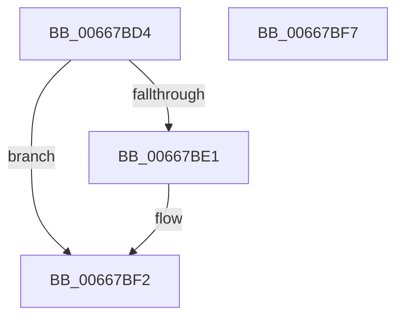

# DrpGetRecordCount

- RVA: `0x00667BD4`–`0x00667BF8` (길이 `36` bytes)
- VA: `0x0000000140667BD4`
- 실행 섹션: `.text`
- PDB 이름 있음: `예`; PDB Function 태그: `아니요`
- unwind 정보 RVA: `0x0005C788`
- 디코드: `13`개 명령, `36/36` bytes 표시
- 미해석 바이트: `0` (있으면 어셈블리에 `.byte`로 보존)

> 이 문서는 커널 이미지의 기계어와 PDB 기호를 분석해 생성했습니다. 4번과 5번은 함수 원형과 자료형을 바이너리 사용 방식에서 추정한 C 해석이며 원본 소스 복구 결과는 아닙니다.

## 1. Dependencies

- 직접 호출 지점: **1**; 고유 호출 대상: **1**
- 직접 호출자로 확인된 함수: **1**
- RIP 상대 이미지 참조: **0**

### Outgoing calls
- `0x00667BD8` → [DrpVerifyData](DrpVerifyData_function_00667C64.md) (function, `0x00667C64`)

### Direct callers
- [MicrocodeGetRecord](MicrocodeGetRecord_function_00667060.md) at `0x006670D3`

### Static image references
- 디코드된 RIP-relative 메모리 참조가 없습니다.

## 2. Other-region calls and transfers

- 다른 실행 섹션으로 향하는 call: **0**
- 별도 외부 분기/꼬리 이동을 확인하지 못했습니다.

## 3. Assembly (complete function range)

```asm
00667BD4  48 83 EC 28                     sub rsp, 0x28
00667BD8  E8 87 00 00 00                  call 0x140667c64
00667BDD  85 C0                           test eax, eax
00667BDF  78 11                           js 0x140667bf2
00667BE1  8B 41 10                        mov eax, dword ptr [rcx + 0x10]
00667BE4  41 89 00                        mov dword ptr [r8], eax
00667BE7  F7 D8                           neg eax
00667BE9  1B C0                           sbb eax, eax
00667BEB  F7 D0                           not eax
00667BED  25 25 02 00 C0                  and eax, 0xc0000225
00667BF2  48 83 C4 28                     add rsp, 0x28
00667BF6  C3                              ret
00667BF7  CC                              int3
```

## 4. C-style interpretation (structured pseudocode)

```c
__int64 __fastcall DrpGetRecordCount(__int64 a1, __int64 a2, __int64 a3)
{
    __int64 result;
    __int64 v_rsp;

    v_rsp = (v_rsp) - (40);
    result = DrpVerifyData(a1, a2, a3, a4);
    if (!(sign_flag)) {
        result = *(unsigned int *)(a1 + 16);
        *(unsigned int *)(a3) = (unsigned int)(result);
        result = (unsigned int)(-(result));
        result = (unsigned int)(~(result));
        result = (unsigned int)((result) & (0xC0000225ULL));
    }
    v_rsp = (v_rsp) + (40);
    return result;
}
```

## 5. (Beta) C Style

```c
int64_t DrpGetRecordCount(int64_t Arg1, int64_t Arg2, int64_t Arg3)
{
    int64_t result;
    int64_t local_rsp;

    local_rsp = (local_rsp) - (40);
    result = DrpVerifyData(Arg1, Arg2, Arg3, a4);
    if (!(sign_flag)) {
        result = *(uint32_t *)(Arg1 + 0x10);
        *(uint32_t *)(Arg3) = (uint32_t)(result);
        result = (uint32_t)(-(result));
        result = (uint32_t)(~(result));
        result = (uint32_t)((result) & (0xC0000225ULL));
    }
    local_rsp = (local_rsp) + (40);
    return result;
}
```

## 6. Execution-region graph

[열기: 2D/3D 그래프와 함수 탐색 컨트롤 패널](../../../control-panel.html?section=text&rva=0x00667BD4&view=graph)

- 2D 그래프는 위에서 아래로 흐르고, 3D 그래프는 빈 공간을 드래그해 회전합니다. Shift+드래그는 이동, 휠은 확대·축소, 함수 노드 선택은 대상 보고서 이동입니다.

### Static fallback


