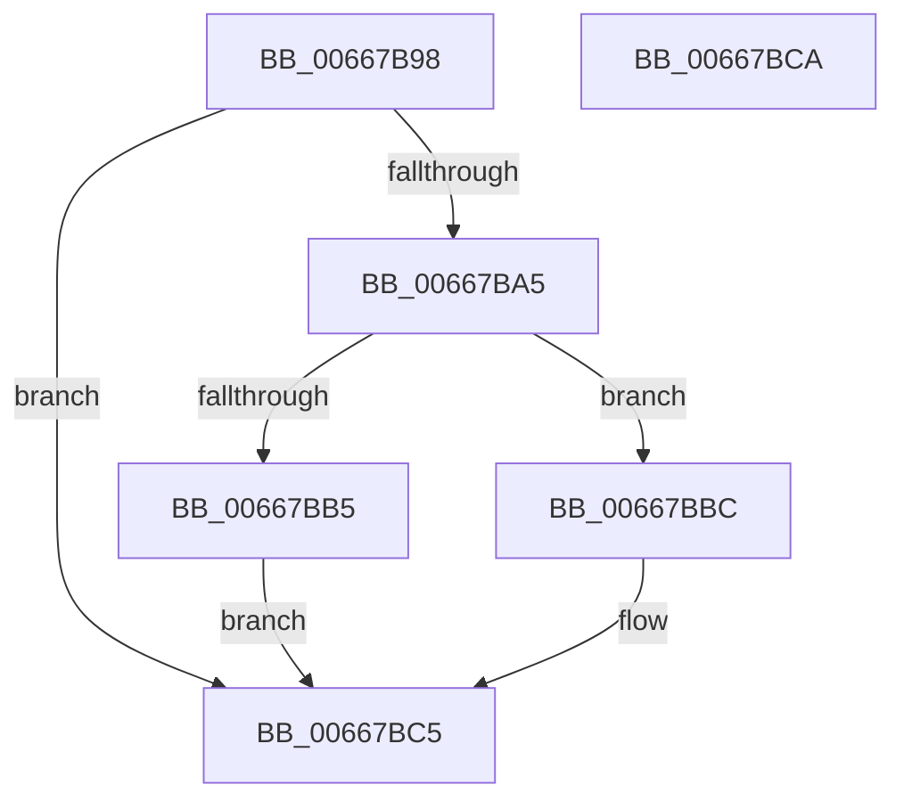

# DrpGetRecord

- RVA: `0x00667B98`–`0x00667BCB` (길이 `51` bytes)
- VA: `0x0000000140667B98`
- 실행 섹션: `.text`
- PDB 이름 있음: `예`; PDB Function 태그: `아니요`
- unwind 정보 RVA: `0x0005C788`
- 디코드: `17`개 명령, `51/51` bytes 표시
- 미해석 바이트: `0` (있으면 어셈블리에 `.byte`로 보존)

> 이 문서는 커널 이미지의 기계어와 PDB 기호를 분석해 생성했습니다. 4번과 5번은 함수 원형과 자료형을 바이너리 사용 방식에서 추정한 C 해석이며 원본 소스 복구 결과는 아닙니다.

## 1. Dependencies

- 직접 호출 지점: **1**; 고유 호출 대상: **1**
- 직접 호출자로 확인된 함수: **1**
- RIP 상대 이미지 참조: **0**

### Outgoing calls
- `0x00667B9C` → [DrpVerifyData](DrpVerifyData_function_00667C64.md) (function, `0x00667C64`)

### Direct callers
- [MicrocodeGetRecord](MicrocodeGetRecord_function_00667060.md) at `0x0066712F`

### Static image references
- 디코드된 RIP-relative 메모리 참조가 없습니다.

## 2. Other-region calls and transfers

- 다른 실행 섹션으로 향하는 call: **0**
- 별도 외부 분기/꼬리 이동을 확인하지 못했습니다.

## 3. Assembly (complete function range)

```asm
00667B98  48 83 EC 28                     sub rsp, 0x28
00667B9C  E8 C3 00 00 00                  call 0x140667c64
00667BA1  85 C0                           test eax, eax
00667BA3  78 20                           js 0x140667bc5
00667BA5  4D 8B 50 18                     mov r10, qword ptr [r8 + 0x18]
00667BA9  4D 8B 40 10                     mov r8, qword ptr [r8 + 0x10]
00667BAD  4D 03 C2                        add r8, r10
00667BB0  4C 3B C2                        cmp r8, rdx
00667BB3  76 07                           jbe 0x140667bbc
00667BB5  B8 06 02 00 C0                  mov eax, 0xc0000206
00667BBA  EB 09                           jmp 0x140667bc5
00667BBC  49 8D 04 0A                     lea rax, [r10 + rcx]
00667BC0  49 89 01                        mov qword ptr [r9], rax
00667BC3  33 C0                           xor eax, eax
00667BC5  48 83 C4 28                     add rsp, 0x28
00667BC9  C3                              ret
00667BCA  CC                              int3
```

## 4. C-style interpretation (structured pseudocode)

```c
__int64 __fastcall DrpGetRecord(__int64 a1, __int64 a2, __int64 a3, __int64 a4)
{
    __int64 result;
    __int64 v_rsp;

    v_rsp = (v_rsp) - (40);
    result = DrpVerifyData(a1, a2, a3, a4);
    if (sign_flag) goto loc_00667BC5;
    a3 = (*(unsigned __int64 *)(a3 + 16)) + (*(unsigned __int64 *)(a3 + 24));
    if (a3 <= a2) goto loc_00667BBC;
    goto loc_00667BC5;
loc_00667BBC:
    *(unsigned __int64 *)(a4) = *(unsigned __int64 *)(a3 + 24) + a1 * 1;
    result = 0;
loc_00667BC5:
    v_rsp = (v_rsp) + (40);
    return result;
}
```

## 5. (Beta) C Style

```c
int64_t DrpGetRecord(int64_t Arg1, int64_t Arg2, int64_t Arg3, int64_t Arg4)
{
    int64_t result;
    int64_t local_rsp;

    local_rsp = (local_rsp) - (40);
    result = DrpVerifyData(Arg1, Arg2, Arg3, Arg4);
    if (sign_flag) goto loc_00667BC5;
    Arg3 = (*(uint64_t *)(Arg3 + 0x10)) + (*(uint64_t *)(Arg3 + 0x18));
    if (Arg3 <= Arg2) goto loc_00667BBC;
    goto loc_00667BC5;
loc_00667BBC:
    *(uint64_t *)(Arg4) = *(uint64_t *)(Arg3 + 0x18) + Arg1 * 1;
    result = 0;
loc_00667BC5:
    local_rsp = (local_rsp) + (40);
    return result;
}
```

## 6. Execution-region graph

[열기: 2D/3D 그래프와 함수 탐색 컨트롤 패널](../../../control-panel.html?section=text&rva=0x00667B98&view=graph)

- 2D 그래프는 위에서 아래로 흐르고, 3D 그래프는 빈 공간을 드래그해 회전합니다. Shift+드래그는 이동, 휠은 확대·축소, 함수 노드 선택은 대상 보고서 이동입니다.

### Static fallback


