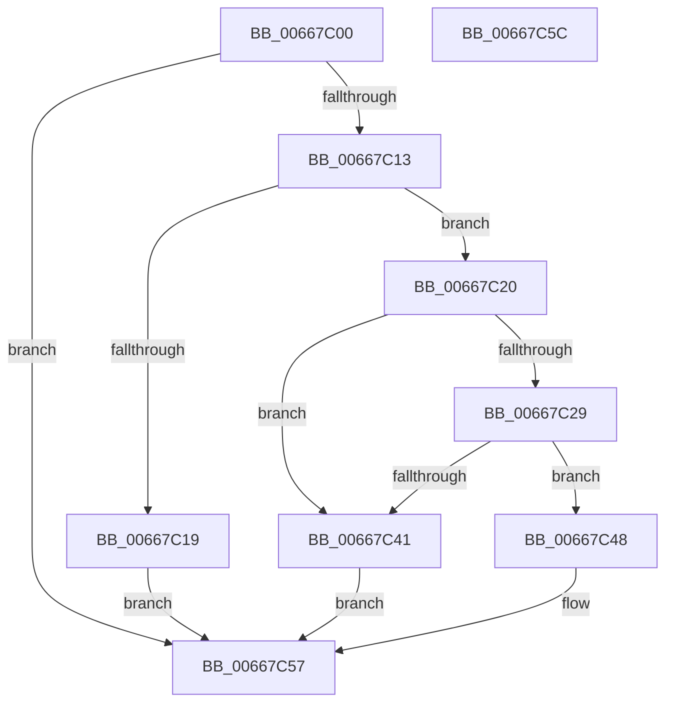

# DrpGetSectionAtIndex

- RVA: `0x00667C00`–`0x00667C5D` (길이 `93` bytes)
- VA: `0x0000000140667C00`
- 실행 섹션: `.text`
- PDB 이름 있음: `예`; PDB Function 태그: `아니요`
- unwind 정보 RVA: `0x0005C788`
- 디코드: `30`개 명령, `93/93` bytes 표시
- 미해석 바이트: `0` (있으면 어셈블리에 `.byte`로 보존)

> 이 문서는 커널 이미지의 기계어와 PDB 기호를 분석해 생성했습니다. 4번과 5번은 함수 원형과 자료형을 바이너리 사용 방식에서 추정한 C 해석이며 원본 소스 복구 결과는 아닙니다.

## 1. Dependencies

- 직접 호출 지점: **1**; 고유 호출 대상: **1**
- 직접 호출자로 확인된 함수: **1**
- RIP 상대 이미지 참조: **0**

### Outgoing calls
- `0x00667C0A` → [DrpVerifyData](DrpVerifyData_function_00667C64.md) (function, `0x00667C64`)

### Direct callers
- [MicrocodeGetRecord](MicrocodeGetRecord_function_00667060.md) at `0x006670FC`

### Static image references
- 디코드된 RIP-relative 메모리 참조가 없습니다.

## 2. Other-region calls and transfers

- 다른 실행 섹션으로 향하는 call: **0**
- 별도 외부 분기/꼬리 이동을 확인하지 못했습니다.

## 3. Assembly (complete function range)

```asm
00667C00  48 83 EC 28                     sub rsp, 0x28
00667C04  4C 8B DA                        mov r11, rdx
00667C07  4C 8B D1                        mov r10, rcx
00667C0A  E8 55 00 00 00                  call 0x140667c64
00667C0F  85 C0                           test eax, eax
00667C11  78 44                           js 0x140667c57
00667C13  44 3B 41 10                     cmp r8d, dword ptr [rcx + 0x10]
00667C17  76 07                           jbe 0x140667c20
00667C19  B8 0D 00 00 C0                  mov eax, 0xc000000d
00667C1E  EB 37                           jmp 0x140667c57
00667C20  8B 41 14                        mov eax, dword ptr [rcx + 0x14]
00667C23  48 3B 41 08                     cmp rax, qword ptr [rcx + 8]
00667C27  73 18                           jae 0x140667c41
00667C29  48 8D 14 08                     lea rdx, [rax + rcx]
00667C2D  41 8B 42 14                     mov eax, dword ptr [r10 + 0x14]
00667C31  41 8D 48 01                     lea ecx, [r8 + 1]
00667C35  48 C1 E1 05                     shl rcx, 5
00667C39  48 03 C8                        add rcx, rax
00667C3C  49 3B CB                        cmp rcx, r11
00667C3F  76 07                           jbe 0x140667c48
00667C41  B8 06 02 00 C0                  mov eax, 0xc0000206
00667C46  EB 0F                           jmp 0x140667c57
00667C48  41 8B C0                        mov eax, r8d
00667C4B  48 C1 E0 05                     shl rax, 5
00667C4F  48 03 C2                        add rax, rdx
00667C52  49 89 01                        mov qword ptr [r9], rax
00667C55  33 C0                           xor eax, eax
00667C57  48 83 C4 28                     add rsp, 0x28
00667C5B  C3                              ret
00667C5C  CC                              int3
```

## 4. C-style interpretation (structured pseudocode)

```c
__int64 __fastcall DrpGetSectionAtIndex(__int64 a1, __int64 a2, __int64 a3, __int64 a4)
{
    __int64 result;
    __int64 v_rsp;

    v_rsp = (v_rsp) - (40);
    result = DrpVerifyData(a1, a2, a3, a4);
    if (sign_flag) goto loc_00667C57;
    if (((unsigned int)(a3)) <= (*(unsigned int *)(a1 + 16))) goto loc_00667C20;
    goto loc_00667C57;
loc_00667C20:
    if (((unsigned int)(*(unsigned int *)(a1 + 20))) >= (*(unsigned __int64 *)(a1 + 8))) goto loc_00667C41;
    a1 = (a3 + 1) << (5);
    a1 = (a1) + ((unsigned int)(*(unsigned int *)(a1 + 20)));
    if (a1 <= a2) goto loc_00667C48;
loc_00667C41:
    goto loc_00667C57;
loc_00667C48:
    result = ((unsigned int)((unsigned int)(a3))) << (5);
    result = (result) + ((unsigned int)(*(unsigned int *)(a1 + 20)) + a1 * 1);
    *(unsigned __int64 *)(a4) = result;
    result = 0;
loc_00667C57:
    v_rsp = (v_rsp) + (40);
    return result;
}
```

## 5. (Beta) C Style

```c
int64_t DrpGetSectionAtIndex(int64_t Arg1, int64_t Arg2, int64_t Arg3, int64_t Arg4)
{
    int64_t result;
    int64_t local_rsp;

    local_rsp = (local_rsp) - (40);
    result = DrpVerifyData(Arg1, Arg2, Arg3, Arg4);
    if (sign_flag) goto loc_00667C57;
    if (((uint32_t)(Arg3)) <= (*(uint32_t *)(Arg1 + 0x10))) goto loc_00667C20;
    goto loc_00667C57;
loc_00667C20:
    if (((uint32_t)(*(uint32_t *)(Arg1 + 0x14))) >= (*(uint64_t *)(Arg1 + 0x8))) goto loc_00667C41;
    Arg1 = (Arg3 + 1) << (5);
    Arg1 = (Arg1) + ((uint32_t)(*(uint32_t *)(Arg1 + 0x14)));
    if (Arg1 <= Arg2) goto loc_00667C48;
loc_00667C41:
    goto loc_00667C57;
loc_00667C48:
    result = ((uint32_t)((uint32_t)(Arg3))) << (5);
    result = (result) + ((uint32_t)(*(uint32_t *)(Arg1 + 0x14)) + Arg1 * 1);
    *(uint64_t *)(Arg4) = result;
    result = 0;
loc_00667C57:
    local_rsp = (local_rsp) + (40);
    return result;
}
```

## 6. Execution-region graph

[열기: 2D/3D 그래프와 함수 탐색 컨트롤 패널](../../../control-panel.html?section=text&rva=0x00667C00&view=graph)

- 2D 그래프는 위에서 아래로 흐르고, 3D 그래프는 빈 공간을 드래그해 회전합니다. Shift+드래그는 이동, 휠은 확대·축소, 함수 노드 선택은 대상 보고서 이동입니다.

### Static fallback


