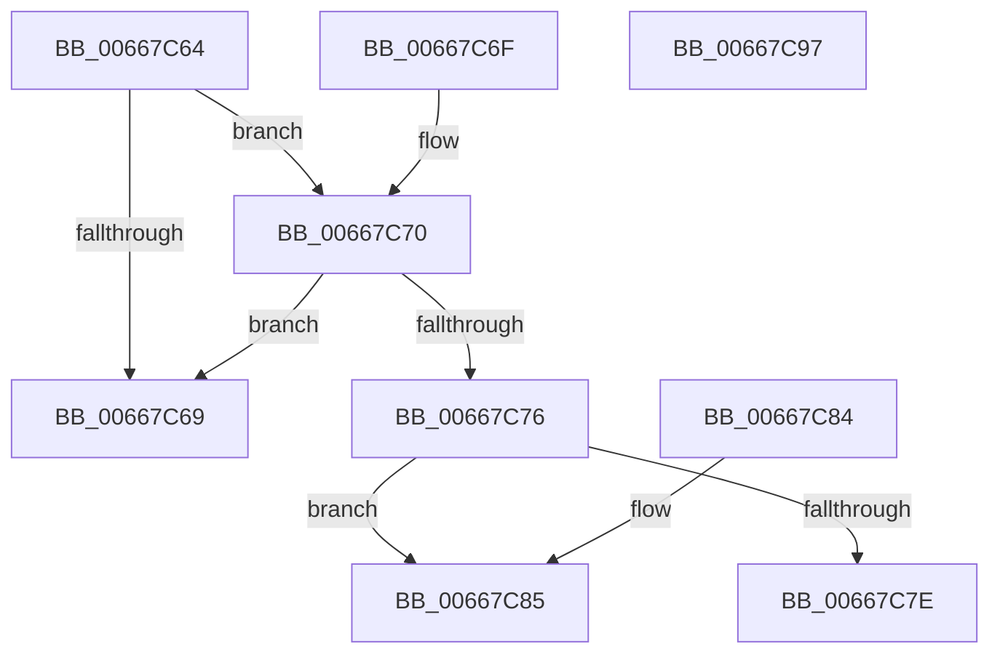

# DrpVerifyData

- RVA: `0x00667C64`–`0x00667C98` (길이 `52` bytes)
- VA: `0x0000000140667C64`
- 실행 섹션: `.text`
- PDB 이름 있음: `예`; PDB Function 태그: `아니요`
- unwind 정보 RVA: `0x000DB714`
- 디코드: `19`개 명령, `52/52` bytes 표시
- 미해석 바이트: `0` (있으면 어셈블리에 `.byte`로 보존)

> 이 문서는 커널 이미지의 기계어와 PDB 기호를 분석해 생성했습니다. 4번과 5번은 함수 원형과 자료형을 바이너리 사용 방식에서 추정한 C 해석이며 원본 소스 복구 결과는 아닙니다.

## 1. Dependencies

- 직접 호출 지점: **0**; 고유 호출 대상: **0**
- 직접 호출자로 확인된 함수: **3**
- RIP 상대 이미지 참조: **0**

### Outgoing calls
- 직접 디코드된 call 명령이 없습니다.

### Direct callers
- [DrpGetRecord](DrpGetRecord_function_00667B98.md) at `0x00667B9C`
- [DrpGetRecordCount](DrpGetRecordCount_function_00667BD4.md) at `0x00667BD8`
- [DrpGetSectionAtIndex](DrpGetSectionAtIndex_function_00667C00.md) at `0x00667C0A`

### Static image references
- 디코드된 RIP-relative 메모리 참조가 없습니다.

## 2. Other-region calls and transfers

- 다른 실행 섹션으로 향하는 call: **0**
- 별도 외부 분기/꼬리 이동을 확인하지 못했습니다.

## 3. Assembly (complete function range)

```asm
00667C64  48 85 C9                        test rcx, rcx
00667C67  75 07                           jne 0x140667c70
00667C69  B8 0D 00 00 C0                  mov eax, 0xc000000d
00667C6E  C3                              ret
00667C6F  CC                              int3
00667C70  48 83 FA 18                     cmp rdx, 0x18
00667C74  72 F3                           jb 0x140667c69
00667C76  81 39 53 4D 43 4D               cmp dword ptr [rcx], 0x4d434d53
00667C7C  74 07                           je 0x140667c85
00667C7E  B8 00 A0 00 C0                  mov eax, 0xc000a000
00667C83  C3                              ret
00667C84  CC                              int3
00667C85  48 8B 41 08                     mov rax, qword ptr [rcx + 8]
00667C89  48 2B C2                        sub rax, rdx
00667C8C  48 F7 D8                        neg rax
00667C8F  1B C0                           sbb eax, eax
00667C91  25 06 02 00 C0                  and eax, 0xc0000206
00667C96  C3                              ret
00667C97  CC                              int3
```

## 4. C-style interpretation (structured pseudocode)

```c
__int64 __fastcall DrpVerifyData(__int64 a1, __int64 a2)
{
    __int64 result;

    if (a1 != 0) goto loc_00667C70;
loc_00667C69:
    return (unsigned int)(0xC000000DULL);
loc_00667C70:
    if (a2 < 24) goto loc_00667C69;
    if ((*(unsigned int *)(a1)) == 0x4D434D53ULL) goto loc_00667C85;
    return (unsigned int)(0xC000A000ULL);
loc_00667C85:
    result = (*(unsigned __int64 *)(a1 + 8)) - (a2);
    result = -(result);
    result = (unsigned int)((result) & (0xC0000206ULL));
    return result;
}
```

## 5. (Beta) C Style

```c
int64_t DrpVerifyData(int64_t Arg1, int64_t Arg2)
{
    int64_t result;

    if (Arg1 != 0) goto loc_00667C70;
loc_00667C69:
    return (uint32_t)(0xC000000DULL);
loc_00667C70:
    if (Arg2 < 24) goto loc_00667C69;
    if ((*(uint32_t *)(Arg1)) == 0x4D434D53ULL) goto loc_00667C85;
    return (uint32_t)(0xC000A000ULL);
loc_00667C85:
    result = (*(uint64_t *)(Arg1 + 0x8)) - (Arg2);
    result = -(result);
    result = (uint32_t)((result) & (0xC0000206ULL));
    return result;
}
```

## 6. Execution-region graph

[열기: 2D/3D 그래프와 함수 탐색 컨트롤 패널](../../../control-panel.html?section=text&rva=0x00667C64&view=graph)

- 2D 그래프는 위에서 아래로 흐르고, 3D 그래프는 빈 공간을 드래그해 회전합니다. Shift+드래그는 이동, 휠은 확대·축소, 함수 노드 선택은 대상 보고서 이동입니다.

### Static fallback


