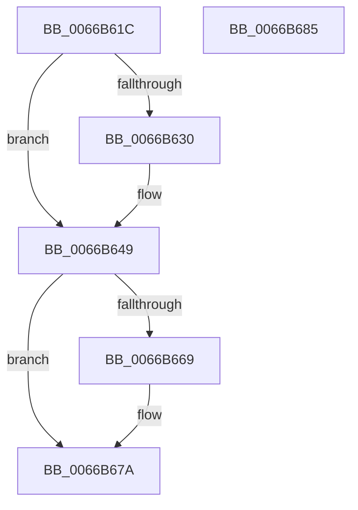

# Feature_CFR_Parent_KM_C__private_ReportUsageFallback

- RVA: `0x0066B61C`–`0x0066B686` (길이 `106` bytes)
- VA: `0x000000014066B61C`
- 실행 섹션: `.text`
- PDB 이름 있음: `예`; PDB Function 태그: `아니요`
- unwind 정보 RVA: `0x0005CAAC`
- 디코드: `29`개 명령, `106/106` bytes 표시
- 미해석 바이트: `0` (있으면 어셈블리에 `.byte`로 보존)

> 이 문서는 커널 이미지의 기계어와 PDB 기호를 분석해 생성했습니다. 4번과 5번은 함수 원형과 자료형을 바이너리 사용 방식에서 추정한 C 해석이며 원본 소스 복구 결과는 아닙니다.

## 1. Dependencies

- 직접 호출 지점: **3**; 고유 호출 대상: **3**
- 직접 호출자로 확인된 함수: **1**
- RIP 상대 이미지 참조: **2**

### Outgoing calls
- `0x0066B641` → [wil_details_FeatureStateCache_ReevaluateCachedFeatureEnabledState](../3F/wil_details_FeatureStateCache_ReevaluateCachedFeatureEnabledState_function_003FE988.md) (function, `0x003FE988`)
- `0x0066B65C` → [wil_details_FeatureReporting_ReportUsageToService](../53/wil_details_FeatureReporting_ReportUsageToService_function_0053E6E4.md) (function, `0x0053E6E4`)
- `0x0066B675` → [wil_details_FeatureStateCache_TryEnableDeviceUsageFastPath](../53/wil_details_FeatureStateCache_TryEnableDeviceUsageFastPath_function_0053E774.md) (function, `0x0053E774`)

### Direct callers
- [CmFcManagerUpdateFeatureConfigurations](../../page/7F/CmFcManagerUpdateFeatureConfigurations_function_007F4CF4.md) at `0x007F4D94`

### Static image references
- `0x0066B633` → RVA `0x000DFAF0` (`.rdata`; read)
- `0x0066B63A` → RVA `0x00FC4CB8` (`.data`; read)

## 2. Other-region calls and transfers

- 다른 실행 섹션으로 향하는 call: **0**
- 별도 외부 분기/꼬리 이동을 확인하지 못했습니다.

## 3. Assembly (complete function range)

```asm
0066B61C  48 89 5C 24 08                  mov qword ptr [rsp + 8], rbx
0066B621  57                              push rdi
0066B622  48 83 EC 20                     sub rsp, 0x20
0066B626  8B FA                           mov edi, edx
0066B628  48 8B D9                        mov rbx, rcx
0066B62B  F6 C1 02                        test cl, 2
0066B62E  75 19                           jne 0x14066b649
0066B630  48 8B D1                        mov rdx, rcx
0066B633  4C 8D 05 B6 44 A7 FF            lea r8, [rip - 0x58bb4a]
0066B63A  48 8D 0D 77 96 95 00            lea rcx, [rip + 0x959677]
0066B641  E8 42 33 D9 FF                  call 0x1403fe988
0066B646  48 8B D8                        mov rbx, rax
0066B649  41 B9 01 00 00 00               mov r9d, 1
0066B64F  48 8D 0D 9A 44 A7 FF            lea rcx, [rip - 0x58bb66]
0066B656  44 8B C7                        mov r8d, edi
0066B659  48 8B D3                        mov rdx, rbx
0066B65C  E8 83 30 ED FF                  call 0x14053e6e4
0066B661  8D 47 FD                        lea eax, [rdi - 3]
0066B664  83 F8 01                        cmp eax, 1
0066B667  77 11                           ja 0x14066b67a
0066B669  4C 8D 05 80 44 A7 FF            lea r8, [rip - 0x58bb80]
0066B670  8B D7                           mov edx, edi
0066B672  48 8B CB                        mov rcx, rbx
0066B675  E8 FA 30 ED FF                  call 0x14053e774
0066B67A  48 8B 5C 24 30                  mov rbx, qword ptr [rsp + 0x30]
0066B67F  48 83 C4 20                     add rsp, 0x20
0066B683  5F                              pop rdi
0066B684  C3                              ret
0066B685  CC                              int3
```

## 4. C-style interpretation (structured pseudocode)

```c
__int64 __fastcall Feature_CFR_Parent_KM_C__private_ReportUsageFallback(__int64 a1, int a2)
{
    __int64 result;
    __int64 v_rbx;
    __int64 v_rsp;
    unsigned __int64 v_stack_p8;

    v_stack_p8 = v_rbx;
    v_rsp = (v_rsp) - (32);
    v_rbx = a1;
    if ((((unsigned __int8)(a1)) & (2)) == 0) {
        a2 = a1;
        a3 = v_rip - 5815114;
        a1 = v_rip + 9803383;
        result = wil_details_FeatureStateCache_ReevaluateCachedFeatureEnabledState(a1, a2, a3, a4);
        v_rbx = result;
    }
    result = wil_details_FeatureReporting_ReportUsageToService(v_rip - 5815142, v_rbx, (unsigned int)((unsigned int)((unsigned int)(a2))), 1);
    result = (unsigned int)(a2) - 3;
    if (((unsigned int)((unsigned int)(a2) - 3)) <= 1) {
        a3 = v_rip - 5815168;
        a2 = (unsigned int)((unsigned int)(a2));
        a1 = v_rbx;
        result = wil_details_FeatureStateCache_TryEnableDeviceUsageFastPath(a1, a2, a3, 1);
    }
    v_rsp = (v_rsp) + (32);
    return result;
}
```

## 5. (Beta) C Style

```c
int64_t Feature_CFR_Parent_KM_C__private_ReportUsageFallback(int64_t Arg1, void *Arg2)
{
    uint8_t *arg2 = (uint8_t *)Arg2;

    int64_t result;
    int64_t local_rbx;
    int64_t local_rsp;
    uint64_t v_stack_p8;

    v_stack_p8 = local_rbx;
    local_rsp = (local_rsp) - (32);
    local_rbx = Arg1;
    if ((((uint8_t)(Arg1)) & (2)) == 0) {
        Arg2 = Arg1;
        a3 = v_rip - 5815114;
        Arg1 = v_rip + 9803383;
        result = wil_details_FeatureStateCache_ReevaluateCachedFeatureEnabledState(Arg1, Arg2, a3, a4);
        local_rbx = result;
    }
    result = wil_details_FeatureReporting_ReportUsageToService(v_rip - 5815142, local_rbx, (uint32_t)((uint32_t)((uint32_t)(Arg2))), 1);
    result = (uint32_t)(Arg2) - 3;
    if (((uint32_t)((uint32_t)(Arg2) - 3)) <= 1) {
        a3 = v_rip - 5815168;
        Arg2 = (uint32_t)((uint32_t)(Arg2));
        Arg1 = local_rbx;
        result = wil_details_FeatureStateCache_TryEnableDeviceUsageFastPath(Arg1, Arg2, a3, 1);
    }
    local_rsp = (local_rsp) + (32);
    return result;
}
```

### 관측된 메모리 오프셋

구조체 형식이 확인되지 않은 접근은 인자 기준의 오프셋으로만 기록했습니다.

| 기준 인자 | 오프셋 표현 | 폭 (bit) | 접근 |
|---|---:|---:|---|
| `Arg2` | `- 0x3` | `32` | `R` |

## 6. Execution-region graph

[열기: 2D/3D 그래프와 함수 탐색 컨트롤 패널](../../../control-panel.html?section=text&rva=0x0066B61C&view=graph)

- 2D 그래프는 위에서 아래로 흐르고, 3D 그래프는 빈 공간을 드래그해 회전합니다. Shift+드래그는 이동, 휠은 확대·축소, 함수 노드 선택은 대상 보고서 이동입니다.

### Static fallback


