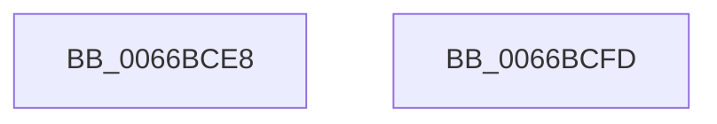

# Feature_ConfAccImp__private_IsEnabledFallback

- RVA: `0x0066BCE8`–`0x0066BCFE` (길이 `22` bytes)
- VA: `0x000000014066BCE8`
- 실행 섹션: `.text`
- PDB 이름 있음: `예`; PDB Function 태그: `아니요`
- unwind 정보 RVA: `0x0005C788`
- 디코드: `6`개 명령, `22/22` bytes 표시
- 미해석 바이트: `0` (있으면 어셈블리에 `.byte`로 보존)

> 이 문서는 커널 이미지의 기계어와 PDB 기호를 분석해 생성했습니다. 4번과 5번은 함수 원형과 자료형을 바이너리 사용 방식에서 추정한 C 해석이며 원본 소스 복구 결과는 아닙니다.

## 1. Dependencies

- 직접 호출 지점: **1**; 고유 호출 대상: **1**
- 직접 호출자로 확인된 함수: **4**
- RIP 상대 이미지 참조: **1**

### Outgoing calls
- `0x0066BCF3` → [wil_details_IsEnabledFallback](../4D/wil_details_IsEnabledFallback_function_004DAEFC.md) (function, `0x004DAEFC`)

### Direct callers
- [Feature_ConfAccImp__private_IsEnabledDeviceOpportunityNoInline](Feature_ConfAccImp__private_IsEnabledDeviceOpportunityNoInline_function_0066BC78.md) at `0x0066BC9F`
- [Feature_ConfAccImp__private_IsEnabledDeviceUsageNoInline](Feature_ConfAccImp__private_IsEnabledDeviceUsageNoInline_function_0066BCB0.md) at `0x0066BCD7`
- [Feature_ConfAccImp__private_IsEnabledNoReportingNoInline](Feature_ConfAccImp__private_IsEnabledNoReportingNoInline_function_0066BD04.md) at `0x0066BD28`
- [Feature_ConfAccImp__private_IsEnabledOtherReporting](Feature_ConfAccImp__private_IsEnabledOtherReporting_function_0066BD3C.md) at `0x0066BD7F`

### Static image references
- `0x0066BCEC` → RVA `0x000DC718` (`.rdata`; read)

## 2. Other-region calls and transfers

- 다른 실행 섹션으로 향하는 call: **0**
- 별도 외부 분기/꼬리 이동을 확인하지 못했습니다.

## 3. Assembly (complete function range)

```asm
0066BCE8  48 83 EC 28                     sub rsp, 0x28
0066BCEC  4C 8D 05 25 0A A7 FF            lea r8, [rip - 0x58f5db]
0066BCF3  E8 04 F2 E6 FF                  call 0x1404daefc
0066BCF8  48 83 C4 28                     add rsp, 0x28
0066BCFC  C3                              ret
0066BCFD  CC                              int3
```

## 4. C-style interpretation (structured pseudocode)

```c
__int64 __fastcall Feature_ConfAccImp__private_IsEnabledFallback(void)
{
    __int64 result;
    __int64 v_rsp;

    v_rsp = (v_rsp) - (40);
    result = wil_details_IsEnabledFallback(a1, a2, v_rip - 5830107, a4);
    v_rsp = (v_rsp) + (40);
    return result;
}
```

## 5. (Beta) C Style

```c
void Feature_ConfAccImp__private_IsEnabledFallback(void)
{
    int64_t result;
    int64_t local_rsp;

    local_rsp = (local_rsp) - (40);
    result = wil_details_IsEnabledFallback(a1, a2, v_rip - 5830107, a4);
    local_rsp = (local_rsp) + (40);
    return result;
}
```

## 6. Execution-region graph

[열기: 2D/3D 그래프와 함수 탐색 컨트롤 패널](../../../control-panel.html?section=text&rva=0x0066BCE8&view=graph)

- 2D 그래프는 위에서 아래로 흐르고, 3D 그래프는 빈 공간을 드래그해 회전합니다. Shift+드래그는 이동, 휠은 확대·축소, 함수 노드 선택은 대상 보고서 이동입니다.

### Static fallback


