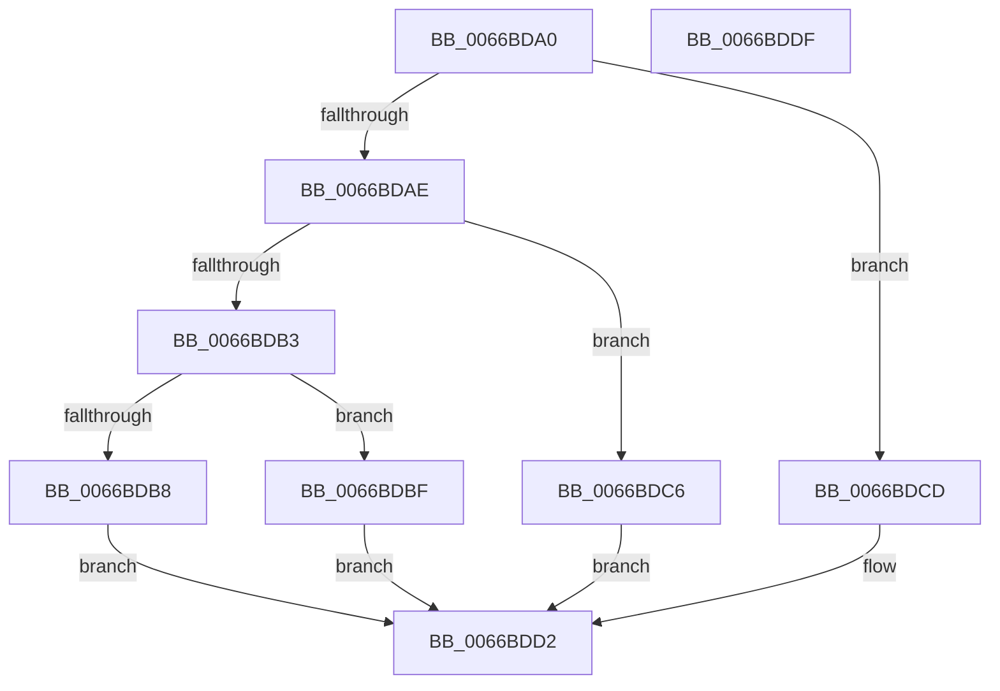

# Feature_ExpToc_IsEnabledWithReporting

- RVA: `0x0066BDA0`–`0x0066BDE0` (길이 `64` bytes)
- VA: `0x000000014066BDA0`
- 실행 섹션: `.text`
- PDB 이름 있음: `예`; PDB Function 태그: `아니요`
- unwind 정보 RVA: `0x0005CF00`
- 디코드: `24`개 명령, `64/64` bytes 표시
- 미해석 바이트: `0` (있으면 어셈블리에 `.byte`로 보존)

> 이 문서는 커널 이미지의 기계어와 PDB 기호를 분석해 생성했습니다. 4번과 5번은 함수 원형과 자료형을 바이너리 사용 방식에서 추정한 C 해석이며 원본 소스 복구 결과는 아닙니다.

## 1. Dependencies

- 직접 호출 지점: **4**; 고유 호출 대상: **4**
- 직접 호출자로 확인된 함수: **0**
- RIP 상대 이미지 참조: **0**

### Outgoing calls
- `0x0066BDB8` → [Feature_ExpToc__private_IsEnabledOtherReporting](Feature_ExpToc__private_IsEnabledOtherReporting_function_0066BEAC.md) (function, `0x0066BEAC`)
- `0x0066BDBF` → [Feature_ExpToc__private_IsEnabledDeviceOpportunityNoInline](Feature_ExpToc__private_IsEnabledDeviceOpportunityNoInline_function_0066BDE8.md) (function, `0x0066BDE8`)
- `0x0066BDC6` → [Feature_ExpToc__private_IsEnabledDeviceUsageNoInline](Feature_ExpToc__private_IsEnabledDeviceUsageNoInline_function_0066BE20.md) (function, `0x0066BE20`)
- `0x0066BDCD` → [Feature_ExpToc__private_IsEnabledNoReportingNoInline](Feature_ExpToc__private_IsEnabledNoReportingNoInline_function_0066BE74.md) (function, `0x0066BE74`)

### Direct callers
- 이 함수 시작 RVA로 연결되는 직접 call은 확인되지 않았습니다. 간접 호출은 완전히 역산할 수 없습니다.

### Static image references
- 디코드된 RIP-relative 메모리 참조가 없습니다.

## 2. Other-region calls and transfers

- 다른 실행 섹션으로 향하는 call: **0**
- 별도 외부 분기/꼬리 이동을 확인하지 못했습니다.

## 3. Assembly (complete function range)

```asm
0066BDA0  40 53                           push rbx
0066BDA2  48 83 EC 20                     sub rsp, 0x20
0066BDA6  33 DB                           xor ebx, ebx
0066BDA8  8B D1                           mov edx, ecx
0066BDAA  85 C9                           test ecx, ecx
0066BDAC  74 1F                           je 0x14066bdcd
0066BDAE  83 EA 03                        sub edx, 3
0066BDB1  74 13                           je 0x14066bdc6
0066BDB3  83 FA 01                        cmp edx, 1
0066BDB6  74 07                           je 0x14066bdbf
0066BDB8  E8 EF 00 00 00                  call 0x14066beac
0066BDBD  EB 13                           jmp 0x14066bdd2
0066BDBF  E8 24 00 00 00                  call 0x14066bde8
0066BDC4  EB 0C                           jmp 0x14066bdd2
0066BDC6  E8 55 00 00 00                  call 0x14066be20
0066BDCB  EB 05                           jmp 0x14066bdd2
0066BDCD  E8 A2 00 00 00                  call 0x14066be74
0066BDD2  85 C0                           test eax, eax
0066BDD4  0F 95 C3                        setne bl
0066BDD7  8B C3                           mov eax, ebx
0066BDD9  48 83 C4 20                     add rsp, 0x20
0066BDDD  5B                              pop rbx
0066BDDE  C3                              ret
0066BDDF  CC                              int3
```

## 4. C-style interpretation (structured pseudocode)

```c
__int64 __fastcall Feature_ExpToc_IsEnabledWithReporting(int a1)
{
    __int64 result;
    __int64 v_rbx;
    __int64 v_rsp;

    v_rsp = (v_rsp) - (32);
    v_rbx = 0;
    if (a1 == 0) goto loc_0066BDCD;
    a2 = (unsigned int)(((unsigned int)(a1)) - (3));
    if (condition_is_equal) goto loc_0066BDC6;
    if (((unsigned int)(a2)) == 1) goto loc_0066BDBF;
    result = Feature_ExpToc__private_IsEnabledOtherReporting(a1, a2, a3, a4);
    goto loc_0066BDD2;
loc_0066BDBF:
    result = Feature_ExpToc__private_IsEnabledDeviceOpportunityNoInline(a1, a2, a3, a4);
    goto loc_0066BDD2;
loc_0066BDC6:
    result = Feature_ExpToc__private_IsEnabledDeviceUsageNoInline(a1, a2, a3, a4);
    goto loc_0066BDD2;
loc_0066BDCD:
    result = Feature_ExpToc__private_IsEnabledNoReportingNoInline(a1, a2, a3, a4);
loc_0066BDD2:
    v_rbx = ((unsigned int)(result) != 0) ? 1 : 0;
    v_rsp = (v_rsp) + (32);
    return (unsigned int)((unsigned int)(v_rbx));
}
```

## 5. (Beta) C Style

```c
int64_t Feature_ExpToc_IsEnabledWithReporting(int32_t Arg1)
{
    int64_t result;
    int64_t local_rbx;
    int64_t local_rsp;

    local_rsp = (local_rsp) - (32);
    local_rbx = 0;
    if (Arg1 == 0) goto loc_0066BDCD;
    a2 = (uint32_t)(((uint32_t)(Arg1)) - (3));
    if (condition_is_equal) goto loc_0066BDC6;
    if (((uint32_t)(a2)) == 1) goto loc_0066BDBF;
    result = Feature_ExpToc__private_IsEnabledOtherReporting(Arg1, a2, a3, a4);
    goto loc_0066BDD2;
loc_0066BDBF:
    result = Feature_ExpToc__private_IsEnabledDeviceOpportunityNoInline(Arg1, a2, a3, a4);
    goto loc_0066BDD2;
loc_0066BDC6:
    result = Feature_ExpToc__private_IsEnabledDeviceUsageNoInline(Arg1, a2, a3, a4);
    goto loc_0066BDD2;
loc_0066BDCD:
    result = Feature_ExpToc__private_IsEnabledNoReportingNoInline(Arg1, a2, a3, a4);
loc_0066BDD2:
    local_rbx = ((uint32_t)(result) != 0) ? 1 : 0;
    local_rsp = (local_rsp) + (32);
    return (uint32_t)((uint32_t)(local_rbx));
}
```

## 6. Execution-region graph

[열기: 2D/3D 그래프와 함수 탐색 컨트롤 패널](../../../control-panel.html?section=text&rva=0x0066BDA0&view=graph)

- 2D 그래프는 위에서 아래로 흐르고, 3D 그래프는 빈 공간을 드래그해 회전합니다. Shift+드래그는 이동, 휠은 확대·축소, 함수 노드 선택은 대상 보고서 이동입니다.

### Static fallback


