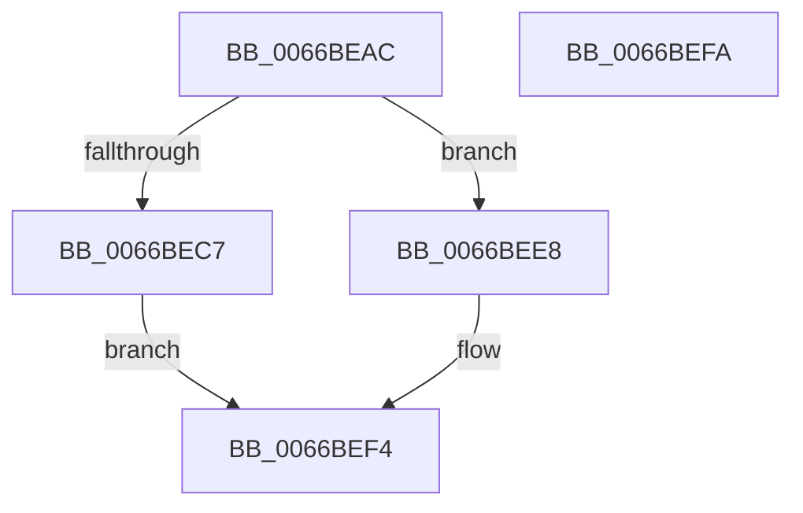

# Feature_ExpToc__private_IsEnabledOtherReporting

- RVA: `0x0066BEAC`–`0x0066BEFB` (길이 `79` bytes)
- VA: `0x000000014066BEAC`
- 실행 섹션: `.text`
- PDB 이름 있음: `예`; PDB Function 태그: `아니요`
- unwind 정보 RVA: `0x0005CF00`
- 디코드: `22`개 명령, `79/79` bytes 표시
- 미해석 바이트: `0` (있으면 어셈블리에 `.byte`로 보존)

> 이 문서는 커널 이미지의 기계어와 PDB 기호를 분석해 생성했습니다. 4번과 5번은 함수 원형과 자료형을 바이너리 사용 방식에서 추정한 C 해석이며 원본 소스 복구 결과는 아닙니다.

## 1. Dependencies

- 직접 호출 지점: **2**; 고유 호출 대상: **2**
- 직접 호출자로 확인된 함수: **1**
- RIP 상대 이미지 참조: **2**

### Outgoing calls
- `0x0066BEDC` → [wil_details_FeatureReporting_ReportUsageToService](../53/wil_details_FeatureReporting_ReportUsageToService_function_0053E6E4.md) (function, `0x0053E6E4`)
- `0x0066BEEF` → [Feature_ExpToc__private_IsEnabledFallback](Feature_ExpToc__private_IsEnabledFallback_function_0066BE58.md) (function, `0x0066BE58`)

### Direct callers
- [Feature_ExpToc_IsEnabledWithReporting](Feature_ExpToc_IsEnabledWithReporting_function_0066BDA0.md) at `0x0066BDB8`

### Static image references
- `0x0066BEB8` → RVA `0x00FC4570` (`.data`; read)
- `0x0066BECF` → RVA `0x000DC670` (`.rdata`; read)

## 2. Other-region calls and transfers

- 다른 실행 섹션으로 향하는 call: **0**
- 별도 외부 분기/꼬리 이동을 확인하지 못했습니다.

## 3. Assembly (complete function range)

```asm
0066BEAC  40 53                           push rbx
0066BEAE  48 83 EC 20                     sub rsp, 0x20
0066BEB2  48 83 64 24 38 00               and qword ptr [rsp + 0x38], 0
0066BEB8  8B 1D B2 86 95 00               mov ebx, dword ptr [rip + 0x9586b2]
0066BEBE  89 5C 24 38                     mov dword ptr [rsp + 0x38], ebx
0066BEC2  F6 C3 02                        test bl, 2
0066BEC5  74 21                           je 0x14066bee8
0066BEC7  48 8B 54 24 38                  mov rdx, qword ptr [rsp + 0x38]
0066BECC  44 8B C1                        mov r8d, ecx
0066BECF  48 8D 0D 9A 07 A7 FF            lea rcx, [rip - 0x58f866]
0066BED6  41 B9 01 00 00 00               mov r9d, 1
0066BEDC  E8 03 28 ED FF                  call 0x14053e6e4
0066BEE1  83 E3 01                        and ebx, 1
0066BEE4  8B C3                           mov eax, ebx
0066BEE6  EB 0C                           jmp 0x14066bef4
0066BEE8  8B D1                           mov edx, ecx
0066BEEA  48 8B 4C 24 38                  mov rcx, qword ptr [rsp + 0x38]
0066BEEF  E8 64 FF FF FF                  call 0x14066be58
0066BEF4  48 83 C4 20                     add rsp, 0x20
0066BEF8  5B                              pop rbx
0066BEF9  C3                              ret
0066BEFA  CC                              int3
```

## 4. C-style interpretation (structured pseudocode)

```c
__int64 __fastcall Feature_ExpToc__private_IsEnabledOtherReporting(int a1)
{
    __int64 result;
    __int64 v_rbx;
    __int64 v_rsp;
    unsigned __int64 v_stack_p10;

    v_rsp = (v_rsp) - (32);
    v_stack_p10 = (unsigned int)((unsigned int)(*(unsigned int *)(v_rip + 9799346)));
    if ((((unsigned __int8)((unsigned int)(*(unsigned int *)(v_rip + 9799346)))) & (2)) == 0) goto loc_0066BEE8;
    result = wil_details_FeatureReporting_ReportUsageToService(v_rip - 5830758, v_stack_p10, (unsigned int)(a1), 1);
    v_rbx = (unsigned int)(((unsigned int)(*(unsigned int *)(v_rip + 9799346))) & (1));
    goto loc_0066BEF4;
loc_0066BEE8:
    result = Feature_ExpToc__private_IsEnabledFallback(v_stack_p10, (unsigned int)((unsigned int)(v_rip - 5830758)), (unsigned int)(a1), 1);
loc_0066BEF4:
    v_rsp = (v_rsp) + (32);
    return result;
}
```

## 5. (Beta) C Style

```c
int64_t Feature_ExpToc__private_IsEnabledOtherReporting(int32_t Arg1)
{
    int64_t result;
    int64_t local_rbx;
    int64_t local_rsp;
    uint64_t v_stack_p10;

    local_rsp = (local_rsp) - (32);
    v_stack_p10 = (uint32_t)((uint32_t)(*(uint32_t *)(v_rip + 0x9586B2)));
    if ((((uint8_t)((uint32_t)(*(uint32_t *)(v_rip + 0x9586B2)))) & (2)) == 0) goto loc_0066BEE8;
    result = wil_details_FeatureReporting_ReportUsageToService(v_rip - 5830758, v_stack_p10, (uint32_t)(Arg1), 1);
    local_rbx = (uint32_t)(((uint32_t)(*(uint32_t *)(v_rip + 0x9586B2))) & (1));
    goto loc_0066BEF4;
loc_0066BEE8:
    result = Feature_ExpToc__private_IsEnabledFallback(v_stack_p10, (uint32_t)((uint32_t)(v_rip - 5830758)), (uint32_t)(Arg1), 1);
loc_0066BEF4:
    local_rsp = (local_rsp) + (32);
    return result;
}
```

## 6. Execution-region graph

[열기: 2D/3D 그래프와 함수 탐색 컨트롤 패널](../../../control-panel.html?section=text&rva=0x0066BEAC&view=graph)

- 2D 그래프는 위에서 아래로 흐르고, 3D 그래프는 빈 공간을 드래그해 회전합니다. Shift+드래그는 이동, 휠은 확대·축소, 함수 노드 선택은 대상 보고서 이동입니다.

### Static fallback


