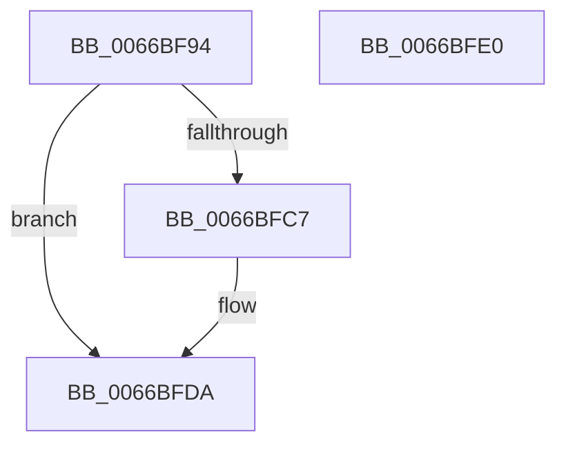

# Feature_GatePerf__private_ReportUsageFallback

- RVA: `0x0066BF94`–`0x0066BFE1` (길이 `77` bytes)
- VA: `0x000000014066BF94`
- 실행 섹션: `.text`
- PDB 이름 있음: `예`; PDB Function 태그: `아니요`
- unwind 정보 RVA: `0x000805BC`
- 디코드: `21`개 명령, `77/77` bytes 표시
- 미해석 바이트: `0` (있으면 어셈블리에 `.byte`로 보존)

> 이 문서는 커널 이미지의 기계어와 PDB 기호를 분석해 생성했습니다. 4번과 5번은 함수 원형과 자료형을 바이너리 사용 방식에서 추정한 C 해석이며 원본 소스 복구 결과는 아닙니다.

## 1. Dependencies

- 직접 호출 지점: **2**; 고유 호출 대상: **2**
- 직접 호출자로 확인된 함수: **1**
- RIP 상대 이미지 참조: **1**

### Outgoing calls
- `0x0066BFBA` → [wil_details_FeatureReporting_ReportUsageToService](../53/wil_details_FeatureReporting_ReportUsageToService_function_0053E6E4.md) (function, `0x0053E6E4`)
- `0x0066BFD5` → [wil_details_FeatureStateCache_TryEnableDeviceUsageFastPath](../53/wil_details_FeatureStateCache_TryEnableDeviceUsageFastPath_function_0053E774.md) (function, `0x0053E774`)

### Direct callers
- [Feature_GatePerf_IsEnabledWithReporting](Feature_GatePerf_IsEnabledWithReporting_function_0066BF10.md) at `0x0066BF7B`

### Static image references
- `0x0066BFA3` → RVA `0x000DC168` (`.rdata`; read)

## 2. Other-region calls and transfers

- 다른 실행 섹션으로 향하는 call: **0**
- 별도 외부 분기/꼬리 이동을 확인하지 못했습니다.

## 3. Assembly (complete function range)

```asm
0066BF94  48 89 4C 24 08                  mov qword ptr [rsp + 8], rcx
0066BF99  53                              push rbx
0066BF9A  48 83 EC 20                     sub rsp, 0x20
0066BF9E  83 4C 24 30 01                  or dword ptr [rsp + 0x30], 1
0066BFA3  48 8D 0D BE 01 A7 FF            lea rcx, [rip - 0x58fe42]
0066BFAA  8B DA                           mov ebx, edx
0066BFAC  44 8B C2                        mov r8d, edx
0066BFAF  48 8B 54 24 30                  mov rdx, qword ptr [rsp + 0x30]
0066BFB4  41 B9 01 00 00 00               mov r9d, 1
0066BFBA  E8 25 27 ED FF                  call 0x14053e6e4
0066BFBF  8D 43 FD                        lea eax, [rbx - 3]
0066BFC2  83 F8 01                        cmp eax, 1
0066BFC5  77 13                           ja 0x14066bfda
0066BFC7  48 8B 4C 24 30                  mov rcx, qword ptr [rsp + 0x30]
0066BFCC  4C 8D 05 95 01 A7 FF            lea r8, [rip - 0x58fe6b]
0066BFD3  8B D3                           mov edx, ebx
0066BFD5  E8 9A 27 ED FF                  call 0x14053e774
0066BFDA  48 83 C4 20                     add rsp, 0x20
0066BFDE  5B                              pop rbx
0066BFDF  C3                              ret
0066BFE0  CC                              int3
```

## 4. C-style interpretation (structured pseudocode)

```c
__int64 __fastcall Feature_GatePerf__private_ReportUsageFallback(__int64 a1, int a2)
{
    __int64 result;
    __int64 v_rsp;
    unsigned __int64 v_stack_p8;

    v_stack_p8 = a1;
    v_rsp = (v_rsp) - (32);
    result = wil_details_FeatureReporting_ReportUsageToService(v_rip - 5832258, v_stack_p8, (unsigned int)(a2), 1);
    result = (unsigned int)(a2) - 3;
    if (((unsigned int)((unsigned int)(a2) - 3)) <= 1) {
        a1 = v_stack_p8;
        a3 = v_rip - 5832299;
        a2 = (unsigned int)((unsigned int)(a2));
        result = wil_details_FeatureStateCache_TryEnableDeviceUsageFastPath(a1, a2, a3, 1);
    }
    v_rsp = (v_rsp) + (32);
    return result;
}
```

## 5. (Beta) C Style

```c
int64_t Feature_GatePerf__private_ReportUsageFallback(int64_t Arg1, void *Arg2)
{
    uint8_t *arg2 = (uint8_t *)Arg2;

    int64_t result;
    int64_t local_rsp;
    uint64_t v_stack_p8;

    v_stack_p8 = Arg1;
    local_rsp = (local_rsp) - (32);
    result = wil_details_FeatureReporting_ReportUsageToService(v_rip - 5832258, v_stack_p8, (uint32_t)(Arg2), 1);
    result = (uint32_t)(Arg2) - 3;
    if (((uint32_t)((uint32_t)(Arg2) - 3)) <= 1) {
        Arg1 = v_stack_p8;
        a3 = v_rip - 5832299;
        Arg2 = (uint32_t)((uint32_t)(Arg2));
        result = wil_details_FeatureStateCache_TryEnableDeviceUsageFastPath(Arg1, Arg2, a3, 1);
    }
    local_rsp = (local_rsp) + (32);
    return result;
}
```

### 관측된 메모리 오프셋

구조체 형식이 확인되지 않은 접근은 인자 기준의 오프셋으로만 기록했습니다.

| 기준 인자 | 오프셋 표현 | 폭 (bit) | 접근 |
|---|---:|---:|---|
| `Arg2` | `- 0x3` | `32` | `R` |

## 6. Execution-region graph

[열기: 2D/3D 그래프와 함수 탐색 컨트롤 패널](../../../control-panel.html?section=text&rva=0x0066BF94&view=graph)

- 2D 그래프는 위에서 아래로 흐르고, 3D 그래프는 빈 공간을 드래그해 회전합니다. Shift+드래그는 이동, 휠은 확대·축소, 함수 노드 선택은 대상 보고서 이동입니다.

### Static fallback


