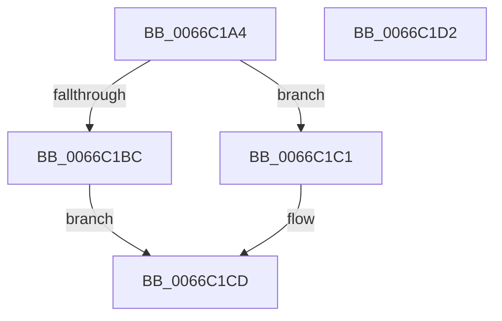

# Feature_LocPerfVal__private_IsEnabledNoReportingNoInline

- RVA: `0x0066C1A4`–`0x0066C1D3` (길이 `47` bytes)
- VA: `0x000000014066C1A4`
- 실행 섹션: `.text`
- PDB 이름 있음: `예`; PDB Function 태그: `아니요`
- unwind 정보 RVA: `0x0005C788`
- 디코드: `14`개 명령, `47/47` bytes 표시
- 미해석 바이트: `0` (있으면 어셈블리에 `.byte`로 보존)

> 이 문서는 커널 이미지의 기계어와 PDB 기호를 분석해 생성했습니다. 4번과 5번은 함수 원형과 자료형을 바이너리 사용 방식에서 추정한 C 해석이며 원본 소스 복구 결과는 아닙니다.

## 1. Dependencies

- 직접 호출 지점: **1**; 고유 호출 대상: **1**
- 직접 호출자로 확인된 함수: **1**
- RIP 상대 이미지 참조: **1**

### Outgoing calls
- `0x0066C1C8` → [Feature_LocPerfVal__private_IsEnabledFallback](Feature_LocPerfVal__private_IsEnabledFallback_function_0066C188.md) (function, `0x0066C188`)

### Direct callers
- [Feature_LocPerfVal_IsEnabledWithReporting](Feature_LocPerfVal_IsEnabledWithReporting_function_0066C0D0.md) at `0x0066C0FD`

### Static image references
- `0x0066C1AE` → RVA `0x00FC45E8` (`.data`; read)

## 2. Other-region calls and transfers

- 다른 실행 섹션으로 향하는 call: **0**
- 별도 외부 분기/꼬리 이동을 확인하지 못했습니다.

## 3. Assembly (complete function range)

```asm
0066C1A4  48 83 EC 28                     sub rsp, 0x28
0066C1A8  48 83 64 24 30 00               and qword ptr [rsp + 0x30], 0
0066C1AE  8B 05 34 84 95 00               mov eax, dword ptr [rip + 0x958434]
0066C1B4  89 44 24 30                     mov dword ptr [rsp + 0x30], eax
0066C1B8  A8 02                           test al, 2
0066C1BA  74 05                           je 0x14066c1c1
0066C1BC  83 E0 01                        and eax, 1
0066C1BF  EB 0C                           jmp 0x14066c1cd
0066C1C1  48 8B 4C 24 30                  mov rcx, qword ptr [rsp + 0x30]
0066C1C6  33 D2                           xor edx, edx
0066C1C8  E8 BB FF FF FF                  call 0x14066c188
0066C1CD  48 83 C4 28                     add rsp, 0x28
0066C1D1  C3                              ret
0066C1D2  CC                              int3
```

## 4. C-style interpretation (structured pseudocode)

```c
__int64 __fastcall Feature_LocPerfVal__private_IsEnabledNoReportingNoInline(__int64 a1, int a2)
{
    __int64 result;
    __int64 v_rsp;
    unsigned __int64 v_stack_p8;

    v_rsp = (v_rsp) - (40);
    v_stack_p8 = (unsigned int)((unsigned int)(*(unsigned int *)(v_rip + 9798708)));
    if ((((unsigned __int8)((unsigned int)(*(unsigned int *)(v_rip + 9798708)))) & (2)) == 0) goto loc_0066C1C1;
    result = (unsigned int)(((unsigned int)(*(unsigned int *)(v_rip + 9798708))) & (1));
    goto loc_0066C1CD;
loc_0066C1C1:
    a2 = 0;
    result = Feature_LocPerfVal__private_IsEnabledFallback(v_stack_p8, a2, a3, a4);
loc_0066C1CD:
    v_rsp = (v_rsp) + (40);
    return result;
}
```

## 5. (Beta) C Style

```c
int64_t Feature_LocPerfVal__private_IsEnabledNoReportingNoInline(int64_t Arg1, int32_t Arg2)
{
    int64_t result;
    int64_t local_rsp;
    uint64_t v_stack_p8;

    local_rsp = (local_rsp) - (40);
    v_stack_p8 = (uint32_t)((uint32_t)(*(uint32_t *)(v_rip + 0x958434)));
    if ((((uint8_t)((uint32_t)(*(uint32_t *)(v_rip + 0x958434)))) & (2)) == 0) goto loc_0066C1C1;
    result = (uint32_t)(((uint32_t)(*(uint32_t *)(v_rip + 0x958434))) & (1));
    goto loc_0066C1CD;
loc_0066C1C1:
    Arg2 = 0;
    result = Feature_LocPerfVal__private_IsEnabledFallback(v_stack_p8, Arg2, a3, a4);
loc_0066C1CD:
    local_rsp = (local_rsp) + (40);
    return result;
}
```

## 6. Execution-region graph

[열기: 2D/3D 그래프와 함수 탐색 컨트롤 패널](../../../control-panel.html?section=text&rva=0x0066C1A4&view=graph)

- 2D 그래프는 위에서 아래로 흐르고, 3D 그래프는 빈 공간을 드래그해 회전합니다. Shift+드래그는 이동, 휠은 확대·축소, 함수 노드 선택은 대상 보고서 이동입니다.

### Static fallback


