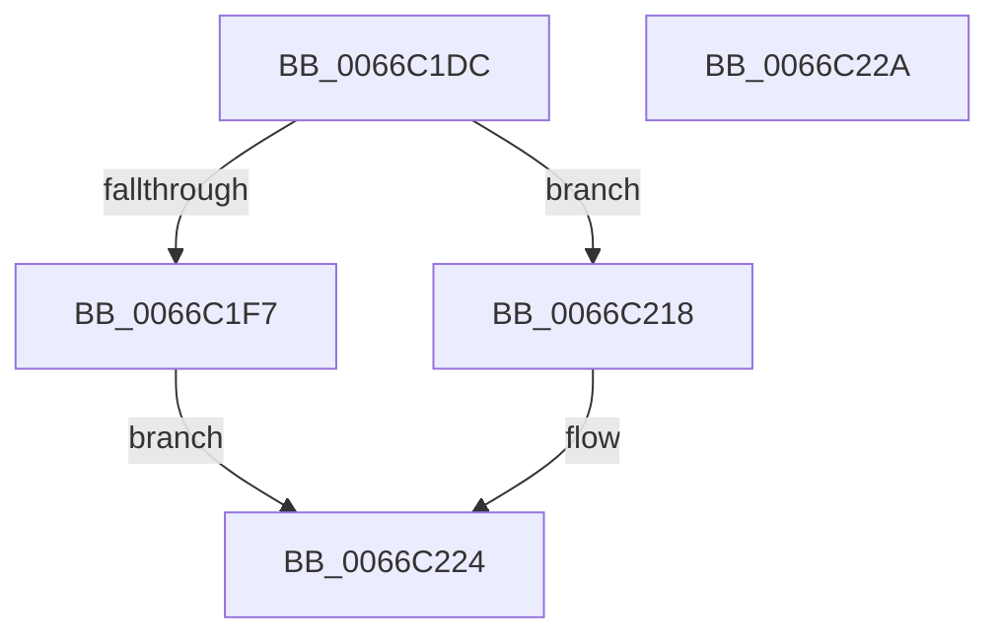

# Feature_LocPerfVal__private_IsEnabledOtherReporting

- RVA: `0x0066C1DC`–`0x0066C22B` (길이 `79` bytes)
- VA: `0x000000014066C1DC`
- 실행 섹션: `.text`
- PDB 이름 있음: `예`; PDB Function 태그: `아니요`
- unwind 정보 RVA: `0x0005CF00`
- 디코드: `22`개 명령, `79/79` bytes 표시
- 미해석 바이트: `0` (있으면 어셈블리에 `.byte`로 보존)

> 이 문서는 커널 이미지의 기계어와 PDB 기호를 분석해 생성했습니다. 4번과 5번은 함수 원형과 자료형을 바이너리 사용 방식에서 추정한 C 해석이며 원본 소스 복구 결과는 아닙니다.

## 1. Dependencies

- 직접 호출 지점: **2**; 고유 호출 대상: **2**
- 직접 호출자로 확인된 함수: **1**
- RIP 상대 이미지 참조: **2**

### Outgoing calls
- `0x0066C20C` → [wil_details_FeatureReporting_ReportUsageToService](../53/wil_details_FeatureReporting_ReportUsageToService_function_0053E6E4.md) (function, `0x0053E6E4`)
- `0x0066C21F` → [Feature_LocPerfVal__private_IsEnabledFallback](Feature_LocPerfVal__private_IsEnabledFallback_function_0066C188.md) (function, `0x0066C188`)

### Direct callers
- [Feature_LocPerfVal_IsEnabledWithReporting](Feature_LocPerfVal_IsEnabledWithReporting_function_0066C0D0.md) at `0x0066C0E8`

### Static image references
- `0x0066C1E8` → RVA `0x00FC45E8` (`.data`; read)
- `0x0066C1FF` → RVA `0x000DCB40` (`.rdata`; read)

## 2. Other-region calls and transfers

- 다른 실행 섹션으로 향하는 call: **0**
- 별도 외부 분기/꼬리 이동을 확인하지 못했습니다.

## 3. Assembly (complete function range)

```asm
0066C1DC  40 53                           push rbx
0066C1DE  48 83 EC 20                     sub rsp, 0x20
0066C1E2  48 83 64 24 38 00               and qword ptr [rsp + 0x38], 0
0066C1E8  8B 1D FA 83 95 00               mov ebx, dword ptr [rip + 0x9583fa]
0066C1EE  89 5C 24 38                     mov dword ptr [rsp + 0x38], ebx
0066C1F2  F6 C3 02                        test bl, 2
0066C1F5  74 21                           je 0x14066c218
0066C1F7  48 8B 54 24 38                  mov rdx, qword ptr [rsp + 0x38]
0066C1FC  44 8B C1                        mov r8d, ecx
0066C1FF  48 8D 0D 3A 09 A7 FF            lea rcx, [rip - 0x58f6c6]
0066C206  41 B9 01 00 00 00               mov r9d, 1
0066C20C  E8 D3 24 ED FF                  call 0x14053e6e4
0066C211  83 E3 01                        and ebx, 1
0066C214  8B C3                           mov eax, ebx
0066C216  EB 0C                           jmp 0x14066c224
0066C218  8B D1                           mov edx, ecx
0066C21A  48 8B 4C 24 38                  mov rcx, qword ptr [rsp + 0x38]
0066C21F  E8 64 FF FF FF                  call 0x14066c188
0066C224  48 83 C4 20                     add rsp, 0x20
0066C228  5B                              pop rbx
0066C229  C3                              ret
0066C22A  CC                              int3
```

## 4. C-style interpretation (structured pseudocode)

```c
__int64 __fastcall Feature_LocPerfVal__private_IsEnabledOtherReporting(int a1)
{
    __int64 result;
    __int64 v_rbx;
    __int64 v_rsp;
    unsigned __int64 v_stack_p10;

    v_rsp = (v_rsp) - (32);
    v_stack_p10 = (unsigned int)((unsigned int)(*(unsigned int *)(v_rip + 9798650)));
    if ((((unsigned __int8)((unsigned int)(*(unsigned int *)(v_rip + 9798650)))) & (2)) == 0) goto loc_0066C218;
    result = wil_details_FeatureReporting_ReportUsageToService(v_rip - 5830342, v_stack_p10, (unsigned int)(a1), 1);
    v_rbx = (unsigned int)(((unsigned int)(*(unsigned int *)(v_rip + 9798650))) & (1));
    goto loc_0066C224;
loc_0066C218:
    result = Feature_LocPerfVal__private_IsEnabledFallback(v_stack_p10, (unsigned int)((unsigned int)(v_rip - 5830342)), (unsigned int)(a1), 1);
loc_0066C224:
    v_rsp = (v_rsp) + (32);
    return result;
}
```

## 5. (Beta) C Style

```c
int64_t Feature_LocPerfVal__private_IsEnabledOtherReporting(int32_t Arg1)
{
    int64_t result;
    int64_t local_rbx;
    int64_t local_rsp;
    uint64_t v_stack_p10;

    local_rsp = (local_rsp) - (32);
    v_stack_p10 = (uint32_t)((uint32_t)(*(uint32_t *)(v_rip + 0x9583FA)));
    if ((((uint8_t)((uint32_t)(*(uint32_t *)(v_rip + 0x9583FA)))) & (2)) == 0) goto loc_0066C218;
    result = wil_details_FeatureReporting_ReportUsageToService(v_rip - 5830342, v_stack_p10, (uint32_t)(Arg1), 1);
    local_rbx = (uint32_t)(((uint32_t)(*(uint32_t *)(v_rip + 0x9583FA))) & (1));
    goto loc_0066C224;
loc_0066C218:
    result = Feature_LocPerfVal__private_IsEnabledFallback(v_stack_p10, (uint32_t)((uint32_t)(v_rip - 5830342)), (uint32_t)(Arg1), 1);
loc_0066C224:
    local_rsp = (local_rsp) + (32);
    return result;
}
```

## 6. Execution-region graph

[열기: 2D/3D 그래프와 함수 탐색 컨트롤 패널](../../../control-panel.html?section=text&rva=0x0066C1DC&view=graph)

- 2D 그래프는 위에서 아래로 흐르고, 3D 그래프는 빈 공간을 드래그해 회전합니다. Shift+드래그는 이동, 휠은 확대·축소, 함수 노드 선택은 대상 보고서 이동입니다.

### Static fallback


