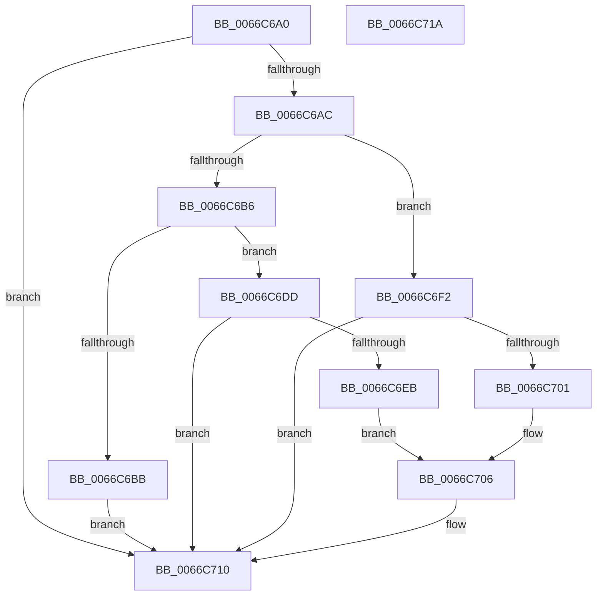

# Feature_TestAccPerf_IsEnabledWithReporting

- RVA: `0x0066C6A0`–`0x0066C71B` (길이 `123` bytes)
- VA: `0x000000014066C6A0`
- 실행 섹션: `.text`
- PDB 이름 있음: `예`; PDB Function 태그: `아니요`
- unwind 정보 RVA: `0x0005C788`
- 디코드: `34`개 명령, `123/123` bytes 표시
- 미해석 바이트: `0` (있으면 어셈블리에 `.byte`로 보존)

> 이 문서는 커널 이미지의 기계어와 PDB 기호를 분석해 생성했습니다. 4번과 5번은 함수 원형과 자료형을 바이너리 사용 방식에서 추정한 C 해석이며 원본 소스 복구 결과는 아닙니다.

## 1. Dependencies

- 직접 호출 지점: **2**; 고유 호출 대상: **2**
- 직접 호출자로 확인된 함수: **0**
- RIP 상대 이미지 참조: **2**

### Outgoing calls
- `0x0066C6D6` → [wil_details_FeatureReporting_ReportUsageToService](../53/wil_details_FeatureReporting_ReportUsageToService_function_0053E6E4.md) (function, `0x0053E6E4`)
- `0x0066C70B` → [Feature_TestAccPerf__private_ReportUsageFallback](Feature_TestAccPerf__private_ReportUsageFallback_function_0066C724.md) (function, `0x0066C724`)

### Direct callers
- 이 함수 시작 RVA로 연결되는 직접 call은 확인되지 않았습니다. 간접 호출은 완전히 역산할 수 없습니다.

### Static image references
- `0x0066C6CF` → RVA `0x000DC1A0` (`.rdata`; read)
- `0x0066C6DD` → RVA `0x00FC4530` (`.data`; read)

## 2. Other-region calls and transfers

- 다른 실행 섹션으로 향하는 call: **0**
- 별도 외부 분기/꼬리 이동을 확인하지 못했습니다.

## 3. Assembly (complete function range)

```asm
0066C6A0  48 83 EC 28                     sub rsp, 0x28
0066C6A4  33 C0                           xor eax, eax
0066C6A6  8B D1                           mov edx, ecx
0066C6A8  85 C9                           test ecx, ecx
0066C6AA  74 64                           je 0x14066c710
0066C6AC  48 89 44 24 38                  mov qword ptr [rsp + 0x38], rax
0066C6B1  83 EA 03                        sub edx, 3
0066C6B4  74 3C                           je 0x14066c6f2
0066C6B6  83 FA 01                        cmp edx, 1
0066C6B9  74 22                           je 0x14066c6dd
0066C6BB  44 8B C1                        mov r8d, ecx
0066C6BE  C7 44 24 38 01 00 00 00         mov dword ptr [rsp + 0x38], 1
0066C6C6  48 8B 54 24 38                  mov rdx, qword ptr [rsp + 0x38]
0066C6CB  44 8D 48 01                     lea r9d, [rax + 1]
0066C6CF  48 8D 0D CA FA A6 FF            lea rcx, [rip - 0x590536]
0066C6D6  E8 09 20 ED FF                  call 0x14053e6e4
0066C6DB  EB 33                           jmp 0x14066c710
0066C6DD  8B 05 4D 7E 95 00               mov eax, dword ptr [rip + 0x957e4d]
0066C6E3  89 44 24 38                     mov dword ptr [rsp + 0x38], eax
0066C6E7  A8 20                           test al, 0x20
0066C6E9  75 25                           jne 0x14066c710
0066C6EB  BA 04 00 00 00                  mov edx, 4
0066C6F0  EB 14                           jmp 0x14066c706
0066C6F2  8B 0D 38 7E 95 00               mov ecx, dword ptr [rip + 0x957e38]
0066C6F8  89 4C 24 38                     mov dword ptr [rsp + 0x38], ecx
0066C6FC  F6 C1 10                        test cl, 0x10
0066C6FF  75 0F                           jne 0x14066c710
0066C701  BA 03 00 00 00                  mov edx, 3
0066C706  48 8B 4C 24 38                  mov rcx, qword ptr [rsp + 0x38]
0066C70B  E8 14 00 00 00                  call 0x14066c724
0066C710  B8 01 00 00 00                  mov eax, 1
0066C715  48 83 C4 28                     add rsp, 0x28
0066C719  C3                              ret
0066C71A  CC                              int3
```

## 4. C-style interpretation (structured pseudocode)

```c
__int64 __fastcall Feature_TestAccPerf_IsEnabledWithReporting(int a1)
{
    __int64 result;
    __int64 v_rsp;
    unsigned __int64 v_stack_p10;

    v_rsp = (v_rsp) - (40);
    result = 0;
    if (a1 == 0) goto loc_0066C710;
    v_stack_p10 = 0;
    a2 = (unsigned int)(((unsigned int)(a1)) - (3));
    if (condition_is_equal) goto loc_0066C6F2;
    if (((unsigned int)(a2)) == 1) goto loc_0066C6DD;
    v_stack_p10 = 1;
    result = wil_details_FeatureReporting_ReportUsageToService(v_rip - 5834038, v_stack_p10, (unsigned int)(a1), result + 1);
    goto loc_0066C710;
loc_0066C6DD:
    v_stack_p10 = (unsigned int)((unsigned int)(*(unsigned int *)(v_rip + 9797197)));
    if ((((unsigned __int8)((unsigned int)(*(unsigned int *)(v_rip + 9797197)))) & (32)) != 0) goto loc_0066C710;
    goto loc_0066C706;
loc_0066C6F2:
    v_stack_p10 = (unsigned int)((unsigned int)(*(unsigned int *)(v_rip + 9797176)));
    if ((((unsigned __int8)((unsigned int)(*(unsigned int *)(v_rip + 9797176)))) & (16)) != 0) goto loc_0066C710;
loc_0066C706:
    result = Feature_TestAccPerf__private_ReportUsageFallback(v_stack_p10, 3, (unsigned int)(a1), result + 1);
loc_0066C710:
    v_rsp = (v_rsp) + (40);
    return 1;
}
```

## 5. (Beta) C Style

```c
int64_t Feature_TestAccPerf_IsEnabledWithReporting(int32_t Arg1)
{
    int64_t result;
    int64_t local_rsp;
    uint64_t v_stack_p10;

    local_rsp = (local_rsp) - (40);
    result = 0;
    if (Arg1 == 0) goto loc_0066C710;
    v_stack_p10 = 0;
    a2 = (uint32_t)(((uint32_t)(Arg1)) - (3));
    if (condition_is_equal) goto loc_0066C6F2;
    if (((uint32_t)(a2)) == 1) goto loc_0066C6DD;
    v_stack_p10 = 1;
    result = wil_details_FeatureReporting_ReportUsageToService(v_rip - 5834038, v_stack_p10, (uint32_t)(Arg1), result + 1);
    goto loc_0066C710;
loc_0066C6DD:
    v_stack_p10 = (uint32_t)((uint32_t)(*(uint32_t *)(v_rip + 0x957E4D)));
    if ((((uint8_t)((uint32_t)(*(uint32_t *)(v_rip + 0x957E4D)))) & (32)) != 0) goto loc_0066C710;
    goto loc_0066C706;
loc_0066C6F2:
    v_stack_p10 = (uint32_t)((uint32_t)(*(uint32_t *)(v_rip + 0x957E38)));
    if ((((uint8_t)((uint32_t)(*(uint32_t *)(v_rip + 0x957E38)))) & (16)) != 0) goto loc_0066C710;
loc_0066C706:
    result = Feature_TestAccPerf__private_ReportUsageFallback(v_stack_p10, 3, (uint32_t)(Arg1), result + 1);
loc_0066C710:
    local_rsp = (local_rsp) + (40);
    return 1;
}
```

## 6. Execution-region graph

[열기: 2D/3D 그래프와 함수 탐색 컨트롤 패널](../../../control-panel.html?section=text&rva=0x0066C6A0&view=graph)

- 2D 그래프는 위에서 아래로 흐르고, 3D 그래프는 빈 공간을 드래그해 회전합니다. Shift+드래그는 이동, 휠은 확대·축소, 함수 노드 선택은 대상 보고서 이동입니다.

### Static fallback


