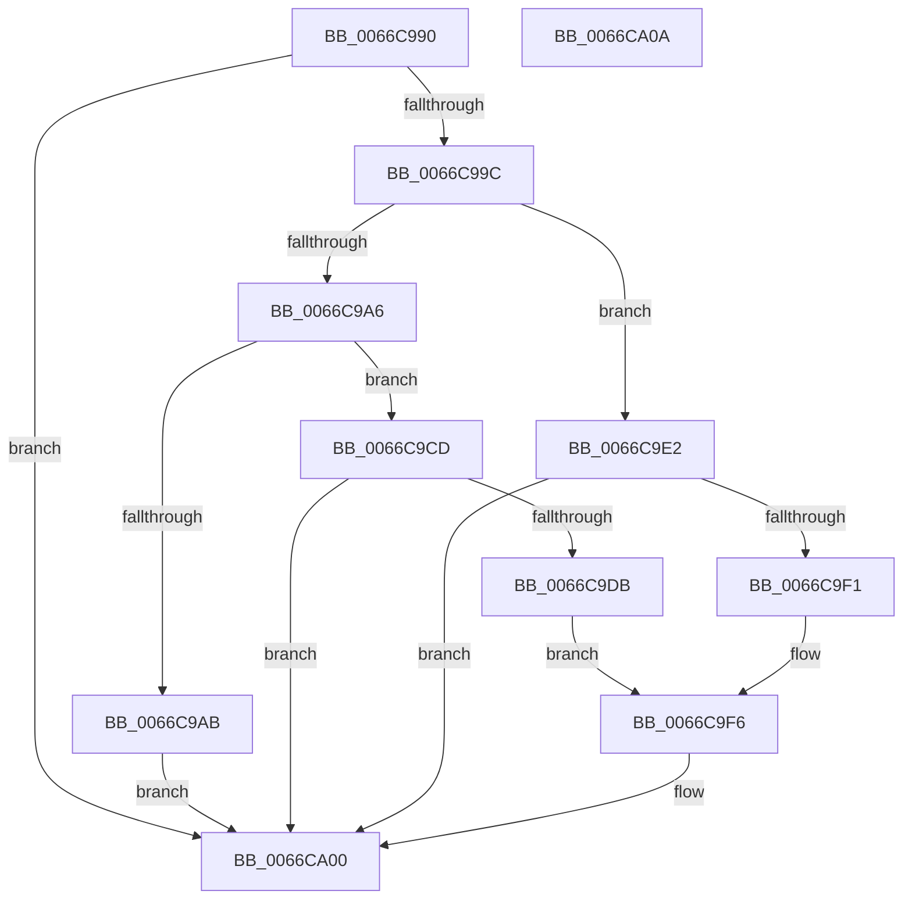

# Feature_TestGateImp_IsEnabledWithReporting

- RVA: `0x0066C990`–`0x0066CA0B` (길이 `123` bytes)
- VA: `0x000000014066C990`
- 실행 섹션: `.text`
- PDB 이름 있음: `예`; PDB Function 태그: `아니요`
- unwind 정보 RVA: `0x0005C788`
- 디코드: `34`개 명령, `123/123` bytes 표시
- 미해석 바이트: `0` (있으면 어셈블리에 `.byte`로 보존)

> 이 문서는 커널 이미지의 기계어와 PDB 기호를 분석해 생성했습니다. 4번과 5번은 함수 원형과 자료형을 바이너리 사용 방식에서 추정한 C 해석이며 원본 소스 복구 결과는 아닙니다.

## 1. Dependencies

- 직접 호출 지점: **2**; 고유 호출 대상: **2**
- 직접 호출자로 확인된 함수: **0**
- RIP 상대 이미지 참조: **2**

### Outgoing calls
- `0x0066C9C6` → [wil_details_FeatureReporting_ReportUsageToService](../53/wil_details_FeatureReporting_ReportUsageToService_function_0053E6E4.md) (function, `0x0053E6E4`)
- `0x0066C9FB` → [Feature_TestGateImp__private_ReportUsageFallback](Feature_TestGateImp__private_ReportUsageFallback_function_0066CA14.md) (function, `0x0066CA14`)

### Direct callers
- 이 함수 시작 RVA로 연결되는 직접 call은 확인되지 않았습니다. 간접 호출은 완전히 역산할 수 없습니다.

### Static image references
- `0x0066C9BF` → RVA `0x000DC280` (`.rdata`; read)
- `0x0066C9CD` → RVA `0x00FC44C0` (`.data`; read)

## 2. Other-region calls and transfers

- 다른 실행 섹션으로 향하는 call: **0**
- 별도 외부 분기/꼬리 이동을 확인하지 못했습니다.

## 3. Assembly (complete function range)

```asm
0066C990  48 83 EC 28                     sub rsp, 0x28
0066C994  33 C0                           xor eax, eax
0066C996  8B D1                           mov edx, ecx
0066C998  85 C9                           test ecx, ecx
0066C99A  74 64                           je 0x14066ca00
0066C99C  48 89 44 24 38                  mov qword ptr [rsp + 0x38], rax
0066C9A1  83 EA 03                        sub edx, 3
0066C9A4  74 3C                           je 0x14066c9e2
0066C9A6  83 FA 01                        cmp edx, 1
0066C9A9  74 22                           je 0x14066c9cd
0066C9AB  44 8B C1                        mov r8d, ecx
0066C9AE  C7 44 24 38 01 00 00 00         mov dword ptr [rsp + 0x38], 1
0066C9B6  48 8B 54 24 38                  mov rdx, qword ptr [rsp + 0x38]
0066C9BB  44 8D 48 01                     lea r9d, [rax + 1]
0066C9BF  48 8D 0D BA F8 A6 FF            lea rcx, [rip - 0x590746]
0066C9C6  E8 19 1D ED FF                  call 0x14053e6e4
0066C9CB  EB 33                           jmp 0x14066ca00
0066C9CD  8B 05 ED 7A 95 00               mov eax, dword ptr [rip + 0x957aed]
0066C9D3  89 44 24 38                     mov dword ptr [rsp + 0x38], eax
0066C9D7  A8 20                           test al, 0x20
0066C9D9  75 25                           jne 0x14066ca00
0066C9DB  BA 04 00 00 00                  mov edx, 4
0066C9E0  EB 14                           jmp 0x14066c9f6
0066C9E2  8B 0D D8 7A 95 00               mov ecx, dword ptr [rip + 0x957ad8]
0066C9E8  89 4C 24 38                     mov dword ptr [rsp + 0x38], ecx
0066C9EC  F6 C1 10                        test cl, 0x10
0066C9EF  75 0F                           jne 0x14066ca00
0066C9F1  BA 03 00 00 00                  mov edx, 3
0066C9F6  48 8B 4C 24 38                  mov rcx, qword ptr [rsp + 0x38]
0066C9FB  E8 14 00 00 00                  call 0x14066ca14
0066CA00  B8 01 00 00 00                  mov eax, 1
0066CA05  48 83 C4 28                     add rsp, 0x28
0066CA09  C3                              ret
0066CA0A  CC                              int3
```

## 4. C-style interpretation (structured pseudocode)

```c
__int64 __fastcall Feature_TestGateImp_IsEnabledWithReporting(int a1)
{
    __int64 result;
    __int64 v_rsp;
    unsigned __int64 v_stack_p10;

    v_rsp = (v_rsp) - (40);
    result = 0;
    if (a1 == 0) goto loc_0066CA00;
    v_stack_p10 = 0;
    a2 = (unsigned int)(((unsigned int)(a1)) - (3));
    if (condition_is_equal) goto loc_0066C9E2;
    if (((unsigned int)(a2)) == 1) goto loc_0066C9CD;
    v_stack_p10 = 1;
    result = wil_details_FeatureReporting_ReportUsageToService(v_rip - 5834566, v_stack_p10, (unsigned int)(a1), result + 1);
    goto loc_0066CA00;
loc_0066C9CD:
    v_stack_p10 = (unsigned int)((unsigned int)(*(unsigned int *)(v_rip + 9796333)));
    if ((((unsigned __int8)((unsigned int)(*(unsigned int *)(v_rip + 9796333)))) & (32)) != 0) goto loc_0066CA00;
    goto loc_0066C9F6;
loc_0066C9E2:
    v_stack_p10 = (unsigned int)((unsigned int)(*(unsigned int *)(v_rip + 9796312)));
    if ((((unsigned __int8)((unsigned int)(*(unsigned int *)(v_rip + 9796312)))) & (16)) != 0) goto loc_0066CA00;
loc_0066C9F6:
    result = Feature_TestGateImp__private_ReportUsageFallback(v_stack_p10, 3, (unsigned int)(a1), result + 1);
loc_0066CA00:
    v_rsp = (v_rsp) + (40);
    return 1;
}
```

## 5. (Beta) C Style

```c
int64_t Feature_TestGateImp_IsEnabledWithReporting(int32_t Arg1)
{
    int64_t result;
    int64_t local_rsp;
    uint64_t v_stack_p10;

    local_rsp = (local_rsp) - (40);
    result = 0;
    if (Arg1 == 0) goto loc_0066CA00;
    v_stack_p10 = 0;
    a2 = (uint32_t)(((uint32_t)(Arg1)) - (3));
    if (condition_is_equal) goto loc_0066C9E2;
    if (((uint32_t)(a2)) == 1) goto loc_0066C9CD;
    v_stack_p10 = 1;
    result = wil_details_FeatureReporting_ReportUsageToService(v_rip - 5834566, v_stack_p10, (uint32_t)(Arg1), result + 1);
    goto loc_0066CA00;
loc_0066C9CD:
    v_stack_p10 = (uint32_t)((uint32_t)(*(uint32_t *)(v_rip + 0x957AED)));
    if ((((uint8_t)((uint32_t)(*(uint32_t *)(v_rip + 0x957AED)))) & (32)) != 0) goto loc_0066CA00;
    goto loc_0066C9F6;
loc_0066C9E2:
    v_stack_p10 = (uint32_t)((uint32_t)(*(uint32_t *)(v_rip + 0x957AD8)));
    if ((((uint8_t)((uint32_t)(*(uint32_t *)(v_rip + 0x957AD8)))) & (16)) != 0) goto loc_0066CA00;
loc_0066C9F6:
    result = Feature_TestGateImp__private_ReportUsageFallback(v_stack_p10, 3, (uint32_t)(Arg1), result + 1);
loc_0066CA00:
    local_rsp = (local_rsp) + (40);
    return 1;
}
```

## 6. Execution-region graph

[열기: 2D/3D 그래프와 함수 탐색 컨트롤 패널](../../../control-panel.html?section=text&rva=0x0066C990&view=graph)

- 2D 그래프는 위에서 아래로 흐르고, 3D 그래프는 빈 공간을 드래그해 회전합니다. Shift+드래그는 이동, 휠은 확대·축소, 함수 노드 선택은 대상 보고서 이동입니다.

### Static fallback


