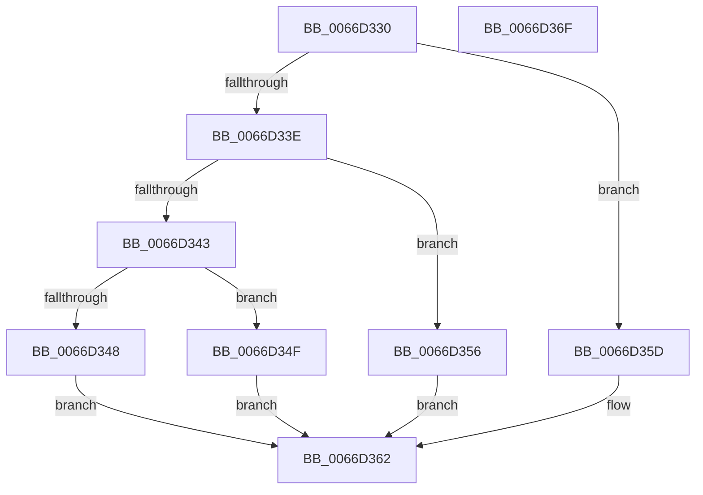

# Feature_UxAccOptimization_IsEnabledWithReporting

- RVA: `0x0066D330`–`0x0066D370` (길이 `64` bytes)
- VA: `0x000000014066D330`
- 실행 섹션: `.text`
- PDB 이름 있음: `예`; PDB Function 태그: `아니요`
- unwind 정보 RVA: `0x0005CF00`
- 디코드: `24`개 명령, `64/64` bytes 표시
- 미해석 바이트: `0` (있으면 어셈블리에 `.byte`로 보존)

> 이 문서는 커널 이미지의 기계어와 PDB 기호를 분석해 생성했습니다. 4번과 5번은 함수 원형과 자료형을 바이너리 사용 방식에서 추정한 C 해석이며 원본 소스 복구 결과는 아닙니다.

## 1. Dependencies

- 직접 호출 지점: **4**; 고유 호출 대상: **4**
- 직접 호출자로 확인된 함수: **0**
- RIP 상대 이미지 참조: **0**

### Outgoing calls
- `0x0066D348` → [Feature_UxAccOptimization__private_IsEnabledOtherReporting](Feature_UxAccOptimization__private_IsEnabledOtherReporting_function_0066D43C.md) (function, `0x0066D43C`)
- `0x0066D34F` → [Feature_UxAccOptimization__private_IsEnabledDeviceOpportunityNoInline](Feature_UxAccOptimization__private_IsEnabledDeviceOpportunityNoInline_function_0066D378.md) (function, `0x0066D378`)
- `0x0066D356` → [Feature_UxAccOptimization__private_IsEnabledDeviceUsageNoInline](Feature_UxAccOptimization__private_IsEnabledDeviceUsageNoInline_function_0066D3B0.md) (function, `0x0066D3B0`)
- `0x0066D35D` → [Feature_UxAccOptimization__private_IsEnabledNoReportingNoInline](Feature_UxAccOptimization__private_IsEnabledNoReportingNoInline_function_0066D404.md) (function, `0x0066D404`)

### Direct callers
- 이 함수 시작 RVA로 연결되는 직접 call은 확인되지 않았습니다. 간접 호출은 완전히 역산할 수 없습니다.

### Static image references
- 디코드된 RIP-relative 메모리 참조가 없습니다.

## 2. Other-region calls and transfers

- 다른 실행 섹션으로 향하는 call: **0**
- 별도 외부 분기/꼬리 이동을 확인하지 못했습니다.

## 3. Assembly (complete function range)

```asm
0066D330  40 53                           push rbx
0066D332  48 83 EC 20                     sub rsp, 0x20
0066D336  33 DB                           xor ebx, ebx
0066D338  8B D1                           mov edx, ecx
0066D33A  85 C9                           test ecx, ecx
0066D33C  74 1F                           je 0x14066d35d
0066D33E  83 EA 03                        sub edx, 3
0066D341  74 13                           je 0x14066d356
0066D343  83 FA 01                        cmp edx, 1
0066D346  74 07                           je 0x14066d34f
0066D348  E8 EF 00 00 00                  call 0x14066d43c
0066D34D  EB 13                           jmp 0x14066d362
0066D34F  E8 24 00 00 00                  call 0x14066d378
0066D354  EB 0C                           jmp 0x14066d362
0066D356  E8 55 00 00 00                  call 0x14066d3b0
0066D35B  EB 05                           jmp 0x14066d362
0066D35D  E8 A2 00 00 00                  call 0x14066d404
0066D362  85 C0                           test eax, eax
0066D364  0F 95 C3                        setne bl
0066D367  8B C3                           mov eax, ebx
0066D369  48 83 C4 20                     add rsp, 0x20
0066D36D  5B                              pop rbx
0066D36E  C3                              ret
0066D36F  CC                              int3
```

## 4. C-style interpretation (structured pseudocode)

```c
__int64 __fastcall Feature_UxAccOptimization_IsEnabledWithReporting(int a1)
{
    __int64 result;
    __int64 v_rbx;
    __int64 v_rsp;

    v_rsp = (v_rsp) - (32);
    v_rbx = 0;
    if (a1 == 0) goto loc_0066D35D;
    a2 = (unsigned int)(((unsigned int)(a1)) - (3));
    if (condition_is_equal) goto loc_0066D356;
    if (((unsigned int)(a2)) == 1) goto loc_0066D34F;
    result = Feature_UxAccOptimization__private_IsEnabledOtherReporting(a1, a2, a3, a4);
    goto loc_0066D362;
loc_0066D34F:
    result = Feature_UxAccOptimization__private_IsEnabledDeviceOpportunityNoInline(a1, a2, a3, a4);
    goto loc_0066D362;
loc_0066D356:
    result = Feature_UxAccOptimization__private_IsEnabledDeviceUsageNoInline(a1, a2, a3, a4);
    goto loc_0066D362;
loc_0066D35D:
    result = Feature_UxAccOptimization__private_IsEnabledNoReportingNoInline(a1, a2, a3, a4);
loc_0066D362:
    v_rbx = ((unsigned int)(result) != 0) ? 1 : 0;
    v_rsp = (v_rsp) + (32);
    return (unsigned int)((unsigned int)(v_rbx));
}
```

## 5. (Beta) C Style

```c
int64_t Feature_UxAccOptimization_IsEnabledWithReporting(int32_t Arg1)
{
    int64_t result;
    int64_t local_rbx;
    int64_t local_rsp;

    local_rsp = (local_rsp) - (32);
    local_rbx = 0;
    if (Arg1 == 0) goto loc_0066D35D;
    a2 = (uint32_t)(((uint32_t)(Arg1)) - (3));
    if (condition_is_equal) goto loc_0066D356;
    if (((uint32_t)(a2)) == 1) goto loc_0066D34F;
    result = Feature_UxAccOptimization__private_IsEnabledOtherReporting(Arg1, a2, a3, a4);
    goto loc_0066D362;
loc_0066D34F:
    result = Feature_UxAccOptimization__private_IsEnabledDeviceOpportunityNoInline(Arg1, a2, a3, a4);
    goto loc_0066D362;
loc_0066D356:
    result = Feature_UxAccOptimization__private_IsEnabledDeviceUsageNoInline(Arg1, a2, a3, a4);
    goto loc_0066D362;
loc_0066D35D:
    result = Feature_UxAccOptimization__private_IsEnabledNoReportingNoInline(Arg1, a2, a3, a4);
loc_0066D362:
    local_rbx = ((uint32_t)(result) != 0) ? 1 : 0;
    local_rsp = (local_rsp) + (32);
    return (uint32_t)((uint32_t)(local_rbx));
}
```

## 6. Execution-region graph

[열기: 2D/3D 그래프와 함수 탐색 컨트롤 패널](../../../control-panel.html?section=text&rva=0x0066D330&view=graph)

- 2D 그래프는 위에서 아래로 흐르고, 3D 그래프는 빈 공간을 드래그해 회전합니다. Shift+드래그는 이동, 휠은 확대·축소, 함수 노드 선택은 대상 보고서 이동입니다.

### Static fallback


