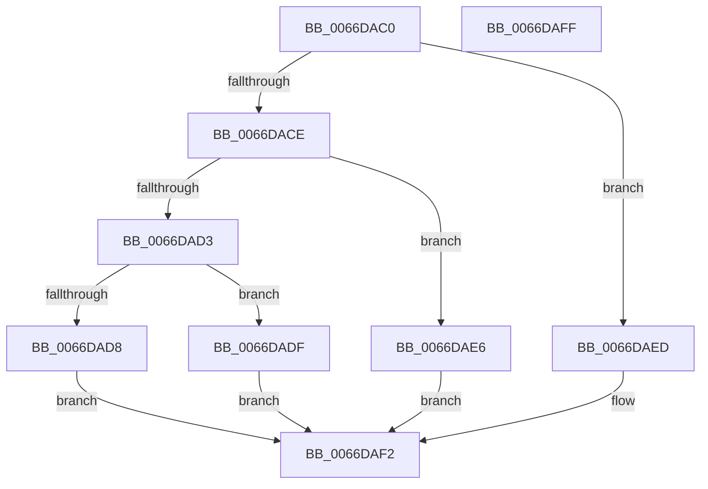

# Feature_ValUxPerf2_IsEnabledWithReporting

- RVA: `0x0066DAC0`–`0x0066DB00` (길이 `64` bytes)
- VA: `0x000000014066DAC0`
- 실행 섹션: `.text`
- PDB 이름 있음: `예`; PDB Function 태그: `아니요`
- unwind 정보 RVA: `0x0005CF00`
- 디코드: `24`개 명령, `64/64` bytes 표시
- 미해석 바이트: `0` (있으면 어셈블리에 `.byte`로 보존)

> 이 문서는 커널 이미지의 기계어와 PDB 기호를 분석해 생성했습니다. 4번과 5번은 함수 원형과 자료형을 바이너리 사용 방식에서 추정한 C 해석이며 원본 소스 복구 결과는 아닙니다.

## 1. Dependencies

- 직접 호출 지점: **4**; 고유 호출 대상: **4**
- 직접 호출자로 확인된 함수: **0**
- RIP 상대 이미지 참조: **0**

### Outgoing calls
- `0x0066DAD8` → [Feature_ValUxPerf2__private_IsEnabledOtherReporting](Feature_ValUxPerf2__private_IsEnabledOtherReporting_function_0066DBCC.md) (function, `0x0066DBCC`)
- `0x0066DADF` → [Feature_ValUxPerf2__private_IsEnabledDeviceOpportunityNoInline](Feature_ValUxPerf2__private_IsEnabledDeviceOpportunityNoInline_function_0066DB08.md) (function, `0x0066DB08`)
- `0x0066DAE6` → [Feature_ValUxPerf2__private_IsEnabledDeviceUsageNoInline](Feature_ValUxPerf2__private_IsEnabledDeviceUsageNoInline_function_0066DB40.md) (function, `0x0066DB40`)
- `0x0066DAED` → [Feature_ValUxPerf2__private_IsEnabledNoReportingNoInline](Feature_ValUxPerf2__private_IsEnabledNoReportingNoInline_function_0066DB94.md) (function, `0x0066DB94`)

### Direct callers
- 이 함수 시작 RVA로 연결되는 직접 call은 확인되지 않았습니다. 간접 호출은 완전히 역산할 수 없습니다.

### Static image references
- 디코드된 RIP-relative 메모리 참조가 없습니다.

## 2. Other-region calls and transfers

- 다른 실행 섹션으로 향하는 call: **0**
- 별도 외부 분기/꼬리 이동을 확인하지 못했습니다.

## 3. Assembly (complete function range)

```asm
0066DAC0  40 53                           push rbx
0066DAC2  48 83 EC 20                     sub rsp, 0x20
0066DAC6  33 DB                           xor ebx, ebx
0066DAC8  8B D1                           mov edx, ecx
0066DACA  85 C9                           test ecx, ecx
0066DACC  74 1F                           je 0x14066daed
0066DACE  83 EA 03                        sub edx, 3
0066DAD1  74 13                           je 0x14066dae6
0066DAD3  83 FA 01                        cmp edx, 1
0066DAD6  74 07                           je 0x14066dadf
0066DAD8  E8 EF 00 00 00                  call 0x14066dbcc
0066DADD  EB 13                           jmp 0x14066daf2
0066DADF  E8 24 00 00 00                  call 0x14066db08
0066DAE4  EB 0C                           jmp 0x14066daf2
0066DAE6  E8 55 00 00 00                  call 0x14066db40
0066DAEB  EB 05                           jmp 0x14066daf2
0066DAED  E8 A2 00 00 00                  call 0x14066db94
0066DAF2  85 C0                           test eax, eax
0066DAF4  0F 95 C3                        setne bl
0066DAF7  8B C3                           mov eax, ebx
0066DAF9  48 83 C4 20                     add rsp, 0x20
0066DAFD  5B                              pop rbx
0066DAFE  C3                              ret
0066DAFF  CC                              int3
```

## 4. C-style interpretation (structured pseudocode)

```c
__int64 __fastcall Feature_ValUxPerf2_IsEnabledWithReporting(int a1)
{
    __int64 result;
    __int64 v_rbx;
    __int64 v_rsp;

    v_rsp = (v_rsp) - (32);
    v_rbx = 0;
    if (a1 == 0) goto loc_0066DAED;
    a2 = (unsigned int)(((unsigned int)(a1)) - (3));
    if (condition_is_equal) goto loc_0066DAE6;
    if (((unsigned int)(a2)) == 1) goto loc_0066DADF;
    result = Feature_ValUxPerf2__private_IsEnabledOtherReporting(a1, a2, a3, a4);
    goto loc_0066DAF2;
loc_0066DADF:
    result = Feature_ValUxPerf2__private_IsEnabledDeviceOpportunityNoInline(a1, a2, a3, a4);
    goto loc_0066DAF2;
loc_0066DAE6:
    result = Feature_ValUxPerf2__private_IsEnabledDeviceUsageNoInline(a1, a2, a3, a4);
    goto loc_0066DAF2;
loc_0066DAED:
    result = Feature_ValUxPerf2__private_IsEnabledNoReportingNoInline(a1, a2, a3, a4);
loc_0066DAF2:
    v_rbx = ((unsigned int)(result) != 0) ? 1 : 0;
    v_rsp = (v_rsp) + (32);
    return (unsigned int)((unsigned int)(v_rbx));
}
```

## 5. (Beta) C Style

```c
int64_t Feature_ValUxPerf2_IsEnabledWithReporting(int32_t Arg1)
{
    int64_t result;
    int64_t local_rbx;
    int64_t local_rsp;

    local_rsp = (local_rsp) - (32);
    local_rbx = 0;
    if (Arg1 == 0) goto loc_0066DAED;
    a2 = (uint32_t)(((uint32_t)(Arg1)) - (3));
    if (condition_is_equal) goto loc_0066DAE6;
    if (((uint32_t)(a2)) == 1) goto loc_0066DADF;
    result = Feature_ValUxPerf2__private_IsEnabledOtherReporting(Arg1, a2, a3, a4);
    goto loc_0066DAF2;
loc_0066DADF:
    result = Feature_ValUxPerf2__private_IsEnabledDeviceOpportunityNoInline(Arg1, a2, a3, a4);
    goto loc_0066DAF2;
loc_0066DAE6:
    result = Feature_ValUxPerf2__private_IsEnabledDeviceUsageNoInline(Arg1, a2, a3, a4);
    goto loc_0066DAF2;
loc_0066DAED:
    result = Feature_ValUxPerf2__private_IsEnabledNoReportingNoInline(Arg1, a2, a3, a4);
loc_0066DAF2:
    local_rbx = ((uint32_t)(result) != 0) ? 1 : 0;
    local_rsp = (local_rsp) + (32);
    return (uint32_t)((uint32_t)(local_rbx));
}
```

## 6. Execution-region graph

[열기: 2D/3D 그래프와 함수 탐색 컨트롤 패널](../../../control-panel.html?section=text&rva=0x0066DAC0&view=graph)

- 2D 그래프는 위에서 아래로 흐르고, 3D 그래프는 빈 공간을 드래그해 회전합니다. Shift+드래그는 이동, 휠은 확대·축소, 함수 노드 선택은 대상 보고서 이동입니다.

### Static fallback


