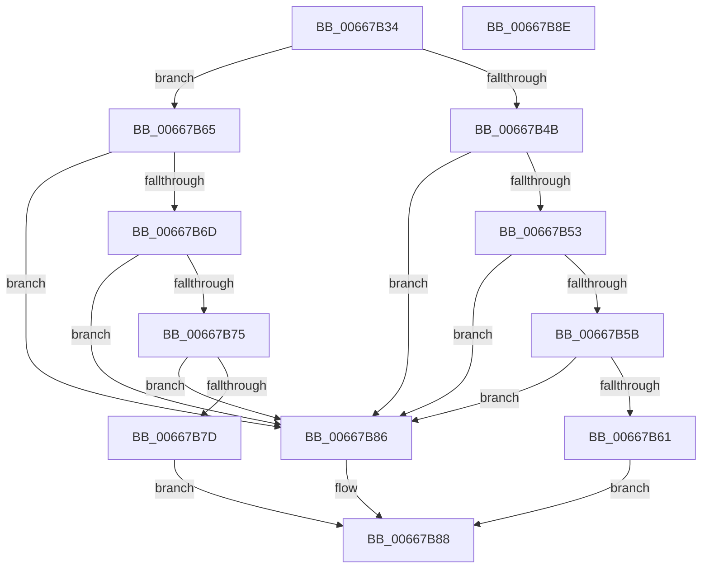

# GetCpuManufacturer

- RVA: `0x00667B34`–`0x00667B8F` (길이 `91` bytes)
- VA: `0x0000000140667B34`
- 실행 섹션: `.text`
- PDB 이름 있음: `예`; PDB Function 태그: `아니요`
- unwind 정보 RVA: `0x000C5118`
- 디코드: `30`개 명령, `91/91` bytes 표시
- 미해석 바이트: `0` (있으면 어셈블리에 `.byte`로 보존)

> 이 문서는 커널 이미지의 기계어와 PDB 기호를 분석해 생성했습니다. 4번과 5번은 함수 원형과 자료형을 바이너리 사용 방식에서 추정한 C 해석이며 원본 소스 복구 결과는 아닙니다.

## 1. Dependencies

- 직접 호출 지점: **0**; 고유 호출 대상: **0**
- 직접 호출자로 확인된 함수: **3**
- RIP 상대 이미지 참조: **0**

### Outgoing calls
- 직접 디코드된 call 명령이 없습니다.

### Direct callers
- [GetMicrocodePatchData](GetMicrocodePatchData_function_00666E48.md) at `0x00666EAD`
- [GetMicrocodePatchData](GetMicrocodePatchData_function_00666E48.md) at `0x00666EC0`
- [GetMicrocodePatchData](GetMicrocodePatchData_function_00666E48.md) at `0x00666ED3`
- [GetMicrocodePatchData](GetMicrocodePatchData_function_00666E48.md) at `0x00666EF0`
- [GetMicrocodePatchData](GetMicrocodePatchData_function_00666E48.md) at `0x00666F01`
- [GetMicrocodePatchData](GetMicrocodePatchData_function_00666E48.md) at `0x00666F43`
- [GetMicrocodePatchData](GetMicrocodePatchData_function_00666E48.md) at `0x00666FDC`
- [MicrocodeUpdate](MicrocodeUpdate_function_00667480.md) at `0x006674F5`
- [MicrocodeUpdate](MicrocodeUpdate_function_00667480.md) at `0x006675A4`
- [MicrocodeValidate](MicrocodeValidate_function_00667688.md) at `0x00667697`
- [MicrocodeValidate](MicrocodeValidate_function_00667688.md) at `0x006676B5`

### Static image references
- 디코드된 RIP-relative 메모리 참조가 없습니다.

## 2. Other-region calls and transfers

- 다른 실행 섹션으로 향하는 call: **0**
- 별도 외부 분기/꼬리 이동을 확인하지 못했습니다.

## 3. Assembly (complete function range)

```asm
00667B34  40 53                           push rbx
00667B36  48 83 EC 10                     sub rsp, 0x10
00667B3A  44 8B C1                        mov r8d, ecx
00667B3D  33 C0                           xor eax, eax
00667B3F  33 C9                           xor ecx, ecx
00667B41  0F A2                           cpuid
00667B43  81 FB 41 75 74 68               cmp ebx, 0x68747541
00667B49  75 1A                           jne 0x140667b65
00667B4B  81 FA 65 6E 74 69               cmp edx, 0x69746e65
00667B51  75 33                           jne 0x140667b86
00667B53  81 F9 63 41 4D 44               cmp ecx, 0x444d4163
00667B59  75 2B                           jne 0x140667b86
00667B5B  41 83 F8 02                     cmp r8d, 2
00667B5F  75 25                           jne 0x140667b86
00667B61  B0 01                           mov al, 1
00667B63  EB 23                           jmp 0x140667b88
00667B65  81 FB 47 65 6E 75               cmp ebx, 0x756e6547
00667B6B  75 19                           jne 0x140667b86
00667B6D  81 FA 69 6E 65 49               cmp edx, 0x49656e69
00667B73  75 11                           jne 0x140667b86
00667B75  81 F9 6E 74 65 6C               cmp ecx, 0x6c65746e
00667B7B  75 09                           jne 0x140667b86
00667B7D  41 83 F8 01                     cmp r8d, 1
00667B81  0F 94 C0                        sete al
00667B84  EB 02                           jmp 0x140667b88
00667B86  32 C0                           xor al, al
00667B88  48 83 C4 10                     add rsp, 0x10
00667B8C  5B                              pop rbx
00667B8D  C3                              ret
00667B8E  CC                              int3
```

## 4. C-style interpretation (structured pseudocode)

```c
__int64 __fastcall GetCpuManufacturer(int a1, int a2)
{
    __int64 result;
    __int64 v_rsp;

    v_rsp = (v_rsp) - (16);
    result = 0;
    a1 = 0;
    if (((unsigned int)(v_rbx)) != 0x68747541ULL) goto loc_00667B65;
    if (a2 != 0x69746E65ULL) goto loc_00667B86;
    if (0 != 0x444D4163ULL) goto loc_00667B86;
    if (((unsigned int)((unsigned int)(a1))) != 2) goto loc_00667B86;
    goto loc_00667B88;
loc_00667B65:
    if (((unsigned int)(v_rbx)) != 0x756E6547ULL) goto loc_00667B86;
    if (a2 != 0x49656E69ULL) goto loc_00667B86;
    if (0 != 0x6C65746EULL) goto loc_00667B86;
    result = (((unsigned int)((unsigned int)(a1))) == 1) ? 1 : 0;
    goto loc_00667B88;
loc_00667B86:
    result = 0;
loc_00667B88:
    v_rsp = (v_rsp) + (16);
    return result;
}
```

## 5. (Beta) C Style

```c
int64_t GetCpuManufacturer(int32_t Arg1, int32_t Arg2)
{
    int64_t result;
    int64_t local_rsp;

    local_rsp = (local_rsp) - (16);
    result = 0;
    Arg1 = 0;
    if (((uint32_t)(local_rbx)) != 0x68747541ULL) goto loc_00667B65;
    if (Arg2 != 0x69746E65ULL) goto loc_00667B86;
    if (0 != 0x444D4163ULL) goto loc_00667B86;
    if (((uint32_t)((uint32_t)(Arg1))) != 2) goto loc_00667B86;
    goto loc_00667B88;
loc_00667B65:
    if (((uint32_t)(local_rbx)) != 0x756E6547ULL) goto loc_00667B86;
    if (Arg2 != 0x49656E69ULL) goto loc_00667B86;
    if (0 != 0x6C65746EULL) goto loc_00667B86;
    result = (((uint32_t)((uint32_t)(Arg1))) == 1) ? 1 : 0;
    goto loc_00667B88;
loc_00667B86:
    result = 0;
loc_00667B88:
    local_rsp = (local_rsp) + (16);
    return result;
}
```

## 6. Execution-region graph

[열기: 2D/3D 그래프와 함수 탐색 컨트롤 패널](../../../control-panel.html?section=text&rva=0x00667B34&view=graph)

- 2D 그래프는 위에서 아래로 흐르고, 3D 그래프는 빈 공간을 드래그해 회전합니다. Shift+드래그는 이동, 휠은 확대·축소, 함수 노드 선택은 대상 보고서 이동입니다.

### Static fallback


