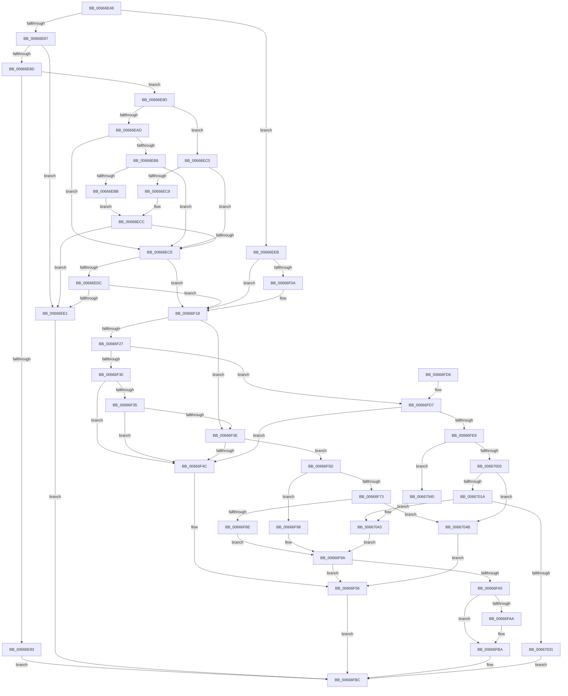

# GetMicrocodePatchData

- RVA: `0x00666E48`–`0x0066705A` (길이 `530` bytes)
- VA: `0x0000000140666E48`
- 실행 섹션: `.text`
- PDB 이름 있음: `예`; PDB Function 태그: `아니요`
- unwind 정보 RVA: `0x000D6244`
- 디코드: `158`개 명령, `530/530` bytes 표시
- 미해석 바이트: `0` (있으면 어셈블리에 `.byte`로 보존)

> 이 문서는 커널 이미지의 기계어와 PDB 기호를 분석해 생성했습니다. 4번과 5번은 함수 원형과 자료형을 바이너리 사용 방식에서 추정한 C 해석이며 원본 소스 복구 결과는 아닙니다.

## 1. Dependencies

- 직접 호출 지점: **16**; 고유 호출 대상: **8**
- 직접 호출자로 확인된 함수: **1**
- RIP 상대 이미지 참조: **1**

### Outgoing calls
- `0x00666E9F` → [Feature_Microcode_Client_CD__private_IsEnabledDeviceUsageNoInline](Feature_Microcode_Client_CD__private_IsEnabledDeviceUsageNoInline_function_00666A18.md) (function, `0x00666A18`)
- `0x00666EAD` → [GetCpuManufacturer](GetCpuManufacturer_function_00667B34.md) (function, `0x00667B34`)
- `0x00666EC0` → [GetCpuManufacturer](GetCpuManufacturer_function_00667B34.md) (function, `0x00667B34`)
- `0x00666ED3` → [GetCpuManufacturer](GetCpuManufacturer_function_00667B34.md) (function, `0x00667B34`)
- `0x00666EF0` → [GetCpuManufacturer](GetCpuManufacturer_function_00667B34.md) (function, `0x00667B34`)
- `0x00666F01` → [GetCpuManufacturer](GetCpuManufacturer_function_00667B34.md) (function, `0x00667B34`)
- `0x00666F0A` → [Feature_Microcode_Client_CD__private_IsEnabledDeviceUsageNoInline](Feature_Microcode_Client_CD__private_IsEnabledDeviceUsageNoInline_function_00666A18.md) (function, `0x00666A18`)
- `0x00666F1D` → [MicrocodeInitLogging](MicrocodeInitLogging_function_00667308.md) (function, `0x00667308`)
- `0x00666F35` → [Feature_Microcode_Client_CD__private_IsEnabledDeviceUsageNoInline](Feature_Microcode_Client_CD__private_IsEnabledDeviceUsageNoInline_function_00666A18.md) (function, `0x00666A18`)
- `0x00666F43` → [GetCpuManufacturer](GetCpuManufacturer_function_00667B34.md) (function, `0x00667B34`)
- `0x00666F81` → [AMDMicrocodeGetRecordData](AMDMicrocodeGetRecordData_function_00667CA0.md) (function, `0x00667CA0`)
- `0x00666F9C` → [MicrocodePrePatchCheckAndLogging](MicrocodePrePatchCheckAndLogging_function_006673E0.md) (function, `0x006673E0`)
- `0x00666FB5` → [memcpy](../6C/memcpy_function_006C6840.md) (function, `0x006C6840`)
- `0x00666FDC` → [GetCpuManufacturer](GetCpuManufacturer_function_00667B34.md) (function, `0x00667B34`)
- `0x00667011` → [IntelMicrocodeGetRecordData](IntelMicrocodeGetRecordData_function_00667954.md) (function, `0x00667954`)
- `0x00667028` → [IntelMicrocodeChecksumValidate](IntelMicrocodeChecksumValidate_function_00667908.md) (function, `0x00667908`)

### Direct callers
- [PrExtExportRecordData](PrExtExportRecordData_function_00666B94.md) at `0x00666C21`

### Static image references
- `0x00666F4C` → RVA `0x00EF7CC4` (`.data`; write)

## 2. Other-region calls and transfers

- 다른 실행 섹션으로 향하는 call: **0**
- 별도 외부 분기/꼬리 이동을 확인하지 못했습니다.

## 3. Assembly (complete function range)

```asm
00666E48  48 89 5C 24 10                  mov qword ptr [rsp + 0x10], rbx
00666E4D  48 89 74 24 18                  mov qword ptr [rsp + 0x18], rsi
00666E52  55                              push rbp
00666E53  41 54                           push r12
00666E55  41 55                           push r13
00666E57  41 56                           push r14
00666E59  41 57                           push r15
00666E5B  48 8B EC                        mov rbp, rsp
00666E5E  48 83 EC 40                     sub rsp, 0x40
00666E62  48 83 65 E0 00                  and qword ptr [rbp - 0x20], 0
00666E67  45 33 F6                        xor r14d, r14d
00666E6A  48 8B F1                        mov rsi, rcx
00666E6D  4C 89 75 30                     mov qword ptr [rbp + 0x30], r14
00666E71  33 C9                           xor ecx, ecx
00666E73  4C 8B FA                        mov r15, rdx
00666E76  4D 8B E9                        mov r13, r9
00666E79  41 8D 46 01                     lea eax, [r14 + 1]
00666E7D  0F A2                           cpuid
00666E7F  44 8B E0                        mov r12d, eax
00666E82  48 85 F6                        test rsi, rsi
00666E85  74 64                           je 0x140666eeb
00666E87  49 83 FF 10                     cmp r15, 0x10
00666E8B  72 54                           jb 0x140666ee1
00666E8D  4C 3B 46 08                     cmp r8, qword ptr [rsi + 8]
00666E91  74 0A                           je 0x140666e9d
00666E93  B8 23 00 00 C0                  mov eax, 0xc0000023
00666E98  E9 1F 01 00 00                  jmp 0x140666fbc
00666E9D  8B 1E                           mov ebx, dword ptr [rsi]
00666E9F  E8 74 FB FF FF                  call 0x140666a18
00666EA4  B9 02 00 00 00                  mov ecx, 2
00666EA9  85 C0                           test eax, eax
00666EAB  74 13                           je 0x140666ec0
00666EAD  E8 82 0C 00 00                  call 0x140667b34
00666EB2  84 C0                           test al, al
00666EB4  74 18                           je 0x140666ece
00666EB6  83 FB 01                        cmp ebx, 1
00666EB9  74 13                           je 0x140666ece
00666EBB  83 FB 0D                        cmp ebx, 0xd
00666EBE  EB 0C                           jmp 0x140666ecc
00666EC0  E8 6F 0C 00 00                  call 0x140667b34
00666EC5  84 C0                           test al, al
00666EC7  74 05                           je 0x140666ece
00666EC9  83 FB 01                        cmp ebx, 1
00666ECC  75 13                           jne 0x140666ee1
00666ECE  B9 01 00 00 00                  mov ecx, 1
00666ED3  E8 5C 0C 00 00                  call 0x140667b34
00666ED8  84 C0                           test al, al
00666EDA  74 3C                           je 0x140666f18
00666EDC  83 FB 02                        cmp ebx, 2
00666EDF  74 37                           je 0x140666f18
00666EE1  B8 0D 00 00 C0                  mov eax, 0xc000000d
00666EE6  E9 D1 00 00 00                  jmp 0x140666fbc
00666EEB  B9 01 00 00 00                  mov ecx, 1
00666EF0  E8 3F 0C 00 00                  call 0x140667b34
00666EF5  F6 D8                           neg al
00666EF7  B9 02 00 00 00                  mov ecx, 2
00666EFC  1B DB                           sbb ebx, ebx
00666EFE  83 E3 02                        and ebx, 2
00666F01  E8 2E 0C 00 00                  call 0x140667b34
00666F06  84 C0                           test al, al
00666F08  74 0E                           je 0x140666f18
00666F0A  E8 09 FB FF FF                  call 0x140666a18
00666F0F  F7 D8                           neg eax
00666F11  1B DB                           sbb ebx, ebx
00666F13  83 E3 0C                        and ebx, 0xc
00666F16  FF C3                           inc ebx
00666F18  8B D3                           mov edx, ebx
00666F1A  41 8B CC                        mov ecx, r12d
00666F1D  E8 E6 03 00 00                  call 0x140667308
00666F22  83 EB 01                        sub ebx, 1
00666F25  74 17                           je 0x140666f3e
00666F27  83 EB 01                        sub ebx, 1
00666F2A  0F 84 A7 00 00 00               je 0x140666fd7
00666F30  83 FB 0B                        cmp ebx, 0xb
00666F33  75 17                           jne 0x140666f4c
00666F35  E8 DE FA FF FF                  call 0x140666a18
00666F3A  85 C0                           test eax, eax
00666F3C  74 0E                           je 0x140666f4c
00666F3E  B9 02 00 00 00                  mov ecx, 2
00666F43  E8 EC 0B 00 00                  call 0x140667b34
00666F48  84 C0                           test al, al
00666F4A  75 11                           jne 0x140666f5d
00666F4C  C7 05 6E 0D 89 00 08 00 00 00   mov dword ptr [rip + 0x890d6e], 8
00666F56  B8 BB 00 00 C0                  mov eax, 0xc00000bb
00666F5B  EB 5F                           jmp 0x140666fbc
00666F5D  B9 8B 00 00 00                  mov ecx, 0x8b
00666F62  0F 32                           rdmsr
00666F64  48 C1 E2 20                     shl rdx, 0x20
00666F68  48 0B C2                        or rax, rdx
00666F6B  48 8B D8                        mov rbx, rax
00666F6E  48 85 F6                        test rsi, rsi
00666F71  74 25                           je 0x140666f98
00666F73  4C 8D 4D 30                     lea r9, [rbp + 0x30]
00666F77  49 8B D7                        mov rdx, r15
00666F7A  4C 8D 45 E0                     lea r8, [rbp - 0x20]
00666F7E  48 8B CE                        mov rcx, rsi
00666F81  E8 1A 0D 00 00                  call 0x140667ca0
00666F86  85 C0                           test eax, eax
00666F88  0F 88 BD 00 00 00               js 0x14066704b
00666F8E  4C 8B 75 30                     mov r14, qword ptr [rbp + 0x30]
00666F92  41 8B 56 04                     mov edx, dword ptr [r14 + 4]
00666F96  EB 02                           jmp 0x140666f9a
00666F98  33 D2                           xor edx, edx
00666F9A  8B CB                           mov ecx, ebx
00666F9C  E8 3F 04 00 00                  call 0x1406673e0
00666FA1  85 C0                           test eax, eax
00666FA3  78 B1                           js 0x140666f56
00666FA5  48 85 F6                        test rsi, rsi
00666FA8  74 10                           je 0x140666fba
00666FAA  4C 8B 45 E0                     mov r8, qword ptr [rbp - 0x20]
00666FAE  49 8B D6                        mov rdx, r14
00666FB1  49 8B 4D 00                     mov rcx, qword ptr [r13]
00666FB5  E8 86 F8 05 00                  call 0x1406c6840
00666FBA  33 C0                           xor eax, eax
00666FBC  4C 8D 5C 24 40                  lea r11, [rsp + 0x40]
00666FC1  49 8B 5B 38                     mov rbx, qword ptr [r11 + 0x38]
00666FC5  49 8B 73 40                     mov rsi, qword ptr [r11 + 0x40]
00666FC9  49 8B E3                        mov rsp, r11
00666FCC  41 5F                           pop r15
00666FCE  41 5E                           pop r14
00666FD0  41 5D                           pop r13
00666FD2  41 5C                           pop r12
00666FD4  5D                              pop rbp
00666FD5  C3                              ret
00666FD6  CC                              int3
00666FD7  B9 01 00 00 00                  mov ecx, 1
00666FDC  E8 53 0B 00 00                  call 0x140667b34
00666FE1  84 C0                           test al, al
00666FE3  0F 84 63 FF FF FF               je 0x140666f4c
00666FE9  B9 8B 00 00 00                  mov ecx, 0x8b
00666FEE  0F 32                           rdmsr
00666FF0  48 C1 E2 20                     shl rdx, 0x20
00666FF4  48 0B C2                        or rax, rdx
00666FF7  48 8B D8                        mov rbx, rax
00666FFA  48 C1 EB 20                     shr rbx, 0x20
00666FFE  48 85 F6                        test rsi, rsi
00667001  74 3D                           je 0x140667040
00667003  4C 8D 4D 30                     lea r9, [rbp + 0x30]
00667007  49 8B D7                        mov rdx, r15
0066700A  4C 8D 45 E0                     lea r8, [rbp - 0x20]
0066700E  48 8B CE                        mov rcx, rsi
00667011  E8 3E 09 00 00                  call 0x140667954
00667016  85 C0                           test eax, eax
00667018  78 31                           js 0x14066704b
0066701A  4C 8B 75 30                     mov r14, qword ptr [rbp + 0x30]
0066701E  8B 55 E0                        mov edx, dword ptr [rbp - 0x20]
00667021  49 8B CE                        mov rcx, r14
00667024  45 8B 4E 04                     mov r9d, dword ptr [r14 + 4]
00667028  E8 DB 08 00 00                  call 0x140667908
0066702D  85 C0                           test eax, eax
0066702F  79 12                           jns 0x140667043
00667031  C7 05 89 0C 89 00 08 00 00 00   mov dword ptr [rip + 0x890c89], 8
0066703B  E9 7C FF FF FF                  jmp 0x140666fbc
00667040  45 33 C9                        xor r9d, r9d
00667043  41 8B D1                        mov edx, r9d
00667046  E9 4F FF FF FF                  jmp 0x140666f9a
0066704B  C7 05 6F 0C 89 00 09 00 00 00   mov dword ptr [rip + 0x890c6f], 9
00667055  E9 FC FE FF FF                  jmp 0x140666f56
```

## 4. C-style interpretation (structured pseudocode)

```c
__int64 __fastcall GetMicrocodePatchData(__int64 a1, __int64 a2, __int64 a3, __int64 a4)
{
    __int64 result;
    __int64 v_r14;
    __int64 v_rbx;
    __int64 v_rsp;
    unsigned __int64 v_stack_m28;
    unsigned __int64 v_stack_m48;
    unsigned __int64 v_stack_p10;
    unsigned __int64 v_stack_p18;
    unsigned __int64 v_stack_p8;

    v_stack_p10 = v_rbx;
    v_stack_p18 = v_rsi;
    v_rsp = (v_rsp) - (64);
    v_r14 = 0;
    v_stack_p8 = 0;
    a1 = 0;
    if (0 == 0) goto loc_00666EEB;
    if (a2 < 16) goto loc_00666EE1;
    if (a3 == (*(unsigned __int64 *)(a1 + 8))) goto loc_00666E9D;
    goto loc_00666FBC;
loc_00666E9D:
    result = Feature_Microcode_Client_CD__private_IsEnabledDeviceUsageNoInline(a1, a2, a3, a4);
    if ((unsigned int)(result) == 0) goto loc_00666EC0;
    result = GetCpuManufacturer(2, a2, a3, a4);
    if ((unsigned __int8)(result) == 0) goto loc_00666ECE;
    if (((unsigned int)((unsigned int)(*(unsigned int *)(a1)))) == 1) goto loc_00666ECE;
    goto loc_00666ECC;
loc_00666EC0:
    result = GetCpuManufacturer(2, a2, a3, a4);
    if ((unsigned __int8)(result) == 0) goto loc_00666ECE;
loc_00666ECC:
    if (((unsigned int)((unsigned int)(*(unsigned int *)(a1)))) != 1) goto loc_00666EE1;
loc_00666ECE:
    result = GetCpuManufacturer(1, a2, a3, a4);
    if ((unsigned __int8)(result) == 0) goto loc_00666F18;
    if (((unsigned int)((unsigned int)(*(unsigned int *)(a1)))) == 2) goto loc_00666F18;
loc_00666EE1:
    goto loc_00666FBC;
loc_00666EEB:
    result = GetCpuManufacturer(1, a2, a3, a4);
    result = (unsigned __int8)(-(result));
    v_rbx = (unsigned int)(((unsigned int)(*(unsigned int *)(a1))) & (2));
    result = GetCpuManufacturer(2, a2, a3, a4);
    if ((unsigned __int8)(result) != 0) {
        result = Feature_Microcode_Client_CD__private_IsEnabledDeviceUsageNoInline(2, a2, a3, a4);
        result = (unsigned int)(-(result));
        v_rbx = (unsigned int)((v_rbx) & (12));
        v_rbx = (unsigned int)((v_rbx) + 1);
    }
    result = MicrocodeInitLogging((unsigned int)((unsigned int)((unsigned int)((unsigned int)(v_r14 + 1)))), (unsigned int)((unsigned int)(v_rbx)), a3, a4);
    v_rbx = (unsigned int)((v_rbx) - (1));
    if (condition_is_equal) goto loc_00666F3E;
    v_rbx = (unsigned int)((v_rbx) - (1));
    if (condition_is_equal) goto loc_00666FD7;
    if (((unsigned int)(v_rbx)) != 11) goto loc_00666F4C;
    result = Feature_Microcode_Client_CD__private_IsEnabledDeviceUsageNoInline((unsigned int)((unsigned int)((unsigned int)((unsigned int)(v_r14 + 1)))), (unsigned int)((unsigned int)(v_rbx)), a3, a4);
    if ((unsigned int)(result) == 0) goto loc_00666F4C;
loc_00666F3E:
    result = GetCpuManufacturer(2, (unsigned int)((unsigned int)(v_rbx)), a3, a4);
    if ((unsigned __int8)(result) != 0) goto loc_00666F5D;
loc_00666F4C:
    *(unsigned int *)(v_rip + 8981870) = 8;
loc_00666F56:
    goto loc_00666FBC;
loc_00666F5D:
    a2 = ((unsigned int)((unsigned int)(v_rbx))) << (32);
    result = ((unsigned int)(0xC00000BBULL)) | (a2);
    if (0 == 0) goto loc_00666F98;
    result = AMDMicrocodeGetRecordData(0, a2, v_stack_m48, v_stack_p8);
    if (sign_flag) goto loc_0066704B;
    goto loc_00666F9A;
loc_00666F98:
    a2 = 0;
loc_00666F9A:
    result = MicrocodePrePatchCheckAndLogging((unsigned int)((unsigned int)(result)), a2, v_stack_m48, v_stack_p8);
    if (sign_flag) goto loc_00666F56;
    if (0 != 0) {
        a3 = v_stack_m48;
        a2 = v_stack_p8;
        a1 = *(unsigned __int64 *)(a4);
        result = memcpy(a1, a2, a3, v_stack_p8);
    }
    result = 0;
loc_00666FBC:
    return result;
loc_00666FD7:
    result = GetCpuManufacturer(1, a2, a3, v_stack_p8);
    if ((unsigned __int8)(result) == 0) goto loc_00666F4C;
    a2 = (a2) << (32);
    result = (result) | (a2);
    v_rbx = (result) >> (32);
    if (*(unsigned __int64 *)(v_stack_m28 + 64) == 0) goto loc_00667040;
    result = IntelMicrocodeGetRecordData(*(unsigned __int64 *)(v_stack_m28 + 64), a2, v_stack_m48, v_stack_p8);
    if (sign_flag) goto loc_0066704B;
    result = IntelMicrocodeChecksumValidate(v_stack_p8, (unsigned int)(v_stack_m48), v_stack_m48, (unsigned int)(*(unsigned int *)(v_stack_p8 + 4)));
    if (!sign_flag) goto loc_00667043;
    *(unsigned int *)(v_rip + 8981641) = 8;
    goto loc_00666FBC;
loc_00667040:
    a4 = 0;
loc_00667043:
    goto loc_00666F9A;
loc_0066704B:
    *(unsigned int *)(v_rip + 8981615) = 9;
    goto loc_00666F56;
}
```

## 5. (Beta) C Style

```c
int64_t GetMicrocodePatchData(int64_t Arg1, int64_t Arg2, int64_t Arg3, void *Arg4)
{
    uint8_t *arg4 = (uint8_t *)Arg4;

    int64_t result;
    int64_t local_r14;
    int64_t local_rbx;
    int64_t local_rsp;
    uint64_t v_stack_m28;
    uint64_t v_stack_m48;
    uint64_t v_stack_p10;
    uint64_t v_stack_p18;
    uint64_t v_stack_p8;

    v_stack_p10 = local_rbx;
    v_stack_p18 = local_rsi;
    local_rsp = (local_rsp) - (64);
    local_r14 = 0;
    v_stack_p8 = 0;
    Arg1 = 0;
    if (0 == 0) goto loc_00666EEB;
    if (Arg2 < 16) goto loc_00666EE1;
    if (Arg3 == (*(uint64_t *)(Arg1 + 0x8))) goto loc_00666E9D;
    goto loc_00666FBC;
loc_00666E9D:
    result = Feature_Microcode_Client_CD__private_IsEnabledDeviceUsageNoInline(Arg1, Arg2, Arg3, Arg4);
    if ((uint32_t)(result) == 0) goto loc_00666EC0;
    result = GetCpuManufacturer(2, Arg2, Arg3, Arg4);
    if ((uint8_t)(result) == 0) goto loc_00666ECE;
    if (((uint32_t)((uint32_t)(*(uint32_t *)(Arg1)))) == 1) goto loc_00666ECE;
    goto loc_00666ECC;
loc_00666EC0:
    result = GetCpuManufacturer(2, Arg2, Arg3, Arg4);
    if ((uint8_t)(result) == 0) goto loc_00666ECE;
loc_00666ECC:
    if (((uint32_t)((uint32_t)(*(uint32_t *)(Arg1)))) != 1) goto loc_00666EE1;
loc_00666ECE:
    result = GetCpuManufacturer(1, Arg2, Arg3, Arg4);
    if ((uint8_t)(result) == 0) goto loc_00666F18;
    if (((uint32_t)((uint32_t)(*(uint32_t *)(Arg1)))) == 2) goto loc_00666F18;
loc_00666EE1:
    goto loc_00666FBC;
loc_00666EEB:
    result = GetCpuManufacturer(1, Arg2, Arg3, Arg4);
    result = (uint8_t)(-(result));
    local_rbx = (uint32_t)(((uint32_t)(*(uint32_t *)(Arg1))) & (2));
    result = GetCpuManufacturer(2, Arg2, Arg3, Arg4);
    if ((uint8_t)(result) != 0) {
        result = Feature_Microcode_Client_CD__private_IsEnabledDeviceUsageNoInline(2, Arg2, Arg3, Arg4);
        result = (uint32_t)(-(result));
        local_rbx = (uint32_t)((local_rbx) & (12));
        local_rbx = (uint32_t)((local_rbx) + 1);
    }
    result = MicrocodeInitLogging((uint32_t)((uint32_t)((uint32_t)((uint32_t)(local_r14 + 1)))), (uint32_t)((uint32_t)(local_rbx)), Arg3, Arg4);
    local_rbx = (uint32_t)((local_rbx) - (1));
    if (condition_is_equal) goto loc_00666F3E;
    local_rbx = (uint32_t)((local_rbx) - (1));
    if (condition_is_equal) goto loc_00666FD7;
    if (((uint32_t)(local_rbx)) != 11) goto loc_00666F4C;
    result = Feature_Microcode_Client_CD__private_IsEnabledDeviceUsageNoInline((uint32_t)((uint32_t)((uint32_t)((uint32_t)(local_r14 + 1)))), (uint32_t)((uint32_t)(local_rbx)), Arg3, Arg4);
    if ((uint32_t)(result) == 0) goto loc_00666F4C;
loc_00666F3E:
    result = GetCpuManufacturer(2, (uint32_t)((uint32_t)(local_rbx)), Arg3, Arg4);
    if ((uint8_t)(result) != 0) goto loc_00666F5D;
loc_00666F4C:
    *(uint32_t *)(v_rip + 0x890D6E) = 8;
loc_00666F56:
    goto loc_00666FBC;
loc_00666F5D:
    Arg2 = ((uint32_t)((uint32_t)(local_rbx))) << (32);
    result = ((uint32_t)(0xC00000BBULL)) | (Arg2);
    if (0 == 0) goto loc_00666F98;
    result = AMDMicrocodeGetRecordData(0, Arg2, v_stack_m48, v_stack_p8);
    if (sign_flag) goto loc_0066704B;
    goto loc_00666F9A;
loc_00666F98:
    Arg2 = 0;
loc_00666F9A:
    result = MicrocodePrePatchCheckAndLogging((uint32_t)((uint32_t)(result)), Arg2, v_stack_m48, v_stack_p8);
    if (sign_flag) goto loc_00666F56;
    if (0 != 0) {
        Arg3 = v_stack_m48;
        Arg2 = v_stack_p8;
        Arg1 = *(uint64_t *)(arg4);
        result = memcpy(Arg1, Arg2, Arg3, v_stack_p8);
    }
    result = 0;
loc_00666FBC:
    return result;
loc_00666FD7:
    result = GetCpuManufacturer(1, Arg2, Arg3, v_stack_p8);
    if ((uint8_t)(result) == 0) goto loc_00666F4C;
    Arg2 = (Arg2) << (32);
    result = (result) | (Arg2);
    local_rbx = (result) >> (32);
    if (*(uint64_t *)(v_stack_m28 + 0x40) == 0) goto loc_00667040;
    result = IntelMicrocodeGetRecordData(*(uint64_t *)(v_stack_m28 + 0x40), Arg2, v_stack_m48, v_stack_p8);
    if (sign_flag) goto loc_0066704B;
    result = IntelMicrocodeChecksumValidate(v_stack_p8, (uint32_t)(v_stack_m48), v_stack_m48, (uint32_t)(*(uint32_t *)(v_stack_p8 + 0x4)));
    if (!sign_flag) goto loc_00667043;
    *(uint32_t *)(v_rip + 0x890C89) = 8;
    goto loc_00666FBC;
loc_00667040:
    Arg4 = 0;
loc_00667043:
    goto loc_00666F9A;
loc_0066704B:
    *(uint32_t *)(v_rip + 0x890C6F) = 9;
    goto loc_00666F56;
}
```

### 관측된 메모리 오프셋

구조체 형식이 확인되지 않은 접근은 인자 기준의 오프셋으로만 기록했습니다.

| 기준 인자 | 오프셋 표현 | 폭 (bit) | 접근 |
|---|---:|---:|---|
| `Arg4` | `+ 0x0` | `64` | `R` |

## 6. Execution-region graph

[열기: 2D/3D 그래프와 함수 탐색 컨트롤 패널](../../../control-panel.html?section=text&rva=0x00666E48&view=graph)

- 2D 그래프는 위에서 아래로 흐르고, 3D 그래프는 빈 공간을 드래그해 회전합니다. Shift+드래그는 이동, 휠은 확대·축소, 함수 노드 선택은 대상 보고서 이동입니다.

### Static fallback


