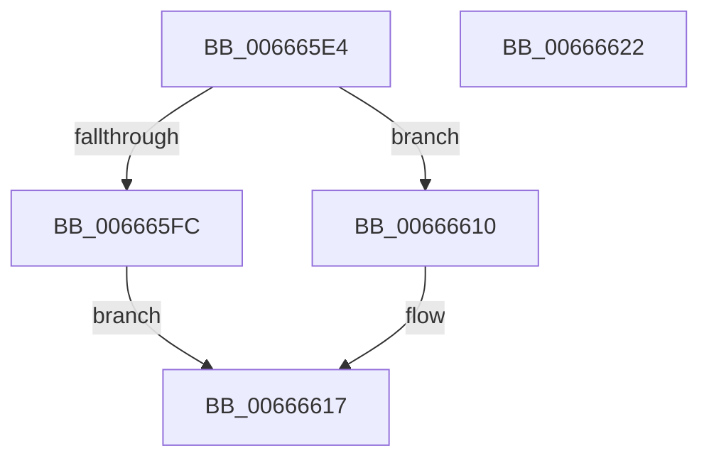

# HviGetEnlightenmentInformation

- RVA: `0x006665E4`–`0x00666623` (길이 `63` bytes)
- VA: `0x00000001406665E4`
- 실행 섹션: `.text`
- PDB 이름 있음: `예`; PDB Function 태그: `아니요`
- unwind 정보 RVA: `0x0005CAAC`
- 디코드: `22`개 명령, `63/63` bytes 표시
- 미해석 바이트: `0` (있으면 어셈블리에 `.byte`로 보존)

> 이 문서는 커널 이미지의 기계어와 PDB 기호를 분석해 생성했습니다. 4번과 5번은 함수 원형과 자료형을 바이너리 사용 방식에서 추정한 C 해석이며 원본 소스 복구 결과는 아닙니다.

## 1. Dependencies

- 직접 호출 지점: **1**; 고유 호출 대상: **1**
- 직접 호출자로 확인된 함수: **6**
- RIP 상대 이미지 참조: **0**

### Outgoing calls
- `0x006665F1` → [HviIsHypervisorMicrosoftCompatible](HviIsHypervisorMicrosoftCompatible_function_006668C8.md) (function, `0x006668C8`)

### Direct callers
- [HvlpDetermineEnlightenments](../58/HvlpDetermineEnlightenments_function_0058CC9C.md) at `0x0058CD01`
- [KiDetectHardwareSpecControlFeatures](../5B/KiDetectHardwareSpecControlFeatures_function_005BEC4C.md) at `0x005BECCD`
- [HviGetImplementedPhysicalBits](HviGetImplementedPhysicalBits_function_00666750.md) at `0x00666775`
- [HvlQueryDetailInfo](../../page/71/HvlQueryDetailInfo_function_00717BDC.md) at `0x00717C7F`
- [RtlpInitFunctionOverrideCapabilities](../../page/79/RtlpInitFunctionOverrideCapabilities_function_0079AC60.md) at `0x0079AE7E`
- [KiComputeDispatchInterruptCost](../../init/C3/KiComputeDispatchInterruptCost_function_00C377C0.md) at `0x00C3783E`

### Static image references
- 디코드된 RIP-relative 메모리 참조가 없습니다.

## 2. Other-region calls and transfers

- 다른 실행 섹션으로 향하는 call: **0**
- 별도 외부 분기/꼬리 이동을 확인하지 못했습니다.

## 3. Assembly (complete function range)

```asm
006665E4  48 89 5C 24 08                  mov qword ptr [rsp + 8], rbx
006665E9  57                              push rdi
006665EA  48 83 EC 20                     sub rsp, 0x20
006665EE  48 8B F9                        mov rdi, rcx
006665F1  E8 D2 02 00 00                  call 0x1406668c8
006665F6  33 C9                           xor ecx, ecx
006665F8  84 C0                           test al, al
006665FA  74 14                           je 0x140666610
006665FC  B8 04 00 00 40                  mov eax, 0x40000004
00666601  0F A2                           cpuid
00666603  89 07                           mov dword ptr [rdi], eax
00666605  89 5F 04                        mov dword ptr [rdi + 4], ebx
00666608  89 4F 08                        mov dword ptr [rdi + 8], ecx
0066660B  89 57 0C                        mov dword ptr [rdi + 0xc], edx
0066660E  EB 07                           jmp 0x140666617
00666610  48 89 0F                        mov qword ptr [rdi], rcx
00666613  48 89 4F 08                     mov qword ptr [rdi + 8], rcx
00666617  48 8B 5C 24 30                  mov rbx, qword ptr [rsp + 0x30]
0066661C  48 83 C4 20                     add rsp, 0x20
00666620  5F                              pop rdi
00666621  C3                              ret
00666622  CC                              int3
```

## 4. C-style interpretation (structured pseudocode)

```c
__int64 __fastcall HviGetEnlightenmentInformation(__int64 a1, int a2)
{
    __int64 result;
    __int64 v_rsp;
    unsigned __int64 v_stack_p8;

    v_stack_p8 = v_rbx;
    v_rsp = (v_rsp) - (32);
    result = HviIsHypervisorMicrosoftCompatible(a1, a2, a3, a4);
    a1 = 0;
    if ((unsigned __int8)(result) == 0) goto loc_00666610;
    *(unsigned int *)(a1) = (unsigned int)((unsigned int)(0x40000004ULL));
    *(unsigned int *)(a1 + 4) = (unsigned int)(v_rbx);
    *(unsigned int *)(a1 + 8) = 0;
    *(unsigned int *)(a1 + 12) = a2;
    goto loc_00666617;
loc_00666610:
    *(unsigned __int64 *)(a1) = 0;
    *(unsigned __int64 *)(a1 + 8) = 0;
loc_00666617:
    v_rsp = (v_rsp) + (32);
    return (unsigned int)(0x40000004ULL);
}
```

## 5. (Beta) C Style

```c
int64_t HviGetEnlightenmentInformation(void *Arg1, int32_t Arg2)
{
    uint8_t *arg1 = (uint8_t *)Arg1;

    int64_t result;
    int64_t local_rsp;
    uint64_t v_stack_p8;

    v_stack_p8 = local_rbx;
    local_rsp = (local_rsp) - (32);
    result = HviIsHypervisorMicrosoftCompatible(Arg1, Arg2, a3, a4);
    Arg1 = 0;
    if ((uint8_t)(result) == 0) goto loc_00666610;
    *(uint32_t *)(arg1) = (uint32_t)((uint32_t)(0x40000004ULL));
    *(uint32_t *)(arg1 + 0x4) = (uint32_t)(local_rbx);
    *(uint32_t *)(arg1 + 0x8) = 0;
    *(uint32_t *)(arg1 + 0xC) = Arg2;
    goto loc_00666617;
loc_00666610:
    *(uint64_t *)(arg1) = 0;
    *(uint64_t *)(arg1 + 0x8) = 0;
loc_00666617:
    local_rsp = (local_rsp) + (32);
    return (uint32_t)(0x40000004ULL);
}
```

### 관측된 메모리 오프셋

구조체 형식이 확인되지 않은 접근은 인자 기준의 오프셋으로만 기록했습니다.

| 기준 인자 | 오프셋 표현 | 폭 (bit) | 접근 |
|---|---:|---:|---|
| `Arg1` | `+ 0x0` | `32` | `W` |
| `Arg1` | `+ 0x0` | `64` | `W` |
| `Arg1` | `+ 0x4` | `32` | `W` |
| `Arg1` | `+ 0x8` | `32` | `W` |
| `Arg1` | `+ 0x8` | `64` | `W` |
| `Arg1` | `+ 0xC` | `32` | `W` |

## 6. Execution-region graph

[열기: 2D/3D 그래프와 함수 탐색 컨트롤 패널](../../../control-panel.html?section=text&rva=0x006665E4&view=graph)

- 2D 그래프는 위에서 아래로 흐르고, 3D 그래프는 빈 공간을 드래그해 회전합니다. Shift+드래그는 이동, 휠은 확대·축소, 함수 노드 선택은 대상 보고서 이동입니다.

### Static fallback


