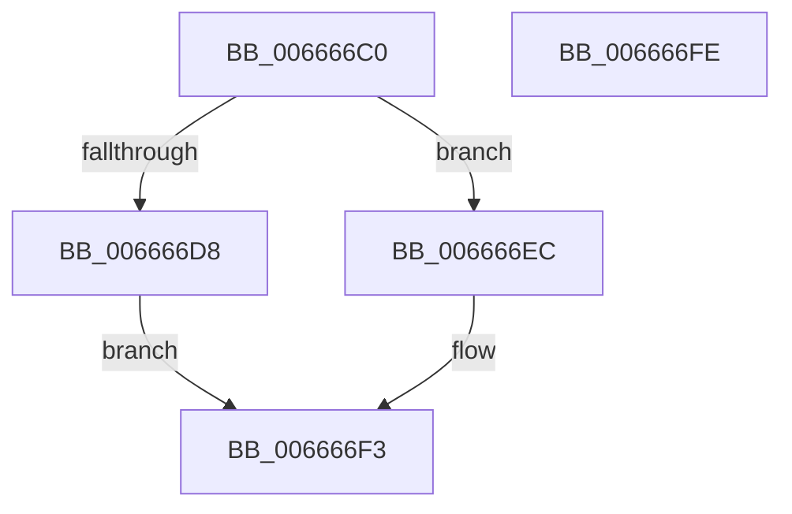

# HviGetHypervisorVersion

- RVA: `0x006666C0`–`0x006666FF` (길이 `63` bytes)
- VA: `0x00000001406666C0`
- 실행 섹션: `.text`
- PDB 이름 있음: `예`; PDB Function 태그: `아니요`
- unwind 정보 RVA: `0x0005CAAC`
- 디코드: `22`개 명령, `63/63` bytes 표시
- 미해석 바이트: `0` (있으면 어셈블리에 `.byte`로 보존)

> 이 문서는 커널 이미지의 기계어와 PDB 기호를 분석해 생성했습니다. 4번과 5번은 함수 원형과 자료형을 바이너리 사용 방식에서 추정한 C 해석이며 원본 소스 복구 결과는 아닙니다.

## 1. Dependencies

- 직접 호출 지점: **1**; 고유 호출 대상: **1**
- 직접 호출자로 확인된 함수: **4**
- RIP 상대 이미지 참조: **0**

### Outgoing calls
- `0x006666CD` → [HviIsHypervisorMicrosoftCompatible](HviIsHypervisorMicrosoftCompatible_function_006668C8.md) (function, `0x006668C8`)

### Direct callers
- [HvlpHvIdentityInfoCallback](../58/HvlpHvIdentityInfoCallback_function_00584560.md) at `0x005845B0`
- [SpcIsHyperVCr3RspErrataPresent](../6A/SpcIsHyperVCr3RspErrataPresent_function_006A788C.md) at `0x006A78E5`
- [HvlPhase0Initialize](../../page/71/HvlPhase0Initialize_function_00717AC8.md) at `0x00717BC2`
- [HvlQueryDetailInfo](../../page/71/HvlQueryDetailInfo_function_00717BDC.md) at `0x00717C5E`

### Static image references
- 디코드된 RIP-relative 메모리 참조가 없습니다.

## 2. Other-region calls and transfers

- 다른 실행 섹션으로 향하는 call: **0**
- 별도 외부 분기/꼬리 이동을 확인하지 못했습니다.

## 3. Assembly (complete function range)

```asm
006666C0  48 89 5C 24 08                  mov qword ptr [rsp + 8], rbx
006666C5  57                              push rdi
006666C6  48 83 EC 20                     sub rsp, 0x20
006666CA  48 8B F9                        mov rdi, rcx
006666CD  E8 F6 01 00 00                  call 0x1406668c8
006666D2  33 C9                           xor ecx, ecx
006666D4  84 C0                           test al, al
006666D6  74 14                           je 0x1406666ec
006666D8  B8 02 00 00 40                  mov eax, 0x40000002
006666DD  0F A2                           cpuid
006666DF  89 07                           mov dword ptr [rdi], eax
006666E1  89 5F 04                        mov dword ptr [rdi + 4], ebx
006666E4  89 4F 08                        mov dword ptr [rdi + 8], ecx
006666E7  89 57 0C                        mov dword ptr [rdi + 0xc], edx
006666EA  EB 07                           jmp 0x1406666f3
006666EC  48 89 0F                        mov qword ptr [rdi], rcx
006666EF  48 89 4F 08                     mov qword ptr [rdi + 8], rcx
006666F3  48 8B 5C 24 30                  mov rbx, qword ptr [rsp + 0x30]
006666F8  48 83 C4 20                     add rsp, 0x20
006666FC  5F                              pop rdi
006666FD  C3                              ret
006666FE  CC                              int3
```

## 4. C-style interpretation (structured pseudocode)

```c
__int64 __fastcall HviGetHypervisorVersion(__int64 a1, int a2)
{
    __int64 result;
    __int64 v_rsp;
    unsigned __int64 v_stack_p8;

    v_stack_p8 = v_rbx;
    v_rsp = (v_rsp) - (32);
    result = HviIsHypervisorMicrosoftCompatible(a1, a2, a3, a4);
    a1 = 0;
    if ((unsigned __int8)(result) == 0) goto loc_006666EC;
    *(unsigned int *)(a1) = (unsigned int)((unsigned int)(0x40000002ULL));
    *(unsigned int *)(a1 + 4) = (unsigned int)(v_rbx);
    *(unsigned int *)(a1 + 8) = 0;
    *(unsigned int *)(a1 + 12) = a2;
    goto loc_006666F3;
loc_006666EC:
    *(unsigned __int64 *)(a1) = 0;
    *(unsigned __int64 *)(a1 + 8) = 0;
loc_006666F3:
    v_rsp = (v_rsp) + (32);
    return (unsigned int)(0x40000002ULL);
}
```

## 5. (Beta) C Style

```c
int64_t HviGetHypervisorVersion(void *Arg1, int32_t Arg2)
{
    uint8_t *arg1 = (uint8_t *)Arg1;

    int64_t result;
    int64_t local_rsp;
    uint64_t v_stack_p8;

    v_stack_p8 = local_rbx;
    local_rsp = (local_rsp) - (32);
    result = HviIsHypervisorMicrosoftCompatible(Arg1, Arg2, a3, a4);
    Arg1 = 0;
    if ((uint8_t)(result) == 0) goto loc_006666EC;
    *(uint32_t *)(arg1) = (uint32_t)((uint32_t)(0x40000002ULL));
    *(uint32_t *)(arg1 + 0x4) = (uint32_t)(local_rbx);
    *(uint32_t *)(arg1 + 0x8) = 0;
    *(uint32_t *)(arg1 + 0xC) = Arg2;
    goto loc_006666F3;
loc_006666EC:
    *(uint64_t *)(arg1) = 0;
    *(uint64_t *)(arg1 + 0x8) = 0;
loc_006666F3:
    local_rsp = (local_rsp) + (32);
    return (uint32_t)(0x40000002ULL);
}
```

### 관측된 메모리 오프셋

구조체 형식이 확인되지 않은 접근은 인자 기준의 오프셋으로만 기록했습니다.

| 기준 인자 | 오프셋 표현 | 폭 (bit) | 접근 |
|---|---:|---:|---|
| `Arg1` | `+ 0x0` | `32` | `W` |
| `Arg1` | `+ 0x0` | `64` | `W` |
| `Arg1` | `+ 0x4` | `32` | `W` |
| `Arg1` | `+ 0x8` | `32` | `W` |
| `Arg1` | `+ 0x8` | `64` | `W` |
| `Arg1` | `+ 0xC` | `32` | `W` |

## 6. Execution-region graph

[열기: 2D/3D 그래프와 함수 탐색 컨트롤 패널](../../../control-panel.html?section=text&rva=0x006666C0&view=graph)

- 2D 그래프는 위에서 아래로 흐르고, 3D 그래프는 빈 공간을 드래그해 회전합니다. Shift+드래그는 이동, 휠은 확대·축소, 함수 노드 선택은 대상 보고서 이동입니다.

### Static fallback


