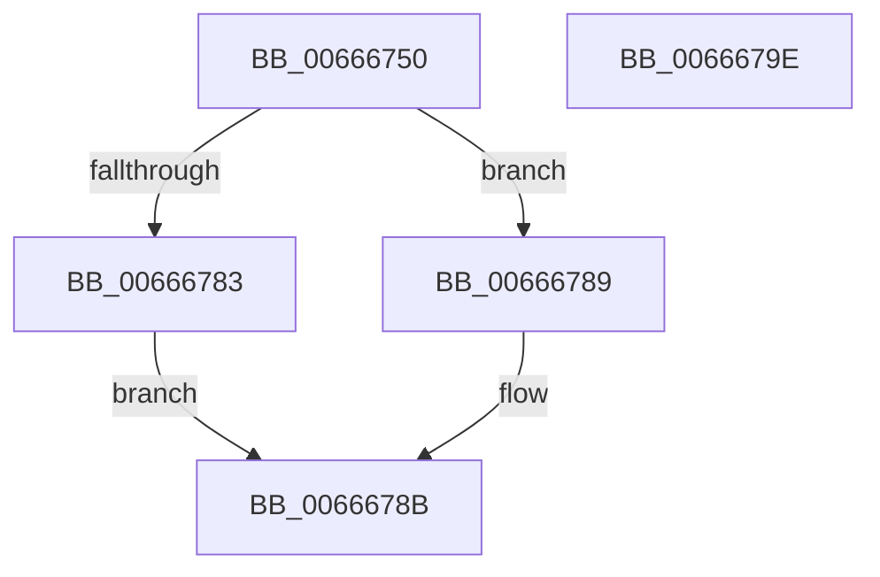

# HviGetImplementedPhysicalBits

- RVA: `0x00666750`–`0x0066679F` (길이 `79` bytes)
- VA: `0x0000000140666750`
- 실행 섹션: `.text`
- PDB 이름 있음: `예`; PDB Function 태그: `아니요`
- unwind 정보 RVA: `0x000AB2E4`
- 디코드: `24`개 명령, `79/79` bytes 표시
- 미해석 바이트: `0` (있으면 어셈블리에 `.byte`로 보존)

> 이 문서는 커널 이미지의 기계어와 PDB 기호를 분석해 생성했습니다. 4번과 5번은 함수 원형과 자료형을 바이너리 사용 방식에서 추정한 C 해석이며 원본 소스 복구 결과는 아닙니다.

## 1. Dependencies

- 직접 호출 지점: **2**; 고유 호출 대상: **2**
- 직접 호출자로 확인된 함수: **1**
- RIP 상대 이미지 참조: **1**

### Outgoing calls
- `0x00666775` → [HviGetEnlightenmentInformation](HviGetEnlightenmentInformation_function_006665E4.md) (function, `0x006665E4`)
- `0x00666793` → [_security_check_cookie](../6A/_security_check_cookie_function_006AC640.md) (function, `0x006AC640`)

### Direct callers
- [RtlGetCpuMaxPhysicalBits](../../pagelk/B7/RtlGetCpuMaxPhysicalBits_function_00B720BC.md) at `0x00B720F6`

### Static image references
- `0x00666756` → RVA `0x00E0A740` (`.data`; read)

## 2. Other-region calls and transfers

- 다른 실행 섹션으로 향하는 call: **0**
- 별도 외부 분기/꼬리 이동을 확인하지 못했습니다.

## 3. Assembly (complete function range)

```asm
00666750  40 53                           push rbx
00666752  48 83 EC 40                     sub rsp, 0x40
00666756  48 8B 05 E3 3F 7A 00            mov rax, qword ptr [rip + 0x7a3fe3]
0066675D  48 33 C4                        xor rax, rsp
00666760  48 89 44 24 30                  mov qword ptr [rsp + 0x30], rax
00666765  48 8B D9                        mov rbx, rcx
00666768  0F 57 C0                        xorps xmm0, xmm0
0066676B  48 8D 4C 24 20                  lea rcx, [rsp + 0x20]
00666770  0F 11 44 24 20                  movups xmmword ptr [rsp + 0x20], xmm0
00666775  E8 6A FE FF FF                  call 0x1406665e4
0066677A  8B 44 24 28                     mov eax, dword ptr [rsp + 0x28]
0066677E  83 E0 7F                        and eax, 0x7f
00666781  74 06                           je 0x140666789
00666783  89 03                           mov dword ptr [rbx], eax
00666785  B0 01                           mov al, 1
00666787  EB 02                           jmp 0x14066678b
00666789  32 C0                           xor al, al
0066678B  48 8B 4C 24 30                  mov rcx, qword ptr [rsp + 0x30]
00666790  48 33 CC                        xor rcx, rsp
00666793  E8 A8 5E 04 00                  call 0x1406ac640
00666798  48 83 C4 40                     add rsp, 0x40
0066679C  5B                              pop rbx
0066679D  C3                              ret
0066679E  CC                              int3
```

## 4. C-style interpretation (structured pseudocode)

```c
__int64 __fastcall HviGetImplementedPhysicalBits(__int64 a1)
{
    __int64 result;
    __int64 v_rsp;
    unsigned __int64 v_stack_m18;
    unsigned int v_stack_m20;
    unsigned __int64 v_stack_m28;

    v_rsp = (v_rsp) - (64);
    result = (*(unsigned __int64 *)(v_rip + 8011747)) ^ (v_rsp);
    v_stack_m18 = result;
    v_stack_m28 = v_xmm0;
    result = HviGetEnlightenmentInformation(v_stack_m28, a2, a3, a4);
    result = (unsigned int)(((unsigned int)(v_stack_m20)) & (127));
    if (condition_is_equal) goto loc_00666789;
    *(unsigned int *)(a1) = (unsigned int)(result);
    goto loc_0066678B;
loc_00666789:
    result = 0;
loc_0066678B:
    a1 = (v_stack_m18) ^ (v_rsp);
    result = _security_check_cookie(a1, a2, a3, a4);
    v_rsp = (v_rsp) + (64);
    return result;
}
```

## 5. (Beta) C Style

```c
int64_t HviGetImplementedPhysicalBits(void *Arg1)
{
    uint8_t *arg1 = (uint8_t *)Arg1;

    int64_t result;
    int64_t local_rsp;
    uint64_t v_stack_m18;
    uint32_t v_stack_m20;
    uint64_t v_stack_m28;

    local_rsp = (local_rsp) - (64);
    result = (*(uint64_t *)(v_rip + 0x7A3FE3)) ^ (local_rsp);
    v_stack_m18 = result;
    v_stack_m28 = v_xmm0;
    result = HviGetEnlightenmentInformation(v_stack_m28, a2, a3, a4);
    result = (uint32_t)(((uint32_t)(v_stack_m20)) & (127));
    if (condition_is_equal) goto loc_00666789;
    *(uint32_t *)(arg1) = (uint32_t)(result);
    goto loc_0066678B;
loc_00666789:
    result = 0;
loc_0066678B:
    Arg1 = (v_stack_m18) ^ (local_rsp);
    result = _security_check_cookie(Arg1, a2, a3, a4);
    local_rsp = (local_rsp) + (64);
    return result;
}
```

### 관측된 메모리 오프셋

구조체 형식이 확인되지 않은 접근은 인자 기준의 오프셋으로만 기록했습니다.

| 기준 인자 | 오프셋 표현 | 폭 (bit) | 접근 |
|---|---:|---:|---|
| `Arg1` | `+ 0x0` | `32` | `W` |

## 6. Execution-region graph

[열기: 2D/3D 그래프와 함수 탐색 컨트롤 패널](../../../control-panel.html?section=text&rva=0x00666750&view=graph)

- 2D 그래프는 위에서 아래로 흐르고, 3D 그래프는 빈 공간을 드래그해 회전합니다. Shift+드래그는 이동, 휠은 확대·축소, 함수 노드 선택은 대상 보고서 이동입니다.

### Static fallback


